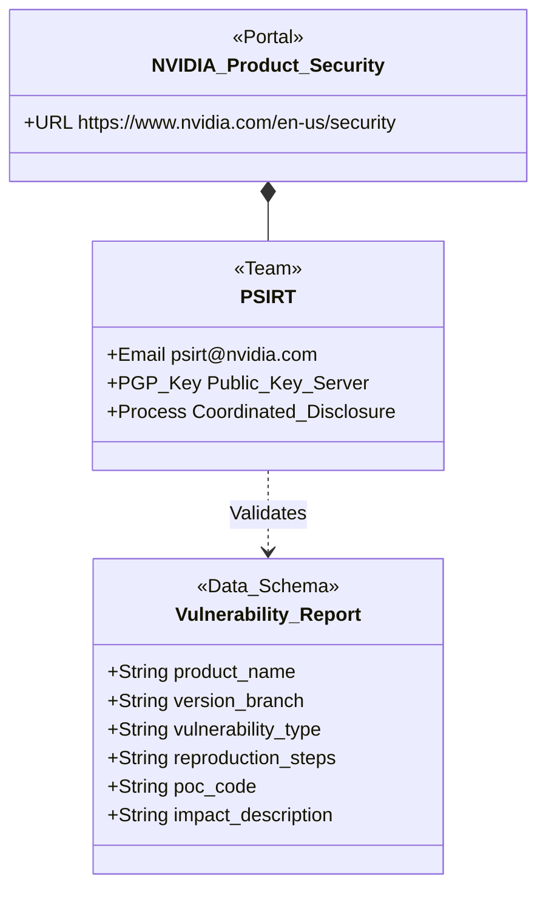

# Security Policy

<details>
<summary>Relevant source files</summary>

The following files were used as context for generating this wiki page:

- [SECURITY.md](SECURITY.md)

</details>


NVIDIA is dedicated to maintaining the security and trust of its software products and services, including all source code repositories within the BioNeMo Agent Toolkit organization [SECURITY.md:1-3](). This policy outlines the formal procedures for reporting vulnerabilities and the expectations for coordinated disclosure.

## Reporting Vulnerabilities

To ensure the safety of our users and the integrity of the codebase, security vulnerabilities must **not** be reported through public GitHub issues or pull requests [SECURITY.md:5-5](). Instead, all potential security issues should be directed to the NVIDIA Product Security Incident Response Team (PSIRT) through the following official channels:

| Channel | Contact Information |
| :--- | :--- |
| **Web Submission** | [Security Vulnerability Submission Form](https://www.nvidia.com/object/submit-security-vulnerability.html) |
| **Email** | psirt@nvidia.com |
| **Secure Communication** | [NVIDIA Public PGP Key](https://www.nvidia.com/en-us/security/pgp-key) |

**Sources:** [SECURITY.md:7-13]()

### Required Report Information

When submitting a report, researchers are required to provide a comprehensive technical summary to facilitate rapid triaging and remediation. The report must include:

1.  **Product Identification**: Specify "BioNeMo Agent Toolkit" and the specific version or branch (e.g., `main` or a specific release tag) containing the vulnerability [SECURITY.md:15-15]().
2.  **Vulnerability Classification**: Identify the type of vulnerability (e.g., Remote Code Execution, Denial of Service, Path Traversal, or Buffer Overflow) [SECURITY.md:16-16]().
3.  **Reproduction Steps**: Clear, step-by-step instructions to reproduce the issue [SECURITY.md:17-17]().
4.  **Artifacts**: A Proof-of-Concept (PoC) or exploit code demonstrating the vulnerability [SECURITY.md:18-18]().
5.  **Impact Assessment**: A description of the potential impact, including how an attacker could realistically exploit the flaw [SECURITY.md:19-19]().

**Sources:** [SECURITY.md:14-20]()

## Data Flow: External Reporting to PSIRT

The following diagram illustrates the flow of security information from a researcher to the NVIDIA internal response teams.

**Vulnerability Disclosure Pipeline**
```mermaid
graph TD
    subgraph "External Researcher"
        [Researcher_Discovery] --> [Draft_Report]
    end

    subgraph "Submission Channels"
        [Draft_Report] -- "Encrypted via PGP" --> [psirt_at_nvidia_com]
        [Draft_Report] -- "HTTPS Form" --> [Web_Submission_Form]
    end

    subgraph "NVIDIA Internal (PSIRT)"
        [psirt_at_nvidia_com] --> [PSIRT_Triage]
        [Web_Submission_Form] --> [PSIRT_Triage]
        [PSIRT_Triage] --> [Impact_Analysis]
        [Impact_Analysis] --> [Remediation_Workflow]
    end

    [Remediation_Workflow] -- "Coordinated Disclosure" --> [Public_Advisory]
    [Public_Advisory] -- "Acknowledgment" --> [Researcher_Discovery]
```
**Sources:** [SECURITY.md:7-21]()

## Coordinated Disclosure & Acknowledgement

NVIDIA operates under a coordinated vulnerability disclosure policy. While NVIDIA does not currently maintain a bug bounty program, it provides formal acknowledgement to researchers when an externally reported security issue is successfully addressed [SECURITY.md:21-21]().

### Policy Framework
The toolkit follows the overarching PSIRT policies regarding timelines, communication, and public disclosure. For detailed information on these policies, researchers should consult the [Product Security Incident Response Team (PSIRT) policies page](https://www.nvidia.com/en-us/security/psirt-policies/) [SECURITY.md:21-21]().

**Sources:** [SECURITY.md:21-26]()

## Security Response Architecture

The BioNeMo Agent Toolkit security response is integrated into the broader NVIDIA Product Security portal. This portal serves as the central hub for security bulletins and incident management.

**Security Management Entities**

**Sources:** [SECURITY.md:14-26]()

---