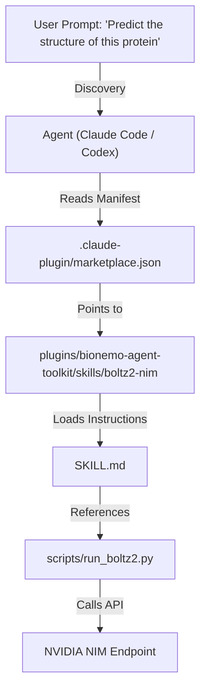
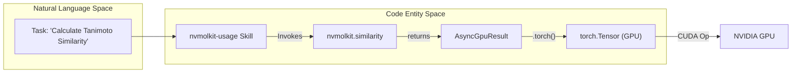

# Glossary

Relevant source files

The following files were used as context for generating this wiki page:

- [.agents/plugins/marketplace.json](.agents/plugins/marketplace.json)
- [.claude-plugin/marketplace.json](.claude-plugin/marketplace.json)
- [CONTRIBUTING.md](CONTRIBUTING.md)
- [LICENSE](LICENSE)
- [NOTICE](NOTICE)
- [README.md](README.md)
- [library-skills/cuEquivariance/SKILL.md](library-skills/cuEquivariance/SKILL.md)
- [library-skills/genomics-workflow-acceleration/SKILL.md](library-skills/genomics-workflow-acceleration/SKILL.md)
- [library-skills/genomics-workflow-acceleration/references/parabricks-tool-map.md](library-skills/genomics-workflow-acceleration/references/parabricks-tool-map.md)
- [library-skills/nvMolKit/SKILL.md](library-skills/nvMolKit/SKILL.md)
- [library-skills/parabricks/SKILL.md](library-skills/parabricks/SKILL.md)
- [library-skills/parabricks/references/tool-index.md](library-skills/parabricks/references/tool-index.md)
- [nim-skills/boltz2-nim/SKILL.md](nim-skills/boltz2-nim/SKILL.md)
- [nim-skills/boltz2-nim/evals/evals.json](nim-skills/boltz2-nim/evals/evals.json)
- [nim-skills/boltz2-nim/evals/trigger_evals.json](nim-skills/boltz2-nim/evals/trigger_evals.json)

This glossary defines codebase-specific terms, domain jargon, and technical abbreviations used throughout the BioNeMo Agent Toolkit. It provides a mapping between scientific concepts and their implementations in the code.

## Core Concepts

### Skill
A **Skill** is the fundamental unit of capability in the toolkit. It is a directory containing structured instructions that allow an AI agent to perform a specific scientific task.
*   **Implementation**: Defined by a `SKILL.md` file containing YAML frontmatter and Markdown instructions [README.md:62-64]().
*   **Data Flow**: The agent reads the `SKILL.md`, identifies required tools (scripts or NIM endpoints), prepares inputs based on `references/`, and executes logic [README.md:11-13]().

### NIM (NVIDIA Inference Microservice)
NIMs are containerized AI models optimized for NVIDIA GPUs, providing standardized APIs (often OpenAI-compatible) for inference.
*   **Implementation**: Skills under `nim-skills/` wrap these microservices [README.md:46-55]().
*   **Authentication**: Typically requires an `NGC_API_KEY` [README.md:41-60]().

### Meta-Skill
A higher-level skill that orchestrates multiple individual NIMs or library calls into a scientific pipeline.
*   **Examples**: `drug-discovery-pipeline` (GenMol → DiffDock → Boltz2) [README.md:44-45]().

### Plugin Marketplace
The toolkit is distributed as a plugin for various agent environments. The marketplace manifests define how these environments discover and install the toolkit.
*   **Claude Code**: Defined in [.claude-plugin/marketplace.json:1-18]().
*   **Codex**: Defined in [.agents/plugins/marketplace.json:1-20]().

---

## Domain Jargon & Abbreviations

| Term | Definition | Code Pointer |
| :--- | :--- | :--- |
| **ADMET** | Absorption, Distribution, Metabolism, Excretion, and Toxicity; used in KERMT for property prediction. | [README.md:57-57]() |
| **BQSR** | Base Quality Score Recalibration; a genomics step to correct systematic errors in base quality scores. | [library-skills/parabricks/references/tool-index.md:17-17]() |
| **ETKDG** | Experimental-Torsion Knowledge Distance Geometry; an algorithm for molecular conformer generation. | [library-skills/nvMolKit/SKILL.md:68-68]() |
| **Irrep** | Irreducible Representation; the building block of equivariant neural networks in `cuEquivariance`. | [library-skills/cuEquivariance/SKILL.md:10-12]() |
| **MSA** | Multiple Sequence Alignment; used as input for protein structure prediction models like OpenFold3. | [README.md:45-45]() |
| **SMILES** | Simplified Molecular Input Line Entry System; a notation for describing chemical structures. | [library-skills/nvMolKit/SKILL.md:51-51]() |

---

## Technical Architecture Diagrams

### From Natural Language to Skill Execution
This diagram shows how a user's natural language request is mapped to specific code entities within the toolkit.

**Sources**: [README.md:11-13](), [README.md:62-64](), [.claude-plugin/marketplace.json:11-17]()

### Library Skill Implementation (nvMolKit Example)
This diagram bridges the gap between the high-level cheminformatics task and the low-level GPU-accelerated implementation.

**Sources**: [library-skills/nvMolKit/SKILL.md:64-74](), [library-skills/nvMolKit/SKILL.md:83-91]()

---

## Specific Component Glossary

### cuEquivariance (cue)
A library for building equivariant neural networks.
*   **`Irreps`**: A collection of irreducible representations with multiplicities [library-skills/cuEquivariance/SKILL.md:12-12]().
*   **`SegmentedTensorProduct` (STP)**: Describes tensor contractions over segments of varying shape [library-skills/cuEquivariance/SKILL.md:13-14]().
*   **`Clebsch-Gordan` (CG) Coefficients**: Coefficients used to link segments in an STP [library-skills/cuEquivariance/SKILL.md:13-14]().

### Parabricks (pbrun)
A suite of GPU-accelerated tools for secondary genomic analysis.
*   **`fq2bam`**: A consolidated tool that performs alignment (BWA-MEM), sorting, and duplicate marking [library-skills/genomics-workflow-acceleration/references/parabricks-tool-map.md:8-8]().
*   **`pbrun`**: The primary CLI entry point for Parabricks tools [library-skills/parabricks/SKILL.md:21-23]().
*   **Runtime Readiness**: A diagnostic check to ensure the environment (GPU, Drivers, Docker) can execute Parabricks [library-skills/parabricks/SKILL.md:103-110]().

### nvMolKit
A library for GPU-accelerated, batched RDKit operations.
*   **`AsyncGpuResult`**: A return type for asynchronous GPU operations that allows zero-copy transfer to `torch` [library-skills/nvMolKit/SKILL.md:83-90]().
*   **`HardwareOptions`**: Configuration for batch sizes and GPU device IDs [library-skills/nvMolKit/SKILL.md:76-76]().

### KERMT
Knowledge-Enhanced Residue-level Molecular Transformer.
*   **`kermt-setup`**: Initial skill to prepare the environment and container [README.md:57-57]().
*   **`cuik-molmaker`**: Accelerated data loading component used by KERMT [README.md:57-57]().

**Sources**: [library-skills/cuEquivariance/SKILL.md:10-16](), [library-skills/parabricks/SKILL.md:17-27](), [library-skills/nvMolKit/SKILL.md:13-18](), [README.md:56-60]()