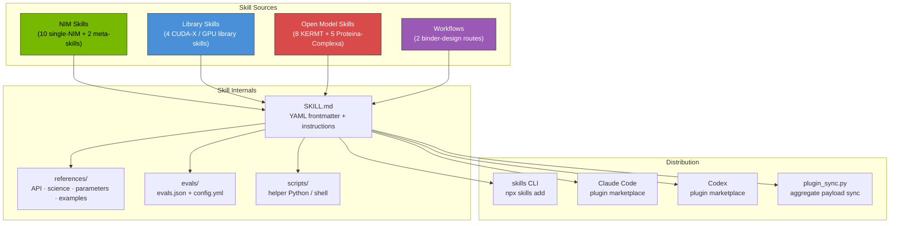

**Turn any agent into a life science expert.** The NVIDIA BioNeMo Agent Toolkit packages a decade of NVIDIA life sciences libraries, tools, and models as **31 ready-to-call agent skills** — each providing structured instructions, scripts, and references so a coding or scientific agent can select a tool, prepare inputs, run it, inspect outputs, and explain results. From protein folding and molecular docking to generative chemistry and de novo binder design, the toolkit bridges the gap between a general-purpose agent and domain-specific scientific computation.


Sources: [README.md](/README.md#L1-L10), [docs/skill-card.md](/docs/skill-card.md#L1-L8)

## What Is a Skill?

A **skill** is a self-contained directory whose centerpiece is a `SKILL.md` file — a YAML frontmatter block (name, description, license, allowed tools) followed by Markdown instructions that teach an agent *how* to perform a specific scientific task. Skills may also ship `references/` directories with progressive-disclosure detail (API schemas, parameter tuning, validation checks, examples), `scripts/` with helper code, and `evals/` with deterministic test cases for quality assurance. When an agent loads a skill, it gains the domain knowledge to route a user's scientific intent to the correct API endpoint, construct a valid payload, execute the call, and interpret the response — without the user needing to know any API contract.

Sources: [README.md](/README.md#L162-L167), [nim-skills/boltz2-nim/SKILL.md](/nim-skills/boltz2-nim/SKILL.md#L1-L21)

## Architecture at a Glance

The toolkit organizes skills into **three canonical types** by deployment model, plus **multi-step workflows** that compose individual skills into scientific pipelines. A nightly sync reconciles skills vendored from external source repositories, while a plugin build step aggregates all skills into distributable payloads for agent marketplaces.



Sources: [README.md](/README.md#L39-L61), [plugins.d/bionemo-agent-toolkit.yml](/plugins.d/bionemo-agent-toolkit.yml#L1-L45), [scripts/plugin_sync.py](/scripts/plugin_sync.py#L1-L27)

## Skill Types

The three deployment models determine how a skill's underlying tool is accessed — hosted cloud API, local GPU library call, or self-hosted model container.

| Type | Deployment Model | Count | Authentication | GPU Required |
|------|-----------------|-------|----------------|--------------|
| **NIM Skills** | Hosted NVIDIA API (`health.api.nvidia.com`) or local Docker container | 10 single + 2 meta | `NGC_API_KEY` Bearer token (hosted); none after readiness (local) | Only for local Docker path |
| **Library Skills** | Direct Python/CUDA library call in user's environment | 4 | None | Yes — CUDA 12.6+ and NVIDIA GPU |
| **Open Model Skills** | User-cloned model repo + optional Docker container | 13 (8 KERMT + 5 Proteina-Complexa) | `NGC_API_KEY` for container pulls; `WANDB_API_KEY` optional for training | Yes — for training, inference, and evaluation |

Sources: [README.md](/README.md#L39-L61), [library-skills/nvmolkit-usage/SKILL.md](/library-skills/nvmolkit-usage/SKILL.md#L36-L46), [nim-skills/boltz2-nim/SKILL.md](/nim-skills/boltz2-nim/SKILL.md#L22-L36)

## The Skill Catalog

### NIM Skills — Cloud-Native BioNeMo Microservices

Each NIM skill wraps a single NVIDIA Inference Microservice with hosted and local Docker paths, full API reference, and validation guidance.

| Skill | Domain | What It Does |
|-------|--------|-------------|
| **boltz2-nim** | Structure prediction | Biomolecular complex structure + binding affinity (pIC50) |
| **diffdock-nim** | Molecular docking | Small-molecule binding-pose prediction |
| **evo2-nim** | Genomics | DNA sequence generation and variant effect scoring |
| **genmol-nim** | Generative chemistry | De novo molecule generation, scaffold decoration, lead optimization |
| **molmim-nim** | Generative chemistry | Latent-space molecule generation and interpolation |
| **msa-search-nim** | Sequence alignment | Multiple sequence alignments via ColabFold/MMseqs2 |
| **openfold2-nim** | Structure prediction | Monomer protein structure prediction |
| **openfold3-nim** | Structure prediction | Biomolecular complex structure prediction |
| **proteinmpnn-nim** | Protein design | Inverse folding / sequence design for a target backbone |
| **rfdiffusion-nim** | Protein design | De novo protein backbone and binder design |

### Meta-Skills — Multi-NIM Workflows

| Skill | Pipeline |
|-------|----------|
| **drug-discovery-pipeline** | GenMol → DiffDock → Boltz2 (generate → dock → score affinity) |
| **msa-structure-prediction-pipeline** | MSA-Search → OpenFold3 (align → predict structure) |

### Library Skills — GPU-Accelerated CUDA-X Libraries

| Skill | Library | What It Does |
|-------|---------|-------------|
| **nvmolkit-usage** | nvMolKit | GPU-batched Morgan fingerprints, Tanimoto similarity, ETKDG conformers, MMFF optimization, Butina clustering, substructure search |
| **parabricks** | Parabricks | Accelerated genomic secondary analysis (BWA-MEM2, GATK4, somatic workflows) |
| **genomics-workflow-acceleration** | Parabricks | Workflow-level genomic pipeline orchestration |
| **cuequivariance** | cuEquivariance | Build equivariant neural-network primitives (segmented tensor products, CG coefficients) |

### Open Model Skills — Self-Hosted Research Models

| Skill Group | Sub-Skills | What It Does |
|-------------|-----------|-------------|
| **KERMT** | setup, pretrain-scratch, continue-pretrain, add-cmim-pretrain, finetune, embed, infer, monitor | Graph neural network for molecular property prediction (ADMET); multi-task GROVER extension with cuik-molmaker data loading |
| **Proteina-Complexa** | setup, target, design, evaluate-pdbs, sweep | Flow-based generative protein binder design with inference-time optimization (beam, FK-steering, MCTS) |

### Workflows — End-to-End Scientific Pipelines

| Workflow | Routes | What It Does |
|----------|--------|-------------|
| **Generative Protein Binder Design** | `complexa-binder-design` (Proteina-Complexa) · `protein-binder-design` (RFdiffusion + ProteinMPNN + Boltz2/OpenFold3) | De novo binder design: resolve target + hotspots → generate binders → co-fold → rank by interface metrics |

Sources: [README.md](/README.md#L39-L61), [nim-skills/meta-skills/README.md](/nim-skills/meta-skills/README.md#L1-L15), [workflows/generative-protein-binder-design/README.md](/workflows/generative-protein-binder-design/README.md#L1-L16), [open-models-skills/proteina-complexa/README.md](/open-models-skills/proteina-complexa/README.md#L1-L16)

## Project Structure

```
bionemo-agent-toolkit/
├── nim-skills/                  # NIM microservice skills (canonical / native)
│   ├── boltz2-nim/              #   SKILL.md + references/ + evals/ + config/
│   ├── diffdock-nim/
│   ├── ...
│   └── meta-skills/             # Multi-NIM pipeline compositions
│       ├── drug-discovery-pipeline/
│       └── msa-structure-prediction-pipeline/
├── library-skills/              # CUDA-X / GPU library skills
│   ├── nvmolkit-usage/
│   ├── parabricks/
│   ├── genomics-workflow-acceleration/
│   └── cuequivariance/
├── open-models-skills/          # Self-hosted open model skills (sourced)
│   ├── kermt/                   #   8 sub-skills (setup → pretrain → finetune → infer)
│   └── proteina-complexa/       #   5 sub-skills (setup → target → design → evaluate → sweep)
├── workflows/                   # End-to-end scientific workflows
│   └── generative-protein-binder-design/
├── components.d/                # Source repo declarations for nightly sync
├── compliance.d/                # Compliance artifacts (skill cards) for sourced skills
├── plugins.d/                   # Plugin build manifests (marketplace packaging)
├── skills/                      # Generated aggregate payload (skills.sh distribution)
├── docs/                        # Skill card, sync findings
├── scripts/                     # plugin_sync.py (aggregate freshness enforcer)
└── catalog-exceptions.yml       # Prune-safe exceptions for native skills
```

Sources: [README.md](/README.md#L162-L167), [components.d/kermt.yml](/components.d/kermt.yml#L1-L16), [catalog-exceptions.yml](/catalog-exceptions.yml#L1-L34)

## How Skills Get Into the Catalog

Skills arrive in the catalog through two channels, governed by the `components.d/` registry and the nightly sync workflow:

- **Native skills** (authored in-repo): NIM skills, workflows, and certain library skills live in this repository as the source of truth. They are never overwritten by sync.
- **Sourced skills** (vendored from external repos): Each entry in `components.d/*.yml` declares a source repository, branch ref, and path mapping. A nightly CI workflow rsyncs skills from those repos into their catalog directories (e.g., `open-models-skills/kermt/`). The `catalog-exceptions.yml` file protects native skills inside scanned roots from being pruned by the orphan detector.

After sync, `scripts/plugin_sync.py` enforces two invariants: **coverage** (every distributable source skill appears in `skills.sh.json`) and **freshness** (the aggregate payload under `skills/bionemo-agent-toolkit/` is an exact copy of each source skill). This runs as `--check` in CI and `--write` by contributors.

> [!TIP]
> The `--delete` flag on the nightly rsync means any file committed directly into a sourced catalog directory is wiped on the next sync. Compliance artifacts (`skill-card.md`) live in `compliance.d/` and are backfilled only when upstream doesn't yet ship its own card — upstream always wins.

Sources: [components.d/nvmolkit.yml](/components.d/nvmolkit.yml#L1-L10), [compliance.d/README.md](/compliance.d/README.md#L1-L28), [scripts/plugin_sync.py](/scripts/plugin_sync.py#L1-L27), [catalog-exceptions.yml](/catalog-exceptions.yml#L1-L34)

## Installation and Agent Compatibility

Skills install via the portable [`skills` CLI](https://github.com/vercel-labs/skills), which copies a skill's `SKILL.md` and supporting files into the target agent's configuration directory:

```bash
# Interactive — pick a skill + install destination
npx skills add NVIDIA-BioNeMo/bionemo-agent-toolkit

# One skill, no prompts
npx skills add NVIDIA-BioNeMo/bionemo-agent-toolkit --skill boltz2-nim --yes

# Target a specific agent (repeatable)
npx skills add NVIDIA-BioNeMo/bionemo-agent-toolkit --skill boltz2-nim --agent claude-code
npx skills add NVIDIA-BioNeMo/bionemo-agent-toolkit --skill boltz2-nim --agent codex

# Browse the catalog without installing
npx skills add NVIDIA-BioNeMo/bionemo-agent-toolkit --list
```

The repository also ships **native plugin marketplaces** for Claude Code (`.claude-plugin/marketplace.json`) and Codex (`.agents/plugins/marketplace.json`), so the toolkit installs through each agent's native plugin flow as well. The `plugins.d/_defaults.yml` sets brand color (`#76b900`), capabilities (`Interactive`, `Write`), and the dual license across all plugins.

| Agent | Installation Path | Status |
|-------|-------------------|--------|
| **Claude Code** | Native plugin marketplace | Repo-verified |
| **Codex** | Native plugin marketplace | Repo-verified |
| **Any SKILL.md-compatible agent** | `npx skills add` CLI | Portable format |

Sources: [README.md](/README.md#L16-L37), [plugins.d/_defaults.yml](/plugins.d/_defaults.yml#L1-L25), [docs/skill-card.md](/docs/skill-card.md#L50-L53)

## License

The toolkit is **dual-licensed**: source code (scripts, tests, build tooling) under **Apache-2.0**; skills and documentation (SKILL.md files, workflows, READMEs) under **CC-BY-4.0**. The `pyproject.toml` declares this as `Apache-2.0 OR CC-BY-4.0` and pins the three runtime dependencies (`biotite`, `numpy`, `pyyaml`) used by the helper scripts shipped inside workflow skills. The repository is a catalog, not an installable Python package — the manifest exists so that NVIDIA nSpect / Black Duck can resolve the dependency tree from `uv.lock`.

Sources: [README.md](/README.md#L168-L177), [pyproject.toml](/pyproject.toml#L1-L52)

## Where to Go Next

The documentation is organized to take you from first steps to deep internals. Here is the recommended reading path:

1. **[Quick Start](2-quick-start)** — Install your first skill and run a hosted NIM call end-to-end.
2. **[Skill Catalog](3-skill-catalog)** — Browse the full catalog with descriptions, triggers, and entry points.
3. **[Architecture Overview](4-architecture-overview)** — Understand the repo layout, sync machinery, and distribution pipeline.
4. **Skill Types** — Dive into the deployment model that matters to you:
   - **[NIM Skills](5-nim-skills)** for hosted/local API microservices.
   - **[Open Model Skills](6-open-model-skills)** for self-hosted research models.
   - **[Library Skills](7-library-skills)** for GPU-accelerated CUDA-X libraries.
5. **Multi-Step Workflows** — When you need composed pipelines:
   - **[Drug Discovery Pipeline](8-drug-discovery-pipeline)** (GenMol → DiffDock → Boltz2).
   - **[Protein Binder Design Workflow](9-protein-binder-design-workflow)** (two independent routes).
   - **[MSA Structure Prediction Pipeline](10-msa-structure-prediction-pipeline)** (MSA-Search → OpenFold3).
6. **Skill Internals** — Author or debug skills:
   - **[SKILL.md File Format](11-skill-md-file-format)** for the YAML + Markdown contract.
   - **[Hosted vs Local NIM Deployment](12-hosted-vs-local-nim-deployment)** for the two NIM execution paths.
   - **[Reference and Validation Files](13-reference-and-validation-files)** for progressive-disclosure patterns.
7. **Evaluation and Quality** — Measure skill effectiveness:
   - **[Skill Lift Evaluation](14-skill-lift-evaluation)** for ACES/Harbor hosted lift methodology.
   - **[Evals Configuration](15-evals-configuration)** for `evals.json` and `config.yml` structure.
8. **Integration and Distribution** — Publish and distribute:
   - **[Plugin Marketplace Integration](16-plugin-marketplace-integration)** for Claude Code / Codex packaging.
   - **[Component Registry and Sync](17-component-registry-and-sync)** for `components.d/` and nightly sync.
9. **[Compliance and Security Model](18-compliance-and-security-model)** — Skill cards, risk tiers, and security scanning.
