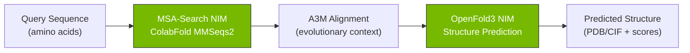

The **MSA Structure Prediction Pipeline** is a meta-skill that orchestrates two NVIDIA BioNeMo NIMs into a single high-accuracy protein structure prediction workflow: **MSA-Search** retrieves evolutionary homologs via GPU-accelerated MMSeqs2, then **OpenFold3** consumes those alignments to predict the 3D structure with full evolutionary context. This pipeline mirrors the AlphaFold3-style approach — sequence in, structure out — and is the recommended path when maximum prediction accuracy matters.

Sources: [SKILL.md](/nim-skills/meta-skills/msa-structure-prediction-pipeline/SKILL.md#L1-L198), [README.md](/nim-skills/meta-skills/README.md#L1-L15)

## Pipeline Architecture

The pipeline is a strict two-step sequential chain. **Step 1** must complete before **Step 2** begins because OpenFold3 requires the A3M alignment text produced by MSA-Search as a nested payload field. There is no parallelism between steps — the data contract is a direct handoff of alignment text through your Python script.



The **data contract** between the two NIMs flows through a 3-level nested dictionary in the OpenFold3 payload. MSA-Search returns alignment text keyed by database name (e.g. `Uniref30_2302`); you extract that text and re-embed it into OpenFold3's `msa` field shaped as `msa[db_key][format_key]["alignment"|"format"]`. This handoff is the single most error-prone step in the pipeline — the evals suite specifically validates correct nesting depth and case-sensitive key matching.

Sources: [SKILL.md](/nim-skills/meta-skills/msa-structure-prediction-pipeline/SKILL.md#L20-L28), [api.md](/nim-skills/openfold3-nim/references/api.md#L49-L68), [evals.json](/nim-skills/meta-skills/msa-structure-prediction-pipeline/evals/evals.json#L1-L152)

## Why Chain These NIMs

Running MSA-Search before OpenFold3 provides **evolutionary information** that materially improves structure prediction. The rationale breaks down as follows:

| Factor | Without MSA (single-sequence) | With MSA (pipeline) |
|---|---|---|
| **Evolutionary context** | None — model sees only the query | Hundreds of homologs inform residue-residue contacts |
| **Accuracy for novel folds** | Lower pLDDT, higher pDE | Higher pLDDT, lower pDE |
| **Complex predictions** | Weak inter-chain contacts | Paired MSA reveals co-evolution signals |
| **Database coverage** | N/A | UniRef30 (sequence homologs) + ColabFold envdb (metagenomic) |

MSA-Search finds evolutionary homologs in **UniRef30** and the **ColabFold environmental database** using GPU-accelerated MMSeqs2. OpenFold3 then uses this MSA to improve structure prediction accuracy — especially for sequences where no close homolog exists in the PDB. Running MSA-Search first means OpenFold3 gets the full evolutionary context rather than falling back to a single-sequence prediction.

Sources: [SKILL.md](/nim-skills/meta-skills/msa-structure-prediction-pipeline/SKILL.md#L32-L37), [science.md](/nim-skills/msa-search-nim/references/science.md#L1-L30)

## Prerequisites and Configuration

Before running the pipeline, confirm three parameters with the user:

1. **Query sequence** — the amino acid sequence to predict (valid IUPAC symbols: `ARNDCQEGHILKMFPSTWYVX`)
2. **MSA depth** — how many sequences to retrieve (default 500; more sequences = slower but richer evolutionary context)
3. **API mode** — hosted NVIDIA API or local Docker containers

### API Mode Comparison

| Aspect | Hosted API | Local Docker |
|---|---|---|
| **Auth** | `Authorization: Bearer $NGC_API_KEY` | No auth after readiness |
| **URL prefix** | `https://health.api.nvidia.com/v1/` | `http://localhost:8000/` (no `/v1/`) |
| **MSA-Search storage** | Managed by NVIDIA | **~1.4 TB** for full database set |
| **Setup time** | None | First download: 14–80+ min depending on method |
| **Best for** | Quick iteration, no infra | Confidential/proprietary sequences |

> [!TIP]
> **Data privacy**: Your protein sequence and the retrieved MSA alignment are transmitted to external NVIDIA-hosted APIs (`health.api.nvidia.com`) on every call. Use local NIM containers for confidential or proprietary sequences.

**Local Docker port conflict warning**: Do not assume MSA-Search and OpenFold3 can both run on `localhost:8000` concurrently. Run one container at a time and hand off the A3M file between them, or start each NIM on a **distinct host port** and set the URLs explicitly in your script.

Sources: [SKILL.md](/nim-skills/meta-skills/msa-structure-prediction-pipeline/SKILL.md#L40-L52), [api.md](/nim-skills/msa-search-nim/references/api.md#L1-L15)

## Step 1: Search for MSA Alignments

The first step calls the **MSA-Search NIM** to retrieve homologous sequences from biological databases. The default configuration queries both UniRef30 and the ColabFold environmental database for maximum coverage.

```python
import requests, json, os
from pathlib import Path

NGC_API_KEY = os.getenv("NGC_API_KEY")
HOSTED = True

query_sequence = "<YOUR_PROTEIN_SEQUENCE>"

if HOSTED:
    msa_url = "https://health.api.nvidia.com/v1/biology/colabfold/msa-search/predict"
    headers = {"Content-Type": "application/json",
               "Authorization": f"Bearer {NGC_API_KEY}"}
else:
    msa_url = "http://localhost:8000/biology/colabfold/msa-search/predict"
    headers = {"Content-Type": "application/json"}

payload = {
    "sequence": query_sequence,
    "databases": ["Uniref30_2302", "colabfold_envdb_202108"],
    "e_value": 0.0001,
    "output_alignment_formats": ["a3m"],
}

r = requests.post(msa_url, headers=headers, json=payload)
r.raise_for_status()
msa_result = r.json()

# Extract the A3M alignment
a3m_alignment = msa_result["alignments"]["Uniref30_2302"]["a3m"]["alignment"]

# Save for reference
with open("query_msa.a3m", "w") as f:
    f.write(a3m_alignment)

# Count sequences in alignment
n_seqs = a3m_alignment.count(">")
print(f"Step 1 complete: found {n_seqs} homologous sequences")
print(f"MSA saved to query_msa.a3m")
```

### MSA-Search Request Parameters

| Parameter | Type | Default | Notes |
|---|---|---|---|
| `sequence` | string | (required) | 1–4096 amino acid characters |
| `databases` | list[string] | `["all"]` | **Case-sensitive**: `Uniref30_2302`, `colabfold_envdb_202108` |
| `e_value` | float | `0.0001` | Hit filtering threshold; relax for remote homologs |
| `max_msa_sequences` | integer | `500` | MSA depth; must match `NIM_GLOBAL_MAX_MSA_DEPTH` locally |
| `output_alignment_formats` | list[string] | `["a3m"]` | `a3m` or `fasta` |

> [!TIP]
> **Case-sensitive database names**: The `databases` field is **case-sensitive** — use `Uniref30_2302` (capital U), not `uniref30_2302`. The response dict keys match the case you sent, so extraction must also use the exact same case. The evals suite (`eval-1`, `eval-2`, `eval-3`) all validate this explicitly.

### MSA-Search Response Shape

```json
{
  "alignments": {
    "<database_name>": {
      "<format>": {
        "alignment": "<a3m or fasta string>",
        "format": "a3m"
      }
    }
  },
  "metrics": {}
}
```

Sources: [SKILL.md](/nim-skills/meta-skills/msa-structure-prediction-pipeline/SKILL.md#L55-L96), [api.md](/nim-skills/msa-search-nim/references/api.md#L20-L52), [parameters.md](/nim-skills/msa-search-nim/references/parameters.md#L1-L46)

## Step 2: Predict Structure with OpenFold3

The second step feeds the MSA alignment directly into **OpenFold3's** `msa` field. The critical implementation detail is the **3-level nested MSA structure** — the alignment text cannot be passed as a flat string.

```python
if HOSTED:
    of3_url = "https://health.api.nvidia.com/v1/biology/openfold/openfold3/predict"
else:
    of3_url = "http://localhost:8000/biology/openfold/openfold3/predict"

# Build the OpenFold3 MSA structure from the retrieved alignment
msa_data = {
    "uniref30": {
        "a3m": {
            "alignment": a3m_alignment,
            "format": "a3m"
        }
    }
}

# Optionally also include colabfold_envdb alignment if requested
# env_alignment = msa_result["alignments"]["colabfold_envdb_202108"]["a3m"]["alignment"]
# msa_data["colabfold_env"] = {"a3m": {"alignment": env_alignment, "format": "a3m"}}

payload = {
    "inputs": [{
        "input_id": "prediction_with_msa",
        "output_format": "pdb",
        "molecules": [
            {
                "type": "protein",
                "sequence": query_sequence,
                "diffusion_samples": 1,
                "msa": msa_data
            }
        ]
    }]
}

r = requests.post(of3_url, headers=headers, json=payload, timeout=300)
r.raise_for_status()
result = r.json()

output = result["outputs"][0]
for i, sample in enumerate(output["structures_with_scores"]):
    fmt = sample["format"]
    filename = f"predicted_structure_{i+1}.{fmt}"
    with open(filename, "w") as f:
        f.write(sample["structure"])
    print(f"\nStep 2 complete: {filename} saved")
    print(f"  Confidence:  {sample['confidence_score']:.4f}")
    print(f"  pLDDT:       {sample['complex_plddt_score']:.4f}")
    print(f"  pTM:         {sample['ptm_score']:.4f}")
```

### MSA Object Nesting (3 Levels)

The MSA payload for OpenFold3 follows this exact shape:

```
msa                          ← Level 1: database key (arbitrary, e.g. "uniref30")
 └── a3m                     ← Level 2: format key (e.g. "a3m")
      ├── alignment          ← Level 3: A3M text string (must start with >query\n)
      └── format             ← Level 3: "a3m"
```

The `database_name` and `format_name` keys are arbitrary strings — OpenFold3 does not enforce specific names. What matters is that the **alignment text** starts with a FASTA-style header (`>query\n`) and the nesting depth is exactly three levels.

### OpenFold3 Confidence Scores

| Score | Range | Direction | Meaning |
|---|---|---|---|
| `confidence_score` | 0–1 | Higher is better | Overall ranking score for this sample |
| `complex_plddt_score` | 0–1 | Higher is better | Average predicted local distance difference test |
| `ptm_score` | 0–1 | Higher is better | Predicted TM-score (monomer quality) |
| `iptm_score` | 0–1 | Higher is better | Predicted interface TM-score (complexes) |
| `complex_pde_score` | Å | Lower is better | Average predicted distance error |

Scores are accessed at `result["outputs"][0]["structures_with_scores"][i]`.

Sources: [SKILL.md](/nim-skills/meta-skills/msa-structure-prediction-pipeline/SKILL.md#L100-L153), [api.md](/nim-skills/openfold3-nim/references/api.md#L49-L68), [api.md](/nim-skills/openfold3-nim/references/api.md#L80-L103), [parameters.md](/nim-skills/openfold3-nim/references/parameters.md#L1-L49)

## Comparing Single-Sequence vs MSA-Informed Prediction

To demonstrate the impact of MSA context, run OpenFold3 **twice** — once with the full MSA and once with a minimal alignment containing only the query sequence:

```python
# Minimal MSA (single sequence — same as no MSA context):
minimal_msa = {
    "main": {
        "a3m": {
            "alignment": f">query\n{query_sequence}",
            "format": "a3m"
        }
    }
}
```

A larger, higher-quality MSA typically yields **higher pLDDT** and **lower pDE**, especially for proteins with many known homologs. Treat toy sequences and single-sequence MSAs as API smoke tests — not meaningful structural biology.

Sources: [SKILL.md](/nim-skills/meta-skills/msa-structure-prediction-pipeline/SKILL.md#L157-L174)

## Protein Complex Predictions

For multi-chain complexes, use the **paired MSA endpoint** to get species-paired alignments, then pass each chain's alignment into the corresponding molecule's `msa` and `paired_msa` fields:

```python
# Paired MSA search endpoint for complexes:
msa_paired_url = "https://health.api.nvidia.com/v1/biology/colabfold/msa-search/paired/predict"
paired_payload = {
    "sequences": [chain_A_sequence, chain_B_sequence],
    "e_value": 0.0001,
}
```

The paired endpoint returns `alignments_by_chain` (keyed by chain ID: `"A"`, `"B"`, etc.) instead of the standard `alignments` shape. UniRef30 is the **only database that supports pairing** — `colabfold_envdb_202108` has no taxonomy metadata and cannot be used for paired search. For local Docker, the `databases:uniref30` profile (~500 GB) is the smallest correct profile for complex work.

Sources: [SKILL.md](/nim-skills/meta-skills/msa-structure-prediction-pipeline/SKILL.md#L178-L189), [api.md](/nim-skills/msa-search-nim/references/api.md#L54-L84), [parameters.md](/nim-skills/msa-search-nim/references/parameters.md#L18-L24)

## Skill Dependencies

| Step | Skill | Key Endpoint | Required For |
|---|---|---|---|
| MSA search | `msa-search-nim` | `/biology/colabfold/msa-search/predict` | All pipeline runs |
| Structure prediction | `openfold3-nim` | `/biology/openfold/openfold3/predict` | All pipeline runs |

Each dependency has its own `SKILL.md` with full hosted/local API details, Docker setup, and supplemental reference files under `references/`. Load those when you need Docker deployment commands, parameter tuning guidance, or validation procedures beyond what this pipeline document provides.

Sources: [SKILL.md](/nim-skills/meta-skills/msa-structure-prediction-pipeline/SKILL.md#L192-L198)

## Evaluation Coverage

The pipeline's evals suite (`evals/evals.json`) defines four validation scenarios that test the complete handoff contract:

| Eval ID | Focus | Key Assertions |
|---|---|---|
| `eval-1-basic-structure-prediction` | Full hosted pipeline end-to-end | Correct endpoint URLs, case-sensitive `Uniref30_2302`, Bearer auth, confidence score output |
| `eval-2-high-depth-msa-retrieval` | MSA → OpenFold3 nesting correctness | 3-level nested `msa` dict, `format: "a3m"` field present, alignment text threaded from Step 1 |
| `eval-3-multi-database-msa` | Dual-database MSA (UniRef30 + envdb) | Full versioned `colabfold_envdb_202108`, both alignments extracted and passed as separate entries |
| `eval-4-full-hosted-pipeline-with-scores` | Score extraction from correct response path | All three score fields read from `outputs[0]["structures_with_scores"][0]` |

Sources: [evals.json](/nim-skills/meta-skills/msa-structure-prediction-pipeline/evals/evals.json#L1-L152)

## Troubleshooting

| Symptom | Likely Cause | Resolution |
|---|---|---|
| `401` from either NIM | Missing or expired `NGC_API_KEY` | Export a valid key; verify with `echo $NGC_API_KEY \| cut -c1-4` |
| `422` from OpenFold3 | Malformed MSA nesting or invalid sequence | Verify 3-level `msa` dict; ensure alignment starts with `>query\n` |
| `422` from MSA-Search | Wrong database name case | Use `Uniref30_2302` (capital U), not `uniref30_2302` |
| Key error extracting alignment | Case mismatch between request and response keys | Access `alignments["Uniref30_2302"]` with exact same case as the `databases` list |
| Empty or shallow MSA | Low-complexity/transmembrane sequence | Biological limit — MSA depth depends on sequence family representation in databases |
| Local Docker `404` | Using `/v1/` prefix on local path | Remove `/v1/` from local prediction URLs |

Sources: [SKILL.md](/nim-skills/openfold3-nim/SKILL.md#L186-L196), [SKILL.md](/nim-skills/msa-search-nim/SKILL.md#L1-L374), [science.md](/nim-skills/msa-search-nim/references/science.md#L14-L22)

---

**Next steps**: For the individual NIM skills behind this pipeline, see [NIM Skills](5-nim-skills). For the other multi-step workflow, see [Drug Discovery Pipeline](8-drug-discovery-pipeline). For evaluation methodology, see [Skill Lift Evaluation](14-skill-lift-evaluation).