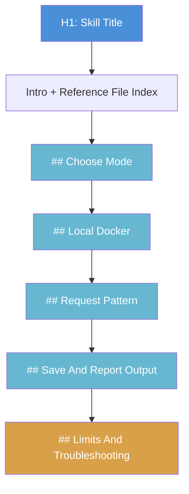
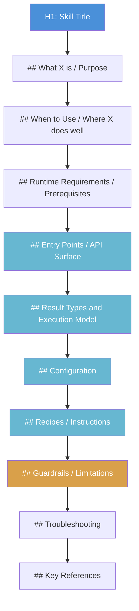

Every skill in the BioNeMo Agent Toolkit is defined by a **SKILL.md** file — a structured document that combines YAML front-matter metadata with a Markdown body containing operational instructions. The front-matter declares identity, licensing, and runtime constraints; the body provides the agent with everything it needs to decide *when* to activate the skill and *how* to execute it. This page documents the schema, required and optional fields, and the distinct structural patterns that emerge across the three skill types.

Sources: [SKILL.md](/nim-skills/boltz2-nim/SKILL.md#L1-L8), [SKILL.md](/library-skills/nvmolkit-usage/SKILL.md#L1-L16), [SKILL.md](/library-skills/parabricks/SKILL.md#L1-L15)

## YAML Front-Matter Schema

The front-matter is delimited by `---` and parsed as standard YAML. It always appears at the very top of the file, before any Markdown content. The fields divide into **universal** (present in every skill type) and **type-specific** (present only in certain skill categories).

### Universal Fields

| Field | Type | Required | Description |
|-------|------|----------|-------------|
| `name` | string | **Yes** | Skill identifier. Must match the parent directory name (e.g., `boltz2-nim`, `parabricks`, `cuequivariance`). |
| `description` | multiline string | **Yes** | Free-text invocation guide. Written in second-person imperative ("Use for …", "Invoke when …"). Declares **when** the agent should activate this skill and what capabilities it provides. Often explicitly states out-of-scope boundaries ("Do NOT use for …"). |
| `license` | string | **Yes** | SPDX-style license expression using `AND` for dual licensing. Common values: `Apache-2.0`, `Apache-2.0 AND CC-BY-4.0`, `CC-BY-4.0 AND Apache-2.0`. |

Sources: [SKILL.md](/nim-skills/boltz2-nim/SKILL.md#L1-L8), [SKILL.md](/library-skills/cuequivariance/SKILL.md#L1-L4), [SKILL.md](/library-skills/genomics-workflow-acceleration/SKILL.md#L1-L22)

### NIM-Skill-Only Fields

These fields appear exclusively in NIM skills (under `nim-skills/`) and govern runtime compatibility and tool permissions for the agent.

| Field | Type | Required | Example | Description |
|-------|------|----------|---------|-------------|
| `compatibility` | string | **Yes** | `"requests>=2.28"` | Semicolon-separated Python package requirements the agent must satisfy before executing. Common packages: `requests`, `numpy`, `rdkit`. |
| `allowed-tools` | string | **Yes** | `Bash, Read, Write, AskUserQuestion` | Comma-separated list of agent tools the skill is permitted to invoke. The standard set is `Bash, Read, Write, AskUserQuestion`. |

Sources: [SKILL.md](/nim-skills/boltz2-nim/SKILL.md#L6-L7), [SKILL.md](/nim-skills/evo2-nim/SKILL.md#L6-L7), [SKILL.md](/nim-skills/molmim-nim/SKILL.md#L6-L7)

### Library-Skill-Only Fields

Library skills (under `library-skills/`) use a nested `metadata` object instead of `compatibility`/`allowed-tools`, providing richer provenance and classification information.

| Field | Type | Required | Example | Description |
|-------|------|----------|---------|-------------|
| `metadata.owner` | string | No | `Kevin Boyd (@scal444)` | Human-readable owner attribution with optional handle. |
| `metadata.risk_tier` | string | No | `skill` | Risk classification tier for compliance gating. |
| `metadata.version` | string | No | `"1.1.0"` | Skill version, independent of any wrapped package version. |
| `metadata.tags` | list of strings | No | `[parabricks, genomics, nvidia]` | Taxonomic tags for catalog filtering and search. |
| `metadata.domain` | string | No | `genomics` | Scientific domain classification. |

```yaml
# NIM skill front-matter (boltz2-nim)
---
name: boltz2-nim
description: >
  Use Boltz2 NIM for biomolecular structure prediction and binding affinity...
license: Apache-2.0 AND CC-BY-4.0
compatibility: "requests>=2.28"
allowed-tools: Bash, Read, Write, AskUserQuestion
---
```

```yaml
# Library skill front-matter (nvmolkit-usage)
---
name: nvmolkit-usage
description: >-
  Write code that calls the installed nvMolKit Python API for GPU-accelerated,
  batched RDKit-style operations...
license: Apache-2.0
metadata:
  owner: Kevin Boyd (@scal444)
  risk_tier: skill
---
```

```yaml
# Library skill front-matter with full metadata (genomics-workflow-acceleration)
---
name: genomics-workflow-acceleration
description: >-
  Use when accelerating existing genomics workflows with NVIDIA Parabricks...
license: CC-BY-4.0 AND Apache-2.0
metadata:
  tags:
    - genomics
    - parabricks
    - workflow-acceleration
  domain: genomics
  version: "1.1.0"
---
```

Sources: [SKILL.md](/nim-skills/boltz2-nim/SKILL.md#L1-L8), [SKILL.md](/library-skills/nvmolkit-usage/SKILL.md#L1-L16), [SKILL.md](/library-skills/genomics-workflow-acceleration/SKILL.md#L1-L22)

## Description Field Patterns

The `description` field is the agent's primary routing signal. Across all skill types, it follows a consistent rhetorical pattern:

1. **Capability declaration** — what the skill does, in imperative form ("Use for …", "Run … via …").
2. **Keyword enumeration** — a comma-separated list of searchable trigger terms the agent matches against user queries (e.g., "Boltz2, protein structures, protein-ligand/DNA/RNA complexes, SMILES or CCD ligands").
3. **Boundary exclusion** — an explicit negative statement when another skill owns the adjacent domain ("Do NOT use for individual pbrun command routing — use parabricks").

This three-part structure ensures the agent can both *select* the correct skill and *reject* requests that fall outside its scope, preventing misrouting between closely related skills (e.g., `parabricks` vs. `genomics-workflow-acceleration`).

Sources: [SKILL.md](/library-skills/parabricks/SKILL.md#L3-L7), [SKILL.md](/library-skills/genomics-workflow-acceleration/SKILL.md#L3-L9), [SKILL.md](/nim-skills/diffdock-nim/SKILL.md#L3-L7)

## Markdown Body: NIM Skill Pattern

NIM skills share the most rigid and consistent body structure. Every NIM SKILL.md follows this section sequence, which guides the agent from mode selection through request construction to output handling and troubleshooting.



| Section | Purpose | Key Content |
|---------|---------|-------------|
| **H1 title** | Identity | Matches the `name` front-matter field in human-readable form (e.g., `# Boltz2 NIM`). |
| **Intro paragraph** | Scope | One-sentence summary of what the skill does, followed by a bulleted index of supplemental files in `references/` that the agent should load only when deeper context is needed. |
| **Choose Mode** | Routing | Asks the user whether to use the hosted NVIDIA API or local Docker. States both endpoint URLs. Explains auth differences (hosted requires `Authorization: Bearer $NGC_API_KEY`; local requires no auth after readiness). Some skills honor `NIM_API_MODE` environment variable when set. |
| **Local Docker** | Deployment | Full bash preflight: `.env` sourcing, `NGC_API_KEY`/`NVIDIA_API_KEY` fallback, `docker login`, `docker run` with GPU/shm/cache flags, and readiness check (`/v1/health/ready` polling). |
| **Request Pattern** | Execution | Python `requests` code block showing the canonical payload shape, URL construction, header setup, and response handling. Includes inline comments on required vs. optional fields. |
| **Save And Report Output** | Output | How to persist artifacts (PDB, CIF, SDF, JSON, FASTA) and which confidence/validation fields to report. Points to `references/examples.md` for detailed save snippets. |
| **Limits And Troubleshooting** | Guardrails | Numeric limits (max poses, max residues, GPU VRAM), HTTP error code meanings (`401`, `403`, `422`, `404`), and common misconfiguration patterns. |

> [!TIP]
> NIM skill bodies always reference their five supplemental files by relative path (`references/api.md`, `references/science.md`, `references/parameters.md`, `references/validation.md`, `references/examples.md`). The agent loads these lazily — only when the task requires deeper detail beyond what the SKILL.md provides.

Sources: [SKILL.md](/nim-skills/boltz2-nim/SKILL.md#L10-L147), [SKILL.md](/nim-skills/diffdock-nim/SKILL.md#L10-L119), [SKILL.md](/nim-skills/rfdiffusion-nim/SKILL.md#L10-L164)

### NIM Skill Mode Selection Variants

While all NIM skills include a `## Choose Mode` section, the sophistication of mode resolution varies. Three distinct patterns emerge:

| Pattern | Skills Using It | Behavior |
|---------|----------------|----------|
| **Simple ask** | boltz2-nim, diffdock-nim, rfdiffusion-nim, molmim-nim | Ask only when context is unclear. State both URLs directly. |
| **Environment-aware** | openfold2-nim, proteinmpnn-nim | Honor an explicitly configured runtime (`NIM_API_MODE` or `<SKILL>_NIM_URL`) before asking. Resolve service URL from environment when present. |
| **Strict environment** | evo2-nim | Honor `NIM_API_MODE` when set. Treat explicit `EVO2_NIM_URL` as local. Do not silently switch modes when the selected endpoint is unavailable — report the failure and fix configuration. |

Sources: [SKILL.md](/nim-skills/boltz2-nim/SKILL.md#L22-L36), [SKILL.md](/nim-skills5/proteinmpnn-nim/SKILL.md#L23-L38), [SKILL.md](/nim-skills/evo2-nim/SKILL.md#L23-L46)

### NIM Skill Local Docker Preflight Contract

Every NIM skill that supports local deployment follows the same preflight script structure. This is not accidental — it is a **contract** that ensures consistent key handling across all NIM skills:

1. **Source `.env`** — `set -a; [ -f .env ] && . ./.env; set +a`
2. **Fallback key** — If `NGC_API_KEY` is unset but `NVIDIA_API_KEY` is set, export the latter as the former
3. **Require key** — `: "${NGC_API_KEY:?Set NGC_API_KEY or NVIDIA_API_KEY}"`
4. **Require cache** — `: "${LOCAL_NIM_CACHE:?Set LOCAL_NIM_CACHE}"`
5. **Docker login** — `echo "$NGC_API_KEY" | docker login nvcr.io --username '$oauthtoken' --password-stdin`
6. **Docker run** — Image-specific flags (`--gpus`, `--shm-size`, `--runtime=nvidia`, cache volume mount, port mapping)
7. **Readiness** — `until curl -sf http://localhost:8000/v1/health/ready; do sleep 5; done`

The cache mount path varies by NIM image: most use `/opt/nim/.cache`, but some (proteinmpnn-nim, molmim-nim) use `/home/nvs/.cache/nim`. Each SKILL.md documents its specific path.

Sources: [SKILL.md](/nim-skills/boltz2-nim/SKILL.md#L44-L72), [SKILL.md](/nim-skills/proteinmpnn-nim/SKILL.md#L42-L57), [SKILL.md](/nim-skills/evo2-nim/SKILL.md#L63-L97)

## Markdown Body: Library Skill Pattern

Library skills serve a fundamentally different purpose — they guide the agent in writing code against a Python API rather than calling a REST endpoint. Their body structure reflects this: deeper conceptual sections replace the hosted/local deployment narrative.



| Section | Purpose | Key Content |
|---------|---------|-------------|
| **What X is / Purpose** | Concept | Defines the library's core abstraction and positioning relative to alternatives (e.g., nvMolKit vs. RDKit). |
| **When to Use / Where X does well** | Routing | Explicit criteria for when this library is the right choice, and when a simpler alternative (plain RDKit, CPU fallback) should be preferred instead. |
| **Runtime Requirements / Prerequisites** | Environment | GPU/compute capability, CUDA version, Python dependencies, installation guidance. |
| **Entry Points / API Surface** | Reference | Tabular mapping of task → module → primary function call. The agent uses this to route user requests to the correct API. |
| **Result Types and Execution Model** | Types | Documents return types (`AsyncGpuResult`, `Device3DResult`, etc.), their memory model (GPU-resident vs. CPU), and synchronization requirements. |
| **Configuration** | Tuning | Configuration objects (`HardwareOptions`, `SubstructSearchConfig`) with field-by-field tables including type, default, and meaning. |
| **Recipes / Instructions** | How-to | Complete code examples for common workflows (fingerprint + similarity, embedding + optimization). |
| **Guardrails / Limitations** | Constraints | Explicit negative constraints ("Do not claim CPU execution", "Do not infer exact flags"). |
| **Key References** | External | URLs to official documentation sites. |

Sources: [SKILL.md](/library-skills/nvmolkit-usage/SKILL.md#L18-L314), [SKILL.md](/library-skills/parabricks/SKILL.md#L17-L162), [SKILL.md](/library-skills/genomics-workflow-acceleration/SKILL.md#L23-L308), [SKILL.md](/library-skills/cuequivariance/SKILL.md#L6-L418)

## Markdown Body: Open Model Skill Pattern

Open model skills (under `open-models-skills/`) are fine-grained operations on models that users train or fine-tune themselves. Each top-level model directory (e.g., `kermt/`, `proteina-complexa/`) contains multiple sub-skills, each with its own SKILL.md. These sub-skills tend to be more operation-specific — focused on a single lifecycle step like inference, fine-tuning, or setup — rather than the full hosted/local API surface that NIM skills document.

| Characteristic | NIM Skills | Library Skills | Open Model Skills |
|----------------|-----------|---------------|-------------------|
| **Primary purpose** | Call a hosted/local REST endpoint | Write code against a Python API | Execute a model lifecycle operation |
| **Front-matter `compatibility`** | Required | Absent | Absent |
| **Front-matter `allowed-tools`** | Required | Absent | Absent |
| **Front-matter `metadata`** | Absent | Common | Possible |
| **Hosted/local mode split** | Always | Never | Varies |
| **Docker deployment** | Always (local NIM) | Sometimes (tool containers) | Sometimes (training containers) |
| **Reference files** | `references/` (5 files: api, science, parameters, validation, examples) | `references/` (variable, domain-specific) | `reference/` (note: singular) |
| **Eval files** | `evals/evals.json` | `evals/evals.json` | `evals/evals.json` + optional `trigger_evals.json` |
| **Code examples** | Python `requests` + Bash | Python API calls | Python + Bash scripts |

Sources: [SKILL.md](/nim-skills/boltz2-nim/SKILL.md#L1-L147), [SKILL.md](/library-skills/nvmolkit-usage/SKILL.md#L1-L16), [SKILL.md](/library-skills/parabricks/SKILL.md#L1-L15)

## Description Field: Trigger Term Enumeration

A critical design pattern in the `description` field is the **trigger term enumeration** — a comma-separated list of keywords and phrases that the agent's skill router matches against user queries. This list is deliberately redundant: it includes the skill name, common aliases, input formats, output formats, and deployment modes.

| Skill | Trigger Terms in Description |
|-------|------------------------------|
| boltz2-nim | "Boltz2, protein structures, protein-ligand/DNA/RNA complexes, SMILES or CCD ligands, pIC50/IC50 affinity scoring, mmCIF output, hosted NVIDIA API calls, local Docker deployment" |
| diffdock-nim | "DiffDock, molecular docking, ligand docking, blind docking, SMILES or SDF ligands, ranked poses, confidence scores, hosted NVIDIA API, local Docker deployment" |
| evo2-nim | "Evo2/Evo 2, DNA generation, genomic sequence generation, hosted generation, local Docker deployment, local forward passes, layer outputs, logits, sampled probabilities" |
| rfdiffusion-nim | "RFDiffusion, de novo protein backbones, motif scaffolding, binder design, hotspot residues, contigs syntax, diffusion steps, hosted NVIDIA API calls, local Docker deployment, PDB backbone outputs" |
| parabricks | "pbrun tools, GPU/runtime readiness, version-aware command guidance, FASTQ/BAM processing, RNA-seq, variant calling, BAM QC, GVCF workflows" |

> [!TIP]
> The trigger term enumeration serves a dual purpose: it is both a **routing signal** for the agent's skill selector and a **discovery aid** for humans browsing the catalog. When authoring a new SKILL.md, include every term a user might plausibly type when they want this skill — including common misspellings and alternative names (e.g., both "Evo2" and "Evo 2").

Sources: [SKILL.md](/nim-skills/boltz2-nim/SKILL.md#L3-L4), [SKILL.md](/nim-skills/diffdock-nim/SKILL.md#L3-L7), [SKILL.md](/nim-skills/evo2-nim/SKILL.md#L3-L7), [SKILL.md](/nim-skills/rfdiffusion-nim/SKILL.md#L3-L7), [SKILL.md](/library-skills/parabricks/SKILL.md#L3-L7)

## Guardrails and Negative Constraints

Both NIM and library skills encode **guardrails** — explicit instructions about what the agent must *not* do. These appear in two locations:

1. **In the `description` field** — boundary exclusions ("Do NOT use for individual pbrun command routing — use parabricks") that prevent skill misrouting at selection time.
2. **In dedicated body sections** — operational constraints that prevent the agent from fabricating information during execution.

Common guardrail categories across the repository:

| Category | Example | Source |
|----------|---------|--------|
| **No invention** | "Do not invent sample names, paths, or container tags" | parabricks |
| **No false claims** | "Do not claim CPU execution of Parabricks tools" | parabricks |
| **No parity claims** | "Do not claim bit-identical VCF/BAM output without a comparison run" | genomics-workflow-acceleration |
| **No key exposure** | "Do not print API keys. Confirm they exist with shell tests, not echoes." | openfold2-nim |
| **No endpoint invention** | "Do not invent hosted latent endpoints" | molmim-nim |
| **No silent mode switch** | "Do not silently switch modes when the selected endpoint is unavailable" | evo2-nim |
| **No cache assumption** | "Warm-cache key-free startup varies by image/version and should not be assumed" | boltz2-nim |

Sources: [SKILL.md](/library-skills/parabricks/SKILL.md#L139-L149), [SKILL.md](/library-skills/genomics-workflow-acceleration/SKILL.md#L37-L44), [SKILL.md](/nim-skills/openfold2-nim/SKILL.md#L37-L39), [SKILL.md](/nim-skills/molmim-nim/SKILL.md#L31-L34), [SKILL.md](/nim-skills/evo2-nim/SKILL.md#L37-L38), [SKILL.md](/nim-skills/boltz2-nim/SKILL.md#L35-L36)

## Reference File Convention

SKILL.md files intentionally keep the body focused on first-pass usage. Deeper context lives in supplemental files under a `references/` (or `reference/`) directory, which the agent loads lazily. The NIM skill reference structure is the most standardized:

| File | Content | Loaded When |
|------|---------|-------------|
| `references/api.md` | Exact endpoints, request/response schemas, Docker flags, all response fields | Agent needs precise field names or Docker configuration |
| `references/science.md` | Model purpose, strengths, limitations, scientific interpretation, handoff criteria | Agent needs to explain results or recommend an alternative model |
| `references/parameters.md` | Parameter effects, valid ranges, tuning guidance | Agent needs to optimize a payload or explain parameter tradeoffs |
| `references/validation.md` | Artifact sanity checks, confidence thresholds, chemistry/structure validation | Agent needs to verify output quality |
| `references/examples.md` | Compact request patterns, save/snippet code | Agent needs a copy-paste-ready example |

Library skills use a less rigid reference structure tailored to their domain (e.g., `references/tool-index.md`, `references/runtime-environment.md`, `references/pbrun-<tool>.md` for parabricks). Open model skills use the singular `reference/` directory name.

Sources: [SKILL.md](/nim-skills/boltz2-nim/SKILL.md#L16-L20), [SKILL.md](/library-skills/parabricks/SKILL.md#L64-L101), [SKILL.md](/library-skills/genomics-workflow-acceleration/SKILL.md#L62-L68)

## Authoring Checklist

When creating or modifying a SKILL.md, verify each item against the patterns established in this repository:

| Step | Check | Applies To |
|------|-------|------------|
| 1 | `name` matches the parent directory name exactly | All |
| 2 | `description` includes capability declaration, trigger term enumeration, and boundary exclusion | All |
| 3 | `license` uses SPDX-style syntax with `AND` for dual licensing | All |
| 4 | `compatibility` and `allowed-tools` are present | NIM skills only |
| 5 | `metadata` object with `owner`, `risk_tier`, `tags`, `version`, `domain` as needed | Library/open-model skills |
| 6 | H1 title matches `name` in human-readable form | All |
| 7 | Intro paragraph references supplemental files with relative paths | All |
| 8 | `## Choose Mode` section with both hosted and local URLs | NIM skills only |
| 9 | Local Docker preflight follows the 7-step contract | NIM skills only |
| 10 | Request pattern includes complete, runnable Python code | NIM skills only |
| 11 | Guardrails include "do not invent" and "do not assume" constraints | All |
| 12 | `## Limits And Troubleshooting` or `## Troubleshooting` documents HTTP errors and numeric limits | All |

Sources: [SKILL.md](/nim-skills/boltz2-nim/SKILL.md#L1-L147), [SKILL.md](/nim-skills/diffdock-nim/SKILL.md#L1-L119), [SKILL.md](/library-skills/nvmolkit-usage/SKILL.md#L1-L314), [SKILL.md](/library-skills/parabricks/SKILL.md#L1-L162), [SKILL.md](/library-skills/genomics-workflow-acceleration/SKILL.md#L1-L308)

## Next Steps

The SKILL.md format is the declarative core of each skill, but its reference files and evaluation configuration complete the picture. To understand how skills are validated and distributed:

- **[Reference and Validation Files](13-reference-and-validation-files)** — deep dive into the `references/` directory structure and evals configuration
- **[Hosted vs Local NIM Deployment](12-hosted-vs-local-nim-deployment)** — the deployment model that NIM skill `## Choose Mode` and `## Local Docker` sections implement
- **[Evals Configuration](15-evals-configuration)** — how `evals/evals.json` files define skill lift evaluations