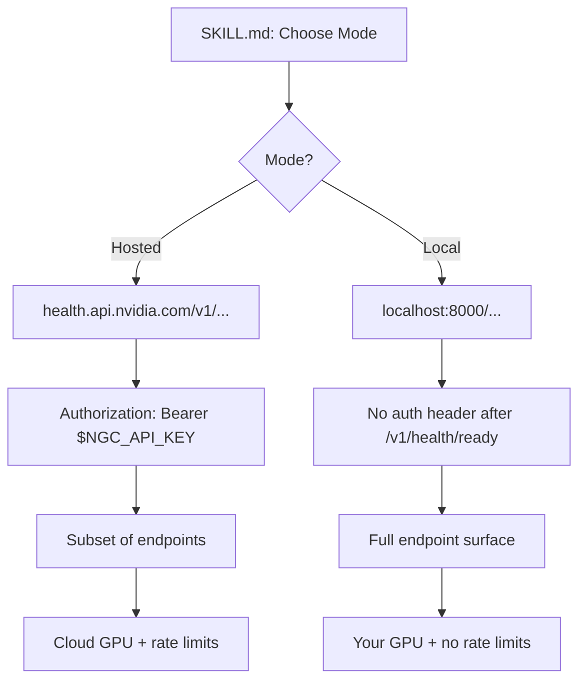
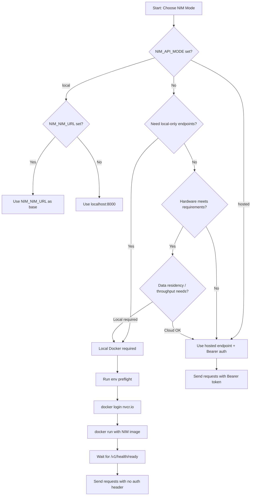

Every NIM skill in this toolkit exposes **two deployment modes** — a cloud-hosted NVIDIA API endpoint and a local Docker container — and the choice between them propagates through every layer of the request: URL construction, authentication headers, endpoint surface, and even payload shape. This page explains the architectural differences, the shared preflight contract, the per-NIM nuances that break assumptions, and the decision framework for selecting the right mode for your workload.

Sources: [SKILL.md](/nim-skills/boltz2-nim/SKILL.md#L1-L147), [SKILL.md](/nim-skills/diffdock-nim/SKILL.md#L1-L119), [SKILL.md](/nim-skills/evo2-nim/SKILL.md#L1-L222)

## Architectural Model: Two Surfaces, One Skill

Each NIM skill's `SKILL.md` follows an identical "Choose Mode → Local Docker → Request Pattern" skeleton. The **hosted surface** is the NVIDIA API cloud (`health.api.nvidia.com`), which fronts a subset of the NIM's endpoints behind authentication and rate limits. The **local surface** is the same NIM image running in Docker on your GPU hardware, exposing the full endpoint set with no auth after readiness. The diagram below shows how a single skill dispatches to either surface:



The critical implication: **the local container is a superset of the hosted API**. If an endpoint exists in hosted, it exists in local — but the converse is not true. MolMIM's `/embedding`, `/hidden`, `/decode`, and `/sampling` endpoints are local-only. Evo 2's `/forward` endpoint is local-only. MSA-Search's structure-template endpoint returned HTTP 404 on hosted at validation time, making it effectively local-only. Plan your mode choice around whether your workflow needs these extended surfaces.

Sources: [SKILL.md](/nim-skills/molmim-nim/SKILL.md#L1-L227), [SKILL.md](/nim-skills/evo2-nim/SKILL.md#L38-L70), [SKILL.md](/nim-skills/msa-search-nim/SKILL.md#L45-L60)

## URL Construction: The `/v1/` Prefix Asymmetry

The most common source of `404` errors in local deployments is the **`/v1/` prefix**. Hosted URLs include `/v1/` after the domain; local URLs omit it. This is not a loose convention — it is a hard structural rule enforced by every NIM in the toolkit:

| NIM | Hosted Path | Local Path | Pattern |
|-----|------------|-----------|---------|
| Boltz2 | `/v1/biology/mit/boltz2/predict` | `/biology/mit/boltz2/predict` | Strip `/v1/` |
| DiffDock | `/v1/biology/mit/diffdock` | `/molecular-docking/diffdock/generate` | **Different route entirely** |
| OpenFold2 | `/v1/biology/openfold/openfold2/...` | `/biology/openfold/openfold2/...` | Strip `/v1/` |
| OpenFold3 | `/v1/biology/openfold/openfold3/predict` | `/biology/openfold/openfold3/predict` | Strip `/v1/` |
| RFDiffusion | `/v1/biology/ipd/rfdiffusion/generate` | `/biology/ipd/rfdiffusion/generate` | Strip `/v1/` |
| ProteinMPNN | `/v1/biology/ipd/proteinmpnn/predict` | `/biology/ipd/proteinmpnn/predict` | Strip `/v1/` |
| MolMIM | `/v1/biology/nvidia/molmim/generate` | `/generate` | **Different route entirely** |
| GenMol | `/v1/biology/nvidia/genmol/generate` | `/generate` | **Different route entirely** |
| Evo 2 | `/v1/biology/arc/evo2-40b/generate` | `/biology/arc/evo2/generate` | Strip `/v1/` + **different model path** |
| MSA-Search | `/v1/biology/colabfold/msa-search/predict` | `/biology/colabfold/msa-search/predict` | Strip `/v1/` |

Three distinct patterns emerge. Most NIMs simply strip the `/v1/` prefix. **DiffDock** uses a completely different route namespace (`/molecular-docking/...` vs `/v1/biology/...`). **MolMIM and GenMol** collapse to root-level endpoints locally (`/generate`, `/embedding`). **Evo 2** changes the model identifier in the path (`evo2-40b` hosted vs `evo2` local). Never assume you can mechanically derive the local URL from the hosted one — always consult the skill's `references/api.md`.

Sources: [api.md](/nim-skills/boltz2-nim/references/api.md#L1-L8), [api.md](/nim-skills/diffdock-nim/references/api.md#L1-L12), [api.md](/nim-skills/evo2-nim/references/api.md#L1-L18), [api.md](/nim-skills/proteinmpnn-nim/references/api.md#L1-L10)

## Authentication: Key Roles Across Modes

The `NGC_API_KEY` plays **three distinct roles** depending on mode and lifecycle phase, and conflating them is the second most common deployment error:

| Phase | Hosted | Local |
|-------|--------|-------|
| **Docker registry login** | N/A | `docker login nvcr.io` with `$oauthtoken` username |
| **Container startup / model download** | N/A | `-e NGC_API_KEY` passed to container for entitlement checks |
| **Inference requests** | `Authorization: Bearer $NGC_API_KEY` header | **No auth header** |

In local mode, the API key is required for `docker login` and first-run model downloads but is **never sent in inference request headers** after the health check passes. In hosted mode, the key is sent with every request. The skill SKILL.md files enforce this through a conditional pattern:

```python
headers = {"Content-Type": "application/json"}
if HOSTED:
    headers["Authorization"] = f"Bearer {os.getenv('NGC_API_KEY')}"
```

The key resolution chain is: `NGC_API_KEY` → `NVIDIA_API_KEY` fallback → `.env` file sourcing. Skills explicitly warn: *"Do not print API keys. Confirm they exist with shell tests, not echoes."*

> [!TIP]
> After local Docker readiness (`/v1/health/ready` returns 200), inference requests must **not** include an `Authorization` header. Including it does not cause an error in most NIMs but violates the documented contract and may break if auth middleware is added in future versions.

Sources: [SKILL.md](/nim-skills/boltz2-nim/SKILL.md#L25-L35), [SKILL.md](/nim-skills/rfdiffusion-nim/SKILL.md#L36-L50), [SKILL.md](/nim-skills/openfold3-nim/SKILL.md#L38-L60)

## Local Docker Preflight: The Shared Contract

Every NIM skill that supports local Docker shares an identical **env preflight** sequence. This is not optional boilerplate — it is the repo's local NIM environment contract, and skills explicitly instruct agents not to drop any part of it:

```bash
set -a
[ -f .env ] && . ./.env
set +a

if [ -z "${NGC_API_KEY:-}" ] && [ -n "${NVIDIA_API_KEY:-}" ]; then
  export NGC_API_KEY="$NVIDIA_API_KEY"
fi
: "${NGC_API_KEY:?Set NGC_API_KEY or NVIDIA_API_KEY}"
: "${LOCAL_NIM_CACHE:?Set LOCAL_NIM_CACHE}"
```

This sequence does four things: (1) auto-exports variables from `.env` if present, (2) falls back from `NVIDIA_API_KEY` to `NGC_API_KEY`, (3) fails fast if neither key is set, and (4) fails fast if `LOCAL_NIM_CACHE` is unset. The **cache directory** is then created and permissioned before `docker run`.

Sources: [SKILL.md](/nim-skills/boltz2-nim/SKILL.md#L38-L56), [SKILL.md](/nim-skills/rfdiffusion-nim/SKILL.md#L52-L76), [SKILL.md](/nim-skills/openfold3-nim/SKILL.md#L62-L84)

## NIM-Specific Docker Variations

While the preflight is shared, the `docker run` command varies significantly across NIMs. The table below captures every axis of variation:

| NIM | Image | GPU Flag | shm-size | Cache Mount | ulimit | Special Env | First Download |
|-----|-------|----------|----------|-------------|--------|-------------|----------------|
| Boltz2 | `nvcr.io/nim/mit/boltz2:1.6.0` | `--gpus all` | 16G | `/opt/nim/.cache` | No | — | ~30 GB |
| DiffDock | `nvcr.io/nim/mit/diffdock:2.2.0` | `NVIDIA_VISIBLE_DEVICES` env | 2G | `/opt/nim/.cache` | memlock=-1, stack=67108864 | — | ~40 GB |
| OpenFold2 | `nvcr.io/nim/openfold/openfold2:latest` | `--gpus all` | — | `/opt/nim/.cache` | No | — | ~10 GB |
| OpenFold3 | `nvcr.io/nim/openfold/openfold3:latest` | `--gpus "device=0"` | 16g | `/opt/nim/.cache` | No | — | 10–15 GB |
| RFDiffusion | `nvcr.io/nim/ipd/rfdiffusion:2` | `--gpus "device=0"` | — | `/opt/nim/.cache` | No | — | — |
| ProteinMPNN | `nvcr.io/nim/ipd/proteinmpnn:latest` | `--gpus "device=N"` | **No** | **`/home/nvs/.cache/nim`** | No | — | — |
| MolMIM | `nvcr.io/nim/nvidia/molmim:1.0.0` | — | — | `/home/nvs/.cache/nim` | No | `NGC_CLI_API_KEY` mapping | — |
| GenMol | `nvcr.io/nim/nvidia/genmol:1.0.1` | `NVIDIA_VISIBLE_DEVICES` env | 2G | `/opt/nim/.cache` | memlock=-1, stack=67108864 | — | ~20 GB |
| Evo 2 | `nvcr.io/nim/arc/evo2:2` | `--gpus "device=0,1"` | — | `/opt/nim/.cache` | No | `NIM_VARIANT`, `NIM_TEST_GPUS` | ~110 GB (40B) |
| MSA-Search | `nvcr.io/nim/colabfold/msa-search:2` | `--gpus all` | — | `/opt/nim/.cache` | No | `NIM_MODEL_NAME` / `NIM_MODEL_PROFILE` | ~490 GB–1.4 TB |

Three NIMs break the `/opt/nim/.cache` convention: **ProteinMPNN** and **MolMIM** mount at `/home/nvs/.cache/nim` instead. Mounting to the wrong path causes silent cache misses and re-downloads on every restart.

> [!TIP]
> DiffDock and GenMol require both `--ulimit memlock=-1` and `--ulimit stack=67108864`. Omitting these causes runtime failures inside the container that present as cryptic CUDA or NCCL errors, not as clear "ulimit" messages. Always copy the Docker command block from `references/api.md` verbatim.

Sources: [api.md](/nim-skills/diffdock-nim/references/api.md#L95-L130), [api.md](/nim-skills/proteinmpnn-nim/references/api.md#L85-L115), [api.md](/nim-skills/evo2-nim/references/api.md#L175-L210), [SKILL.md](/nim-skills/msa-search-nim/SKILL.md#L62-L110)

## Environment Variable Mode Selection

Some NIMs support **declarative mode selection** via environment variables, eliminating the need for the agent to ask the user interactively. The `NIM_API_MODE` variable is recognized by Evo 2 and ProteinMPNN:

| Variable | Values | Effect |
|----------|--------|--------|
| `NIM_API_MODE` | `hosted` \| `local` | Selects endpoint surface and auth behavior |
| `<NIM>_NIM_URL` | Any URL | Overrides local base URL (e.g., `EVO2_NIM_URL`, `PROTEINMPNN_NIM_URL`) |
| `NIM_TEST_GPU` / `NIM_TEST_GPUS` | GPU indices | Selects GPU device(s) for local Docker |

When `NIM_API_MODE` is set, skills honor it without prompting. When a `<NIM>_NIM_URL` is set but `NIM_API_MODE` is not, skills infer local mode. When neither is set, the skill asks the user. This cascading resolution prevents ambiguous deployments in orchestrated pipelines where multiple NIMs must agree on a mode.

The URL variable is critical in **multi-container deployments** where `localhost:8000` is wrong because the caller and NIM live in separate network namespaces. Evo 2's SKILL.md warns: *"A caller in a separate container usually needs a service URL such as `http://evo2-nim:8000`."*

Sources: [SKILL.md](/nim-skills/evo2-nim/SKILL.md#L43-L55), [SKILL.md](/nim-skills/proteinmpnn-nim/SKILL.md#L27-L42)

## Hosted API Limitations: The Endpoint Subset

Choosing hosted mode means accepting a **narrower endpoint surface**. The following capabilities are available only in local Docker deployments:

| Capability | NIM | Local Endpoint | Hosted Status |
|-----------|-----|---------------|---------------|
| Latent embedding | MolMIM | `/embedding` | Not exposed |
| Hidden state extraction | MolMIM | `/hidden` | Not exposed |
| Latent decoding | MolMIM | `/decode` | Not exposed |
| Latent sampling | MolMIM | `/sampling` | Not exposed |
| Forward pass / layer outputs | Evo 2 | `/forward` | Not exposed |
| Structure template search | MSA-Search | `/biology/colabfold/msa-search/structure-templates/predict` | 404 at validation |
| Paired MSA search | MSA-Search | `/biology/colabfold/msa-search/paired/predict` | Available hosted |
| Custom model variant (7B) | Evo 2 | `NIM_VARIANT=7b` env | No variant selection |

If your workflow requires any of these, local deployment is not optional — it is required. The MolMIM skill explicitly states: *"State explicitly that the hosted API reference exposes `/generate`; `/embedding`, `/hidden`, `/decode`, and `/sampling` are local-only in the current docs."*

Sources: [SKILL.md](/nim-skills/molmim-nim/SKILL.md#L25-L40), [SKILL.md](/nim-skills/evo2-nim/SKILL.md#L55-L70), [SKILL.md](/nim-skills/msa-search-nim/SKILL.md#L55-L60)

## Hardware Constraints: When Local Is Not Possible

Local deployment demands specific GPU hardware. The most restrictive is **Evo 2**, which requires FP8-capable GPUs (compute capability ≥ 8.9). The Evo 2 skill explicitly warns: *"Do not present A100 as compatible; A100 can pull the image but fails warmup because FP8 requires compute capability 8.9 or higher."*

| NIM | Min VRAM | GPU Requirement | Multi-GPU |
|-----|----------|----------------|-----------|
| Boltz2 | — | `--gpus all` | Yes |
| DiffDock | 24 GB | Single GPU | No |
| OpenFold2 | — | 1 GPU, 80 GB disk, 64 GB RAM | No |
| OpenFold3 | ~80 GB for >1800 residues | Single GPU | No |
| RFDiffusion | ~12 GB | Single GPU | No |
| ProteinMPNN | ~3 GB | Compute capability >7.0 | No |
| GenMol | — | Single GPU | No |
| Evo 2 (40B) | 2×H100 80GB or 1×H200 141GB | **FP8 required (≥8.9)** | 2×H100 or 1×H200 |
| Evo 2 (7B) | — | H100, H200, RTX 6000 Ada, L40S | No |
| MSA-Search | — | GPU + NVMe | No |

When your available hardware does not meet these requirements, hosted mode is the only viable path. Conversely, when you need throughput beyond hosted rate limits, or when data residency prohibits cloud transmission, local mode becomes mandatory regardless of hardware cost.

Sources: [SKILL.md](/nim-skills/evo2-nim/SKILL.md#L72-L85), [api.md](/nim-skills/diffdock-nim/references/api.md#L140-L156), [api.md](/nim-skills/proteinmpnn-nim/references/api.md#L120-L129)

## MSA-Search: The Local-First Special Case

MSA-Search deserves separate treatment because its local deployment is qualitatively different from every other NIM. The database footprint ranges from ~100 MB (PDB70 smoke test) to ~1.4 TB (full database set), and the first-run download time can exceed 80 minutes using the NIM's built-in downloader. The recommended local deployment uses a **parallel downloader (aria2c)** that reduces UniRef30 download from >80 minutes to ~14 minutes on H100.

MSA-Search also introduces **model profiles** (`NIM_MODEL_PROFILE`) as a startup-time database selector, and **`NIM_MODEL_NAME`** as a way to point the NIM at pre-downloaded database files, bypassing the built-in downloader entirely. Neither concept exists in other NIMs. The profile hashes change between image releases and must be discovered at runtime via `list-model-profiles` — never hardcoded.

| Profile | Databases | Storage | Use Case |
|---------|-----------|---------|----------|
| `databases:pdb70` | PDB70 | ~100 MB | Smoke test |
| `databases:uniref30` | UniRef30 | ~500 GB | Paired MSA for complexes |
| `databases:uniref30,pdb70,pdb` | UniRef30 + PDB70 + PDB structures | ~700 GB | Structural template search |
| `databases:all` | Full set | ~1.2 TB | Maximum monomer sensitivity |

Sources: [SKILL.md](/nim-skills/msa-search-nim/SKILL.md#L62-L170)

## Decision Framework

The following flowchart synthesizes the mode-selection logic across all NIM skills:



**Quick decision rules:**

- **Use hosted when**: you need fast prototyping, lack local GPU hardware, or only need the standard prediction/generation endpoints.
- **Use local when**: you need local-only endpoints (MolMIM latent workflow, Evo 2 forward pass, MSA-Search templates), require data residency, need throughput beyond hosted rate limits, or are running multi-step pipelines where inter-NIM latency matters.
- **Use `NIM_API_MODE`** in orchestrated pipelines to ensure all NIMs in a workflow agree on the same mode without per-skill user prompts.

Sources: [SKILL.md](/nim-skills/evo2-nim/SKILL.md#L43-L55), [SKILL.md](/nim-skills/proteinmpnn-nim/SKILL.md#L27-L42), [SKILL.md](/nim-skills/molmim-nim/SKILL.md#L25-L40)

## Readiness And Warm-Cache Behavior

Every local NIM exposes `GET /v1/health/ready` as its readiness signal. The standard poll loop is:

```bash
until curl -sf http://localhost:8000/v1/health/ready; do sleep 5; done
```

Evo 2 uses `sleep 10` instead of `sleep 5` due to longer warmup times. **First startup downloads model weights** into `LOCAL_NIM_CACHE`, and this download can range from ~3 GB (ProteinMPNN) to ~110 GB (Evo 2 40B). Subsequent starts with a warm cache skip the download.

Skills contain an important caveat: *"Warm-cache key-free startup varies by image/version and should not be assumed."* This means you cannot assume that a cached NIM starts without `NGC_API_KEY` — entitlement checks may still occur even when weights are cached. Always pass `-e NGC_API_KEY` to the container regardless of cache state.

Sources: [SKILL.md](/nim-skills/boltz2-nim/SKILL.md#L57-L60), [SKILL.md](/nim-skills/evo2-nim/SKILL.md#L100-L105), [SKILL.md](/nim-skills/openfold3-nim/SKILL.md#L85-L88)

## Request Pattern Template

Every NIM skill uses the same conditional request pattern. Here is the canonical form, parameterized for any NIM:

```python
import os
import requests

HOSTED = os.getenv("NIM_API_MODE", "hosted").strip().lower() != "local"
url = (
    HOSTED_URL           # e.g. "https://health.api.nvidia.com/v1/biology/..."
    if HOSTED else
    LOCAL_URL            # e.g. "http://localhost:8000/biology/..."
)
headers = {"Content-Type": "application/json"}
if HOSTED:
    headers["Authorization"] = f"Bearer {os.getenv('NGC_API_KEY')}"

payload = { ... }       # NIM-specific fields
response = requests.post(url, headers=headers, json=payload, timeout=300)
response.raise_for_status()
result = response.json()
```

The `timeout=300` default (5 minutes) is consistent across skills. Some skills use shorter timeouts for faster endpoints (MolMIM embedding uses `timeout=60`; GenMol uses `timeout=180`). Adjust based on your payload size and model complexity.

Sources: [SKILL.md](/nim-skills/boltz2-nim/SKILL.md#L62-L85), [SKILL.md](/nim-skills/genmol-nim/SKILL.md#L68-L90), [SKILL.md](/nim-skills/proteinmpnn-nim/SKILL.md#L52-L80)

## Common Failure Modes

| Error | Cause | Fix |
|-------|-------|-----|
| `401 Unauthorized` | Missing/expired `NGC_API_KEY` on hosted | Regenerate key at NGC, set in env |
| `404` on local | Accidental `/v1/` prefix in URL | Strip `/v1/` from local prediction path |
| `404` on local | Wrong route (e.g., used hosted path locally) | Consult `references/api.md` for exact local path |
| `422` | Invalid payload (bad sequence, wrong field names) | Validate payload against schema in `references/api.md` |
| Container OOM | Insufficient GPU VRAM or `--shm-size` | Check hardware requirements table, add `--shm-size` |
| Slow first startup | Model weight download | Pre-populate `LOCAL_NIM_CACHE`; for MSA-Search, use aria2c |
| A100 Evo 2 failure | FP8 not supported on compute 8.0 | Use H100/H200/RTX 6000 Ada, or switch to `NIM_VARIANT=7b` |
| Cache mount error | Wrong mount path inside container | Check NIM-specific table: `/opt/nim/.cache` vs `/home/nvs/.cache/nim` |

Sources: [SKILL.md](/nim-skills/boltz2-nim/SKILL.md#L130-L147), [SKILL.md](/nim-skills/diffdock-nim/SKILL.md#L105-L119), [SKILL.md](/nim-skills/rfdiffusion-nim/SKILL.md#L140-L164)

---

**Next steps**: For the file structure behind these deployment patterns, see [SKILL.md File Format](11-skill-md-file-format). For how mode selection integrates with multi-NIM pipelines, see [Drug Discovery Pipeline](8-drug-discovery-pipeline) and [Protein Binder Design Workflow](9-protein-binder-design-workflow).