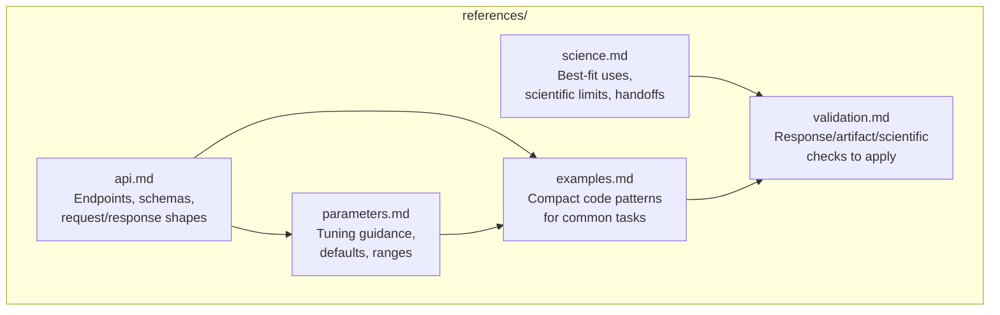
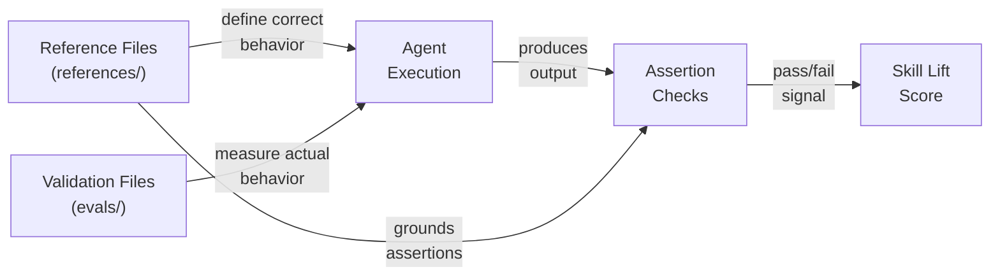

Every skill in the BioNeMo Agent Toolkit ships **ground-truth documents** that keep the AI agent accurate and **validation definitions** that keep it honest. Reference files (`references/` or `reference/`) provide authoritative API schemas, parameter constraints, scientific context, and worked examples. Validation files (`evals/`) define prompt–assertion pairs that prove the agent actually produces correct, executable output. Together they form the two pillars of skill quality: **what the agent should know** and **how we verify it knows**.

## Reference File Taxonomy

The toolkit employs three distinct reference directory conventions, one per skill category. The naming and structure differ, but the purpose is always the same — give the agent an unambiguous source of truth that overrides speculation.

| Skill Category | Directory Name | Location Pattern | Canonical Files |
|---|---|---|---|
| **NIM Skills** | `references/` (plural) | `nim-skills/<skill>/references/` | `api.md`, `examples.md`, `parameters.md`, `science.md`, `)validation.md` |
| **Open Model Skills** | `reference/` (singular) | `open-models-skills/<group>/<skill>/reference/` | Domain-specific: `pipelines.md`, `troubleshooting.md`, `target_schema.md`, etc. |
| **Library Skills** | `references/` (plural) | `library-skills/<skill>/references/` | Domain-specific: `tool-index.md`, `pbrun-*.md`, `workflow-frameworks.md`, etc. |
| **Workflows** | `references/` (plural) | `workflows/<workflow>/references/` | `.mdc` route-selection rules |

Sources: [boltz2-nim references](nim-skills/boltz2-nim/references#L1-L1), [complexa-design reference](open-models-skills/proteina-complexa/complexa-design/reference#L1-L1), [parabricks references](library-skills/parabricks/references#L1-L1), [workflow references](workflows/generative-protein-binder-design/references#L1-L1)

## NIM Skill Reference Canon — The Five-File Contract

Every NIM skill adheres to an identical five-file layout inside `references/`. This contract ensures that any agent consuming a NIM skill finds the same informational architecture regardless of which NIM it targets.



Each file serves a distinct cognitive role in the agent's reasoning pipeline:

| File | Role | When the Agent Uses It |
|---|---|---|
| **`api.md`** | Authoritative endpoint URLs, HTTP methods, full request/response JSON schemas with field types, defaults, and constraints | Building any request payload; resolving hosted vs local endpoint URLs;<br/>auth header structure |
| **`parameters.md`** | Tuning guidance with conservative defaults, valid ranges, and "do not touch casually" warnings | Choosing parameter values beyond defaults; answering "what does `recycling_steps` do?" |
| **`science.md`** | Best-fit use cases, known scientific limits, and handoff points to other NIMs | Deciding if this NIM is the right tool; knowing when to recommend a different NIM (e.g., DiffDock for pose ranking) |
| **`examples.md`** | Compact, copy-adaptable code patterns for the most common request shapes | Quickly assembling working code; the agent adapts these snippets to user-specific values |
| **`validation.md`** | Checklist of response structure checks, artifact persistence rules, and scientific sanity expectations | Post-call verification; confirming the API returned valid data; flagging low-confidence results |

Sources: [api.md](nim-skills/boltz2-nim/references/api.md#L1-L10), [parameters.md](nim-skills/boltz2-nim/references/parameters.md#L1-L10), [science.md](nim-skills/boltz2-nim/references/science.md#L1-L10), [examples.md](nim-skills/boltz2-nim/references/examples.md#L1-L10), [validation.md](nim-skills/boltz2-nim/references/validation.md#L1-L10)

### `api.md` — The Schema Authority

The `api.md` file is the single source of truth for HTTP interaction. It defines **endpoint tables** (hosted vs local), **request body schemas** with full field-level documentation (type, required, default, description), **nested object schemas** (Polymer, Ligand, Constraint), and **response schema** with example JSON. Every field that the agent might set or read is documented here.

For example, Boltz2's `api.md` specifies 13 top-level request fields including `polymers`, `ligands`, `constraints`, `recycling_steps`, `sampling_steps`, `diffusion_samples`, and affinity-specific fields — each with type, required flag, default, and description. The response schema documents `structures`, `confidence_scores`, and the nested `affinities` object with its three list-valued sub-fields.

Sources: [boltz2B api.md](nim*skills/boltz2-nim/references/api.md#L1-L199)

### `validation.md` — The Verification Checklist

Every NIM `validation.md` follows a consistent section structure that maps to progressively deeper levels of trust:

1. **Response Checks** — structural verification: required keys exist, list lengths match requested samples, field types are correct
2. **Artifact Checks** — persistence rules: save structures to correct file extensions (`.cif`, `.sdf`), name files with chain/sample identifiers, never overwrite previous samples
3. **Scientific Sanity Checks** — domain-appropriate warnings: low confidence should be surfaced not hidden, affinity predictions are ranking signals not measured IC50, MSA sequences must match polymer sequences
4. **Local Deployment Checks** (where applicable) — Docker setup, health endpoints, auth behavior differences between hosted and local

> [!TIP]
> The `validation.md` is not a test suite — it is a **reasoning guide** that the agent applies after every API call. The agent checks each item against the actual response and flags violations to the user. This is what distinguishes a skill-assisted agent from a raw API wrapper.

Sources: [boltz2 validation.md](nim-skills/boltz2-nim/references/validation.md#L1-L31), [diffdock validation.md](nim-skills/diffdock-nim/references/validation.md#L1-L44), [molmim validation.md](nim-skills/molmim-nim/references/validation.md#L1-L52)

## Open Model Skill References — Domain-Specific Documents

Open model skills break from the five-file canon because they serve **multi-step local workflows** rather than single API calls. Their `reference/` directory contains files named for the specific knowledge domain the agent needs.

### Proteina-Complexa Example

The `proteina-complexa` group demonstrates the pattern clearly. Each sub-skill has its own `reference/` with context-appropriate files, plus a `_shared/reference/` for cross-cutting concerns:

| Skill | Reference Files | Purpose |
|---|---|---|
| `complexa-design` | `pipelines.md`, `overrides.md`, `troubleshooting.md` | Pipeline config matrix, Hydra override keys, failure diagnosis |
| `complexa-setup` | `downloads.md`, `env_keys.md` | Model download flags/destinations, `.env` variable reference |
| `complexa-target` | `target_schema.md` | Target dict YAML schema, chain-spec grammar, worked examples |
| `complexa-evaluate-pdbs` | `eval_configs.md` | Evaluate/analyze config matrix, success thresholds, worked examples |
| `complexa-sweep` | `SWEEP.md`, `sweep_axes.md` | Sweep configuration, parameter axes |
| `_shared` | `hardware.md` | GPU/VRAM requirements per pipeline, OOM mitigation |

The `troubleshooting.md` file is particularly notable — it maps **symptoms** to **root causes** to **fixes** with exact CLI overrides. For instance, GPU OOM during generation maps to reducing `++generation.dataloader.batch_size=8` and `++gen_njobs=1`, while a missing `AF2_DIR` maps to either adding it to `.env` or switching to `++metric.binder_folding_method=esmfold`.

> [!TIP]
> Open model skill reference files often contain **worked examples at the bottom** — full `complexa` CLI invocations with every override. These are the agent's primary code-generation templates, more reliable than synthesizing commands from schema alone.

Sources: [complexa-design pipelines.md](open-models-skills/proteina-complexa/complexa-design/reference/pipelines.md#L1-L176), [complexa-setup downloads.md](open-models-skills/proteina-complexa/complexa-setup/reference/downloads.md#L1-L148), [complexa-target target_schema.md](open-models-skills/proteina-complexa/complexa-target/reference/target_schema.md#L1-L200), [complexa-evaluate-pdbs eval_configs.md](open-models-skills/proteina-complexa/complexa-evaluate-pdbs/reference/eval_configs.md#L1-L198), [_shared hardware.md](open-models-skills/proteina-complexa/_shared/reference/hardware.md#L1-L81)

## Library Skill References — Tool-Catalog Pattern

Library skills serve **tool discovery and routing** rather than API interaction. Their reference files are structured around mapping user intent to the correct tool command and flag set.

### Parabricks — Per-Tool Reference Files

The `parabricks` library skill contains one reference file per `pbrun` subcommand, each following a consistent internal structure:

| Section | Content |
|---|---|
| **First Steps** | Identify execution context, collect required/optional inputs, route to runtime reference |
| **Command Shape** | Canonical `pbrun` invocation with placeholders wrapped in Docker |
| **Option Mapping** | Table mapping baseline CPU/GATK flags to Parabricks equivalents |
| **Parabricks-Only Options** | GPU-specific flags with no baseline equivalent |
| **Validation** | Post-run checks: file existence, error log scanning |
| **Guardrails** | "Do not guess" rules for biological identifiers, reference builds, runtimes |
| **Troubleshooting** | GPU visibility, mount/path, memory, runtime diagnosis |

The `tool-index.md` file provides the routing layer — mapping user intent ("raw FASTQ to aligned BAM") to the correct `pbrun` subcommand.

### Genomics Workflow Acceleration — Framework-Specific References

The `genomics-workflow-acceleration` skill takes a different approach with files that address **workflow transformation** rather than individual tool calls:

| File | Purpose |
|---|---|
| `workflow-frameworks.md` | Detect framework (Nextflow/Snakemake/WDL/Python), implement GPU toggle in place |
| `parabricks-tool-map.md` | Map CPU steps to Parabricks equivalents |
| `nf-core-parabricks-map.md` | Nextflow-specific nf-core module mapping |
| `step-consolidation.md` | Merge redundant GPU-branch stages (e.g., BWA+MarkDuplicates → single `fq2bam`) |
| `comparison-checklist.md` | Toggle-off vs toggle-on A/B comparison protocol |
| `workflow-layout.md` | Single-tree vs sibling-copy directory strategy |

Sources: [pbrun-fq2bam.md](library-skills/parabricks/references/pbrun-fq2bam.md#L1-L174), [tool-index.md](library-skills/parabricks/references/tool-index.md#L1-L57), [workflow-frameworks.md](library-skills/genomics-workflow-acceleration/references/workflow-frameworks.md#L1-L121), [parabricks-tool-map.md](library-skills/genomics-workflow-acceleration/references/parabricks-tool-map.md#L1-L49), [comparison-checklist.md](library-skills/genomics-workflow-acceleration/references/comparison-checklist.md#L1-L51), [step-consolidation.md](library-skills/genomics-workflow-acceleration/references/step-consolidation.md#L1-L93)

## Workflow-Level References — Route Selection Rules

Workflows contain `.mdc` reference files that provide **decision logic** for choosing between alternative paths. These are Cursor rules-format files with YAML frontmatter (`alwaysApply`, `title`, `description`, `tags`) followed by markdown comparison tables.

The `route-selection.mdc` in the Protein Binder Design workflow provides a side-by-side comparison of `complexa-binder-design` vs `protein-binder-design` across dimensions like generator, selection method, validation backend, ranking metrics, and backend requirements — ending with a clear "prefer when" rule.

Sources: [route-selection.mdc](workflows/generative-protein-binder-design/references/route-selection.mdc#L1-L26)

## Evaluation Files — The Validation Side

While reference files tell the agent **what** to know, eval files verify **that the agent performs correctly**. Every skill's `evals/` directory contains the test definitions that power the Skill Lift evaluation system.

### Evals Directory Structure

| File | Purpose | Present In |
|---|---|---|
| `evals.json` | Core test definitions: prompts, expected outputs, assertion lists | All skills |
| `trigger_evals.json` | Positive/negative trigger phrases for skill routing | Most NIM skills, some open model skills |
| `config.yml` | Harbor runtime configuration (schema version, task source, required env vars, grading mode) | NIM skills with Harbor integration |
| `files/` | Fixture files (PDB structures, SMILES lists, etc.) used by eval prompts | Skills requiring file-based inputs (diffdock, proteinmpnn) |

Sources: [boltz2 evals.json](nim-skills/boltz2-nim/evals/evals.json#L1-L166), [boltz2 config.yml](nim-skills/boltz2-nim/evals/config.yml#L1-L10), [boltz2 trigger_evals.json](nim-skills/boltz2-nim/evals/trigger_evals.json#L1-L23)

### `evals.json` — Assertion-Driven Test Definitions

Each entry in `evals.json` defines a **prompt** (what the user asks), an **expected_output** (what a correct answer looks like), and an **assertions** array of verifiable checks. Assertions use a consistent schema:

```json
{
  "id": "bearer-auth-header",
  "description": "Sets Authorization header with Bearer token from environment variable",
  "check": "Script contains 'Authorization' and 'Bearer' and 'NGC_API_KEY'"
}
```

The `id` provides a stable identifier for tracking over time, `description` explains the intent, and `check` defines the verifiable condition. Evals also support **deferred_evals** — tests that are not yet runnable (e.g., waiting on local Docker infrastructure) but are defined for future activation.

### `trigger_evals.json` — Skill Routing Verification

This file validates that the skill activates for the right prompts and **does not** activate for the wrong ones. Each entry has a `query` and a `should_trigger` boolean. For Boltz2, queries about "predict structure" or "binding affinity" trigger the skill (`should_trigger: true`), while queries about "parse PDB in Python" or "run BLAST" do not (`should_trigger: false`).

Sources: [boltz2 evals.json](nim-skills/boltz2-nim/evals/evals.json#L1-L166), [boltz2 trigger_evals.json](nim-skills/boltz2-nim/evals/trigger_evals.json#L1-L23)

## The Reference ↔ Validation Feedback Loop

Reference files and validation files form a closed-loop quality system. The relationship is bidirectional:



**Reference files ground the assertions.** When `validation.md` says "save every returned structure as `.cif`", the corresponding eval assertion checks that the agent's output script writes to a `.cif` extension. When `api.md` documents that the hosted endpoint is `health.api.nvidia.com/v1/biology/mit/boltz2/predict`, the eval assertion verifies the agent used that exact URL. This ensures that evals are not testing abstract properties but are **anchored to the same source of truth** that guides the agent's reasoning.

Sources: [boltz2 validation.md](nim-skills/boltz2-nim/references/validation.md#L1-L31), [boltz2 evals.json](nim-skills/boltz2-nim/evals/evals.json#L1-L166)

## Adding or Updating Reference and Validation Files

When creating a new skill or extending an existing one, follow these principles:

**For NIM skills**, maintain the five-file canon. Each file has a fixed role — do not merge `api.md` content into `examples.md` or skip `validation.md`. The agent expects this structure and reads files by name.

**For open model skills**, name reference files after the **knowledge domain** they document (`downloads.md`, `env_keys.md`, `target_schema.md`). If content is shared across sub-skills, place it in `_shared/reference/` rather than duplicating.

**For library skills**, create one reference file per **tool or workflow concern**. Include routing heuristics, option mapping tables, and guardrails in every tool-specific file.

**For evals**, every new capability documented in a reference file should have at least one corresponding assertion in `evals.json`. If the reference says "use `alignment` not `data` for MSA fields", the eval should check that the agent does not emit the stale field. Add trigger phrases to `trigger_evals.json` for both positive (should activate) and negative (should not activate) cases.

Sources: [boltz2-nim references structure](nim-skills/boltz2-nim/references#L1-L1), [complexa reference structure](open-models-skills/proteina-complexa/complexa-design/reference#L1-L1), [parabricks references structure](library-skills/parabricks/references#L1-L1)

---

**Next steps**: Understand how eval assertions are graded and aggregated in the [Skill Lift Evaluation](14-skill-lift-evaluation) framework, or explore the detailed [Evals Configuration](15-evals-configuration) format. For the file format that ties references into the agent's reasoning, see [SKILL.md File Format](11-skill-md-file-format).