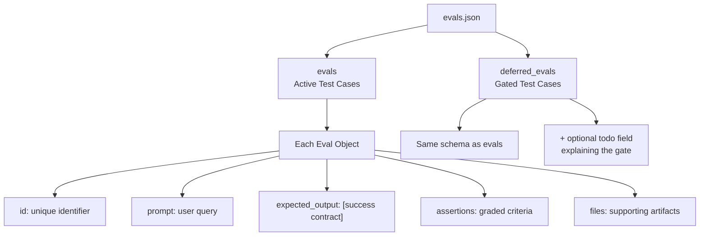
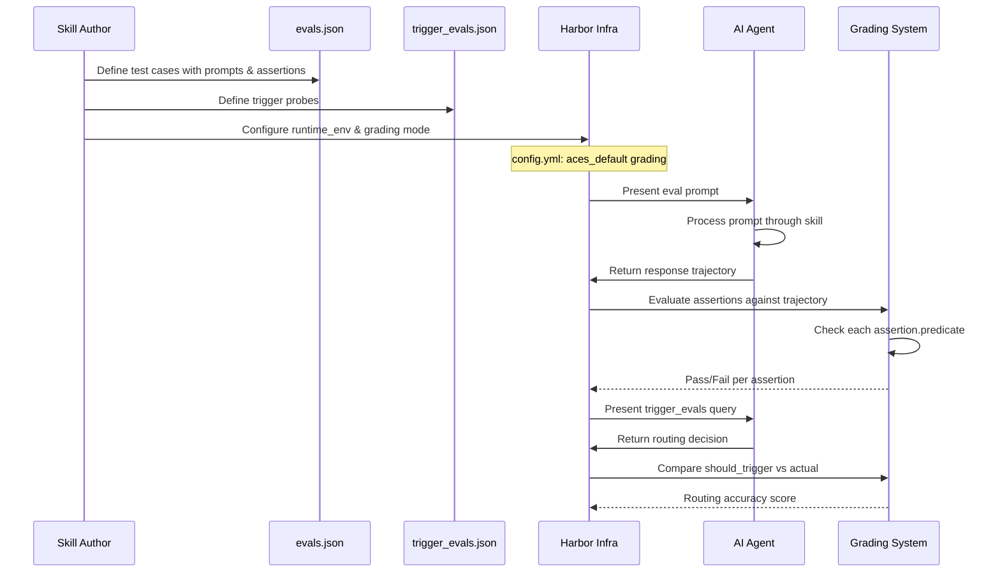

Skill Lift Evaluation is the quality assurance framework that validates whether an AI agent correctly applies a skill's domain knowledge when responding to user prompts. Every skill in the BioNeMo Agent Toolkit ships with an `evals/` directory containing structured test cases, assertion-based grading criteria, and trigger dispatch probes that collectively define the competency contract between skill author and agent runtime. Understanding this evaluation architecture is essential for contributing new skills, extending existing coverage, or debugging agent behavior.

## Evaluation Directory Structure

Each skill contains an `evals/` subdirectory with a predictable set of files. The presence and complexity of these files varies by skill type — NIM skills carry the richest evaluation surface, while library skills use a simpler but equally rigorous schema.

| File | Purpose | Required By |
|---|---|---|
| `evals.json` | Core evaluation test cases with prompts, expected outputs, and assertions | All skills |
| `trigger_evals.json` | Skill dispatch probes testing whether the agent correctly routes to or away from this skill | NIM skills, some library skills |
| `config.yml` | Harbor execution and grading configuration | NIM skills only |
| `files/` | Supporting artifacts (PDB structures, SDF ligands) referenced by eval prompts | Skills needing file inputs |
| `harbor/` | Full Harbor task definition with Docker environment, grader scripts, and test harness | Advanced NIM skills |

Sources: [evals.json](nim-skills/boltz2-nim/evals/evals.json#L1-L166), [trigger_evals.json](nim-skills/boltz2-nim/evals/trigger_evals.json#L1-L23), [config.yml](nim-skills/boltz2-nim/evals/config.yml#L1-L10)

## Core Evaluation Schema: evals.json

The `evals.json` file is the authoritative evaluation contract. It defines test cases that probe the agent's ability to produce correct, complete, and safe outputs for domain-specific prompts. The top-level structure contains a `skill_name` identifier and two test case arrays: `evals` (active) and `deferred_evals` (infrastructure-gated).



Each evaluation object contains the following fields:

- **`id`** — A unique identifier within the skill's evaluation set. NIM skills use simple integers (`"1"`, `"2"`); library skills use prefixed strings (`"nvmolkit-usage-001"`, `"cuequivariance-003"`).
- **`prompt`** — The natural language user query presented to the agent. Prompts are crafted to test specific API usage patterns, edge cases, or multi-step workflows.
- **`expected_output`** — A prose description of the minimally acceptable correct response. This is not a literal string match but a behavioral contract describing what the agent must produce.
- **`files`** — An array of relative paths to supporting files (e.g., PDB structures) that the agent should read or process. Empty when no file inputs are needed.
- **`assertions`** — The graded criteria, discussed in detail below.
- **`expected_skill`** — (Library skills only) The skill name the agent should invoke, or `null` for negative test cases.
- **`expected_script`** — (Library skills only) A script the agent should execute as part of the eval, or `null`.

Sources: [evals.json](nim-skills/boltz2-nim/evals/evals.json#L1-L166), [evals.json](library-skills/nvmolkit-usage/evals/evals.json#L1-L174)

## Assertion Models

The toolkit uses two distinct assertion formats depending on skill type, each serving different grading infrastructure.

### NIM Skill Assertions (Object-Based)

NIM skill assertions are structured objects with three fields, enabling automated programmatic grading by the Harbor infrastructure:

```json
{
  "id": "hosted-endpoint-url",
  "description": "Uses the correct hosted endpoint URL (health.api.nvidia.com)",
  "check": "Script contains 'health.api.nvidia.com/v1/biology/mit/boltz2/predict'"
}
```

- **`id`** — Machine-readable assertion identifier, used by grading automation.
- **`description`** — Human-readable explanation of what this assertion verifies.
- **`check`** — A concrete, verifiable predicate against the agent's output trajectory. These typically use substring presence checks, structural pattern requirements, or behavioral observations like "Trajectory shows successful execution."

This object format enables the Harbor `aces_default` grading mode to programmatically evaluate each assertion against the agent's response trajectory.

Sources: [evals.json](nim-skills/boltz2-nim/evals/evals.json#L25-L37)

### Library Skill Assertions (String-Based)

Library skill assertions are plain prose strings that describe the expected behavior in natural language:

```json
"The agent uses MorganFingerprintGenerator(radius=2, fpSize=2048) and calls GetFingerprints once on the molecule collection rather than once per molecule"
```

These assertions require human or LLM-based grading since they express semantic correctness rather than substring patterns. This format is appropriate for library skills where correctness depends on conceptual understanding (e.g., batched API usage, GPU dataflow hygiene) rather than exact endpoint URLs.

Sources: [evals.json](library-skills/nvmolkit-usage/evals/evals.json#L30-L36)

## Deferred Evaluations

The `deferred_evals` array contains test cases that are valid but currently gated by infrastructure prerequisites. Each deferred eval may include a **`todo`** field explaining the blocker:

```json
{
  "todo": "Waiting on local Docker setup in Harbor before enabling this eval.",
  "id": "3",
  "prompt": "Help me set up the Boltz2 NIM locally with Docker...",
  ...
}
```

Deferred evals follow the same schema as active evals but are excluded from grading until their infrastructure gate is resolved. The most common gate is **local Docker deployment** — many NIM skills defer their local-inference evals pending Harbor container orchestration support. This pattern allows skill authors to define comprehensive test coverage upfront without blocking initial skill publication on infrastructure that is still being provisioned.

Sources: [evals.json](nim-skills/boltz2-nim/evals/evals.json#L72-L76), [evals.json](nim-skills/evo2-nim/evals/evals.json#L53-L54)

## Trigger Evaluation: trigger_evals.json

Trigger evals test **skill dispatch accuracy** — whether the agent correctly activates this skill for relevant queries and correctly avoids it for irrelevant ones. This is a routing-quality measure distinct from the output-quality measures in `evals.json`.

```json
[
  {"query": "Predict the structure of this protein sequence using Boltz2: MTEYK...", "should_trigger": true},
  {"query": "How do I parse a PDB file in Python to extract backbone coordinates?", "should_trigger": false},
  {"query": "Run BLAST to find homologs for this protein sequence", "should_trigger": false}
]
```

Each entry contains:

- **`query`** — A user prompt that should or should not trigger this skill.
- **`should_trigger`** — Boolean indicating whether the agent's skill router should activate this skill for the given query.

Positive trigger probes (`should_trigger: true`) cover the skill's domain vocabulary, API names, and task phrasing. Negative trigger probes (`should_trigger: false`) cover adjacent domains that might falsely activate the skill — for instance, Boltz2's negative probes include generic PDB parsing, BLAST searches, and molecular docking (which belongs to DiffDock, not Boltz2).

Sources: [trigger_evals.json](nim-skills/boltz2-nim/evals/trigger_evals.json#L1-L23), [trigger_evals.json](nim-skills/evo2-nim/evals/trigger_evals.json#L1-L23)

## Harbor Configuration: config.yml

NIM skills include a `config.yml` that configures the Harbor evaluation infrastructure:

```yaml
schema_version: 1

harbor:
  task_source: evals_json
  runtime_env:
    - NGC_API_KEY

grading:
  mode: aces_default
```

The configuration declares:

- **`task_source`** — The evaluation data source (`evals_json` means the Harbor task definitions are derived from the `evals.json` file).
- **`runtime_env`** — Environment variables required at evaluation time. `NGC_API_KEY` is universally required for NIM skills since evaluations must execute real API requests against hosted NVIDIA endpoints.
- **`grading.mode`** — The grading strategy. `aces_default` is the standard automated grading mode that evaluates each object-based assertion's `check` predicate against the agent's output trajectory.

Sources: [config.yml](nim-skills/boltz2-nim/evals/config.yml#L1-L10), [config.yml](nim-skills/evo2-nim/evals/config.yml#L1-L10)

## Harbor Task Definitions

Beyond the basic `config.yml`, some NIM skills include a full `harbor/` directory with containerized evaluation environments. This is the most sophisticated evaluation tier, providing isolated Docker-based sandboxes with custom graders.

The `harbor/` directory structure for ProteinMPNN demonstrates the full pattern:

| Path | Purpose |
|---|---|
| `harbor/dataset.toml` | Dataset definition for the Harbor evaluation run |
| `harbor/<task-name>/task.toml` | Task configuration declaring inputs, outputs, and constraints |
| `harbor/<task-name>/instruction.md` | Detailed task instructions provided to the agent inside the Harbor environment |
| `harbor/<task-name>/environment/Dockerfile` | Docker image definition for the isolated evaluation environment |
| `harbor/<task-name>/environment/input/` | Input files staged into the container |
| `harbor/<task-name>/tests/grader.py` | Python grader that programmatically scores the agent's output |
| `harbor/<task-name>/tests/test.sh` | Shell test script for validation |

This Harbor-based evaluation tier is used for local NIM deployment evals where the agent must demonstrate correct Docker setup, environment configuration, health checking, and local inference execution. The Dockerfile provides a controlled environment with the actual NIM container, and the grader script validates the agent's trajectory against precise criteria that go beyond simple substring checks.

Sources: [harbor structure](nim-skills/proteinmpnn-nim/evals/harbor/proteinmpnn-local-design#L1-L7)

## Evaluation Coverage Patterns

Examining evals across the toolkit reveals systematic coverage patterns that ensure comprehensive skill quality. Each skill's evaluation set is designed to probe multiple dimensions of agent competency.

### NIM Skill Coverage Matrix

NIM skills consistently cover these evaluation dimensions:

| Dimension | Description | Example Assertion |
|---|---|---|
| **Hosted Execution** | Agent executes real API requests, not just writes code | `hosted-request-executed` |
| **Endpoint Correctness** | Uses the exact API endpoint URL | `hosted-endpoint-url` |
| **Authentication** | Reads `NGC_API_KEY` from environment with Bearer token | `bearer-auth-header` / `api-key-from-env` |
| **Payload Correctness** | Uses correct field names, types, and values | `protein-molecule-type`, `smiles-in-ligand` |
| **Output Handling** | Saves artifacts and reports response values | `saves-cif-output`, `reports-confidence-score` |
| **Local Deployment** | Correct Docker image, env vars, cache mounts, health checks | `docker-image-tag`, `env-contract-and-cache` |
| **Safety** | No leaked secrets, no destructive commands | Implicit in all assertions |

Sources: [evals.json](nim-skills/boltz2-nim/evals/evals.json#L1-L166), [evals.json](nim-skills/diffdock-nim/evals/evals.json#L1-L168)

### Library Skill Coverage Matrix

Library skills focus on conceptual correctness and API migration quality:

| Dimension | Description | Example Pattern |
|---|---|---|
| **SKILL.md Reference** | Agent reads the skill documentation before answering | "The agent read or referenced the nvmolkit-usage SKILL.md" |
| **Batched API Usage** | Uses batched APIs correctly, not per-element loops | "calls GetFingerprints once on the molecule collection rather than once per molecule" |
| **GPU Dataflow Hygiene** | Keeps data on GPU, delays host transfer | "feeds the GPU-resident fingerprint result directly to crossTanimotoSimilarity without an intervening NumPy conversion" |
| **Safe Result Handling** | Correctly synchronizes AsyncGpuResult before host reads | "safely inspects the AsyncGpuResult with .numpy() or synchronization" |
| **Negative Routing** | Correctly declines out-of-scope requests | "The agent declined to provide clinical variant interpretation" |
| **No Destructive Actions** | No secrets leaked, no destructive commands | "did not leak secrets, run destructive commands" |

Sources: [evals.json](library-skills/nvmolkit-usage/evals/evals.json#L1-L174), [evals.json](library-skills/genomics-workflow-acceleration/evals/evals.json#L1-L60)

### Negative Test Cases

Both skill types include **negative test cases** — prompts that are outside the skill's domain. These serve dual purpose: they validate that the agent does not inappropriately invoke the skill, and they appear in `trigger_evals.json` with `should_trigger: false`.

In library skill `evals.json`, negative cases have `expected_skill: null`, indicating the agent should not invoke this skill. For example, cuequivariance eval `cuequivariance-004` asks about PostgreSQL database setup — the correct behavior is to answer the question without invoking cuequivariance concepts. Similarly, genomics-workflow-acceleration eval `genomics-workflow-acceleration-004` asks for clinical variant interpretation — the correct behavior is to decline and suggest appropriate alternatives.

Sources: [evals.json](library-skills/cuequivariance/evals/evals.json#L42-L58), [evals.json](library-skills/genomics-workflow-acceleration/evals/evals.json#L44-L60)

## Evaluation Lifecycle

The complete evaluation lifecycle flows from skill authoring through automated grading:



The lifecycle has two independent evaluation streams: **output quality** (evals.json assertions against agent responses) and **dispatch accuracy** (trigger_evals.json routing decisions). Both streams must pass for a skill to be considered fully validated.

Sources: [config.yml](nim-skills/boltz2-nim/evals/config.yml#L1-L10), [evals.json](nim-skills/boltz2-nim/evals/evals.json#L1-L166)

## Supporting Files

Some evaluations require input files that the agent must read or process. These are staged in the `evals/files/` directory and referenced by the `files` field in the eval object. For example, DiffDock's primary eval references `evals/files/protein.pdb` as the receptor structure, and ProteinMPNN references `evals/files/1R42.pdb` as the backbone to redesign.

The `files` array contains paths relative to the skill root. When Harbor executes the evaluation, it stages these files at `/workspace/input/` inside the container, and the eval prompt references this staged location (e.g., "the staged receptor at /workspace/input/protein.pdb").

Sources: [evals.json](nim-skills/diffdock-nim/evals/evals.json#L10-L11), [evals.json](nim-skills/proteinmpnn-nim/evals/evals.json#L10-L11)

> [!TIP]
> When adding a new eval that requires input files, always include both the `files` array entry (relative path from skill root) AND update the prompt to reference the staged container path (`/workspace/input/<filename>`). The Harbor infrastructure maps between these two locations at evaluation time.

## Cross-Skill Evaluation Patterns

Examining all skills reveals that evaluation coverage scales with skill complexity. NIM skills consistently have 3-4 active evals plus 1-3 deferred evals, while library skills range from 4 (genomics-workflow-acceleration) to 11 (nvmolkit-usage) active evals. This reflects the different testing priorities: NIM skills validate API integration correctness across a bounded surface, while library skills must validate conceptual migration patterns across diverse RDKit-to-GPU codebases.

The assertion count per eval also varies meaningfully. NIM skill evals typically carry 5-7 object-based assertions that validate endpoint, auth, payload, and output handling independently. Library skill evals carry 5-7 string-based assertions that validate conceptual correctness and API usage patterns. Both formats achieve similar granularity through different mechanisms optimized for their respective grading infrastructure.

Sources: [evals.json](library-skills/nvmolkit-usage/evals/evals.json#L1-L174), [evals.json](nim-skills/boltz2-nim/evals/evals.json#L1-L166)

## Next Steps

For detailed configuration options and grading modes, see [Evals Configuration](15-evals-configuration). For the SKILL.md format that evaluations reference, see [SKILL.md File Format](11-skill-md-file-format). For understanding how evaluations integrate with the plugin marketplace distribution pipeline, see [Plugin Marketplace Integration](16-plugin-marketplace-integration).