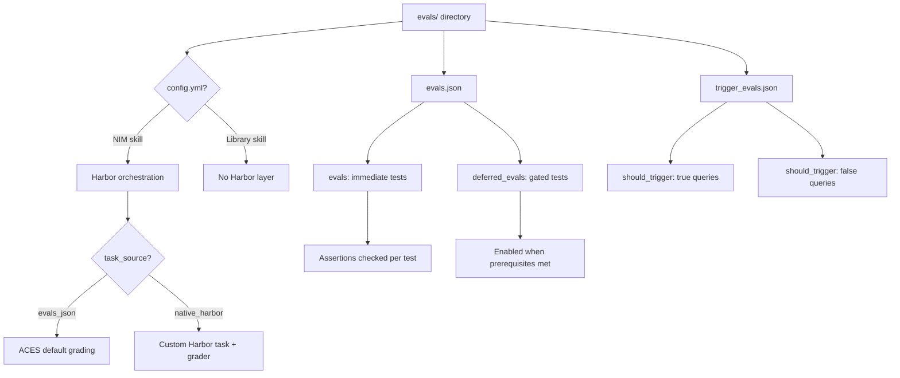

The **evals** subsystem is the quality gate for every skill in the BioNeMo Agent Toolkit. Each skill directory contains an `evals/` folder housing the test definitions, trigger classifiers, and orchestration configuration that together determine whether a skill produces correct, safe, and well-structured outputs. Understanding how these files are structured and how they differ across skill types is essential for authoring new skills, extending existing evaluations, or diagnosing evaluation failures.

Sources: [evals.json](nim-skills/boltz2-nim/evals/evals.json#L1-L166), [config.yml](nim-skills/boltz2-nim/evals/config.yml#L1-L10)

## Evals Directory Structure by Skill Type

The file composition inside `evals/` varies systematically across the three skill categories. **NIM skills** carry the full trio of `config.yml`, `evals.json`, and `trigger_evals.json`, plus optional `files/` and `harbor/` subdirectories. **Library skills** omit `config.yml` entirely and may or may not include `trigger_evals.json`. This distinction reflects whether the skill requires a Harbor-managed runtime environment (NIM skills always do; library skills typically don't).

| File / Directory | NIM Skills | Library Skills | Purpose |
|---|---|---|---|
| `config.yml` | ✅ Always | ❌ Absent | Harbor orchestration and grading mode |
| `evals.json` | ✅ Always | ✅ Always | Core evaluation test definitions |
| `trigger_evals.json` | ✅ Always | ⚠️ Optional | Skill-routing trigger classifiers |
| `files/` | ⚠️ Optional | ❌ Absent | Input fixtures (PDB, SDF, etc.) |
| `harbor/` | ⚠️ Rare | ❌ Absent | Native Harbor task packaging |

The following Mermaid diagram illustrates how these files relate to each other within the evaluation lifecycle:



Sources: [config.yml](nim-skills/diffdock-nim/evals/config.yml#L1-L10), [evals.json](library-skills/parabricks/evals/evals.json#L1-L60), [trigger_evals.json](library-skills/nvmolkit-usage/evals/trigger_evals.json#L1-L31)

## config.yml — Harbor Orchestration

The `config.yml` file is exclusive to NIM skills and controls how the Harbor evaluation runner processes the skill's tests. It declares the **task source**, **required runtime environment variables**, and **grading mode**. Every NIM skill except ProteinMPNN uses the same canonical form:

```yaml
schema_version: 1

harbor:
  task_source: evals_json
  runtime_env:
    - NGC_API_KEY

grading:
  mode: aces_default
```

The three fields serve distinct purposes. **`schema_version`** pins the config schema for forward compatibility. **`harbor.task_source`** tells Harbor where to find the test definitions—`evals_json` means Harbor reads from the sibling `evals.json` file directly. **`harbor.runtime_env`** enumerates environment variables that must be present at evaluation time; `NGC_API_KEY` is universal because all hosted NIM calls authenticate through NVIDIA's API. **`grading.mode`** selects the assertion-checking strategy—`aces_default` applies the standard ACES grader that checks each assertion's `check` string against the agent's trajectory.

### The Native Harbor Variant (ProteinMPNN)

ProteinMPNN is the repository's **local-GPU BYOT** (Bring Your Own Task) example, and its `config.yml` diverges to support a fully custom Harbor task with its own Docker environment, custom grader, and health checks:

```yaml
schema_version: 1

harbor:
  task_source: native_harbor
  custom_dockerfile_mode: preserve
  base_image_mode: disabled
  n_attempts: 1
  pass_threshold: 0.8
  stop_on_pass: false
  n_concurrent: 1
  runtime_env:
    - NGC_API_KEY

grading:
  mode: custom_only
```

When `task_source` is `native_harbor`, Harbor looks for a `harbor/` subdirectory containing a `dataset.toml` and one or more task directories. Each task directory packages its own `task.toml` (resource limits, timeouts, health checks), `instruction.md` (the prompt sent to the agent), `environment/Dockerfile` (the container image), and `tests/` (a `grader.py` and `test.sh`). This mode is appropriate when the evaluation requires a live local NIM running inside the test container itself.

> [!TIP]
> When switching a skill from hosted API evaluation (`evals_json` + `aces_default`) to local NIM evaluation (`native_harbor` + `custom_only`), you must create the full `harbor/` task package. The `evals.json` dataset remains available if you switch back—just change `task_source` to `evals_json` and `grading.mode` to `aces_default`.

Sources: [config.yml](nim-skills/boltz2-nim/evals/config.yml#L1-L10), [config.yml](nim-skills/proteinmpnn-nim/evals/config.yml#L1-L20), [task.toml](nim-skills/proteinmpnn-nim/evals/harbor/proteinmpnn-local-design/task.toml#L1-L34)

## evals.json — Test Definitions

The `evals.json` file is the heart of the evaluation system. It defines the concrete prompts, expected outputs, and assertions that judge whether the agent handled a request correctly. The file is present in **every skill type** and follows a consistent top-level schema:

```json
{
  "skill_name": "<skill-id>",
  "evals": [ ... ],
  "deferred_evals": [ ... ]
}
```

### Immediate Evals (`evals`)

Entries in the `evals` array run on every evaluation cycle. Each entry is a test case with these fields:

| Field | Required | Description |
|---|---|---|
| `id` | ✅ | Unique test identifier (string or integer) |
| `prompt` | ✅ | The user-facing query sent to the agent |
| `expected_output` | ✅ | Human-readable description of the correct output |
| `files` | ✅ | Array of fixture file paths relative to `evals/` |
| `assertions` | ✅ | Array of assertion objects that verify the output |
| `expected_skill` | ⚠️ | Which skill should be triggered (library skills) |
| `expected_script` | ⚠️ | Script the agent should execute (library skills) |

The **assertion** object differs between NIM and library skills. **NIM skills** use structured assertions with three fields:

```json
{
  "id": "bearer-auth-header",
  "description": "Sets Authorization header with Bearer token from environment variable",
  "check": "Script contains 'Authorization' and 'Bearer' and 'NGC_API_KEY'"
}
```

**Library skills** use a simpler string-based assertion format where each entry is a plain-text condition:

```json
"assertions": [
  "The agent read or referenced the nvmolkit-usage SKILL.md for installation and runtime requirements",
  "The agent creates and activates a conda, mamba, or micromamba environment with a supported Python version"
]
```

This structural difference reflects the evaluation philosophy: NIM skill assertions verify **code-level facts** (presence of specific strings, API patterns, environment variable usage), while library skill assertions verify **behavioral outcomes** (whether the agent followed the correct workflow, used the right API patterns, avoided anti-patterns).

### Deferred Evals (`deferred_evals`)

The `deferred_evals` array holds tests that are **gated behind prerequisites** and do not run by default. Two gating mechanisms exist:

1. **`todo` field** — A human-readable reason string. Any entry with a `todo` field is skipped entirely. This is used for evaluations awaiting infrastructure (e.g., "Waiting on local Docker setup in Harbor before enabling this eval").

2. **Implicit deferral** — Entries without a `todo` field but placed in `deferred_evals` instead of `evals` are conditionally enabled based on the evaluation runner's configuration. These typically cover advanced scenarios (local Docker deployment, multi-polymer inputs, affinity predictions) that are validated separately from core functionality.

Sources: [evals.json](nim-skills/boltz2-nim/evals/evals.json#L1-L166), [evals.json](nim-skills/diffdock-nim/evals/evals.json#L1-L168), [evals.json](library-skills/nvmolkit-usage/evals/evals.json#L1-L174)

## trigger_evals.json — Skill Routing Classifiers

The `trigger_evals.json` file defines a **binary classification test** that validates whether the skill correctly activates for relevant queries and correctly declines for irrelevant ones. This file serves a different purpose from `evals.json`: it tests the **routing logic** rather than the **output quality**.

NIM skills use an **array format** with explicit `should_trigger` boolean labels:

```json
[
  {"query": "Predict the structure of this protein sequence using Boltz2: ...", "should_trigger": true},
  {"query": "How do I parse a PDB file in Python to extract backbone coordinates?", "should_trigger": false}
]
```

Library skills use an **object format** with a `skill_name` wrapper and `trigger_evals` array, where the expected field is `"trigger"` or `"no_trigger"`:

```json
{
  "skill_name": "nvmolkit-usage",
  "trigger_evals": [
    {"id": "nvmolkit-usage-trigger-001", "prompt": "Can you port my RDKit Morgan fingerprint...", "expected": "trigger"},
    {"id": "nvmolkit-usage-trigger-004", "prompt": "Write a pandas data cleaning script...", "expected": "no_trigger"}
  ]
}
```

In both cases, **positive examples** (`should_trigger: true` / `"trigger"`) cover the skill's domain vocabulary and typical user requests, while **negative examples** (`should_trigger: false` / `"no_trigger"`) cover adjacent but distinct domains that should not activate the skill. A well-constructed `trigger_evals.json` prevents both **false activations** (e.g., a general chemistry query triggering the Boltz2 skill) and **missed activations** (e.g., a binding affinity query failing to trigger DiffDock).

> [!TIP]
> When adding a new NIM skill, include at least 10 positive trigger examples spanning the skill's full vocabulary (different API operations, input types, deployment modes) and at least 5 negative examples from closely related but distinct skills. This boundary density is what makes the classifier reliable.

Sources: [trigger_evals.json](nim-skills/boltz2-nim/evals/trigger_evals.json#L1-L23), [trigger_evals.json](library-skills/nvmolkit-usage/evals/trigger_evals.json#L1-L31)

## Assertion Design Patterns

The assertion system encodes skill-specific correctness criteria. Across the repository, several recurring patterns emerge:

### NIM Skill Assertion Patterns

NIM skills consistently verify the same categories of correctness, forming a **de facto contract** for API-calling agents:

| Pattern | Example Assertion ID | What It Checks |
|---|---|---|
| **Endpoint correctness** | `hosted-endpoint-url` | Script contains the exact NVIDIA API URL |
| **Authentication** | `bearer-auth-header` | Authorization header with Bearer token from env var |
| **Request execution** | `hosted-request-executed` | Trajectory shows actual execution, not just code writing |
| **Input sanitization** | `atom-records-only` | PDB input filtered to ATOM lines only |
| **Output persistence** | `saves-cif-output` | Structure saved to correct file format |
| **Result reporting** | `reports-confidence-score` | Response fields printed/displayed |
| **Security** | `api-key-from-env` | Credentials read from environment, not hardcoded |

### Library Skill Assertion Patterns

Library skill assertions focus on **workflow correctness** and **anti-pattern prevention**:

| Pattern | Example | What It Checks |
|---|---|---|
| **Skill reference** | "The agent read the SKILL.md" | Agent consulted the skill documentation |
| **API usage** | "calls GetFingerprints once on the collection" | Correct batched API pattern, not per-element loops |
| **GPU dataflow** | "delays host conversion until after GPU operations" | No premature `.numpy()` in hot loops |
| **Anti-pattern** | "does not pass an RDKit-style condensed lower triangle" | Prevents common misuse of library APIs |
| **Negative routing** | "did not invoke the parabricks skill" | Skill correctly declined an out-of-scope request |

Sources: [evals.json](nim-skills/diffdock-nim/evals/evals.json#L1-L168), [evals.json](library-skills/cuequivariance/evals/evals.json#L1-L58)

## Fixture Files and the files/ Directory

Some evaluations require **input fixtures**—PDB structures, SDF ligand files, or other artifacts that the agent must process during the test. These are stored in the `evals/files/` directory and referenced from `evals.json` via the `files` array:

```json
{
  "id": "1",
  "prompt": "I want to dock aspirin to a protein target using the staged receptor at /workspace/input/protein.pdb...",
  "files": ["evals/files/protein.pdb"],
  "assertions": [...]
}
```

The Harbor runtime stages these files into the agent's workspace (typically `/workspace/input/`) before the evaluation prompt is delivered. Not all skills require fixtures—many NIM skill evals use inline data (SMILES strings, amino acid sequences) directly in the prompt, keeping the `files` array empty.

Sources: [evals.json](nim-skills/diffdock-nim/evals/evals.json#L1-L168)

## Native Harbor Task Packaging

When a skill requires a **live local service** for evaluation (as opposed to calling a hosted API), the `native_harbor` task source activates an entirely different evaluation path. The `harbor/` directory packages a self-contained evaluation environment:

```
harbor/
├── dataset.toml                    # Dataset manifest
└── <task-name>/
    ├── task.toml                   # Resource limits, timeouts, health check
    ├── instruction.md              # Agent prompt for the task
    ├── environment/
    │   ├── Dockerfile              # Container image with the NIM
    │   └── input/                  # Task-specific input fixtures
    └── tests/
        ├── grader.py               # Custom Python grading logic
        └── test.sh                 # Test runner script
```

The `task.toml` declares the computational resources allocated to the evaluation container—CPU cores, memory, storage, GPU count, network mode, and skill directory mount path. It also defines the **health check** that confirms the local NIM is ready before the agent prompt is delivered:

```toml
[environment]
cpus = 4
memory_mb = 8192
gpus = 1
network_mode = "public"

[environment.healthcheck]
command = "curl -fsS http://127.0.0.1:8000/v1/health/ready"
interval_sec = 10.0
start_period_sec = 300.0
retries = 60
```

The `instruction.md` file replaces the `prompt` field from `evals.json` as the agent's task description, and `grader.py` replaces the `aces_default` assertion checker with custom verification logic. This packaging model is currently used only by ProteinMPNN for local-GPU evaluation but serves as the template for any future skill that needs to evaluate against a locally deployed NIM.

Sources: [dataset.toml](nim-skills/proteinmpnn-nim/evals/harbor/dataset.toml#L1-L7), [task.toml](nim-skills/proteinmpnn-nim/evals/harbor/proteinmpnn-local-design/task.toml#L1-L34), [instruction.md](nim-skills/proteinmpnn-nim/evals/harbor/proteinmpnn-local-design/instruction.md#L1-L26)

## Configuration Variants Summary

The following table summarizes every observed `config.yml` variant across the repository, providing a quick reference for which configuration applies to which evaluation mode:

| Variant | `task_source` | `grading.mode` | Harbor Dir | Used By |
|---|---|---|---|---|
| **Standard hosted** | `evals_json` | `aces_default` | Absent | boltz2, diffdock, evo2, genmol, molmim, msa-search, openfold2, rfdiffusion |
| **Local GPU BYOT** | `native_harbor` | `custom_only` | Present | proteinmpnn |
| **Library (no config)** | N/A | N/A | Absent | nvmolkit-usage, parabricks, cuequivariance, genomics-workflow-acceleration |

Sources: [config.yml](nim-skills/boltz2-nim/evals/config.yml#L1-L10), [config.yml](nim-skills/proteinmpnn-nim/evals/config.yml#L1-L20)

## Composing a New Evals Configuration

When adding a new skill to the toolkit, the evals configuration should follow the established patterns for its skill type:

**For a new NIM skill**, create all three files:
1. `evals/config.yml` — Start from the standard hosted variant. Add `NGC_API_KEY` to `runtime_env`. Use `evals_json` / `aces_default` unless you need a local container.
2. `evals/evals.json` — Define at least one immediate eval covering the primary API operation, with assertions for endpoint URL, authentication, execution, and output. Place advanced scenarios (local Docker, multi-input) in `deferred_evals`.
3. `evals/trigger_evals.json` — Provide ≥10 positive and ≥5 negative trigger examples covering the skill's domain boundary.

**For a new library skill**, create two files:
1. `evals/evals.json` — Use string-based assertions that verify behavioral outcomes and anti-pattern avoidance. Include `expected_skill` fields.
2. `evals/trigger_evals.json` — Use the object format with `skill_name` wrapper. Include both `trigger` and `no_trigger` examples.

For deeper context on how evaluations feed into the Skill Lift scoring system, see [Skill Lift Evaluation](14-skill-lift-evaluation). For the reference and validation files that may appear alongside evals fixtures, see [Reference and Validation Files](13-reference-and-validation-files).