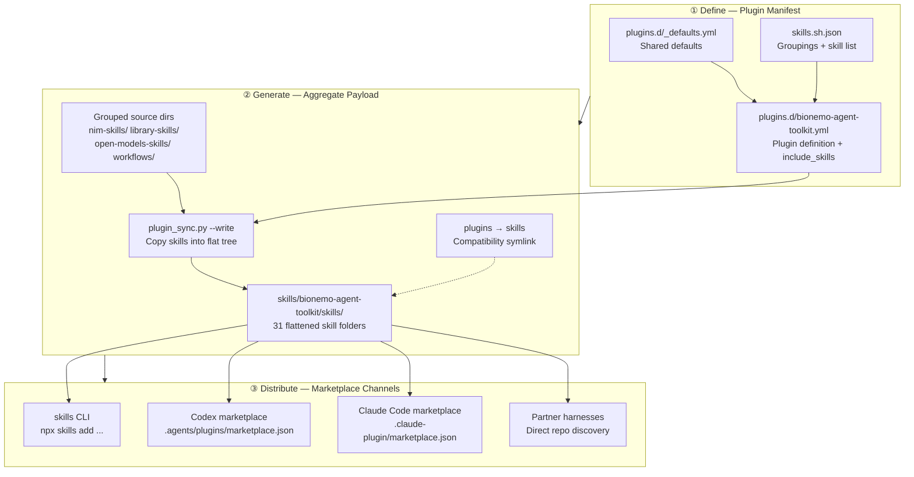
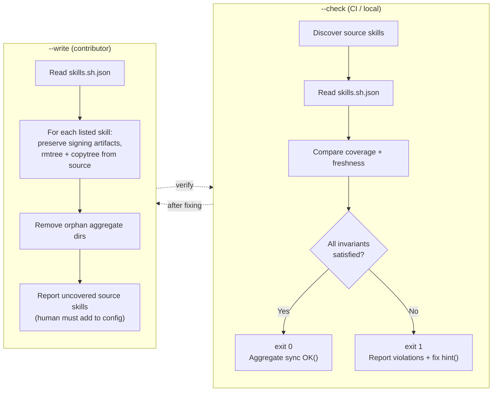
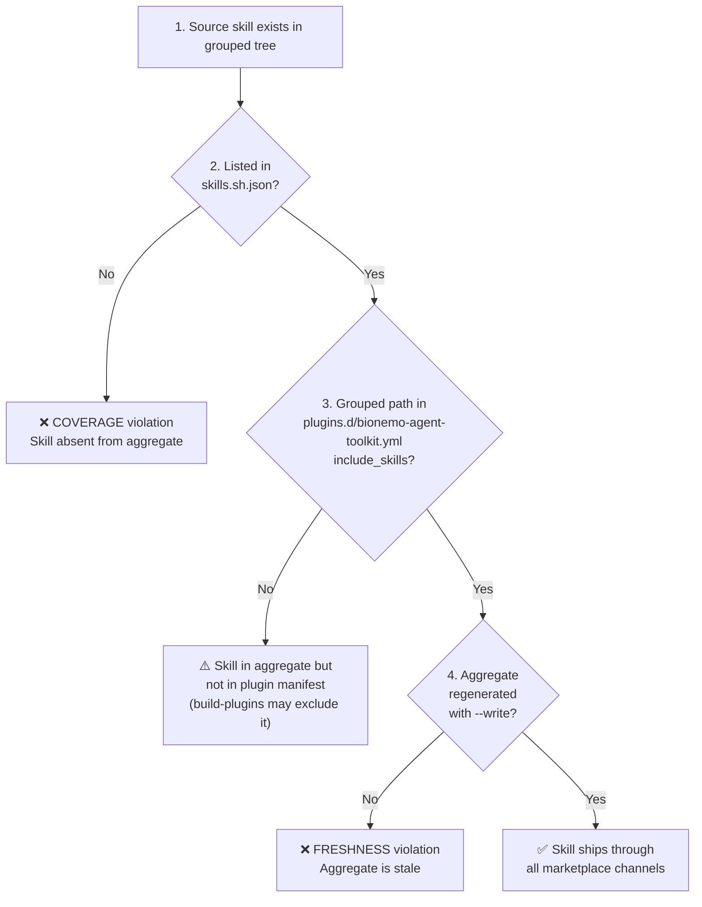

The BioNeMo Agent Toolkit reaches its users through **plugin marketplaces** — agent-native distribution channels that discover, install, and activate skills without manual file copying. This integration is not a single API call but a layered architecture spanning **plugin definition**, **aggregate payload generation**, **synchronization enforcement**, and **multi-marketplace shipping**. Understanding how these layers connect is essential for anyone contributing skills or debugging distribution failures.

## Plugin Marketplace Architecture

The integration follows a three-stage pipeline: **define** which skills ship in the plugin, **generate** a flat aggregate payload from the grouped source tree, and **distribute** that payload through multiple marketplace channels. Each stage has its own configuration artifact and validation contract.



The key insight is that **the grouped source tree and the flat aggregate are two different views of the same skills**. The grouped tree (`nim-skills/boltz2-nim/`, `open-models-skills/kermt/kermt-infer/`) is the authoring and review structure. The flat aggregate (`skills/bionemo-agent-toolkit/skills/boltz2-nim/`, `skills/bionemo-agent-toolkit/skills/kermt-infer/`) is the distributable payload that marketplaces consume. The synchronization script is the bridge that keeps them consistent.

Sources: [_defaults.yml](/plugins.d/_defaults.yml#L1-L25), [bionemo-agent-toolkit.yml](/plugins.d/bionemo-agent-toolkit.yml#L1-L45), [plugin_sync.py](/scripts/plugin_sync.py#L1-L27), [README.md](/README.md#L33-L37)

## Plugin Definition Layer — `plugins.d/`

The `plugins.d/` directory follows the **NVIDIA/skills convention** — a deliberately compatible format so that this toolkit's artifacts can drop into the upstream `NVIDIA/skills` repository if skills migrate there. The directory contains two files with a **defaults-override** relationship.

### Shared Defaults — `_defaults.yml`

Files prefixed with `_` are **includes**, not standalone plugin definitions. They provide baseline fields that every plugin inherits unless explicitly overridden. The current defaults establish:

| Field | Value | Purpose |
|-------|-------|---------|
| `version` | `1.0.0` | Plugin manifest schema version |
| `author.name` | `NVIDIA` | Organization attribution |
| `author.url` | GitHub repo URL | Author homepage link |
| `homepage` | GitHub repo URL | Plugin landing page |
| `repository` | GitHub repo URL | Source code location |
| `license` | `Apache-2.0 AND CC-BY-4.0` | Dual-license declaration |
| `brand_color` | `#76b900` | NVIDIA green for UI theming |
| `capabilities` | `Interactive`, `Write` | Agent interaction model |
| `skill_files` | `copy` | File installation strategy |

The **`skill_files: copy`** directive is a critical architectural choice. It means each curated skill is **rsync'd as real files** into the plugin tree, which is required for Codex local installs. The alternative — `symlink` — would link back to the canonical grouped directories, saving disk space but breaking agents that expect self-contained file trees.

Sources: [_defaults.yml](/plugins.d/_defaults.yml#L1-L25)

### Plugin Manifest — `bionemo-agent-toolkit.yml`

The main plugin definition declares the **identity, categorization, and skill membership** of the toolkit. It inherits all defaults from `_defaults.yml` and adds plugin-specific fields:

```yaml
name: bionemo-agent-toolkit
description: Turn any agent into a life-science expert with NVIDIA BioNeMo skills
category: Science
keywords: [bionemo, protein-folding, molecular-docking, ...]
include_skills:
  - nim-skills/boltz2-nim/
  - nim-skills/diffdock-nim/
  - library-skills/nvmolkit-usage/
  - open-models-skills/kermt/
  - workflows/generative-protein-binder-design/
  # ... 12 grouped paths total
```

> [!TIP]
> The `include_skills` paths are **grouped paths** (e.g. `nim-skills/boltz2-nim/`), not flat `skills/<name>/` paths. This differs from the NVIDIA/skills convention. The forked `build-plugins.py` must resolve these relative to the repo root (not a fixed `skills/` root) and key the plugin-tree basename off the **last path segment**. When adding a new skill to the plugin, add its grouped path here AND to the appropriate grouping in `skills.sh.json`.

The 12 `include_skills` entries map to the 31 individual skills in the aggregate — grouped paths like `open-models-skills/kermt/` expand to 8 leaf skills (kermt-setup, kermt-infer, etc.), and `workflows/generative-protein-binder-design/` expands to 2 workflow skills.

Sources: [bionemo-agent-toolkit.yml](/plugins.d/bionemo-agent-toolkit.yml#L1-L45)

## Catalog Groupings — `skills.sh.json`

While `plugins.d/` defines *which paths* to include, `skills.sh.json` defines **how skills are organized for display and distribution** through the skills.sh registry. It follows the [skills.sh schema](https://skills.sh/schemas/skills.sh.schema.json) and declares four groupings:

| Grouping | Skill Count | Examples |
|----------|-------------|----------|
| **BioNeMo NIMs** | 12 | boltz2-nim, diffdock-nim, openfold3-nim, drug-discovery-pipeline |
| **CUDA-X Libraries** | 4 | cuequivariance, nvmolkit-usage, parabricks |
| **Open Models** | 13 | kermt-infer, kermt-finetune, complexa-design, complexa-sweep |
| **Workflows** | 2 | protein-binder-design, complexa-binder-design |

The `"notGrouped": "bottom"` setting means any skill not assigned to a grouping appears at the bottom of the listing rather than being hidden. This file is the **authoritative list** of which skills ship in the aggregate payload — a skill absent from this file will not appear in `skills/bionemo-agent-toolkit/skills/` after a `--write` sync, regardless of whether it exists in the source tree.

Sources: [skills.sh.json](/skills.sh.json#L1-L57)

## The Generated Aggregate Payload

The deployable payload lives at `skills/bionemo-agent-toolkit/skills/` — a **flat directory** containing 31 skill folders, each an exact copy of its source. This is what the marketplace ships. The structure is purely mechanical:

```
skills/bionemo-agent-toolkit/skills/
├── boltz2-nim/          # copied from nim-skills/boltz2-nim/
├── diffdock-nim/        # copied from nim-skills/diffdock-nim/
├── kermt-infer/         # copied from open-models-skills/kermt/kermt-infer/
├── nvmolkit-usage/      # copied from library-skills/nvm6olkit-usage/
├── protein-binder-design/  # copied from workflows/.../protein-binder-design/
└── ... (31 total)
```

**Never edit the aggregate directly.** It is a generated artifact — any hand-edited change will be overwritten on the next `plugin_sync.py --write` run. The source of truth is always the grouped tree. The root-level `plugins` directory is a **compatibility symlink** pointing to `skills/`, preserved during the migration from the old plugin naming convention. The sync script validates this symlink and will report an error if it drifts.

Sources: [plugin_sync.py](/scripts/plugin_sync.py#L37-L42), [README.md](/README.md#L162-L166), [CONTRIBUTING.md](/CONTRIBUTING.md#L53-L57)

## Synchronization Engine — `plugin_sync.py`

The synchronization script is the **integrity gate** between the source tree and the aggregate payload. It enforces two invariants that, together, guarantee the marketplace ships exactly what authors intended — nothing missing, nothing stale, nothing orphaned.

### The Two Invariants

| Invariant | Meaning | Violation Example |
|-----------|---------|-------------------|
| **COVERAGE** | Every distributable source skill is listed in `skills.sh.json` | A new skill added to `D `nim-skills/`(name)/` but never added to a grouping |
| **FRESHNESS** | For every listed skill, the aggregate folder is an exact copy of the source folder | A `SKILL.md` edited in source but aggregate not regenerated |

### Four Diagnostic Categories

When running `--check`, the script classifies every discrepancy into one of four categories:

| Category | Diagnosis | Human$HARUKA_PARSER_BS]Fix |
|----------|-----------|---------|
| **`[coverage]`** | Source skill exists but is not listed in `skills.sh.json` | Add the skill to the appropriate grouping (human decision) |
| **`[stale-config]`** | `skills.sh.json` lists a name with no corresponding source skill | Remove the entry from the grouping |
| **`[orphan]`** | Aggregate folder exists but is not listed in `skills.sh.json` | Remove from aggregate automatically on `--write`, or add to config |
| **`[freshness]`** | Aggregate content differs from source (SHA-256 mismatch) | Run `--write` to regenerate |

### Operational Modes



The typical7 **`--check` mode** is the CI gate — it must pass before merge. The **`--write` mode** is the contributor tool that/ to rebuild the aggregate after sourceG changes. The/ typical workflow is: edit source skill → run `--check` (see the gap) → run `--write` (fix it) → run `--check` again (confirm).

> [!TIP]
> The `--write` rebuild **preserves aggregate-only signing artifacts** (`skill.oms.sig`, `BENCHMARK.md`, `skill-card.md`) across the rmtree+copytree cycle. These files are generated& generated by the `nvskills-ci` signing service directly into the aggregate — they do not exist in source and must survive a rebuild. The `--check` mode4 mode skips them in the freshness comparison for the same reason.

Sources: [plugin_sync.py](/scripts/plugin_sync.py#L11-L27), [plugin_sync.py](/scripts/plugin_sync.py#L151-L197), [plugin_sync.py](/scripts/plugin_sync.py#L200-L252)

## Multi-Marketplace Distribution Channels

The@ The toolkit ships through **four@ four distinct distribution channels**, each@ each targeting a different agent ecosystem. The aggregate payload is the singleB single shared artifact — all channels consume the same `skills/bionemo-agent-toolkit/skills/` directory.

| Channel | Install Command | Integration6 Mechanism | Audience |
|---------|----------------|----------------------"------|----------|
| **skills CLI** | `npx skills add NVIDIA-BioNeMo/bionemo-agent-toolkit` | Vercel skills.sh registry + SKILL1D format | Any agent supportingD portable `SKILL.md` |
| **Codex native** | Codex plugin marketplace flow | `.agents/plugins/marketplace.json` | OpenAI Codex users |
| **Claude Code native** | Claude Code plugin marketplace flow | `.claude-plugin/marketplace.json` | Anthropic Claude Code users |
| **Partner harnesses** | Direct repo cloning/discovery | Repository structure convention | Custom agent integrations |

### skills CLI — The Universal Installer

The `skills` CLI (from [vercel-labs/skills](https://github.com/vercel-labs/skills)) is the primary install mechanism. It supports interactive selection, single-skill installs, and agent-specific targeting:

```bash
# Interactive — browse and pick
npx skills add NVIDIA-BioNeMo/bionemo-agent-toolkit

# Single skill, no prompts
npx skills add NVIDIA-BioNeMo/bionemo-agent-toolkit --skill boltz2-nim --yes

# Agent-specific install (repeatable across agents)
npx skills add NVIDIA-BioNeMo/bionemo-agent-toolkit --skill diffdock-nim --agent claude-code
npx skills add NVIDIA-BioNeMo/bionemo-agent-toolkit --skill diffdock-nim --agent codex

# Browse without installing
npx skills add NVIDIA-BioNeMo/bionemo-agent-toolkit --list
```

### Native Marketplace Vendoring

The Codex and Claude Code marketplace JSON files are **vendored in-repo** — they ship as part of the repository itself, not as a separate package registry. This means installing the toolkit through either agent's native plugin flow requires no external registry lookup; the marketplace definition travels with the code. The skill card references both paths as verified deployment targets.

Sources: [README.md](/README.md#L16-L37), [skill-card.md](/docs/skill-card.md#L50-L53)

## Adding a Skill to the Plugin

When a new skill is authored (or a sourced skill is onboarded), it must be registered in **three places** to fully enter the plugin distribution pipeline. Missing any registration causes a specific failure mode:



| Step | File to Edit | What to Add | Failure if Missing |
|------|-------------|-------------|-------------------|
| 1 | Create source skill dir | `SKILL.md` + `evals/` + `references/` | Skill doesn't exist |
| 2 | `skills.sh.json` | Skill name to appropriate grouping | `--check` reports `[coverage]` violation |
| 3 | `plugins.d/bionemo-agent-toolkit.yml` | Grouped path to `include_skills` | `build-plugins` may not include it in the plugin tree |
| 4 | Run `plugin_sync.py --write` | Regenerate aggregate | `--check` reports `[freshness]` violation |

After registration, verify with the check gate:

```bash
python scripts/plugin_sync.py --check
# Expected: "Aggregate sync OK — N skills, payload matches source."
```

Sources: [CONTRIBUTING.md](/CONTRIBUTING.md#L30-L57), [plugin_sync.py](/scripts/plugin_sync.py#L164-L194)

## Compatibility and Migration Notes

The repository is in a **transition period** between the legacy `plugins/` naming and the current `skills/` convention. Two compatibility mechanisms are in place:

- **`plugins` symlink**: The root `plugins` directory is a symlink to `skills/`, preserving the old path for existing plugin consumers. The sync script validates this symlink in both `--check` and `--write` modes and will fail if it drifts or is removed prematurely.

- **NVIDIA/skills format compatibility**: The `plugins.d/` convention is adopted from `NVIDIA/skills` and kept intentionally compatible. The key difference is that `include_skills` uses **grouped paths** (e.g., `nim-skills/boltz2-nim/`) rather than flat `skills/<name>/` paths. The forked `build-plugins.py` resolves these relative to the repo root, and the aggregate is keyed by the last path segment.

These compat shims mean the toolkit can be consumed by both the BioNeMo-specific pipeline and the upstream NVIDIA/skills infrastructure without structural changes.

Sources: [_defaults.yml](/plugins.d/_defaults.yml#L1-L5), [bionemo-agent-toolkit.yml](/plugins.d/bionemo-agent-toolkit.yml#L21-L24), [plugin_sync.py](/scripts/plugin_sync.py#L141-L148)

## Next Steps

The plugin marketplace integration connects to several adjacent topics in the toolkit architecture. For the component registry that feeds sourced skills into the grouped tree, see [Component Registry and Sync](17-component-registry-and-sync). For the evaluation pipeline that validates skills before they enter the aggregate, see [Skill Lift Evaluation](14-skill-lift-evaluation). For the SKILL.md format that each skill in the aggregate must conform to, see [SKILL.md File Format](11-skill-md-file-format).