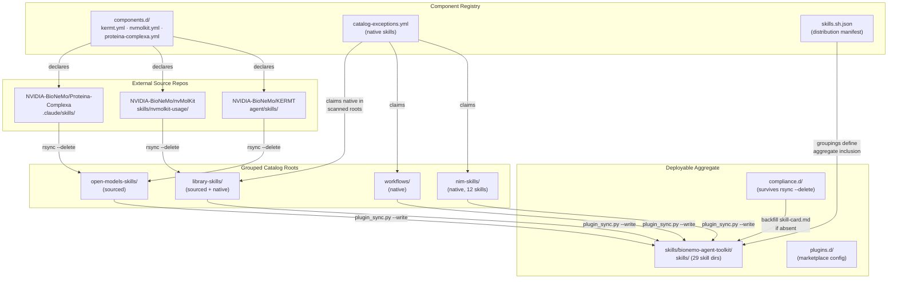

The BioNeMo Agent Toolkit is an **aggregator repository** — the majority of its skills are authored in external GitHub repositories and vendored into this repo via an automated nightly sync. The **component registry** (`components.d/`) declares which external repos to ingest, the **sync script** (`scripts/plugin_sync.py`) enforces that the distributable aggregate stays identical to source, and the **compliance vault** (`compliance.d/`) preserves artifacts that the sync's `rsync --delete` would otherwise destroy. Understanding this three-part system is essential before editing any skill in the catalog.

Sources: [CONTRIBUTING.md](/CONTRIBUTING.md#L31-L57), [scripts/plugin_sync.py](/scripts/plugin_sync.py#L1-L27)

## The Two-Class Skill Model

Every skill in the catalog exists under exactly one of two ownership classes, and this distinction determines which registry claims it and whether you may edit it in this repository:

| Property | **Sourced** | **Native** |
|---|---|---|
| Authoring location | External public GitHub repo | This repository |
| Declared in | `components.d/<slug>.yml` | `catalog-exceptions.yml` |
| Source of truth | The upstream repo | The in-repo directory |
| Editable in this repo? | **No** — rsync overwrites on next sync | Yes |
| Sync behavior | `rsync --delete` overwrites the vendored copy | Not touched by sync |
| Orphan-pruner exposure | Scanned roots are pruned; must be claimed | Native roots excluded from pruning |

A skill directory that is claimed by **neither** registry is deleted by the orphan pruner (`.github/scripts/prune-orphans.sh`). This is a hard constraint — every directory must be accounted for.

Sources: [CONTRIBUTING.md](/CONTRIBUTING.md#L40-L51), [catalog-exceptions.yml](/catalog-exceptions.yml#L1-L10)

## Component Registry — `components.d/`

Each YAML file in `components.d/` declares one **sourced** component — an external GitHub repository whose skill directories are vendored into this catalog by the nightly sync workflow. The schema is minimal and intentionally compatible with `NVIDIA/skills`:

```yaml
name: <Component Name>           # Human-readable product name
repo: <owner>/<repo>             # PUBLIC GitHub repository
ref: <branch>                    # Publishing branch to clone
skills:                          # One or more skill entries
  - path: <skills-subpath>       # Directory in the source repo containing skill(s)
    catalog_dir: <group>/<name>  # Destination under a grouped catalog root (depth-1)
```

The current registry contains three sourced components:

| File | Source Repo | Branch | Skill Path | Catalog Destination | Skills Vendored |
|---|---|---|---|---|---|
| `kermt.yml` | `NVIDIA-BioNeMo/KERMT` | `main` | `agent/skills` | `open-models-skills/kermt` | 8 skills (bulk entry) |
| `nvmolkit.yml` | `NVIDIA-BioNeMo/nvMolKit` | `main` | `skills/nvmolkit-usage` | `library-skills/nvmolkit-usage` | 1 skill |
| `proteina-complexa.yml` | `NVIDIA-BioNeMo/Proteina-Complexa` | `aggregator-compat` | `.claude/skills` | `open-models-skills/proteina-complexa` | 5 skills |

> [!TIP]
> The `catalog_dir` must be **depth-1** under its group root (e.g., `open-models-skills/kermt`, not `open-models-skills/kermt/subgroup`). This uniform depth is what makes the orphan pruner's scan logic consistent across all sourced roots. The bulk-entry form in `kermt.yml` — where a single `path` maps to a grouped `catalog_dir` containing multiple skills — is supported specifically for this repository's grouped tree convention.

Sources: [components.d/kermt.yml](/components.d/kermt.yml#L1-L16), [components.d/nvmolkit.yml](/components.d/nvmolkit.yml#L1-L10), [components.d/proteina-complexa.yml](/components.d/proteina-complexa.yml#L1-L13)

## Native Skill Registry — `catalog-exceptions.yml`

Skills authored natively in this repo cannot be declared in `components.d/` (they have no external source), so they are registered in `catalog-exceptions.yml` instead. The orphan pruner scans the **sourced roots** (`library-skills/`, `open-models-skills/`) and deletes any directory not claimed by either `components.d/` or this exceptions list. The wholly-native roots (`nim-skills/`, `workflows/`) are excluded from pruning entirely.

```yaml
exceptions:
  - dir: <catalog-path>          # Path relative to repo root
    reason: <why it exists without components.d>
    owner: <github-handle>
    component: <product-name>
```

The file documents two categories of exceptions: (1) **native roots** (`nim-skills`, `workflows`) that are never pruned and are listed purely for documentation clarity, and (2) **native skills inside scanned roots** (`library-skills/parabricks`, `library-skills/genomics-workflow-acceleration`, `library-skills/cuequivariance`) that must be listed or the pruner deletes them. These three lack a public GitHub source — Parabricks and Genomics exist only on internal GitLab, and cuEquivariance embeds its `SKILL.md` inside a Python package directory rather than exposing a clean skill folder.

Sources: [catalog-exceptions.yml](/catalog-exceptions.yml#L1-L34)

## Aggregate Manifest — `skills.sh.json`

The `skills.sh.json` file is the **distribution manifest** consumed by the skills.sh registry and marketplace tooling. It defines named groupings that control how skills appear in the plugin listing, and it is the authoritative index of which skills are included in the deployable aggregate under `skills/bionemo-agent-toolkit/skills/`.

```json
{
  "$schema": "https://skills.sh/schemas/skills.sh.schema.json",
  "groupings": [
    { "title": "BioNeMo NIMs",      "skills": ["boltz2-nim", "diffdock-nim", ...] },
    { "title": "CUDA-X Libraries",   "skills": ["cuequivariance", "nvmolkit-usage", ...] },
    { "title": "Open Models",        "skills": ["kermt-add-cmim-pretrain", ...] },
    { "title": "Workflows",          "skills": ["complexa-binder-design", ...] }
  ]
}
```

Assigning a skill to a grouping is a **human decision** — the sync script will report an uncovered skill but will not auto-add it, because choosing the correct group requires domain judgment.

Sources: [skills.sh.json](/skills.sh.json#L1-L57)

## Sync Enforcement — `plugin_sync.py`

The aggregate payload under `skills/bionemo-agent-toolkit/skills/` is a **generated copy** of the source skills. Because nothing in the repo regenerates it automatically, it can silently drift — a skill added to source but never reflected in the aggregate, or a source edit that never propagates. The sync script (`scripts/plugin_sync.py`) closes this gap by enforcing two invariants:

1. **COVERAGE** — every distributable source skill is listed in `skills.sh.json`.
2. **FRESHNESS** — for every listed skill, the aggregate skill folder is a byte-identical copy of the source skill folder (SHA-256 comparison, including `evals/`).

The script operates in two mutually exclusive modes:

| Mode | Flag | Purpose | Auto-fix? |
|---|---|---|---|
| **Check** | `--check` | CI + local verification; exits non-zero if out of sync | No — reports only |
| **Write** | `--write` | Rebuilds the aggregate payload from source + manifest | Partial — fixes freshness, not coverage |

### Check Mode Diagnostics

When run with `--check`, the script performs four distinct audits and reports any violations with tagged prefixes:

| Tag | Audit | What it catches |
|---|---|---|
| `[coverage]` | Source skill not in `skills.sh.json` | A new skill exists in source but was never added to a grouping |
| `[stale-config]` | Listed name has no source skill | A grouping references a skill that no longer exists |
| `[orphan]` | Aggregate folder not in `skills.sh.json` | A payload directory with no manifest entry |
| `[freshness]` | Source ≠ aggregate (byte-level) | File missing, extra, or content-differing between source and payload |
| `[compatibility]` | `plugins` symlink drift | The `plugins → skills` compatibility symlink points to the wrong target |

### Write Mode Behavior

The `--write` mode rebuilds each listed skill in the aggregate by removing the old copy and replacing it with `shutil.copytree` from source. It handles two critical edge cases:

- **Aggregate-only artifacts** (`skill.oms.sig`, `BENCHMARK.md`, `skill-card.md`) are **preserved** across the rebuild — these are generated by the NVSkills signing/eval pipeline directly into the aggregate and are never authored in source. Wiping them would invalidate signatures and break Tier 3 eval gates.
- **Orphan removal** — aggregate folders not listed in the manifest are deleted.
- **Coverage gaps are not auto-fixed** — uncovered source skills are reported but not added to the aggregate, because group assignment requires human judgment.

> [!TIP]
> When running `--write`, always run `--check` first. The write mode silently skips skills listed in `skills.sh.json` that have no source directory (stale-config), which can mask manifest errors if not checked independently.

Sources: [scripts/plugin_sync.py](/scripts/plugin_sync.py#L1-L27), [scripts/plugin_sync.py](/scripts/plugin_sync.py#L151-L197), [scripts/plugin_sync.py](/scripts/plugin_sync.py#L200-L252)

## Compliance Vault — `compliance.d/`

The nightly sync uses `rsync --delete` when vendoring sourced skills, which means any file committed directly into a sourced catalog directory is **destroyed on the next sync run**. The `compliance.d/` directory sits outside every rsync target and every prune root, providing a safe haven for compliance artifacts — specifically `skill-card.md` files — that must survive sync cycles.

The backfill mechanism is simple and self-retiring:

```
compliance.d/<catalog_dir>/<skill>/skill-card.md
   ↓ copied after rsync, ONLY if no card exists at the destination
<catalog_dir>/<skill>/skill-card.md
```

Once an upstream source repo ships its own `skill-card.md`, the rsync delivers it to the catalog and the backfill becomes a no-op — no flag to flip, no coordination needed. The sync PR body reports both states: **backfilled** (upstream still owes a card) and **retirable** (upstream now ships its own card, so the `compliance.d` entry is dead weight).

Two artifact types are explicitly **excluded** from `compliance.d/`:

- **`skill.oms.sig`** — cryptographic signatures are valid only over the exact bytes they were generated from. Copying a signature onto different content produces a verification failure, and `NVIDIA/skills`' sync detects and reverts this.
- **Evals** — eval definitions must be co-located with the skill in its source repo (`SRC-10`), because `rsync --delete` would wipe catalog-only evals on the next run.

Sources: [compliance.d/README.md](/compliance.d/README.md#L1-L53)

## Sync Lifecycle — End-to-End Flow

The following diagram traces the complete path from source repositories to the deployable aggregate, showing all registry and validation touchpoints:



Sources: [CONTRIBUTING.md](/CONTRIBUTING.md#L31-L57), [scripts/plugin_sync.py](/scripts/plugin_sync.py#L36-L55)

## Source Compatibility Requirements

For a skill to be cleanly ingestible by the sync, its source repository must satisfy the `SRC-*` requirements defined in `CONTRIBUTING.md`. Hard requirements (`SRC-1/3/4`) break the sync or corrupt the vendored copy if violated; structure requirements (`SRC-2/5/6/7/8/9`) affect catalog quality; and compliance requirements (`SRC-10/11`) are enforced by `NVIDIA/skills` but currently tolerated by this toolkit.

| Tag | Category | Requirement | Current Violations |
|---|---|---|---|
| SRC-1 | Hard | Public GitHub repo | Parabricks, Genomics (GitLab only) |
| SRC-3 | Hard | Self-contained skill directory with `SKILL.md` | cuEquivariance (embedded in package dir) |
| SRC-4 | Hard | No references outside the vendored subtree | Proteina-Complexa `complexa-sweep` references `../../../docs/SWEEP.md` |
| SRC-2 | Structure | Skills under one stable subpath (ideally `skills/`) | All three repos use non-canonical paths |
| SRC-5 | Structure | `ref` is the current publishing branch | Proteina-Complexa pinned to `aggregator-compat` not `dev` |
| SRC-10 | Compliance | Co-located `evals/evals.json` per skill | No sourced component ships evals upstream |

This toolkit is **tolerant**: it syncs skills that don't yet meet the full SRC set and records gaps in `docs/sync-findings.md` for upstream remediation. `NVIDIA/skills` **enforces** the full set, so aim for full compliance to ensure a skill is ingestible by both.

Sources: [CONTRIBUTING.md](/CONTRIBUTING.md#L72-L105), [docs/sync-findings.md](/docs/sync-findings.md#L1-L63)

## Plugin Marketplace Configuration — `plugins.d/`

The `plugins.d/` directory configures how the toolkit is packaged for plugin marketplaces (Claude Code, Codex). It contains two files:

- **`_defaults.yml`** — shared defaults (version, author, homepage, license, brand color, capabilities) applied to every plugin. The `skill_files: copy` directive ensures real files are rsynced into the plugin tree (required for Codex local install), as opposed to symlinks back to the canonical grouped directories.
- **`bionemo-agent-toolkit.yml`** — the plugin definition with curated `include_skills` paths pointing to grouped catalog directories (not the flat aggregate). This file inherits all defaults from `_defaults.yml` and adds plugin-specific metadata (display name, description, category, keywords).

Sources: [plugins.d/_defaults.yml](/plugins.d/_defaults.yml#L1-L25), [plugins.d/bionemo-agent-toolkit.yml](/plugins.d/bionemo-agent-toolkit.yml#L1-L45)

## Operational Commands

The following commands are the day-to-day interface for maintaining sync integrity:

| Command | When to Use | What It Does |
|---|---|---|
| `python scripts/plugin_sync.py --check` | CI, pre-merge, local verification | Reports coverage gaps, freshness drift, orphan payloads, symlink problems |
| `python scripts/plugin_sync.py --write` | After adding a skill to `skills.sh.json` | Rebuilds the aggregate from source; preserves signing artifacts; removes orphans |

### Adding a New Sourced Skill

1. Create `components.d/<slug>.yml` declaring the source repo, branch, skill path, and catalog destination.
2. Verify the source repo meets `SRC-*` requirements (check `docs/sync-findings.md` for known gaps).
3. Add each skill name to the appropriate grouping in `skills.sh.json`.
4. Run `python scripts/plugin_sync.py --check` to verify coverage.
5. Run `python scripts/plugin_sync.py --write` to rebuild the aggregate.
6. If the source repo doesn't yet ship `skill-card.md`, add one under `compliance.d/<catalog_dir>/<skill>/`.
7. Commit and open a PR.

### Adding a New Native Skill

1. Create the skill directory under the appropriate root (`nim-skills/`, `workflows/`, or a scanned root).
2. If the skill is inside a **scanned root** (`library-skills/`, `open-models-skills/`), add an entry to `catalog-exceptions.yml` with a documented reason and owner.
3. Add the skill name to a grouping in `skills.sh.json`.
4. Run `python scripts/plugin_sync.py --write` to include it in the aggregate.
5. Commit and open a PR.

Sources: [CONTRIBUTING.md](/CONTRIBUTING.md#L59-L70), [scripts/plugin_sync.py](/scripts/plugin_sync.py#L255-L266)

## Next Steps

With the registry and sync architecture understood, the natural progression is toward the compliance model that governs what can be distributed and how security is enforced:

- **[Compliance and Security Model](18-compliance-and-security-model)** — the NVCARPS tiers, `SRC-10/11` enforcement, signing workflow, and the security boundary between sourced and native skills.
- **[Plugin Marketplace Integration](16-plugin-marketplace-integration)** — how `plugins.d/` drives the build pipeline that packages the aggregate into Claude Code and Codex marketplace payloads.
- **[Skill Lift Evaluation](14-skill-lift-evaluation)** — the evaluation gate that validates the aggregate payload before it can be signed and distributed.