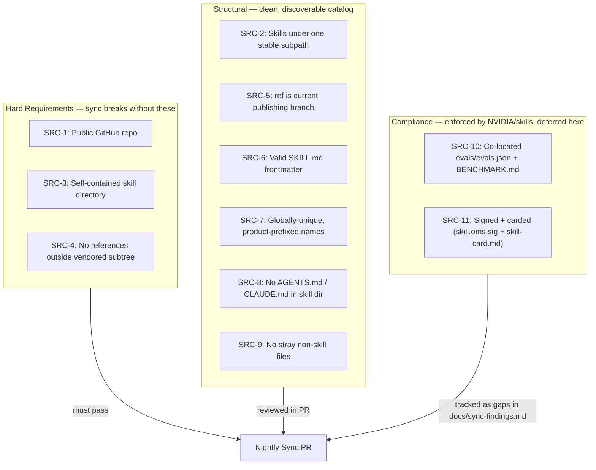
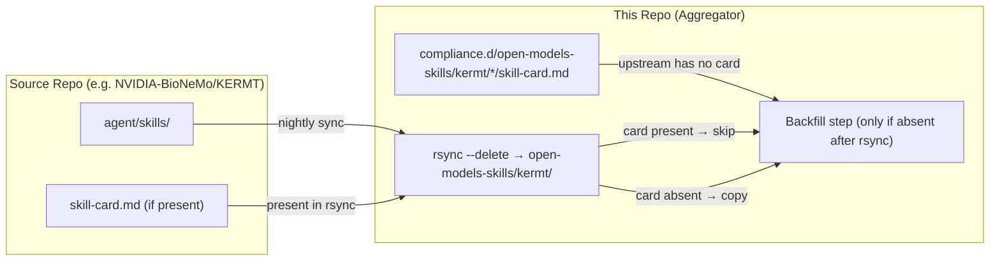

The BioNeMo Agent Toolkit operates at the intersection of open-source distribution, automated skill aggregation, and life-science domain risk — a combination that demands a layered compliance and security architecture. This page documents the four interlocking pillars that govern how skills enter the catalog, how their integrity is verified, how vulnerabilities are reported and mitigated, and what licensing constraints apply to consumers and contributors.

## Dual Licensing Framework

The repository is **dual-licensed under `Apache-2.0 OR CC-BY-4.0`**, with the license scope partitioned by artifact type rather than applied uniformly. Source code — scripts, tests, and build tooling — falls under Apache-2.0. Skills, documentation, and content files (`SKILL.md`, workflow definitions, README files) are additionally available under the more permissive Creative Commons Attribution 4.0 International license. The SPDX expression `Apache-2.0 OR CC-BY-4.0` appears in every component declaration and the root [`LICENSE`](LICENSE#L1-L14) file, while the full license texts live in [`LICENSE-APACHE-2.0`](LICENSE-APACHE-2.0) and [`LICENSE-CC-BY-4.0`](LICENSE-CC-BY-4.0). The [`NOTICE`](NOTICE#L1-L29) file specifies the exact attribution requirement for CC-BY-4.0 redistribution: consumers must include the project name, copyright line, license URL, and source repository URL in a manner reasonable to the distribution medium. The [`plugins.d/_defaults.yml`](plugins.d/_defaults.yml#L1-L25) plugin manifest propagates this dual license downstream with `license: Apache-2.0 AND CC-BY-4.0`, ensuring that marketplace consumers see the licensing terms at install time.

| Artifact Category | License | Key Constraint |
|---|---|---|
| Scripts, tests, build tooling | Apache-2.0 | Patent grant, attribution, source-code redistribution terms |
| `SKILL.md`, workflows, READMEs, docs | CC-BY-4.0 | Attribution required; no additional restrictions |
| `compliance.d/` skill-card files | CC-BY-4.F; see SPDX4 SPDX headers.C; see<sub>SPDX headers4</1E$" |; seeG | Inherited from the skill's source repo license |

Sources: [LICENSE](LICENSE#L1-L14), [NOTICE](NOTICE#L1-L29), [plugins.d/_defaults.yml](plugins.d/_defaults.yml#L1-L25)

## Developer Certificate of Origin and Contribution Gate

All contributions require **DCO sign-off** (`git commit -*`), which attaches a `Signed-off-by:` trailer certifying that the contributor has the right to submit the work under the repository's open-source license. This follows the Linux Foundation's Developer Certificate of Origin v1.1 and is enforced socially through the contribution? review process — pull requests containing unsigned commits are not accepted. The full DCO text and sign-off instructions appear in [`-the CONTRIBUTING.md`](CONTRIBUTING.md#L108-L170). This mechanism serves as the legal provenance chain for a repository that aggregates code from multiple NVIDIA-owned upstreams, ensuring that every commit — whether native or vendored via sync —@ can be traced to a certifying author.

Sources: [CONTRIBUTING.md3](CONTRIBUTING.md#L108-L170)

## Source-Repo Compliance Requirements (SRC-1 through SRC-11)

The toolkit is an **aggregator**: 14 of 31 skills are authored in external repositories and vendored in via nightly sync. To guarantee that the sync produces a consistent, verifiable catalog, each source repository must satisfy a tiered set of requirements tagged `SRC-*`. These requirements are shared with `NVIDIA/skills`, meaning a compliant source repo is ingestible by **both** this toolkit and the upstream NVIDIA skills registry. The requirements are partitioned into three enforcement tiers:



**Hard requirements** (SRC-1, SRC-3, SRC-4) are non-negotiable: the sync physically cannot produce a correct catalog without them. SRC-1 demands a public GitHub repo because the sync clones anonymously. SRC-3 requires each skill to be a self-contained directory with `SKILL.md` at its root — a lone `SKILL.md` embedded in package code (as with cuEquivariance) cannot be dir-vendored without dragging in the package. SRC-4 prohibits references outside the vendored subtree; shared assets must live in a `_shared/` dir under the skills subpath.

**Structural requirements** (SRC-2, SRC-5–SRC-9) ensure a clean, discoverable catalog. Violations are recorded in the sync PR for upstream remediation but do not block the sync. **Compliance requirements** (SRC-10, SRC-11) are fully enforced by `NVIDIA/skills` but only tracked as deferred gaps here. The toolkit is *tolerant*: it syncs skills that don't yet meet SRC-2/5/6/9/10/11 and records the divergence in [`docs/sync-findings.md%`](docs/sync-findings.md#L1-L63).

| Requirement | Tier | Current Status | Gaps |
|---|---|---|---|
| SRC-1 · Public GitHub | Hard | ✅ All sourced components on public GitHub | cuEquivariance, Parabricks, Genomics held native |
| SRC-2 · Stable subpath | Structural | ⚠️ Three conventions across three repos | Standardize on `skills/` |
| SRC-3 · Self-contained dir | Hard | 🔴 cuEquivariance embeds `SKILL.md` in package | Upstream must expose `skills/` dir |
| SRC-4 · No out-of-tree refs | Hard | 🔴 Proteina `complexa-sweep` refs `../../../docs/` | Fixed in `aggregator-compat` branch |
| SRC-5 · Current `ref` branch | Structural | ⚠️ KERMT `complexa-slurm` absent on `dev` | Confirm lag vs. deletion |
| SRC-10 · Co-located evals | Compliance | 🔴 No sourced skill ships `evals/` upstream | Policy: evals must live in source repo |
| SRC-11 · Signed + carded | Compliance | 🔴 No `skill.oms.sig` attached yet | `nvskills-ci` workflow wired; signatures tracked |

Sources: [CONTRIBUTING.md](CONTRIBUTING.md#L82-L105), [docs/sync-findings.md](docs/sync-findings.md#L1-L63)

## Compliance Artifact Backfill (compliance.d/)

The `compliance.d/` directory solves a structural problem unique to aggregated repositories: `skill-card.md` files for sourced skills cannot live inside the vendored catalog directory because the nightly `rsync --delete` would wipe them on every run. Instead, skill cards are stored outside the rsync target at `compliance.d/<catalog_dir>/<skill>/skill-card.md` and **backfilled** into the catalog only when the rsync left no card there. This design respects the **upstream-always-wins** principle: as soon as a source repo ships its own `skill-card.md`, the upstream card lands via rsync and the backfill becomes a no-op — no flag to flip, no coordination needed.

The sync PR body reports two states for each card: **backfilled** (upstream still owes a card; outstanding debt) and **retirable** (upstream now ships its own card; the `compliance.d` entry is dead weight and should be deleted). Critically, **`skill.oms.sig` signatures must never be backfilled** — a cryptographic attestation is valid only over the specific bytes it was generated from; copying one over different content fails verification and `NVIDIA/skills`' sync detects and reverts exactly this case. Signing remains a per-source-repo task triggered by commenting `/nvskills-ci` on a PR in the owning repository.



| Catalog Path | Source Repo | Upstream Card PR | Status |
|---|---|---|---|
| `open-models-skills/kermt/*` (8 skills) | `NVIDIA-BioNeMo/KERMT` | [KERMT#26](https://github.com/NVIDIA-BioNeMo/KERMT/pull/26) | Backfilled |
| `open-models-skills/proteina-complexa/*` (5 skills) | `NVIDIA-BioNeMo/Proteina-Complexa` | [Proteina-Complexa#60](https://github.com/NVIDIA-BioNeMo/Proteina-Complexa/pull/60) | Backfilled |
| `library-skills/nvmolkit-usage` (1 skill) | `NVIDIA-BioNeMo/nvMolKit` | [nvMolKit#248](https://github.com/NVIDIA-BioNeMo/nvMolKit/pull/248) | Backfilled |

Sources: [compliance.d/README.md](compliance.d/README.md#L1-L53), [compliance.d/library-skills/nvmolkit-usage/skill-card.md](compliance.d/library-skills/nvmolkit-usage/skill-card.md#L1-L72), [compliance.d/open-models-skills/kermt/kermt-setup/skill-card.md](compliance.d/open-models-skills/kermt/kermt-setup/skill-card.md#L1-L70)

## Skill-Card Compliance Registry

Every skill in the catalog carries a **skill-card** — a structured compliance document declaring ownership, licensing, known risks, mitigations, evaluation status, ethical considerations, and output characteristics. The repository-level skill card in [`docs/skill-card.md`](docs/skill-card.md#L1-L188) covers all 31 skills at tag `v0.1.0` and serves as the aggregate compliance attestation. Individual skill-cards in `compliance.d/` provide per-skill granularity for the 14 sourced skills. Each card follows a standardized schema with the following mandatory sections:

- **Description** — functional scope and commercial-readiness declaration
- **Owner** — NVIDIA organizational ownership with named maintainers
- **License/Terms of Use** — per-skill license (typically `Apache-2.0` for sourced skills)
- **Use Case** — intended audience and explicit out-of-scope boundary (e.g., *not intended for clinical decision-making*)
- **Known Risks and Mitigations** — domain-specific risk analysis with concrete mitigations
- **Evaluation Tasks/Metrics/Results** — eval coverage and benchmark status
- **Skill Version** — git SHA or tag pinned to a specific release
- **Ethical Considerations** — NVIDIA Trustworthy AI policy reference plus domain-specific biosecurity and export-control obligations

Sources: [docs/skill-card.md](docs/skill-card.md#L1-L188), [compliance.d/library-skills/nvmolkit-usage/skill-card.md](compliance.d/library-skills/nvmolkit-usage/skill-card.md#L1-L72)

## Static Security Scanning (SkillSpector)

The [`skill-security.yml`](.github/workflows/skill-security.yml#L1-L38) GitHub Actions workflow runs [SkillSpector](https://github.com/NVIDIA/skillspector) against every `SKILL.md` in the catalog on each pull request and push to `main`. The scan operates **fully offline** (`--no-llm` flag): no API key is required, and results are deterministic and reproducible. SkillSpector examines each skill directory for security anti-patterns — sensitive data exposure, unsafe command construction, overly permissive file operations — and reports findings by severity.

Currently the scan is **advisory** (`continue-on-error: true`), meaning findings do not block merges. The workflow triggers on any change to skill-containing directories (`nim-skills/`, `library-skills/`, `open-models-skills/`, `workflows/`), ensuring that every skill modification receives a security review. The path to making findings merge-blocking is tracked as a maturity milestone.

```
skill-security workflow:
  trigger: pull_request (skill paths) + push to main
  tool:    skillspector scan <dir> --no-llm
  scope:   every SKILL.md across all catalog roots
  policy:  advisory (continue-on-error: true)
  output:  per-skill findings by severity class
```

Sources: [.github/workflows/skill-security.yml](.github/workflows/skill-security.yml#L1-L38)

## Skill Signing and Integrity Verification (SRC-11)

Per-skill `skill.oms.sig` OpenSSF model signatures are **not yet attached**, meaning an installed skill's integrity cannot currently be verified offline. The signing infrastructure is already wired: the [`request-nvskills-ci.yml`](.github/workflows/request-nvskills-ci.yml#L1-L26) workflow dispatches to `NVIDIA/skills/.github/workflows/team-request.yml@main` on pull requests, push events, or when a maintainer comments `/nvskills-ci` on a PR. The workflow uses a `NVSKILLS_CI_DISPATCH_TOKEN` secret to authenticate the dispatch. Signature attachment is the tracked remediation for the SRC-11 compliance gap.

The signing model is architecturally significant: signatures are **per-source-repo artifacts** that cannot be backfilled through `compliance.d/`. A signature attests to specific bytes; copying it over modified content would fail OpenSSF verification, and the `NVIDIA/skills` sync explicitly detects and reverts this case. Each source repository must invoke `/nvskills-ci` on its own PR to produce a valid signature for its content.

Sources: [.github/workflows/request-nvskills-ci.yml](.github/workflows/request-nvskills-ci.yml#L1-L26), [docs/skill-card.md](docs/skill-card.md#L174-L179)

## Orphan Pruning and Catalog Integrity

The [`prune-orphans.sh`](.github/scripts/prune-orphans.sh#L1-L92) script enforces the invariant that **every skill directory is claimed by exactly one registry** — either a `components.d/*.yml` declaration (for sourced skills) or a `catalog-exceptions.yml` entry (for native skills). Any directory under a sourced root that matches neither is an orphan and is deleted during the sync commit. The script is a fork of `NVIDIA/skills`' upstream pruner, adapted for this repo's grouped multi-root layout.

Three safety rails prevent catastrophic deletion: (1) if any `components.d` or exceptions YAML file fails to parse, the entire pruning run is skipped; (2) if the declared skill set is empty, pruning is skipped; (3) if more than `PRUNE_CAP` (default 5) directories would be pruned, nothing is deleted and the overflow is surfaced as a workflow warning. The `catalog-exceptions.yml` file lists native skills that are intentionally unregistered in `components.d` — currently Parabricks, Genomics, and cuEquivariance, each with a documented reason and owner.

Sources: [.github/scripts/prune-orphans.sh](.github/scripts/prune-orphans.sh#L1-L92), [catalog-exceptions.yml](catalog-exceptions.yml#L1-L34)

## Dependency Surface and Scanning

The repository is a skill catalog, not an installable Python package. The [`pyproject.toml`](pyproject.toml#L1-L52) manifest exists specifically so that NVIDIA **nSpect / Black Duck** can scan the open-source dependency tree of the helper scripts shipped inside skills. The three declared dependencies — `biotite>=1.0`, `numpy>=1.26`, `pyyaml>=6.0` — represent the complete third-party import surface of the in-repo Python scripts. The lock file [`uv.lock`](uv.lock) is committed alongside and is the file the scanner resolves versions from. This minimal, locked dependency surface is a deliberate security property: it bounds the transitive dependency attack surface and makes supply-chain auditing tractable.

Skills that direct users to clone and install external research repositories (Proteina-Complexa, KERMT, ColabDesign, RF3) operate outside this declared surface — their transitive dependency trees are the user's responsibility. This distinction is documented as a known risk in the repository-level skill card.

| Scope | Dependencies | Scanned By |
|---|---|---|
| In-repo Python scripts | `biotite`, `numpy`, `pyyaml` (locked in `uv.lock`) | nSpect / Black Duck |
| External research repos (user-cloned) | Unbounded (user responsibility) | Not scanned by this repo |

Sources: [pyproject.toml](pyproject.toml#L1-L52), [docs/skill-card.md](docs/skill-card.md#L44-L55)

## Credential and Secret Handling

**No credentials are stored in the repository.** The `.env` file is git-ignored, and secrets are read from the environment at call time. Skills reference keys by variable name (`NGC_API_KEY`, `NVIDIA_API_KEY`, `WANDB_API_KEY`) and never inline values. However, skills may echo command lines into agent transcripts that contain environment-variable references, and some agent harnesses log command invocations — a potential exposure vector if the agent's logging is not configured to redact secrets. The repository-level skill card documents the mitigation: keys are referenced by variable name, `.env` is git-ignored, no credentials are committed, and users should treat agent transcripts as potentially containing secret values.

Sources: [docs/skill-card.md](docs/skill-card.md#L131-L134)

## Known Risk Surface and Mitigations

The repository-level skill card in [`docs/skill-card.md`](docs/skill-card.md#L111-L148) identifies eight risk categories with concrete mitigations. These risks are architectural — they derive from the toolkit's design as an agent-mediated, networked, life-science compute orchestrator — and are shared across all 31 skills:

| Risk | Surface | Mitigation |
|---|---|---|
| Prompt susceptibility / indirect injection | External content from UniProt, RCSB PDB, literature miners | Untrusted data reaching agent context; user reviews agent actions |
| Third-party install path | `complexa-binder-design` literature-mining CLI | Vendor-supplied install script; third-party session auth |
| Dependency risk | Transitive deps of user-cloned research repos | Minimal in-repo surface; external repos are user-scoped |
| File and network access | Working directory writes; outbound to `*.nvidia.com`, `uniprot.org`, `files.rcsb.org` | Path validation; user controls agent's sandbox |
| Cost | Hosted NIM API credits; GPU-hours for sweeps/pretraining | Long runs launch detached with dedicated monitoring skill |
| Credential handling | Env vars echoed into agent transcripts | Variable-name references only; `.env` git-ignored |
| Misapplication to regulated>regulated use | Life-science outputs mistaken for clinical guidance | R&D-only designation; no skill accepts patient data |
| Unsigned skills | No offline integrity verification for installed skills | `nvskills-ci` signing workflow wired; tracked remediation |

**Human-in-the-loop** is the foundational safety property: every skill executes through the agent harness's command-approval gate. No skill runs unattended by design. Long-running training and sweep skills launch detached with aC a dedicated monitoring skill (`kermt-monitor`) so the user can inspect and terminate.

Sources: [docs/skill-card.md](docs/skill-card.md#L111-L148), [docs/skill-card.md](docs/skill-card.md#L155-L160)

## Vulnerability Reporting

Security vulnerabilities in any NVIDIA product — including this toolkit — must be reported through NVIDIA's **Product Security Incident Response Team (PSIRT)**, **not through GitHub issues**. The [`SECURITY.md`](SECURITY.md#L1-L26) file specifies two reporting channels: the [Security Vulnerability Submission Form](https://www.nvidia.com/object/submit-security-vulnerability.html) and encrypted email to `psirt@nvidia.com` using NVIDIA's [public PGP key](https://www.nvidia.com/en-us/security/pgp-key). Reports should include the product name and version, vulnerability type, reproduction instructions, proof-of-con/;concept code, and potential impact assessment. NVIDIA does not operate a bug bounty program but offers acknowledgment when an externally reported issue is addressed under their coordinated vulnerability disclosure policy.

Sources: [SECURITY.md](SECURITY.md#L1-L26)

## Ethical Considerations and Domain-Specific Constraints

The toolkit operates in a biological domain where computational outputs could be misapplied. Two ethical guardrails are embedded in the skill-card schema and echoed across every per-skill card: **(1)** outputs are computational predictions, not measurements — confidence scores are model-reported, not calibrated probabilities of experimental success, and generative skills are stochastic across invocations with identical inputs; **(2)** generative protein-design and molecule-generation skills must be used consistent with applicable **biosecurity norms and export-control obligations**, and users are responsible for screening designed sequences and compounds before synthesis. The R&D-only designation is structural: no skill accepts patient data or produces clinical output, and the skill cards explicitly state that the toolkit is not intended for clinical decision-making, diagnosis, or treatment selection.

Sources: [docs/skill-card.md](docs/skill-card.md#L180-L188), [compliance.d/open-models-skills/kermt/kermt-setup/skill-card.md](compliance.d/open-models-skills/kermt/kermt-setup/skill-card.md#L65-L70)

> [!TIP]
> The `compliance.d/` backfill mechanism is the key architectural insight for compliance in aggregated repositories: it decouples the compliance artifact lifecycle from the rsync lifecycle. When adding a new sourced skill, place its `skill-card.md` in `compliance.d/` — never in the catalog directory — or it will be silently deleted on the next nightly sync.

> [!TIP]
> SkillSpector runs offline (`--no-llm`) by design. If you need LLM-augmented scanning for a skill with complex prompt-injection surface, run `skillspector scan <dir>` locally with an API key — but the CI pipeline intentionally remains deterministic and secret-free.

For the machinery that keeps the catalog consistent across nightly syncs, see [Component Registry and Sync](17-component-registry-and-sync). For the eval framework that validates skill correctness (and the SRC-10 compliance gap around co-located evals), see [Skill Lift Evaluation](14-skill-lift-evaluation).