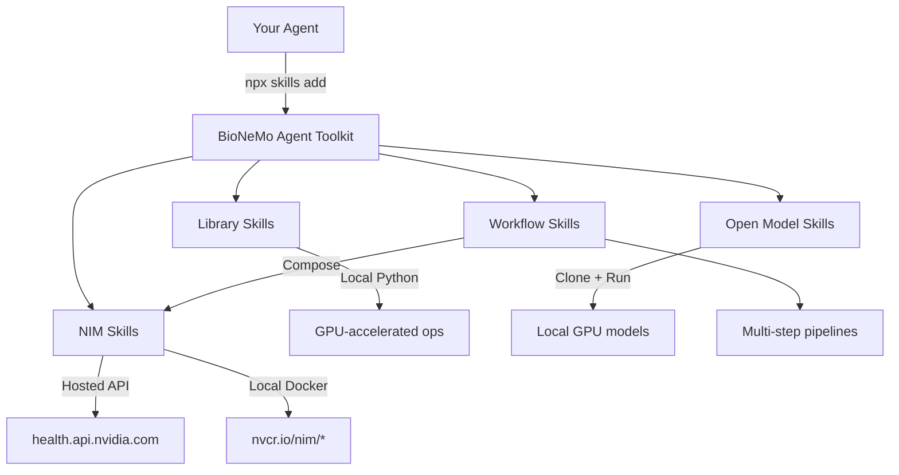
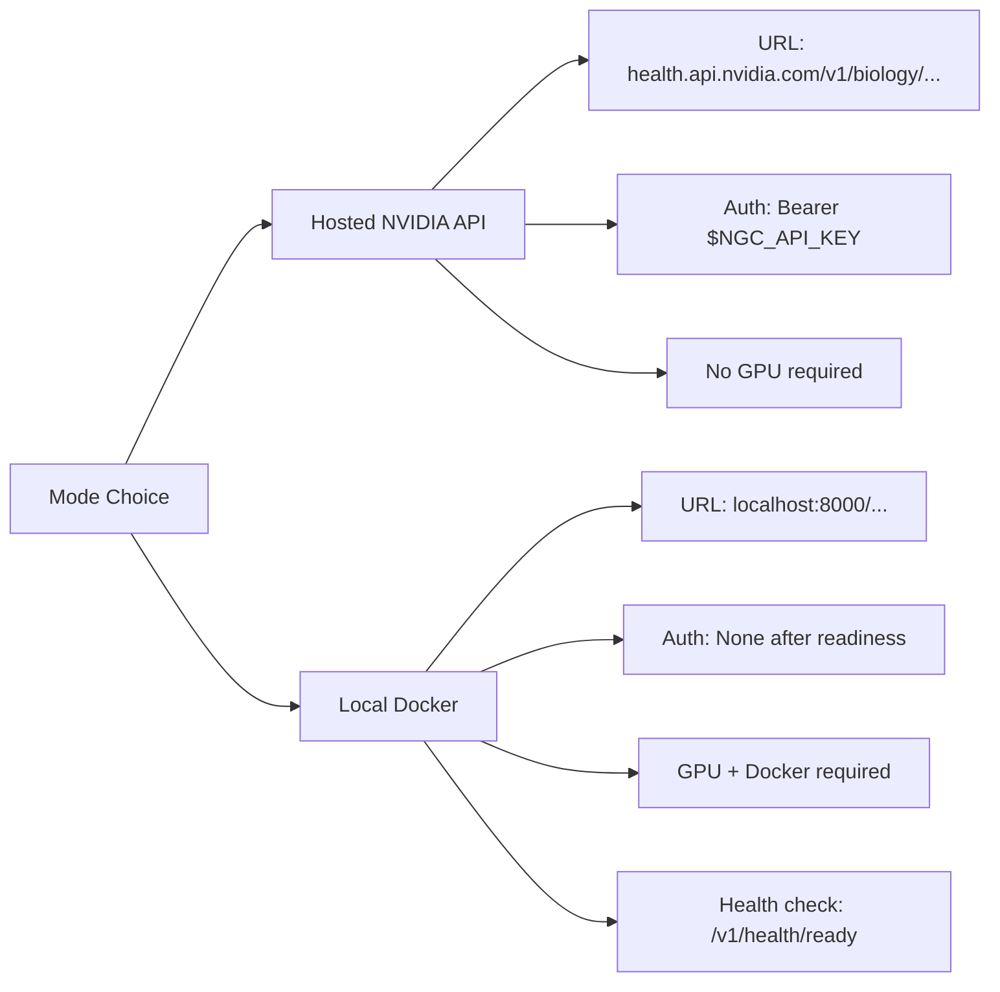
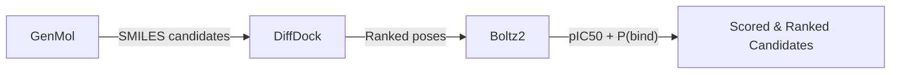

Get a life-science-capable agent running in under five minutes. The NVIDIA BioNeMo Agent Toolkit packages **31 ready-to-call skills** — protein folding, molecular docking, generative chemistry, genomics, protein design, and more — into structured instructions any coding agent can follow. Each skill carries the domain knowledge a general-purpose agent lacks: endpoint contracts, input preparation, parameter selection, output interpretation, and validation checks. You express intent in scientific terms; the skill translates that into correct API calls.


Sources: [README.md](/README.md#L1-L177), [docs/skill-card.md](/docs/skill-card.md#L1-L188)

## Prerequisites

Before installing skills, confirm your environment meets these baseline requirements:

| Requirement | Purpose | When Needed |
|---|---|---|
| **Agent harness** (Claude Code, Codex, or any `SKILL.md`-compatible agent) | Reads and executes skill instructions | Always |
| **`NGC_API_KEY`** (or `NVIDIA_API_KEY`) | Authenticates to hosted NVIDIA NIM endpoints on `health.api.nvidia.com` | Any hosted NIM skill call |
| **Docker + NVIDIA Container Toolkit** | Runs self-hosted NIM containers, Parabricks, or KERMT | Local NIM deployment, Parabricks, open-model skills |
| **NVIDIA GPU** | GPU-accelerated local inference | Parabricks, nvMolKit, cuEquivariance, KERMT, Proteina-Complexa; **not** needed for hosted-NIM paths |
| **Python ≥ 3.10** with `biotite`, `numpy`, `pyyaml` | Binder-design helper scripts | Protein binder design workflows |

> [!TIP]
> Hosted NIM paths require only an `NGC_API_KEY` and an HTTP client — no local GPU, no Docker. Start with hosted mode to validate your workflow before investing in local deployment.

Sources: [README.md](/README.md#L13-L32), [pyproject.toml](/pyproject.toml#L1-L52), [docs/skill-card.md](/docs/skill-card.md#L33-L48)

## Install a Skill

Skills install through the [`skills` CLI](https://github.com/vercel-labs/skills) — a lightweight `npx`-based tool that copies structured skill directories into your agent's configuration. The toolkit also ships native plugin marketplaces for **Claude Code** and **Codex**, so skills are discoverable through each agent's built-in plugin flow as well.

### Interactive Install (Recommended for First Use)

```bash
# Browse the catalog and pick a skill + install destination
npx skills add NVIDIA-BioNeMo/bionemo-agent-toolkit
```

This opens an interactive picker showing all available skills. Select one and choose where to install it.

### One-Line Install (No Prompts)

```bash
# Install a specific skill without any prompts
npx skills add NVIDIA-BioNeMo/bionemo-agent-toolkit --skill boltz2-nim --yes
```

### Target a Specific Agent

```bash
# Install the same skill into multiple agents
npx skills add NVIDIA-BioNeMo/bionemo-agent-toolkit --skill diffdock-nim --agent claude-code
npx skills add NVIDIA-BioNeMo/bionemo-agent-toolkit --skill diffdock-nim --agent codex
```

### Browse Without Installing

```bash
# List all available skills — nothing is written to disk
npx skills add NVIDIA-BioNeMo/bionemo-agent-toolkit --list
```

Sources: [README.md](/README.md#L15-L31)

## Skill Types at a Glance

The toolkit organizes skills into four categories, each with distinct deployment characteristics:

| Category | Count | Deployment | Example Skills |
|---|---|---|---|
| **NIM Skills** | 10 | Hosted API or local Docker | Boltz-2, DiffDock, Evo 2, GenMol, MolMIM, MSA-Search, OpenFold2, OpenFold3, ProteinMPNN, RFdiffusion |
| **Library Skills** | 4 | Local Python + GPU | nvMolKit, Parabricks, cuEquivariance, Genomics Workflow Acceleration |
| **Open Model Skills** | 2 | Local clone + GPU | KERMT (ADMET), Proteina-Complexa (binder design) |
| **Workflow Skills** | 3 | Multi-step NIM orchestration | Drug Discovery Pipeline, Protein Binder Design, MSA Structure Prediction |



Sources: [README.md](/README.md#L34-L61), [nim-skills/README.md](/nim-skills/README.md#L1-L15), [plugins.d/bionemo-agent-toolkit.yml](/plugins.d/bionemo-agent-toolkit.yml#L1-L45)

## Your First Skill Call: Boltz-2 Structure Prediction

Here is a complete working example using the **Boltz-2 NIM** in hosted mode — the fastest path from install to result. This predicts the 3D structure of a protein sequence and returns an mmCIF file with confidence scores.

### Step 1: Install the Skill

```bash
npx skills add NVIDIA-BioNeMo/bionemo-agent-toolkit --skill boltz2-nim --yes
```

### Step 2: Set Your API Key

```bash
export NGC_API_KEY="nvapi-..."
```

### Step 3: Run the Prediction

Once the skill is installed in your agent, simply describe what you want in natural language:

> *"Predict the structure of insulin using Boltz2. The sequence is MALWMRLLPLLALLALWGPDPAAAFVNQHLCGSHLVEALYLVCGERGFFYTPKTRREAEDLQVGQVELGGGPGAGSLQPLALEGSLQKRGIVEQCCTSICSLYQLENYCN. Use the hosted NVIDIA API."*

The agent reads the installed `SKILL.md`, constructs the correct endpoint URL, formats the payload, authenticates with your `NGC_API_KEY`, executes the request, and saves the resulting `.cif` structure file.

### What the Agent Executes Under the Hood

```python
import os
import requests

url = "https://health.api.nvidia.com/v1/biology/mit/boltz2/predict"
headers = {
    "Content-Type": "application/json",
    "Authorization": f"Bearer {os.getenv('NGC_API_KEY')}",
}

payload = {
    "polymers": [{
        "id": "A",
        "molecule_type": "protein",
        "sequence": "MALWMRLLPLLALLALWGPDPAAAFVNQHLCGSHLVEALYLVCGERGFFYTPKTRREAEDLQVGQVELGGGPGAGSLQPLALEGSLQKRGIVEQCCTSICSLYQLENYCN",
    }],
    "recycling_steps": 3,
    "sampling_steps": 50,
    "diffusion_samples": 1,
    "step_scale": 1.638,
    "output_format": "mmcif",
}

response = requests.post(url, headers=headers, json=payload, timeout=300)
result = response.json()
# result contains: structures (mmCIF), confidence_scores
```

The skill's `SKILL.md` contains all of this — endpoint URLs, payload schemas, authentication patterns, output parsing, and validation steps — so the agent never has to guess.

Sources: [nim-skills/boltz2-nim/SKILL.md](/nim-skills/boltz2-nim/SKILL.md#L1-L147), [nim-skills/boltz2-nim/evals/evals.json](/nim-skills/boltz2-nim/evals/evals.json#L1-L166)

## Common Skill Patterns

Every skill follows the same structural contract. Understanding the pattern for one skill transfers to all others.

### Hosted vs. Local: The Universal Decision Point

Every NIM skill begins with a mode choice — **hosted API** or **local Docker** — and the pattern is consistent across all of them:



| Aspect | Hosted | Local Docker |
|---|---|---|
| **URL prefix** | `https://health.api.nvidia.com/v1/biology/...` | `http://localhost:8000/...` (no `/v1/`) |
| **Authentication** | `Authorization: Bearer $NGC_API_KEY` on every request | No auth after container readiness |
| **GPU** | Not required | Required (varies by NIM) |
| **Startup** | Immediate | `docker login nvcr.io` → `docker run` → health check loop |
| **Data privacy** | Inputs sent to NVIDIA cloud | Inputs stay on your machine |
| **Cost** | API credits | Your GPU time |

### Skill Directory Anatomy

Every skill is a directory containing a `SKILL.md` (the primary instruction file with YAML frontmatter) plus optional reference and evaluation files:

```
nim-skills/boltz2-nim/
├── SKILL.md              ← Agent reads this (instructions + metadata)
├── references/
│   ├── api.md            ← Exact endpoints, schemas, Docker flags
│   ├── science.md        ← Purpose, strengths, limitations
│   ├── parameters.md     ← Tuning parameters
│   ├── validation.md     ← Output sanity checks
│   └── examples.md       ← Compact payload patterns
└── evals/
    ├── config.yml        ← Evaluation harness configuration
    └── evals.json        ← Functional + trigger evaluation cases
```

The `SKILL.md` is self-contained for first-pass usage. The agent loads `references/` files only when deeper detail is needed — this progressive-disclosure pattern keeps the agent's context window efficient.

Sources: [nim-skills/boltz2-nim/SKILL.md](/nim-skills/boltz2-nim/SKILL.md#L1-L25), [nim-skills/diffdock-nim/SKILL.md](/nim-skills/diffdock-nim/SKILL.md#L1-L30), [nim-skills/rfdiffusion-nim/SKILL.md](/nim-skills/rfdiffusion-nim/SKILL.md#L1-L30)

## Skill Selection Guide

Use this decision table to identify the right skill for your scientific task:

| Your Goal | Skill to Install | Install Command |
|---|---|---|
| Predict protein/biomolecular structure | `boltz2-nim` | `npx skills add NVIDIA-BioNeMo/bionemo-agent-toolkit --skill boltz2-nim --yes` |
| Predict monomer protein structure | `openfold2-nim` | `npx skills add NVIDIA-BioNeMo/bionemo-agent-toolkit --skill openfold2-nim --yes` |
| Predict biomolecular complex structure | `openfold3-nim` | `npx skills add NVIDIA-BioNeMo/bionemo-agent-toolkit --skill openfold3-nim --yes` |
| Dock a small molecule to a protein | `diffdock-nim` | `npx skills add NVIDIA-BioNeMo/bionemo-agent-toolkit --skill diffdock-nim --yes` |
| Generate/analyze DNA sequences | `evo2-nim` | `npx skills add NVIDIA-BioNeMo/bionemo-agent-toolkit --skill evo2-nim --yes` |
| Generate drug-like molecules | `genmol-nim` | `npx skills add NVIDIA-BioNeMo/bionemo-agent-toolkit --skill genmol-nim --yes` |
| Optimize molecules in latent space | `molmim-nim` | `npx skills add NVIDIA-BioNeMo/bionemo-agent-toolkit --skill molmim-nim --yes` |
| Build multiple sequence alignments | `msa-search-nim` | `npx skills add NVIDIA-BioNeMo/bionemo-agent-toolkit --skill msa-search-nim --yes` |
| Design sequences for a target backbone | `proteinmpnn-nim` | `npx skills add NVIDIA-BioNeMo/bionemo-agent-toolkit --skill proteinmpnn-nim --yes` |
| Design de novo protein backbones/binders | `rfdiffusion-nim` | `npx skills add NVIDIA-BioNeMo/bionemo-agent-toolkit --skill rfdiffusion-nim --yes` |
| Accelerated cheminformatics (GPU) | `nvmolkit-usage` | `npx skills add NVIDIA-BioNeMo/bionemo-agent-toolkit --skill nvmolkit-usage --yes` |
| Accelerated genomic analysis | `parabricks` | `npx skills add NVIDIA-BioNeMo/bionemo-agent-toolkit --skill parabricks --yes` |
| End-to-end virtual screening | `drug-discovery-pipeline` | `npx skills add NVIDIA-BioNeMo/bionemo-agent-toolkit --skill drug-discovery-pipeline --yes` |

Sources: [README.md](/README.md#L34-L61), [plugins.d/bionemo-agent-toolkit.yml](/plugins.d/bionemo-agent-toolkit.yml#L20-L44)

## Running a Multi-Step Workflow

Workflows compose multiple NIM skills into end-to-end scientific pipelines. The **Drug Discovery Pipeline** is a canonical example — it chains GenMol → DiffDock → Boltz2 in a single orchestrated flow:



Install the workflow skill the same way:

```bash
npx skills add NVIDIA-BioNeMo/bionemo-agent-toolkit --skill drug-discovery-pipeline --yes
```

Then describe your goal in natural language:

> *"Generate 30 drug-like molecules targeting this protein, dock them, and score binding affinity using the hosted API."*

The agent orchestrates all three NIMs sequentially — generating candidates with GenMol, docking each to the target protein with DiffDock, and predicting binding affinity with Boltz2 — producing a ranked table of candidates with QED scores, docking confidence, and pIC50 values.

Sources: [nim-skills/meta-skills/drug-discovery-pipeline/SKILL.md](/nim-skills/meta-skills/drug-discovery-pipeline/SKILL.md#L1-L60), [workflows/generative-protein-binder-design/README.md](/workflows/generative-protein-binder-design/README.md#L1-L16)

## Troubleshooting Common Issues

| Symptom | Cause | Fix |
|---|---|---|
| `401 Unauthorized` on hosted NIM call | Missing or invalid `NGC_API_KEY` | `export NGC_API_KEY="nvapi-..."` and verify at [build.nvidia.com](https://build.nvidia.com) |
| `422 Unprocessable Entity` | Invalid sequence, SMILES, or payload shape | Check the skill's `references/validation.md` for input requirements |
| Local NIM returns `404` | Used hosted URL path on local container (or vice versa) | Local paths omit `/v1/`; check the skill's `references/api.md` for the correct URL |
| Container health check loops forever | NIM still downloading model weights on first run | Wait — Boltz2 downloads ~30 GB on first start; monitor with `docker logs` |
| `NGC_API_KEY` not found in `.env` | Shell env not sourced | The skill's preflight loads `.env` only if it exists; prefer exporting directly |
| Agent picks wrong skill for "predict structure" | Overlapping descriptions (Boltz-2 vs OpenFold2 vs OpenFold3) | Specify the model name explicitly in your prompt |

> [!TIP]
> Every NIM skill's `SKILL.md` includes a **Limits And Troubleshooting** section with model-specific error codes, payload constraints, and common pitfalls. When an agent call fails, ask the agent to consult that section before retrying.

Sources: [nim-skills/boltz2-nim/SKILL.md](/nim-skills/boltz2-nim/SKILL.md#L130-L147), [nim-skills/diffdock-nim/SKILL.md](/nim-skills/diffdock-nim/SKILL.md#L105-L119), [nim-skills/rfdiffusion-nim/SKILL.md](/nim-skills/rfdiffusion-nim/SKILL.md#L148-L164)

## Where to Go Next

You now have a working skill installed and understand the core patterns. Here is the recommended reading path to deepen your mastery:

1. **[Skill Catalog](3-skill-catalog)** — browse all 31 skills with detailed descriptions and use cases
2. **[Architecture Overview](4-architecture-overview)** — understand how skills, references, evals, and workflows compose into the toolkit
3. **[NIM Skills](5-nim-skills)** — deep dive into hosted/local deployment, authentication, and the universal request pattern
4. **[SKILL.md File Format](11-skill-md-file-format)** — understand the YAML frontmatter and instruction structure that agents read
5. **[Hosted vs Local NIM Deployment](12-hosted-vs-local-nim-deployment)** — decide when to use cloud APIs vs. self-hosted containers

If you're eager to run a multi-step pipeline right away, jump to **[Drug Discovery Pipeline](8-drug-discovery-pipeline)** or **[Protein Binder Design Workflow](9-protein-binder-design-workflow)**.