The **NVIDIA BioNeMo Agent Toolkit** ships over **30 production-ready skills** that transform any coding or scientific agent into a life-science expert. Each skill is a self-contained directory containing a `SKILL.md` instruction file, optional `references/` for deeper context, optional `scripts/` for helper code, and `evals/` for validation. This catalog organizes every skill into four families — **NIM Skills**, **Library Skills**, **Open Model Skills**, and **Workflows** — so you can quickly find the right tool for your biological task.

Sources: [README.md](/README.md#L1-L177), [skills.sh.json](/skills.sh.json#L1-L58)

## How the Catalog Is Organized

Skills live under four root directories in the repository, each representing a distinct provenance and deployment model. The [`skills.sh.json`](/skills.sh.json) grouping file defines how these skills appear in the `npx skills add` interactive picker and in plugin marketplace listings.

```mermaid
graph TD
    Catalog["bionemo-agent-toolkit"] --> NIM["nim-skills/<br/>NIM Microservices<br/>(10 atomic + 2 meta)"]
    Catalog --> LIB["library-skills/<br/>CUDA-X Libraries<br/>(4 skills)"]
    Catalog --> Open["open-models-skills/<br/>Open Models<br/>(8 KERMT + 5 Complexa)"]
    Catalog --> WF["workflows/<br/>Multi-Step Workflows<br/>(2 skills)"]

    NIM --> N1["boltz2-nim"]
    NIM --> N2["diffdock-nim"]
    NIM --> N3["evo2-nim"]
    NIM --> N4["genmol-nim"]
    NIM --> N5["molmim-nim"]
    NIM --> N6["msa-search-nim"]
    NIM --> N7["openfold2-nim"]
    NIM --> N8["openfold3-nim"]
    NIM --> N9["proteinmpnn-nim"]
    NIM --> N10["rfdiffusion-nim"]
    NIM --> META["meta-skills/"]
    META --> M1["drug-discovery-pipeline"]
    META --> M2["msa-structure-prediction-pipeline"]

    LIB --> L1["nvmolkit-usage"]
    LIB --> L2["parabricks"]
    LIB --> L3["cuequivariance"]
    LIB --> L4["genomics-workflow-acceleration"]

    OPEN --> O1["kermt/ (8 skills)"]
    OPEN --> O2["proteina-complexa/ (5 skills)"]

    WF --> W1["protein-binder-design"]
    WF --> W2["complexa-binder-design"]

    style NIM fill:#76b900,stroke:#333,color:#000
    style LIB fill:#4A90D9,stroke:#333,color:#fff
    style OPEN fill:#D4A017,stroke:#333,color:#000
    style WF fill:#C0392B,stroke:#333,color:#fff
```

| Family | Root Directory | Skill Count | Deployment Model |
|--------|---------------|-------------|-----------------|
| **NIM Skills** | `nim-skills/` | 12 (10 atomic + 2 meta) | Hosted NVIDIA API or local Docker NIM |
| **Library Skills** | `library-skills/` | 4 | Local Python library / CLI |
| **Open Model Skills** | `open-models-skills/` | 13 (8 KERMT + 5 Complexa) | Local Docker containers on your GPU |
| **Workflows** | `workflows/` | 2 | Multi-skill orchestration pipelines |

Sources: [skills.sh.json](/skills.sh.json#L1-L58), [README.md](/README.md#L47-L79)

## NIM Skills — Hosted API or Local Docker

NIM skills wrap **NVIDIA Inference Microservices (NIMs)** — containerized model endpoints that you can call via the hosted NVIDIA API (`health.api.nvidia.com`) or run locally with Docker. Every NIM skill follows a consistent pattern: choose mode → prepare inputs → call endpoint → save and validate output. Each ships `references/` files for API schemas, parameter tuning, validation checks, and science context.

| Skill | Directory | Scientific Domain | Key Capability |
|-------|-----------|-------------------|----------------|
| **Boltz-2** | `nim-skills/boltz2-nim/` | Structure & affinity | Biomolecular structure prediction + binding affinity (pIC50/IC50) |
| **DiffDock** | `nim-skills/diffdock-nim/` | Molecular docking | Small-molecule blind docking — ranked poses + confidence scores |
| **Evo 2** | `nim-skills/evo2-nim/` | Genomics | DNA sequence generation, variant scoring, and layer-output extraction |
| **GenMol** | `nim-skills/genmol-nim/` | Generative chemistry | De novo molecule generation, scaffold decoration, lead optimization (SAFE notation) |
| **MolMIM** | `nim-skills/molmim-nim/` | Generative chemistry | Latent-space molecule generation, CMA-ES guided optimization |
| **MSA-Search** | `nim-skills/msa-search-nim/` | Sequence alignment | GPU-accelerated MSA via ColabFold/MMSeqs2, paired MSA, PDB70 templates |
| **OpenFold2** | `nim-skills/openfold2-nim/` | Protein folding | Monomer protein structure prediction (AlphaFold2-like) |
| **OpenFold3** | `nim-skills/openfold3-nim/` | Protein folding | Biomolecular complex prediction (protein + DNA/RNA + ligands) |
| **ProteinMPNN** | `nim-skills/proteinmpnn-nim/` | Protein design | Inverse folding — sequence design for a target backbone |
| **RFdiffusion** | `nim-skills/rfdiffusion-nim/` | Protein design | De novo backbone and binder design, motif scaffolding |

Sources: [README.md](/README.md#L47-L79), [boltz2-nim/SKILL.md](/nim-skills/boltz2-nim/SKILL.md#L1-L10), [diffdock-nim/SKILL.md](/nim-skills/diffdock-nim/SKILL.md#L1-L10), [evo2-nim/SKILL.md](/nim-skills/evo2-nim/SKILL.md#L1-L10), [genmol-nim/SKILL.md](/nim-skills/genmol-nim/SKILL.md#L1-L10)

### NIM Meta-Skills — Composed Pipelines

Two **meta-skills** under `nim-skills/meta-skills/` orchestrate multiple NIM calls into common scientific workflows. They contain their own `SKILL.md` workflow instructions and `evals/` definitions, while delegating API-specific payloads to the individual NIM skills.

| Meta-Skill | Pipeline Sequence | Directory |
|-----------|-------------------|-----------|
| **Drug Discovery Pipeline** | GenMol → DiffDock → Boltz-2 (generate candidates, dock, score affinity) | `nim-skills/meta-skills/drug-discovery-pipeline/` |
| **MSA Structure Prediction Pipeline** | MSA-Search → OpenFold3 (build alignment, predict structure) | `nim-skills/meta-skills/msa-structure-prediction-pipeline/` |

Sources: [nim-skills/meta-skills/README.md](/nim-skills/meta-skills/README.md#L1-L15), [README.md](/README.md#L48-L53)

> [!TIP]
> All NIM skills share the same dual-mode pattern — hosted (`Authorization: Bearer $NGC_API_KEY`) or local Docker (no auth after readiness). When installing a NIM skill, set `NGC_API_KEY` in your environment for hosted access, or set `LOCAL_NIM_CACHE` for local deployment.

## Library Skills — GPU-Accelerated Libraries

Library skills provide agent-ready instructions for **CUDA-X accelerated Python libraries** — no NIM endpoints involved. The agent writes code that imports and calls these libraries directly. They are ideal when you need batch GPU throughput for cheminformatics or genomics operations on your own hardware.

| Skill | Directory | Library | Key Capability |
|-------|-----------|---------|----------------|
| **nvMolKit Usage** | `library-skills/nvmolkit-usage/` | `nvmolkit` | GPU-batched Morgan fingerprints, Tanimoto similarity, ETKDG conformers, MMFF optimization, Butina clustering |
| **Parabricks** | `library-skills/parabricks/` | `pbrun` CLI | Route individual Parabricks tools — FASTQ/BAM processing, RNA-seq, variant calling |
| **Genomics Workflow Acceleration** | `library-skills/genomics-workflow-acceleration/` | `pbrun` + workflow engines | Map CPU steps to GPU in existing Nextflow/Snakemake/WDL pipelines, with runtime toggles |
| **cuEquivariance** | `library-skills/cuequivariance/` | `cuequivariance` | Build equivariant neural-network primitives — segmented tensor products, CG coefficients, custom groups |

Sources: [README.md](/README.md#L72-L79), [nvmolkit-usage/SKILL.md](/library-skills/nvmolkit-usage/SKILL.md#L1-L10), [parabricks/SKILL.md](/library-skills/parabricks/SKILL.md#L1-L10), [cuequivariance/SKILL.md](/library-skills/cuequivariance/SKILL.md#L1-L10), [genomics-workflow-acceleration/SKILL.md](/library-skills/genomics-workflow-acceleration/SKILL.md#L1-L10)

## Open Model Skills — Local GPU Deployment

Open model skills wrap models that run **entirely on your local GPU infrastructure** via Docker containers. Unlike NIM skills, there is no hosted API option — you build the container image and run inference locally. These skill families are **multi-skill groups**: each model exposes a lifecycle of setup, training, and inference skills.

### KERMT — Molecular Property Prediction (8 Skills)

**KERMT** is a pretrained graph neural network for molecular ADMET (Absorption, Distribution, Metabolism, Excretion, Toxicity) property prediction. It is a multi-task extension of GROVER with accelerated data loading. All eight skills share a common Docker image and depend on `kermt-setup` running first.

| Skill | Purpose |
|-------|---------|
| `kermt-setup` | Bootstrap environment — verify Docker + NVIDIA toolkit, build image, GPU smoke test |
| `kermt-pretrain-scratch` | Pretrain KERMT from scratch on your dataset |
| `kermt-continue-pretrain` | Continue pretraining from an existing checkpoint |
| `kermt-add-cmim-pretrain` | Add CMIM (conditional molecular information maximization) pretraining |
| `kermt-finetune` | Finetune a pretrained checkpoint for downstream ADMET tasks |
| `kermt-infer` | Run predictions with a finetuned checkpoint on a SMILES CSV |
| `kermt-embed` | Generate molecular embeddings from a checkpoint |
| `kermt-monitor` | Monitor training progress and resource usage |

Sources: [README.md](/README.md#L74-L75), [kermt-setup/SKILL.md](/open-models-skills/kermt/kermt-setup/SKILL.md#L1-L15), [kermt-infer/SKILL.md](/open-models-skills/kermt/kermt-infer/SKILL.md#L1-L15)

### Proteina-Complexa — Protein Binder Design (5 Skills)

**Proteina-Complexa** combines a pretrained flow-based generative model (built on La-Proteina) with inference-time optimization for high-quality binder generation. It supports three design pipelines: **protein binder** (default), **ligand binder** (small-molecule pocket), and **AME motif scaffolding** (enzyme design).

| Skill | Primary Tool | Purpose |
|-------|-------------|---------|
| `complexa-setup` | File-edit + CLI | Bootstrap environment, download model weights |
| `complexa-target` | File-edit | Register design targets in YAML configs |
| `complexa-design` | CLI (`complexa design`) | Run full design pipeline (generate → filter → evaluate → analyze) |
| `complexa-evaluate-pdbs` | CLI (`complexa analysis`) | Re-fold and score existing PDBs |
| `complexa-sweep` | Python script | Hyperparameter sweep over beam_width, nsteps, reward weights |

Sources: [proteina-complexa/README.md](/open-models-skills/proteina-complexa/README.md#L1-L52), [README.md](/README.md#L73-L74)

## Workflows — End-to-End Scientific Pipelines

Workflows are the highest-level skills in the catalog. They orchestrate multiple skill families (NIM skills, open model skills, custom scripts) into **complete scientific narratives** with validation, manifest generation, and branching logic. Workflows live under `workflows/` and are **native** to this repository — they are not synced from external sources.

| Workflow | Directory | Route | Pipeline Composition |
|----------|-----------|-------|---------------------|
| **Protein Binder Design** | `workflows/generative-protein-binder-design/protein-binder-design/` | NIM route | RFdiffusion → ProteinMPNN → Boltz-2 (backbone → sequence → structure validation) |
| **Complexa Binder Design** | `workflows/generative-protein-binder-design/complexa-binder-design/` | Complexa route | Complexa design pipeline + Boltz-2 refolding + IPSAE interface analysis |

Both workflows share a `workflow-rules.mdc` rule file and a `references/route-selection.mdc` that helps the agent choose between the NIM route and the Complexa route based on available infrastructure and user intent.

Sources: [README.md](/README.md#L48-L50), [generative-protein-binder-design/README.md](/workflows/generative-protein-binder-design/README.md#L1-L52)

## Browsing and Installing Skills

The toolkit integrates with the [`skills` CLI](https://github.com/vercel-labs/skills) for interactive discovery and installation. Use `--list` to browse without installing, or target a specific skill directly.

| Command | What It Does |
|---------|-------------|
| `npx skills add NVIDIA-BioNeMo/bionemo-agent-toolkit` | Interactive picker — browse catalog and choose install destination |
| `npx skills add NVIDIA-BioNeMo/bionemo-agent-toolkit --list` | List all available skills without installing |
| `npx skills add NVIDIA-BioNeMo/bionemo-agent-toolkit --skill boltz2-nim --yes` | Install one skill with no prompts |
| `npx skills add ... --agent claude-code` | Target a specific agent's skill directory (repeatable for multiple agents) |

The catalog grouping displayed by the picker is defined in [`skills.sh.json`](/skills.sh.json), which sorts skills into **BioNeMo NIMs**, **CUDA-X Libraries**, **Open Models**, and **Workflows** sections.

Sources: [README.md](/README.md#L17-L30), [skills.sh.json](/skills.sh.json#L1-L58)

## Complete Skill Reference

The table below lists every skill in the catalog with its group, directory, and a one-line description — use it as your definitive lookup.

| # | Skill Name | Group | Directory | One-Line Description |
|---|-----------|------|-----------|---------------------|
| 1 | `boltz2-nim` | BioNeMo NIMs | `nim-skills/boltz2-nim/` | Biomolecular structure prediction + binding affinity |
| 2 | `diffdock-nim` | BioNeMo NIMs | `nim-skills/diffdock-nim/` | Small-molecule blind docking with ranked poses |
| 3 | `evo2-nim` | BioNeMo NIMs | `nim-skills/evo2-nim/` | DNA sequence generation and variant scoring |
| 4 | `genmol-nim` | BioNeMo NIMs | `nim-skills/genmol-nim/` | De novo molecule generation via SAFE notation |
| 5 | `molmim-nim` | BioNeMo NIMs | `nim-skills/molmim-nim/` | Latent-space molecule generation and optimization |
| 6 | `msa-search-nim` | BioNeMo NIMs | `nim-skills/msa-search-nim/` | GPU-accelerated multiple sequence alignment |
| 7 | `openfold2-nim` | BioNeMo NIMs | `nim-skills/openfold2-nim/` | Monomer protein structure prediction |
| 8 | `openfold3-nim` | BioNeMo NIMs | `nim-skills/openfold3-nim/` | Biomolecular complex structure prediction |
| 9 | `proteinmpnn-nim` | BioNeMo NIMs | `nim-skills/proteinmpnn-nim/` | Inverse folding / sequence design for target backbone |
| 10 | `rfdiffusion-nim` | BioNeMo NIMs | `nim-skills/rfdiffusion-nim/` | De novo protein backbone and binder design |
| 11 | `drug-discovery-pipeline` | BioNeMo NIMs | `nim-skills/meta-skills/drug-discovery-pipeline/` | GenMol → DiffDock → Boltz-2 virtual screening |
| 12 | `msa-structure-prediction-pipeline` | BioNeMo NIMs | `nim-skills/meta-skills/msa-structure-prediction-pipeline/` | MSA-Search → OpenFold3 structure prediction |
| 13 | `nvmolkit-usage` | CUDA-X Libraries | `library-skills/nvmolkit-usage/` | GPU-batched cheminformatics (fingerprints, similarity, conformers) |
| 14 | `parabricks` | CUDA-X Libraries | `library-skills/parabricks/` | Individual Parabricks pbrun command routing |
| 15 | `genomics-workflow-acceleration` | CUDA-X Libraries | `library-skills/genomics-workflow-acceleration/` | GPU-accelerate existing genomics workflows in-place |
| 16 | `cuequivariance` | CUDA-X Libraries | `library-skills/cuequivariance/` | Equivariant NN primitives (tensor products, CG coefficients) |
| 17 | `kermt-setup` | Open Models | `open-models-skills/kermt/kermt-setup/` | Bootstrap KERMT Docker environment |
| 18 | `kermt-pretrain-scratch` | Open Models | `open-models-skills/kermt/kermt-pretrain-scratch/` | Pretrain KERMT from scratch |
| 19 | `kermt-continue-pretrain` | Open Models | `open-models-skills/kermt/kermt-continue-pretrain/` | Continue pretraining from checkpoint |
| 20 | `kermt-add-cmim-pretrain` | Open Models | `open-models-skills/kermt/kermt-add-cmim-pretrain/` | Add CMIM pretraining stage |
| 21 | `kermt-finetune` | Open Models | `open-models-skills/kermt/kermt-finetune/` | Finetune for downstream ADMET tasks |
| 22 | `kermt-infer` | Open Models | `open-models-skills/kermt/kermt-infer/` | Run molecular property predictions |
| 23 | `kermt-embed` | Open Models | `open-models-skills/kermt/kermt-embed/` | Generate molecular embeddings |
| 24 | `kermt-monitor` | Open Models | `open-models-skills/kermt/kermt-monitor/` | Monitor training progress |
| 25 | `complexa-setup` | Open Models | `open-models-skills/proteina-complexa/complexa-setup/` | Bootstrap Complexa environment and download weights |
| 26 | `complexa-target` | Open Models | `open-models-skills/proteina-complexa/complexa-target/` | Register design targets |
| 27 | `complexa-design` | Open Models | `open-models-skills/proteina-complexa/complexa-design/` | Run design pipeline (binder, ligand, or AME) |
| 28 | `complexa-evaluate-pdbs` | Open Models | `open-models-skills/proteina-complexa/complexa-evaluate-pdbs/` | Re-fold and score PDBs |
| 29 | `complexa-sweep` | Open Models | `open-models-skills/proteina-complexa/complexa-sweep/` | Hyperparameter sweep |
| 30 | `protein-binder-design` | Workflows | `workflows/generative-protein-binder-design/protein-binder-design/` | End-to-end NIM-based binder design |
| 31 | `complexa-binder-design` | Workflows | `workflows/generative-protein-binder-design/complexa-binder-design/` | End-to-end Complexa-based binder design |

Sources: [skills.sh.json](/skills.sh.json#L1-L58), [plugins.d/bionemo-agent-toolkit.yml](/plugins.d/bionemo-agent-toolkit.yml#L1-L45), [README.md](/README.md#L47-L79)

> [!TIP]
> The `plugins.d/bionemo-agent-toolkit.yml` file defines the **curated subset** of skills included in the plugin marketplace build — not every catalog skill appears in the plugin. If a skill you need is missing from the plugin, install it directly with `npx skills add --skill <name>`.

## Where to Go Next

Now that you have a map of the full catalog, dive into the skill type that matches your use case:

- **Working with NIM APIs?** → Read [NIM Skills](5-nim-skills) for the hosted/local deployment pattern shared by all 10 atomic NIM skills.
- **Running open models on local GPUs?** → Read [Open Model Skills](6-open-model-skills) for the KERMT and Proteina-Complexa lifecycle patterns.
- **Integrating CUDA-X libraries into code?** → Read [Library Skills](7-library-skills) for direct Python API usage patterns.
- **Building multi-step pipelines?** → Start with [Drug Discovery Pipeline](8-drug-discovery-pipeline) or [Protein Binder Design Workflow](9-protein-binder-design-workflow).
- **Understanding skill internals?** → Read [SKILL.md File Format](11-skill-md-file-format) to learn the anatomy of every skill directory.