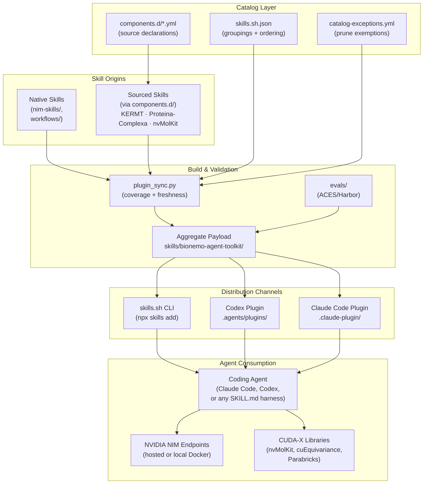

The NVIDIA BioNeMo Agent Toolkit is a **skill-based architecture** that transforms life-science capabilities — protein folding, molecular docking, generative chemistry, genomics, and protein design — into self-contained, agent-consumable units. Each skill is an isolated directory anchored by a `SKILL.md` file (YAML frontmatter + structured instructions), optionally accompanied by `references/`, `evals/`, `config/`, and `scripts/`. The toolkit does not host infrastructure; it ships domain knowledge that lets any coding agent select, configure, invoke, and interpret BioNeMo tools correctly.


Sources: [README.md](/README.md#L1-L177), [docs/skill-card.md](/docs/skill-card.md#L1-L188)

## Architectural Principles

The toolkit is governed by three first-principles design decisions that shape every layer of the system:

1. **Skill as atomic unit of capability.** A skill is the smallest distributable, evaluable, and composable unit. It carries everything an agent needs — trigger conditions, parameter contracts, request patterns, output interpretation, and troubleshooting — without requiring runtime infrastructure from the toolkit itself.

2. **Dual-origin catalog.** Skills originate from two sources: **native** skills authored directly in this repository (NIM skills, workflows), and **sourced** skills vendored from external NVIDIA repositories (KERMT, Proteina-Complexa, nvMolKit) via a nightly sync pipeline. This distinction determines how skills are maintained, validated, and governed.

3. **Aggregate payload for distribution.** The canonical installable payload lives under `skills/bionemo-agent-toolkit/skills/` — a generated mirror of the source skills. Distribution channels (skills.sh CLI, Codex marketplace, Claude Code plugin) all consume this aggregate, not the source directories directly.

Sources: [README.md](/README.md#L162-L167), [scripts/plugin_sync.py](/scripts/plugin_sync.py#L1-L27)

## System Architecture Diagram

The following diagram shows the end-to-end flow from skill authoring through distribution to agent consumption:



Sources: [scripts/plugin_sync.py](/scripts/plugin_sync.py#L37-L55), [plugins.d/bionemo-agent-toolkit.yml](/plugins.d/bionemo-agent-toolkit.yml#L1-L45), [skills.sh.json](/skills.sh.json#L1-L57)

## Skill Taxonomy

The repository organizes skills into four distinct categories, each with a different origin pattern, deployment model, and maintenance contract:

| Category | Directory | Origin | Deployment Model | Count | Examples |
|---|---|---|---|---|---|
| **NIM Skills** | `nim-skills/` | Native (authored in-repo) | Hosted NVIDIA API or local Docker container | 12 | boltz2-nim, diffdock-nim, genmol-nim, rfdiffusion-nim |
| **Library Skills** | `library-skills/` | Native or sourced | Python library on GPU hardware | 4 | nvmolkit-usage, parabricks, cuequivariance |
| **Open Model Skills** | `open-models-skills/` | Sourced (vendored from external repos) | Local model training/inference with GPU | 13 | kermt-setup, complexa-design |
| **Workflows** | `workflows/` | Native (authored in-repo) | Multi-skill orchestration | 2 | protein-binder-design, complexa-binder-design |

**Meta-skills** (under `nim-skills/meta-skills/`) are a special sub-category of NIM skills that compose multiple single-NIM skills into pipeline workflows (e.g., GenMol → DiffDock → Boltz2 for drug discovery). They carry their own `SKILL.md` and `evals/` but delegate API specifics to the constituent skills.

Sources: [README.md](/README.md#L39-L61), [nim-skills/meta-skills/README.md](/nim-skills/meta-skills/README.md#L1-L15), [skills.sh.json](/skills.sh.json#L1-L57)

## Skill Internal Structure

Every skill follows a uniform directory contract. The `SKILL.md` file is the only required artifact; all other directories are optional and loaded on demand:

```
<skill-name>/
├── SKILL.md              # Required: YAML frontmatter + agent instructions
├── references/           # Optional: detailed API, science, parameter docs
│   ├── api.md            #   endpoint schemas, Docker flags
│   ├── science.md        #   purpose, strengths, limitations
│   ├── parameters.md     #   tuning guide
│   ├── validation.md     #   output sanity checks
│   └── examples.md       #   compact payload patterns
├── evals/                # Optional: evaluation definitions
│   ├── config.yml        #   Harbor/ACES configuration
│   ├── evals.json        #   functional eval cases + assertions
│   ├── trigger_evals.json#   trigger precision/recall labels
│   └── files/            #   eval fixture files (PDB, etc.)
├── config/               # Optional: tool config (e.g., skillspector baseline)
└── scripts/              # Optional: helper scripts for the skill
```

The `SKILL.md` frontmatter defines the skill's identity and activation contract:

| Frontmatter Field | Purpose | Example |
|---|---|---|
| `name` | Unique skill identifier | `boltz2-nim` |
| `description` | Trigger description — agent matches this to decide activation | `Use Boltz2 NIM for biomolecular structure prediction...` |
| `license` | Dual-license declaration | `Apache-2.0 AND CC-BY-4.0` |
| `compatibility` | Runtime dependency constraints | `requests>=2.28` |
| `allowed-tools` | Agent tool permissions | `Bash, Read, Write, AskUserQuestion` |
| `metadata` | Extended metadata (owner, risk_tier) | `owner: ..., risk_tier: skill` |

Sources: [nim-skills/boltz2-nim/SKILL.md](/nim-skills/boltz2-nim/SKILL.md#L1-L8), [README.md](/README.md#L162-L167), [nim-skills/boltz2-nim](/nim-skills/boltz2-nim)

## Component Registry and Sourcing Pipeline

Skills vendored from external repositories are declared in `components.d/*.yml`. Each declaration specifies the source repository, branch ref, path to skills within that repo, and the target catalog directory:

| Component | Source Repo | Ref | Source Path | Catalog Directory |
|---|---|---|---|---|
| **KERMT** | `NVIDIA-BioNeMo/KERMT` | `main` | `agent/skills` | `open-models-skills/kermt` |
| **nvMolKit** | `NVIDIA-BioNeMo/nvMolKit` | `main` | `skills/nvmolkit-usage` | `library-skills/nvmolkit-usage` |
| **Proteina-Complexa** | `NVIDIA-BioNeMo/Proteina-Complexa` | `aggregator-compat` | `.claude/skills` | `open-models-skills/proteina-complexa` |

The nightly sync uses `rsync --delete` to mirror source skills into the catalog. Because `--delete` removes any file not present in the source, directly-authored files in sourced directories would be wiped — this is why compliance artifacts (`skill-card.md`) live in `compliance.d/` and are **backfilled** only when the rsync leaves no card in the catalog. As soon as upstream ships its own `skill-card.md`, the backfill becomes a no-op.

The `catalog-exceptions.yml` declares directories that are exempt from the orphan-pruning step. This includes the **native roots** (`nim-skills/`, `workflows/`) which are not scanned at all, and **native skills inside scanned roots** (e.g., `library-skills/parabricks`) that lack a public source repo and would otherwise be deleted by the pruner.

Sources: [components.d/kermt.yml](/components.d/kermt.yml#L1-L16), [components.d/nvmolkit.yml](/components.d/nvmolkit.yml#L1-L10), [components.d/proteina-complexa.yml](/components.d/proteina-complexa.yml#L1-L13), [catalog-exceptions.yml](/catalog-exceptions.yml#L1-L34), [compliance.d/README.md](/compliance.d/README.md#L1-L53)

## Aggregate Sync and Distribution

The `skills.sh.json` manifest is the central distribution config. It declares every distributable skill grouped into four categories — **BioNeMo NIMs**, **CUDA-X Libraries**, **Open Models**, and **Workflows** — with `notGrouped: "bottom"` controlling display order for ungrouped entries.

The sync script `plugin_sync.py` enforces two critical invariants:

1. **Coverage** — every distributable source skill (discovered by scanning `SOURCE_ROOTS` for `SKILL.md` files) must be listed in `skills.sh.json`. Unlisted skills are reported as coverage gaps.
2. **Freshness** — for every listed skill, the aggregate copy under `skills/bionemo-agent-toolkit/skills/<name>/` must be an exact byte-for-byte match of the source directory (excluding generated-only artifacts like `skill.oms.sig` and `BENCHMARK.md`).

The script operates in two modes: `--check` (CI gate, reports drift) and `--write` (contributor tool, rebuilds the aggregate). Aggregate-only artifacts (signatures, benchmark reports) survive a `--write` rebuild rather than being wiped, because they are generated by external signing/eval pipelines and not part of the source→aggregate sync contract.

Sources: [scripts/plugin_sync.py](/scripts/plugin_sync.py#L1-L55), [scripts/plugin_sync.py](/scripts/plugin_sync.py#L150-L198), [skills.sh.json](/skills.sh.json#L1-L57)

## Plugin Marketplace Integration

The toolkit ships self-hosted plugin marketplaces for agent-native installation:

| Channel | Mechanism | Config File |
|---|---|---|
| **skills.sh CLI** | `npx skills add NVIDIA-BioNeMo/bionemo-agent-toolkit` | `skills.sh.json` |
| **Codex** | Native plugin marketplace | `.agents/plugins/marketplace.json` |
| **Claude Code** | Native plugin marketplace | `.claude-plugin/marketplace.json` |

The `plugins.d/bionemo-agent-toolkit.yml` declares the plugin metadata (name, version, description, category, keywords) and curates which skills are included via `include_skills` — listing grouped paths (not flat `skills/<name>/`). Default fields (author, license, brand color, capabilities) are inherited from `plugins.d/_defaults.yml`, keeping per-plugin declarations minimal. The `skill_files: copy` strategy ensures real files are placed into the plugin tree (required for Codex local install), as opposed to symlinks back to canonical directories.

Sources: [plugins.d/bionemo-agent-toolkit.yml](/plugins.d/bionemo-agent-toolkit.yml#L1-L45), [plugins.d/_defaults.yml](/plugins.d/_defaults.yml#L1-L25), [README.md](/README.md#L33-L37)

## Evaluation Architecture

Each skill that ships evals follows a co-located pattern: `evals/` sits directly inside the skill directory. The evaluation system operates at two levels:

**Hosted Skill Lift (ACES/SkillEvaluator):** Each NIM skill provides a single, bounded `evals/evals.json` case plus `evals/config.yml`. The `astra-skill-eval` CLI converts the case into Harbor tasks and runs the same prompt both with and without the skill. The task requires a call to the real hosted NVIDIA NIM endpoint — whether the agent successfully discovers and executes that call is part of the measurement. The ACES default grader combines deterministic trajectory checks with LLM judgments.

**Eval case structure:** Each case in `evals.json` contains a natural-language `prompt`, an `expected_output` description, fixture `files`, and machine-checkable `assertions` that verify endpoint correctness, authentication, payload construction, and inter-skill data handoffs. Pipeline skills (e.g., drug-discovery-pipeline) include assertions validating that outputs from one NIM correctly feed into the next (e.g., GenMol SMILES → DiffDock ligand field).

The `evals/config.yml` declares the Harbor task source (`evals_json`) and required runtime environment variables (e.g., `NGC_API_KEY`), plus the grading mode (`aces_default`).

Sources: [README.md](/README.md#L62-L78), [nim-skills/boltz2-nim/evals/config.yml](/nim-skills/boltz2-nim/evals/config.yml#L1-L10), [nim-skills/meta-skills/drug-discovery-pipeline/evals/evals.json](/nim-skills/meta-skills/drug-discovery-pipeline/evals/evals.json#L1-L167)

## Workflow Composition Pattern

Workflows compose multiple skills into multi-step scientific pipelines. Two composition mechanisms exist:

**Meta-skills** (under `nim-skills/meta-skills/`) are NIM-pipeline compositions that live in the NIM skill tree. Each meta-skill's `SKILL.md` contains the full orchestration instructions — step-by-step code for each NIM call, data handoff patterns between steps, and ranking/filtering logic. The Drug Discovery Pipeline, for example, sequences GenMol → DiffDock → Boltz2 with explicit SMILES handoffs, SAFE-notation encoding, and multi-stage ranking.

**Workflow rules** (`.mdc` files) provide route-selection logic. The `workflow-rules.mdc` in `workflows/generative-protein-binder-design/` acts as a dispatcher that helps the agent choose between two independent binder-design routes — Proteina-Complexa (reward-guided co-design) or RFdiffusion + ProteinMPNN + Boltz2 (classic diffusion + inverse-folding pipeline) — based on user intent.

```
Workflow Composition Hierarchy
├── Meta-Skills (sequential NIM pipelines)
│   ├── drug-discovery-pipeline: GenMol → DiffDock → Boltz2
│   └── msa-structure-prediction-pipeline: MSA-Search → OpenFold3
└── Workflows (route selection + multi-skill orchestration)
    ├── protein-binder-design: RFdiffusion → ProteinMPNN → Boltz2/OpenFold3
    └── complexa-binder-design: Proteina-Complexa reward-guided co-design
```

Sources: [nim-skills/meta-skills/drug-discovery-pipeline/SKILL.md](/nim-skills/meta-skills/drug-discovery-pipeline/SKILL.md#L1-L30), [workflows/generative-protein-binder-design/workflow-rules.mdc](/workflows/generative-protein-binder-design/workflow-rules.mdc#L1-L36), [workflows/generative-protein-binder-design/README.md](/workflows/generative-protein-binder-design/README.md#L1-L16)

## Visual Project Structure

The complete repository layout reveals the architectural layering — from source skills through build tooling to distribution artifacts:

```
bionemo-agent-toolkit/
│
├── nim-skills/                    # ── Native NIM skills (source of truth)
│   ├── boltz2-nim/                # Each: SKILL.md + references/ + evals/ + config/
│   ├── diffdock-nim/
│   ├── evo2-nim/
│   ├── genmol-nim/
│   ├── molmim-nim/
│   ├── msa-search-nim/
│   ├── openfold2-nim/
│   ├── openfold3-nim/
│   ├── proteinmpnn-nim/
│   ├── rfdiffusion-nim/
│   └── meta-skills/               # Composed NIM pipelines
│       ├── drug-discovery-pipeline/
│       └── msa-structure-prediction-pipeline/
│
├── library-skills/                # ── CUDA-X library skills
│   ├── nvmolkit-usage/            # (sourced from NVIDIA-BioNeMo/nvMolKit)
│   ├── parabricks/                # (native — no public source yet)
│   ├── genomics-workflow-acceleration/
│   └── cuequivariance/            # (native — upstream embeds SKILL.md)
│
├── open-models-skills/            # ── Sourced open-model skills
│   ├── kermt/                     # ← NVIDIA-BioNeMo/KERMT (8 skills)
│   └── proteina-complexa/         # ← NVIDIA-BioNeMo/Proteina-Complexa (5 skills)
│
├── workflows/                     # ── Native workflow compositions
│   └── generative-protein-binder-design/
│       ├── protein-binder-design/ # RFdiffusion + ProteinMPNN route
│       ├── complexa-binder-design/# Proteina-Complexa route
│       └── workflow-rules.mdc     # Route selection logic
│
├── skills/bionemo-agent-toolkit/  # ── Generated aggregate (distribution payload)
│   └── skills/                    #    ← exact copy of all source skills
│
├── components.d/                  # ── Source declarations for vendored skills
├── compliance.d/                  # ── Compliance artifacts (outside rsync targets)
├── plugins.d/                     # ── Plugin marketplace metadata
├── catalog-exceptions.yml         # ── Prune exemptions for native-in-sourced-root
├── skills.sh.json                 # ── Distribution manifest (groupings + ordering)
├── scripts/plugin_sync.py         # ── Aggregate sync enforcement
└── docs/                          # ── Compliance & sync documentation
```

Sources: [README.md](/README.md#L1-L177), [scripts/plugin_sync.py](/scripts/plugin_sync.py#L37-L55)

## Key Architectural Invariants

Understanding these invariants is essential for contributing to or extending the toolkit:

| Invariant | Enforcement | Failure Mode |
|---|---|---|
| Every distributable skill has a `SKILL.md` | `plugin_sync.py --check` (coverage) | CI gate fails; skill invisible to distribution |
| Aggregate payload matches source exactly | `plugin_sync.py --check` (freshness) | CI gate fails; stale payload ships wrong instructions |
| Sourced skills are not directly edited in catalog | Nightly rsync with `--delete` | Local edits wiped on next sync |
| Compliance artifacts for sourced skills live in `compliance.d/` | Sync workflow backfill step | Cards deleted by rsync; backfill restores |
| Native skills in scanned roots are listed in `catalog-exceptions.yml` | `prune-orphans.sh` | Pruner deletes unlisted native skills |
| `plugins` symlink points to `skills/` | `plugin_sync.py` compatibility check | Migration compatibility breaks |

> [!TIP]
> When adding a new skill, you must: (1) create the skill directory with `SKILL.md` in the appropriate source root, (2) add the skill name to the correct grouping in `skills.sh.json`, and (3) run `python scripts/plugin_sync.py --write` to rebuild the aggregate. If the skill is sourced from an external repo, declare it in `components.d/` instead of authoring in-repo.

> [!TIP]
> The `evals/` directory is intentionally kept in the aggregate payload (not stripped) because NVCARPS Tier 3 live-agent eval validates the aggregate and requires the eval dataset to be present. Stripping it would cause Tier 3 to skip, invalidating coverage gates.

Sources: [scripts/plugin_sync.py](/scripts/plugin_sync.py#L44-L55), [scripts/plugin_sync.py](/scripts/plugin_sync.py#L150-L198), [compliance.d/README.md](/compliance.d/README.md#L1-L53), [catalog-exceptions.yml](/catalog-exceptions.yml#L1-L34)

## Where to Go Next

The architecture above sets the stage for deeper exploration of each layer:

- **Skill type internals**: [NIM Skills](5-nim-skills), [Open Model Skills](6-open-model-skills), [Library Skills](7-library-skills) — detailed structure and deployment patterns per category
- **Multi-step workflows**: [Drug Discovery Pipeline](8-drug-discovery-pipeline), [Protein Binder Design Workflow](9-protein-binder-design-workflow), [MSA Structure Prediction Pipeline](10-msa-structure-prediction-pipeline) — composition and handoff patterns
- **Skill internals**: [SKILL.md File Format](11-skill-md-file-format), [Hosted vs Local NIM Deployment](12-hosted-vs-local-nim-deployment), [Reference and Validation Files](13-reference-and-validation-files) — authoring and configuration details
- **Quality and distribution**: [Skill Lift Evaluation](14-skill-lift-evaluation), [Plugin Marketplace Integration](16-plugin-marketplace-integration), [Component Registry and Sync](17-component-registry-and-sync) — validation and distribution pipelines