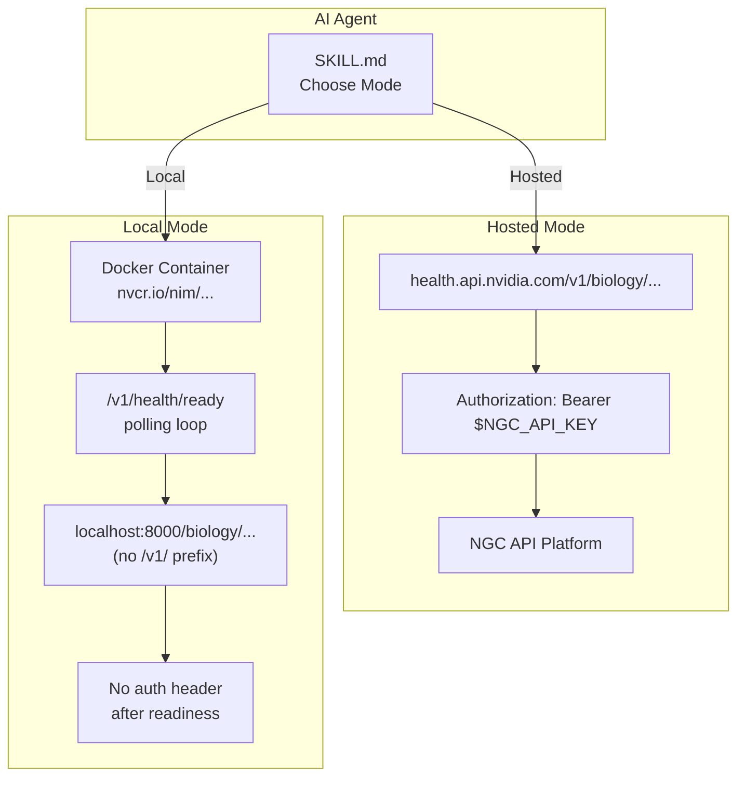
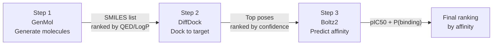

NIM Skills are **portable runtime skill bundles** that wrap individual BioNeMo NIM (NVIDIA Inference Microservice) endpoints into agent-consumable workflows. Each skill encapsulates a single model's hosted API and local Docker deployment surface, providing structured instructions, reference schemas, validation criteria, and evaluation definitions — everything an AI agent needs to discover, invoke, and verify a BioNeMo model without human hand-holding. They are the atomic building blocks that [Meta-Skills](5-nim-skills) compose into multi-step scientific pipelines like [Drug Discovery Pipeline](8-drug-discovery-pipeline) and [MSA Structure Prediction Pipeline](10-msa-structure-prediction-pipeline).

Sources: [README.md](/nim-skills/README.md#L1-L15)

## NIM Skill Catalog

The toolkit ships **10 individual NIM skills** spanning four biomedical domains and **2 meta-skills** that orchestrate them into pipelines:

| Skill | Domain | Capability | Hosted Endpoint Base | Local Endpoint Base |
|---|---|---|---|---|
| `boltz2-nim` | Structure & Affinity | Biomolecular structure prediction + binding affinity (protein, DNA, RNA, ligand) | `health.api.nvidia.com/v1/biology/mit/boltz2/...` | `localhost:8000/biology/mit/boltz2/...` |
| `diffdock-nim` | Docking | Blind protein-ligand docking with ranked poses + confidence | `health.api.nvidia.com/v1/biology/mit/diffdock` | `localhost:8000/molecular-docking/diffdock/generate` |
| `evo2-nim` | Genomics | DNA sequence generation + local forward/layer-output extraction | `health.api.nvidia.com/v1/biology/arc/evo2-40b/...` | `$EVO2_NIM_URL/biology/arc/evo2/...` |
| `genmol-nim` | Molecule Design | De novo molecule generation, scaffold decoration, motif extension via SAFE notation | `health.api.nvidia.com/v1/biology/nvidia/genmol/...` | `localhost:8000/generate` |
| `molmim-nim` | Molecule Design | Latent-space molecule embedding, sampling, CMA-ES guided optimization | `health.api.nvidia.com/v1/biology/nvidia/molmim/...` | `localhost:8000/...` (multiple endpoints) |
| `msa-search-nim` | Structure & Affinity | GPU-accelerated MSA generation (UniRef30, ColabFold envdb, PDB70 templates) | `health.api.nvidia.com/v1/biology/colabfold/msa-search/...` | `localhost:8000/biology/colabfold/msa-search/...` |
| `openfold2-nim` | Structure & Affinity | Monomer protein structure prediction (AlphaFold2-like) | `health.api.nvidia.com/v1/biology/openfold/openfold2/...` | `localhost:8000/biology/openfold/openfold2/...` |
| `openfold3-nim` | Structure & Affinity | Multi-entity complex prediction (protein, DNA, RNA, ligand) | `health.api.nvidia.com/v1/biology/openfold/openfold3/...` | `localhost:8000/biology/openfold/openfold3/...` |
| `proteinmpnn-nim` | Protein Design | Inverse folding — sequence design for a target backbone PDB | `health.api.nvidia.com/v1/biology/ipd/proteinmpnn/...` | `localhost:8000/biology/ipd/proteinmpnn/...` |
| `rfdiffusion-nim` | Protein Design | De novo backbone design, motif scaffolding, binder design | `health.api.nvidia.com/v1/biology/ipd/rfdiffusion/...` | `localhost:8000/biology/ipd/rfdiffusion/...` |

Sources: [boltz2-nim/SKILL.md](/nim-skills/boltz2-nim/SKILL.md#L1-L8), [diffdock-nim/SKILL.md](/nim-skills/diffdock-nim/SKILL.md#L1-L8), [evo2-nim/SKILL.md](/nim-skills/evo2-nim/SKILL.md#L1-L8), [genmol-nim/SKILL.md](/nim-skills/genmol-nim/SKILL.md#L1-L8), [molmim-nim/SKILL.md](/nim-skills/molmim-nim/SKILL.md#L1-L8), [msa-search-nim/SKILL.md](/nim-skills/msa-search-nim/SKILL.md#L1-L8), [openfold2-nim/SKILL.md](/nim-skills/openfold2-nim/SKILL.md#L1-L8), [openfold3-nim/SKILL.md](/nim-skills/openfold3-nim/SKILL.md#L1-L8), [proteinmpnn-nim/SKILL.md](/nim-skills/proteinmpnn-nim/SKILL.md#L1-L8), [rfdiffusion-nim/SKILL.md](/nim-skills/rfdiffusion-nim/SKILL.md#L1-L8)

## Skill Directory Anatomy

Every NIM skill follows an identical layout, making the structure predictable and enabling automated tooling to discover, validate, and publish each skill uniformly:

```
nim-skills/<skill-name>/
├── SKILL.md                    # Agent-facing runtime instructions (frontmatter + body)
├── config/
│   └── skillspector-baseline.yml   # SkillSpector false-positive suppression rules
├── evals/
│   ├── config.yml              # Harbor task source, required env vars, grading mode
│   ├── evals.json              # Task eval definitions with prompt + assertions
│   └── trigger_evals.json      # Skill-trigger classification tests (should/shouldn't activate)
└── references/
    ├── api.md                  # Exact endpoints, schemas, Docker flags, response fields
    ├── examples.md             # Compact hosted/local payload patterns and save snippets
    ├── parameters.md           # Parameter descriptions, ranges, and tuning effects
    ├── science.md              # Model purpose, strengths, limitations, handoffs
    └── validation.md           # Artifact and scientific sanity checks
```

The **`SKILL.md`** file is the primary contract — an agent reads it first for immediate usage guidance, then loads reference files only when the task requires deeper detail. The **`evals/`** directory defines how the skill's agent behavior is tested and validated (see [Evals Configuration](15-evals-configuration)). The **`config/`** directory houses compliance suppression rules audited against the [SkillSpector](18-compliance-and-security-model) static analyzer.

Sources: [README.md](/nim-skills/README.md#L6-L14), [skillspector-baseline.yml](/nim-skills/boltz2-nim/config/skillspector-baseline.yml#L1-L19)

## SKILL.md Frontmatter Schema

The YAML frontmatter at the top of every `SKILL.md` encodes machine-readable skill metadata consumed by the agent runtime and the publishing pipeline:

```yaml
---
name: <skill-name>                          # Unique skill identifier (matches directory name)
description: >                              # Natural-language trigger description for agent routing
  <What the skill does and when to invoke it>
license: Apache-2.0 AND CC-BY-4.0           # Dual license for code + documentation
compatibility: "requests>=2.28"             # Python package requirements for the skill's code
allowed-tools: Bash, Read, Write, AskUserQuestion  # Tool primitives the agent may use
---
```

The **`name`** field is the canonical skill identifier used in eval routing, component registry sync, and meta-skill composition. The **`description`** is a densely packed trigger surface — it lists model names, task types, input formats, and deployment modes so that an agent's skill-selection heuristic can match user intent without ambiguity. The **`allowed-tools`** list constrains the agent's execution surface to a safe, auditable set of primitives.

Sources: [boltz2-nim/SKILL.md](/nim-skills/boltz2-nim/SKILL.md#L1-L8), [evo2-nim/SKILL.md](/nim-skills/evo2-nim/SKILL.md#L1-L8)

## Dual-Mode Architecture: Hosted vs Local

Every NIM skill supports **two deployment modes** that share the same prediction logic but differ in endpoint routing, authentication, and infrastructure requirements. This dual-mode design is the central architectural pattern of the NIM skill layer:



### Mode Selection Protocol

Each `SKILL.md` begins with a **"Choose Mode"** section that follows a consistent protocol:

1. **Honor explicit configuration** — if `NIM_API_MODE` is set to `hosted` or `local`, use it without asking
2. **Infer from environment** — if a skill-specific URL variable is set (e.g., `EVO2_NIM_URL`, `PROTEINMPNN_NIM_URL`), treat it as local mode
3. **Ask only when ambiguous** — prompt the user only when neither the environment nor the user's request makes the mode clear

### Endpoint Routing Differences

The hosted and local paths are **not identical** — a common source of errors:

- **Hosted** endpoints use the `/v1/` prefix: `https://health.api.nvidia.com/v1/biology/...`
- **Local** endpoints **omit** `/v1/`: `http://localhost:8000/biology/...`
- Some skills have **structurally different** local paths (e.g., DiffDock local uses `/molecular-docking/diffdock/generate` while hosted uses `/v1/biology/mit/diffdock`)
- Some skills expose **local-only endpoints** not available on the hosted API (e.g., MolMIM's `/embedding`, `/hidden`, `/decode`, `/sampling`; Evo2's `/forward`)

> [!TIP]
> When debugging a local `404`, the most common cause is accidentally including the `/v1/` prefix on a local endpoint. Every NIM skill's troubleshooting section calls this out explicitly.

### Authentication Contract

| Aspect | Hosted | Local |
|---|---|---|
| Auth header | `Authorization: Bearer $NGC_API_KEY` | None (after readiness) |
| Key variable | `NGC_API_KEY` | `NGC_API_KEY` or `NVIDIA_API_KEY` (fallback for Docker login) |
| Key purpose | API request authorization | Container registry login + first-run model download |
| Key visibility | Never print or echo — confirm existence via shell tests | Same — never print keys |
| After readiness | N/A | No auth header on inference requests |

Sources: [boltz2-nim/SKILL.md](/nim-skills/boltz2-nim/SKILL.md#L22-L36), [diffdock-nim/SKILL.md](/nim-skills/diffdock-nim/SKILL.md#L21-L36), [evo2-nim/SKILL.md](/nim-skills/evo2-nim/SKILL.md#L23-L46), [molmim-nim/SKILL.md](/nim-skills/molmim-nim/SKILL.md#L22-L57)

## Local Docker Deployment Pattern

The local deployment follows a rigorous **env preflight → registry login → container launch → readiness poll → inference** sequence. Every SKILL.md encodes the same contract to prevent common mistakes:

```bash
# 1. Env preflight — source .env, resolve key fallback, validate required vars
set -a
[ -f .env ] && . ./.env
set +a
if [ -z "${NGC_API_KEY:-}" ] && [ -n "${NVIDIA_API_KEY:-}" ]; then
  export NGC_API_KEY="$NVIDIA_API_KEY"
fi
: "${NGC_API_KEY:?Set NGC_API_KEY or NVIDIA_API_KEY}"
: "${LOCAL_NIM_CACHE:?Set LOCAL_NIM_CACHE}"

# 2. Registry login
echo "$NGC_API_KEY" | docker login nvcr.io --username '$oauthtoken' --password-stdin

# 3. Container launch (image, GPU, cache mount, port vary per skill)
mkdir -p "${LOCAL_NIM_CACHE}"
docker run --rm --name <skill> --gpus all \
  --shm-size=<size> \
  -e NGC_API_KEY \
  -v "${LOCAL_NIM_CACHE}:/opt/nim/.cache" \
  -p 8000:8000 \
  nvcr.io/nim/<org>/<image>:<tag>

# 4. Readiness check
until curl -sf http://localhost:8000/v1/health/ready; do sleep 5; done

# 5. Inference (no Authorization header)
```

Key constraints enforced across all skills:

- **Never invent a `LOCAL_NIM_CACHE` default** — the user must set it explicitly
- **Never drop the `NVIDIA_API_KEY` fallback** — some environments set this instead of `NGC_API_KEY`
- **Never assume warm-cache key-free startup** — first-run downloads model weights and the time varies by image/version
- **Cache mount path varies** — most skills use `/opt/nim/.cache`, but ProteinMPNN uses `/home/nvs/.cache/nim`

### GPU Requirements by Skill

| Skill | Min VRAM | GPU Notes | First-Run Download |
|---|---|---|---|
| Boltz2 | ~16 GB | `--gpus all`, `--shm-size=16G` | ~30 GB model weights |
| DiffDock | ~24 GB | Single GPU | Moderate |
| Evo2 40B | 2×H100 80GB or 1×H200 141GB | **FP8 required** (compute capability ≥8.9); A100 incompatible | ~110 GB |
| Evo2 7B | H100/H200/RTX6000Ada/L40S | Set `NIM_VARIANT=7b` | ~50 GB |
| GenMol | Single GPU | `NIM_TEST_GPU=0` | ~20 GB |
| MolMIM | Single GPU | `NGC_CLI_API_KEY` mapping | Moderate |
| MSA-Search | GPU required | DB: 490 GB (UniRef30) to 1.4 TB (full) | 14 min (parallel) vs 80+ min (built-in) |
| OpenFold2 | Single GPU | ~80 GB disk, 64 GB RAM recommended | ~10 GB parameters |
| OpenFold3 | Single GPU | `--shm-size=16g` | ~10-15 GB model weights |
| ProteinMPNN | ~3 GB | Cache at `/home/nvs/.cache/nim` | Moderate |
| RFDiffusion | ~12 GB | Single GPU, `device=0` default | Moderate |

Sources: [boltz2-nim/SKILL.md](/nim-skills/boltz2-nim/SKILL.md#L38-L74), [evo2-nim/SKILL.md](/nim-skills/evo2-nim/SKILL.md#L48-L101), [msa-search-nim/SKILL.md](/nim-skills/msa-search-nim/SKILL.md#L42-L106), [openfold3-nim/SKILL.md](/nim-skills/openfold3-nim/SKILL.md#L46-L91), [proteinmpnn-nim/SKILL.md](/nim-skills/proteinmpnn-nim/SKILL.md#L40-L57)

## Request Pattern Conventions

Every SKILL.md includes a **"Request Pattern"** section with a ready-to-execute Python snippet. These follow a consistent template:

```python
import os
import requests

HOSTED = True  # or os.getenv("NIM_API_MODE", "hosted").strip().lower() != "local"
url = (
    "<HOSTED_URL>"
    if HOSTED else "<LOCAL_URL>"
)
headers = {"Content-Type": "application/json"}
if HOSTED:
    headers["Authorization"] = f"Bearer {os.getenv('NGC_API_KEY')}"

payload = { ... }  # skill-specific fields
response = requests.post(url, headers=headers, json=payload, timeout=300)
response.raise_for_status()
result = response.json()
```

Each skill documents its **payload gotchas** — non-obvious API quirks that trip up unfamiliar users:

| Skill | Key Gotcha |
|---|---|
| Boltz2 | MSA uses `alignment`/`format`/`rank`, not the stale `data` field; affinity requires `predict_affinity: True` on exactly one ligand |
| DiffDock | SMILES ligand uses `ligand_file_type: "txt"` (not `"smiles"`); strip PDB to ATOM records only |
| Evo2 | Field is `num_tokens` (not `max_tokens`); `/forward` is local-only, no hosted equivalent; A100 incompatible with FP8 |
| GenMol | `temperature` and `noise` are **strings** not floats; the `smiles` field takes SAFE notation, not raw SMILES |
| MolMIM | Field is `smi` (not `smiles`); `/embedding`, `/hidden`, `/decode`, `/sampling` are local-only |
| OpenFold2 | Monomer-only — hand off complexes to OpenFold3 or Boltz2; `selected_models` is 1-5 |
| OpenFold3 | Top level is `{"inputs": [...]}` with exactly one input; `molecules` supports 1-32 entities |
| ProteinMPNN | `sampling_temp` must be a list even for one value; cache mount is `/home/nvs/.cache/nim` |
| RFDiffusion | De novo requires a dummy PDB for hosted validation; `hotspot_res` uses `"A50"` strings, not tuples |

Sources: [genmol-nim/SKILL.md](/nim-skills/genmol-nim/SKILL.md#L55-L109), [diffdock-nim/SKILL.md](/nim-skills/diffdock-nim/SKILL.md#L54-L71), [molmim-nim/SKILL.md](/nim-skills/molmim-nim/SKILL.md#L110-L127), [evo2-nim/SKILL.md](/nim-skills/evo2-nim/SKILL.md#L208-L221), [proteinmpnn-nim/SKILL.md](/nim-skills/proteinmpnn-nim/SKILL.md#L91-L98), [rfdiffusion-nim/SKILL.md](/nim-skills/rfdiffusion-nim/SKILL.md#L78-L99)

## Meta-Skills: Composing NIM Skills into Pipelines

The `nim-skills/meta-skills/` directory contains **composition skills** that chain multiple individual NIM skills into end-to-end scientific workflows. Unlike individual skills, meta-skills do not wrap a single API — they orchestrate a sequence of NIM calls, passing outputs from one step as inputs to the next.

### Drug Discovery Pipeline

**GenMol → DiffDock → Boltz2**: Generate drug-like molecules, dock them to a protein target, then predict binding affinity for the top docking hits. Supports de novo hit discovery, scaffold-based lead optimization, and virtual screening.



### MSA Structure Prediction Pipeline

**MSA-Search → OpenFold3**: Search for evolutionary homologs via GPU-accelerated MMSeqs2, then feed the A3M alignment into OpenFold3 for MSA-informed structure prediction — the full AlphaFold3-style pipeline.


Meta-skills carry a distinct **privacy notice** in their frontmatter: molecule/sequence inputs and `NGC_API_KEY` are transmitted to external NVIDIA-hosted APIs on every call. The description explicitly advises using local NIM containers for confidential or proprietary data.

Sources: [meta-skills/README.md](/nim-skills/meta-skills/README.md#L1-L15), [drug-discovery-pipeline/SKILL.md](/nim-skills/meta-skills/drug-discovery-pipeline/SKILL.md#L1-L28), [msa-structure-prediction-pipeline/SKILL.md](/nim-skills/meta-skills/msa-structure-prediction-pipeline/SKILL.md#L1-L37)

## Evaluation and Trigger System

Each skill's `evals/` directory defines two evaluation layers:

**`evals.json`** contains **task evals** — structured test cases with a `prompt`, `expected_output`, and an `assertions` array. Each assertion has an `id`, `description`, and `check` (a natural-language predicate that the grading system evaluates against the agent's trajectory). Evals are split into immediate `evals` (run on every publish) and `deferred_evals` (awaiting infrastructure, like local Docker environments in Harbor). The config in `config.yml` specifies the Harbor task source, required environment variables (e.g., `NGC_API_KEY`), and grading mode.

**`trigger_evals.json`** contains **skill-routing classification tests** — pairs of `{query, should_trigger}` that verify the agent's skill-selection heuristic correctly activates the skill for relevant queries and **does not** activate it for unrelated ones. For example, Boltz2's trigger evals include protein structure queries as `should_trigger: true` and BLAST/molecular-weight queries as `should_trigger: false`.

Sources: [evals.json](/nim-skills/boltz2-nim/evals/evals.json#L1-L166), [trigger_evals.json](/nim-skills/boltz2-nim/evals/trigger_evals.json#L1-L23), [config.yml](/nim-skills/boltz2-nim/evals/config.yml#L1-L10)

## Skill Interconnections and Handoffs

NIM skills are not isolated — the SKILL.md bodies document explicit **handoff points** where one skill's output becomes another's input, forming a knowledge graph of biomedical workflows:

| From Skill | Handoff Trigger | To Skill | Data Passed |
|---|---|---|---|
| `msa-search-nim` | User needs MSA for structure prediction | `openfold2-nim` or `openfold3-nim` | A3M alignment → `alignments` or `msa` payload field |
| `rfdiffusion-nim` | Generated backbone PDB needs sequences | `proteinmpnn-nim` | `output_pdb` → `input_pdb` |
| `proteinEvo2-nim` | Designed sequences need structure validation | `boltz2-nim` or `openfold3-nim` | FASTA sequences → `sequence` or `polymers` field |
| `proteinmpnn-nim` | Designed sequences need structure validation | `boltz2-nim` or `openfold3-nim` | Multi-FASTA → prediction payload |
| `genmol-nim` | Generated molecules need docking | `diffdock-nim` | SMILES list → `ligand` field |
| `diffdock-nim` | Top docking poses need affinity scoring | `boltz2-nim` | Pose SDF + receptor → structure+affinity payload |

These handoffs are precisely what the meta-skills codify into executable pipelines, but they are also documented inline within each individual skill's `references/science.md` so that an agent can discover and chain them dynamically.

Sources: [openfold2-nim/SKILL.md](/nim-skills/openfold2-nim/SKILL.md#L113-L115), [rfdiffusion-nim/SKILL.md](/nim-skills/rfdiffusion-nim/SKILL.md#L149-L154), [drug-discovery-pipeline/SKILL.md](/nim-skills/meta-skills/drug-discovery-pipeline/SKILL.md#L22-L28), [msa-structure-prediction-pipeline/SKILL.md](/nim-skills/meta-skills/msa-structure-prediction-pipeline/SKILL.md#L33-L37)

## Next Steps

- **Understand the full SKILL.md format**: See [SKILL.md File Format](11-skill-md-file-format) for a deep dive into frontmatter fields and body structure
- **Choose your deployment**: See [Hosted vs Local NIM Deployment](12-hosted-vs-local-nim-deployment) for a detailed comparison of the two modes
- **Explore other skill types**: [Open Model Skills](6-open-model-skills) for training/fine-tuning workflows, [Library Skills](7-library-skills) for GPU-accelerated library integrations
- **Run a pipeline end-to-end**: [Drug Discovery Pipeline](8-drug-discovery-pipeline) or [MSA Structure Prediction Pipeline](10-msa-structure-prediction-pipeline)
- **Validate skill quality**: [Skill Lift Evaluation](14-skill-lift-evaluation) and [Evals Configuration](15-evals-configuration)