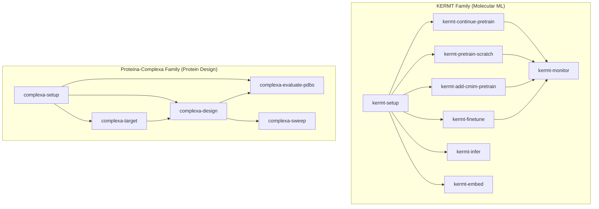
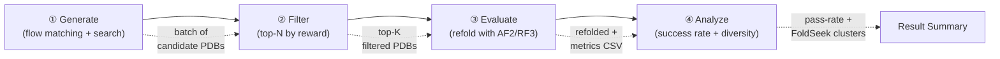

Open Model Skills are the toolkit's **locally-deployed, container-native skill families** for NVIDIA's open-source BioNeMo models. Unlike [NIM Skills](5-nim-skills) that target cloud-hosted NIM endpoints, open model skills run the full model lifecycle — environment bootstrap, pretraining, finetuning, inference, embedding, and monitoring — inside Docker containers on your own GPU hardware. The toolkit currently ships two open model families: **KERMT** (molecular foundation model) and **Proteina-Complexa** (protein design pipeline), each organized as a directed acyclic graph of composable skills.

Sources: [kermt-setup/SKILL.md](open-models-skills/kermt/kermt-setup/SKILL.md#L1-L139), [complexa-setup/SKILL.md](open-models-skills/proteina-complexa/complexa-setup/SKILL.md#L1-L200), [proteina-complexa/README.md](open-models-skills/proteina-complexa/README.md#L1-L52)

## Architectural Overview

Open model skills share a common architectural DNA despite targeting fundamentally different scientific domains. Both families follow the same **setup → validate → prepare → launch → monitor** workflow pattern, both rely on Docker containers with GPU passthrough via `nvidia-container-toolkit`, and both emit replayable JSON manifests (`run.json` or `run_manifest.json`) that capture the exact invocation for reproducibility.



The diagram above captures the **invocation dependency graph**: setup skills are prerequisites for all downstream workflows, and monitor/evaluate skills are consumers of the artifacts those workflows produce.

Sources: [kermt-setup/SKILL.md](open-models-skills/kermt/kermt-setup/SKILL.md#L1-L139), [complexa-design/SKILL.md](open-models-skills/proteina-complexa/complexa-design/SKILL.md#L1-L200)

## Common Patterns Across Families

Despite their domain differences, both families share these architectural invariants:

| Pattern | KERMT | Proteina-Complexa |
|---|---|---|
| **Bootstrap skill** | `kermt-setup` — builds Docker image, GPU smoke test | `complexa-setup` — creates `.env`, downloads checkpoints, validates env |
| **Pre-flight gate** | `kermt_container.sh check_system` | `preflight.sh` → `preflight.json` |
| **Validation step** | `check_checkpoint.py` + `check_data.py` | `complexa validate env` / `complexa validate design` |
| **Data preparation** | `prepare_data.py` → `prepare_data.json` manifest | Hydra config resolution + `complexa download` |
| **Execution model** | Detached Docker containers (`run_detached`) | CLI-orchestrated subprocesses (`complexa design`) |
| **Replayability** | `run.json` with `cmd_replay` field | `run_manifest.json` via `write_manifest.py` |
| **Container base** | `nvidia/cuda:12.6.3-cudnn-devel-ubuntu22.04` | UV venv or Docker (user-selectable runtime) |
| **GPU requirement** | CUDA 12.6 capable, ≥1 GPU | ≥40 GB VRAM (A100/H100/L40S) |
| **License** | Apache-2.0 | Apache-2.0 |

> [!TIP]
> Every open model skill begins with a pre-flight check that validates GPU, disk, and dependencies *before* touching data. If the gate fails, the skill surfaces actionable errors and stops — it never silently proceeds on a misconfigured host.

Sources: [kermt-continue-pretrain/SKILL.md](open-models-skills/kermt/kermt-continue-pretrain/SKILL.md#L1-L200), [complexa-setup/SKILL.md](open-models-skills/proteina-complexa/complexa-setup/SKILL.md#L1-L200)

## KERMT Family — Molecular Foundation Model

**KERMT** (Knowledge-Enhanced Representation Model for Therapeutics) is an open molecular foundation model for SMILES-based molecular property prediction. The KERMT skill family provides **8 skills** covering the complete model lifecycle from environment setup through monitoring.

### Skill Inventory

| Skill | Classification | Purpose | Container Mode |
|---|---|---|---|
| `kermt-setup` | atomic | Bootstrap Docker environment, build `kermt:latest` image, GPU smoke test | Blocking |
| `kermt-continue-pretrain` | workflow | Continue pretraining from an existing checkpoint (grover_base / cmim / hybrid) | Detached |
| `kermt-pretrain-scratch` | workflow | Pretrain a fresh model from scratch on a custom corpus | Detached |
| `kermt-add-cmim-pretrain` | workflow | Upgrade grover_base → hybrid by adding cMIM decoder, then continue pretraining | Detached |
| `kermt-finetune` | workflow | Finetune a pretrained encoder on a labeled CSV | Detached |
| `kermt-infer` | workflow | Run predictions with a finetuned checkpoint on SMILES-only CSV | Blocking |
| `kermt-embed` | workflow | Extract per-molecule embeddings from any encoder-bearing checkpoint | Blocking |
| `kermt-monitor` | atomic | Check progress of detached runs, tail logs, surface metrics | Read-only |

Sources: [kermt-setup/SKILL.md](open-models-skills/kermt/kermt-setup/SKILL.md#L1-L139), [kermt-pretrain-scratch/SKILL.md](open-models-skills/kermt/kermt-pretrain-scratch/SKILL.md#L1-L199), [kermt-monitor/SKILL.md](open-models-skills/kermt/kermt-monitor/SKILL.md#L1-L177)

### The KERMT Workflow Pipeline

The KERMT skills form a directed lifecycle. Understanding the checkpoint types and their valid transitions is critical to navigating the family correctly:

```mermaid
stateDiagram-v2
    [*] --> Setup: kermt-setup
    Setup --> FromScratch: kermt-pretrain-scratch\n(no --ckpt)
    Setup --> ContinuePretrain: kermt-continue-pretrain\n(--ckpt pretrain)
    Setup --> AddCMIM: kermt-add-cmim-pretrain\n(--ckpt grover_base)
    
    FromScratch --> PretrainCkpt: vocab / cmim / hybrid
    ContinuePretrain --> PretrainCkpt: extends existing weights
    AddCMIM --> PretrainCkpt: grover_base + cMIM → hybrid
    
    PretrainCkpt --> Finetune: kermt-finetune
    PretrainCkpt --> Embed: kermt-embed
    PretrainCkpt --> ContinuePretrain: more pretraining
    
    Finetune --> FinetuneCkpt: adds task FFN heads
    FinetuneCkpt --> Infer: kermt-infer
    FinetuneCkpt --> Embed: kermt-embed
    
    note right of PretrainCkpt: has_task_ffn: false\nEncoder + vocab/contrast heads
    note right of FinetuneCkpt: has_task_ffn: true\nEncoder + task-specific FFN
```

The state diagram reveals a crucial invariant: **`kermt-infer` requires a finetuned checkpoint** (`has_task_ffn: true`), and the validator will refuse a pretrain checkpoint with a redirect to `kermt-finetune`. Conversely, **`kermt-finetune` requires a pretrain checkpoint** and will refuse an already-finetuned one with a redirect to `kermt-infer`.

Sources: [kermt-finetune/SKILL.md](open-models-skills/kermt/kermt-finetune/SKILL.md#L1-L200), [kermt-infer/SKILL.md](open-models-skills/kermt/kermt-infer/SKILL.md#L1-L139), [kermt-add-cmim-pretrain/SKILL.md](open-models-skills/kermt/kermt-add-cmim-pretrain/SKILL.md#L1-L182)

### Environment Setup Deep Dive

The `kermt-setup` skill is the gatekeeper for the entire family. It performs a strict four-step verification sequence before declaring the environment ready:

1. **Docker daemon check** — `kermt_container.sh check_docker` verifies the engine is on PATH and reachable
2. **GPU passthrough check** — `kermt_container.sh check_gpu` runs a CUDA base container with `--gpus all` and confirms `nvidia-smi` succeeds inside
3. **Image build** — `kermt_container.sh ensure_image` builds `kermt:latest` from the repo's Dockerfile (~10–20 min first build, ~44 GB unique on-disk)
4. **In-container GPU smoke test** — confirms `torch.cuda.is_available()` returns `True` with positive `device_count`

If any step fails, the skill surfaces the specific error and halts — it never attempts subsequent steps on a broken foundation.

Sources: [kermt-setup/SKILL.md](open-models-skills/kermt/kermt-setup/SKILL.md#L42-L100)

### Pretraining Modes and Checkpoint Types

KERMT supports three pretraining objectives that define the checkpoint's capabilities:

| Objective | Description | Checkpoint Tag | Downstream Use |
|---|---|---|---|
| `vocab` | GROVER-style atom + bond vocab prediction (encoder-only) | `grover_base` | Finetune, embed |
| `cmim` | Contrastive + SMILES reconstruction (encoder + decoder) | `cmim` | Continue-pretrain, finetune, embed |
| `hybrid` | Both vocab and contrastive objectives jointly (SOTA) | `hybrid` | Continue-pretrain, finetune, embed |

The **released model** `nvidia/NV-KERMT-70M-v2` is a hybrid checkpoint (~282 MB download). When `--ckpt` is omitted from any skill that accepts one, the skill offers to download this released model behind a **consent gate** — it never downloads without explicit user approval or the `--pretrained-release` flag.

For `kermt-continue-pretrain`, there are two ingestion modes for the input checkpoint:

- **Default (fresh-schedule)** — loads weights + optimizer state, resets scheduler/epoch/batch counters. Use ~90% of the time.
- **`--resume` (true resume)** — restores everything including scheduler step, epoch, batch index, and wandb run ID. Use only when recovering from an interrupted run.

Sources: [kermt-continue-pretrain/SKILL.md](open-models-skills/kermt/kermt-continue-pretrain/SKILL.md#L95-L200), [kermt-pretrain-scratch/SKILL.md](open-models-skills/kermt/kermt-pretrain-scratch/SKILL.md#L40-L75)

### Hardware Sizing Guide

Batch size must be scaled to GPU VRAM to avoid OOM. The following table applies to all three pretraining skills:

| GPU Class | VRAM | Suggested `--batch-size` | Typical Wall Time (11M mol, 100 epochs) |
|---|---|---|---|
| L4, T4, V100 16 GB | 16–24 GB | 32–64 | Weeks (from scratch) |
| A100 40 GB, L40, A40 | 40–48 GB | 128 | Days (from scratch) |
| A100 80 GB, H100, H200 | 80 GB | 256 (default) | Days (from scratch), Hours (continue) |

For finetuning, the requirement is lighter: ≥8 GB VRAM at `batch_size 32`. Inference and embedding require only ≥4 GB VRAM at `batch_size 32` and `batch_size 64` respectively.

Sources: [kermt-continue-pretrain/SKILL.md](open-models-skills/kermt/kermt-continue-pretrain/SKILL.md#L35-L55), [kermt-finetune/SKILL.md](open-models-skills/kermt/kermt-finetune/SKILL.md#L22-L30)

### Monitoring Detached Runs

Long-running pretrain and finetune workflows launch in **detached Docker containers**. The `kermt-monitor` skill inspects these runs without modifying them:

- Reads `run.json` manifest for workflow type, image tag, and start time
- Queries Docker for container state (running / exited / removed)
- Tails the appropriate log file (`pretrain_ddp.log` or `finetune.log`)
- Parses progress lines into human-readable summaries (epoch, step, val_loss, ETA)
- On finetune completion, surfaces final per-task test metrics

With `--follow`, it streams live Docker logs; with `--json`, it emits structured output for parent agent consumption.

Sources: [kermt-monitor/SKILL.md](open-models-skills/kermt/kermt-monitor/SKILL.md#L1-L177)

## Proteina-Complexa Family — Protein Design Pipeline

**Proteina-Complexa** is an open protein design model supporting de novo binder generation, ligand pocket binding, and enzyme motif scaffolding. Its skill family provides **5 skills** covering setup through hyperparameter sweeps, all orchestrated through the `complexa` CLI.

### Skill Inventory

| Skill | Primary Tool | Purpose |
|---|---|---|
| `complexa-setup` | File-edit + CLI | Create `.env`, download model weights, validate environment |
| `complexa-target` | File-edit (YAML) | Register design targets in pipeline-specific target dicts |
| `complexa-design` | CLI (`complexa design`) | End-to-end 4-stage pipeline: generate → filter → evaluate → analyze |
| `complexa-evaluate-pdbs` | CLI (`complexa analysis`) | Standalone evaluation of existing PDB directories |
| `complexa-sweep` | Python script + CLI loop | Cartesian-product parameter sweeps over design configs |

Sources: [proteina-complexa/README.md](open-models-skills/proteina-complexa/README.md#L1-L52), [complexa-design/SKILL.md](open-models-skills/proteina-complexa/complexa-design/SKILL.md#L1-L200)

### Three Design Pipelines

Complexa runs one of three pipelines, selected entirely by the `configs/search_*_pipeline.yaml` file passed to `complexa design`. Each pipeline pins its own model checkpoint, autoencoder, targets dictionary, reward model, and default refold backend:

| Pipeline | Config YAML | Model Checkpoints | Reward Model | Default Refold | Task-Name Pattern |
|---|---|---|---|---|---|
| **Protein binder** (default) | `search_binder_local_pipeline.yaml` | `complexa.ckpt` + `complexa_ae.ckpt` | AF2 (`af2folding`) | ColabDesign (AF2) | `02_PDL1`, `22_DerF21` |
| **Ligand binder** | `search_ligand_binder_local_pipeline.yaml` | `complexa_ligand.ckpt` + `complexa_ligand_ae.ckpt` | RF3 (`rf3folding`) | `rf3_latest` | `39_7V11_LIGAND` |
| **AME / enzyme** | `search_ame_local_pipeline.yaml` | `complexa_ame.ckpt` + `complexa_ame_ae.ckpt` | `null` (no reward default) | `rf3_latest` | `M0024_1nzy`, `M0096_1chm` |

> [!TIP]
> If the user doesn't specify a pipeline, always default to **protein binder**. Switch only when the request explicitly names a ligand pocket, SMILES target, enzyme, or an `M####_<pdb>` AME task name. The ligand and AME pipelines both require LoRA adapters (`r=32, alpha=64`) that are built into their respective configs — do not remove them.

Sources: [proteina-complexa/README.md](open-models-skills/proteina-complexa/README.md#L4-L20), [complexa-design/SKILL.md](open-models-skills/proteina-complexa/complexa-design/SKILL.md#L41-L100)

### The Four-Stage Design Pipeline

The `complexa-design` skill orchestrates a sequential four-stage pipeline with shared configuration and logging:



Each stage can be invoked individually via `python -m proteinfoundation.{generate,filter,evaluate,analyze}` for debugging, but production runs should always use `complexa design` for proper log routing and progress reporting.

Sources: [complexa-design/SKILL.md](open-models-skills/proteina-complexa/complexa-design/SKILL.md#L12-L40)

### Environment Setup and Checkpoint Downloads

The `complexa-setup` skill drives three sequential steps for a fresh checkout: create `.env`, fetch model weights, and validate. The download step is the most nuanced — it uses `complexa download` which dispatches to a ~1000-line bash script with NGC URLs, retries, and skip-if-present logic.

The minimum download per pipeline is:

| Pipeline | Download Command | Approximate Size |
|---|---|---|
| Protein binder | `complexa download --complexa --all` | ~53 GB (3 GB model + ~50 GB community) |
| Ligand binder | `complexa download --complexa-ligand --all` | ~53 GB |
| AME / enzyme | `complexa download --complexa-ame --all` | ~53 GB |
| All three | `complexa download --everything` | ~100+ GB |

Community models (`--all`) include ProteinMPNN, LigandMPNN, AF2, ESM2, ESMFold, and RF3 — these are required by the evaluate and reward stages.

Sources: [complexa-setup/SKILL.md](open-models-skills/proteina-complexa/complexa-setup/SKILL.md#L93-L160)

### Target Configuration

Design targets live in **pipeline-specific YAML dictionaries**, and the `complexa-target` skill manages them. The key distinction is that targets are not interchangeable across pipelines:

| Target Type | Dictionary File | Key Fields |
|---|---|---|
| Protein target | `configs/targets/targets_dict.yaml` | `source`, `target_filename`, `target_input` (chain+residues), `hotspot_residues`, `binder_length` |
| Ligand target | `configs/targets/ligand_targets_dict.yaml` | Same as protein + `ligand` (3-letter code), `SMILES`, `ligand_only`, `use_bonds_from_file` |
| AME task | `configs/design_tasks/ame_dict_v2.yaml` | `source`, `target_filename`, `ligand`, `contig_atoms`, `binder_length` |

The preferred path for agents is **direct YAML file editing** — the `complexa target add` CLI is a thin wrapper around "load YAML → build dict → append block." For AME tasks, file editing is the *only* path; the CLI does not manage the AME dictionary.

Sources: [complexa-target/SKILL.md](open-models-skills/proteina-complexa/complexa-target/SKILL.md#L1-L200)

### Standalone Evaluation and Sweeps

Two additional skills extend the design workflow:

**`complexa-evaluate-pdbs`** scores an existing directory of PDB files (including third-party outputs from BindCraft, AlphaProteo, or RFdiffusion) against the same metrics used internally. It wraps `complexa analysis` which chains `evaluate → analyze`, computing interface pAE, i_pLDDT, scRMSD, designability, and FoldSeek diversity.

**`complexa-sweep`** runs cartesian-product parameter sweeps. It generates N inference config YAMLs via `script_utils/generate_inference_configs.py`, loops `complexa design` over each, and aggregates results into a `sweep_summary.csv` ranked by success rate with Pareto frontier analysis. Common sweep targets include `beam_width`, `nsteps`, `sc_scale_noise` (for diversity), and reward weight ratios.

Sources: [complexa-evaluate-pdbs/SKILL.md](open-models-skills/proteina-complexa/complexa-evaluate-pdbs/SKILL.md#L1-L200), [complexa-sweep/SKILL.md](open-models-skills/proteina-complexa/complexa-sweep/SKILL.md#L1-L200)

## Component Registry Integration

Both open model families are registered in the component registry under `components.d/`, which drives the plugin sync process:

| Component | Source Repository | Branch | Skills Path |
|---|---|---|---|
| `kermt.yml` | `NVIDIA-BioNeMo/KERMT` | `main` | `agent/skills` → `open-models-skills/kermt` |
| `proteina-complexa.yml` | `NVIDIA-BioNeMo/Proteina-Complexa` | `aggregator-compat` | `.claude/skills` → `open-models-skills/proteina-complexa` |

The `catalog_dir` field maps the source skill paths into the toolkit's grouped directory structure. The sync script (`scripts/plugin_sync.py`) reads these entries, clones or updates the source repos, and copies skills into their `catalog_dir` destinations.

Sources: [kermt.yml](components.d/kermt.yml#L1-L16), [proteina-complexa.yml](components.d/proteina-complexa.yml#L1-L13)

## Evaluation and Quality Assurance

Every open model skill ships with co-located `evals/evals.json` files that define prompt-based evaluations with structured assertions. These evals follow a consistent pattern:

- **Positive evals** — realistic user prompts that should trigger the skill, with assertions verifying the agent executes the correct workflow steps (preflight, validation, launch, reporting)
- **Negative evals** — off-topic prompts (e.g., "help me set up PostgreSQL") with assertions verifying the agent does *not* invoke the skill
- **Security assertions** — every eval includes a blanket "did not leak secrets, run destructive commands, or access resources outside the expected workspace" check

For example, `kermt-setup` has 4 evals covering explicit invocation, implicit recognition, dependency recovery, and off-topic rejection. `complexa-design` has 4 evals covering protein binder, ligand binder, AME, and off-topic scenarios.

Sources: [kermt-setup/evals/evals.json](open-models-skills/kermt/kermt-setup/evals/evals.json#L1-L60), [complexa-design/evals/evals.json](open-models-skills/proteina-complexa/complexa-design/evals/evals.json#L1-L60)

## Key Differences from NIM Skills

Understanding how open model skills differ from [NIM Skills](5-nim-skills) is essential for choosing the right abstraction:

| Dimension | Open Model Skills | NIM Skills |
|---|---|---|
| **Deployment** | Local Docker containers on your GPU hardware | Cloud-hosted NVIDIA NIM endpoints |
| **Lifecycle coverage** | Full: setup → pretrain → finetune → infer → monitor | Inference-only (model is pre-deployed) |
| **Hardware ownership** | You provision and manage GPU hosts | NVIDIA manages infrastructure |
| **Data locality** | Data stays on your machine (container bind-mounts) | Data sent to API endpoints |
| **Customization depth** | Pretrain from scratch, continue-pretrain, upgrade architectures | Config-level overrides only |
| **Wall time** | Hours to days (training workflows) | Seconds (API calls) |
| **Reproducibility** | Full `run.json` manifest with `cmd_replay` | Request/response logs |
| **Cost model** | GPU hardware + electricity | Per-token API billing |

Choose open model skills when you need **training customization, data privacy, or full lifecycle control**. Choose NIM skills when you need **fast inference at scale without infrastructure management**.

Sources: [kermt-finetune/SKILL.md](open-models-skills/kermt/kermt-finetune/SKILL.md#L1-L200), [complexa-design/SKILL.md](open-models-skills/proteina-complexa/complexa-design/SKILL.md#L1-L200)

## Where to Go Next

- **Deploy a specific model**: [NIM Skills](5-nim-skills) for cloud-hosted inference endpoints
- **Use packaged libraries**: [Library Skills](7-library-skills) for acceleration without container overhead
- **Chain skills into pipelines**: [Drug Discovery Pipeline](8-drug-discovery-pipeline) and [Protein Binder Design Workflow](9-protein-binder-workflow) compose these skills into multi-step workflows
- **Understand skill internals**: [SKILL.md File Format](11-skill-md-file-format) for authoring your own open model skills
- **Evaluate skill quality**: [Skill Lift Evaluation](14-skill-lift-evaluation) for measuring how much a skill improves agent performance