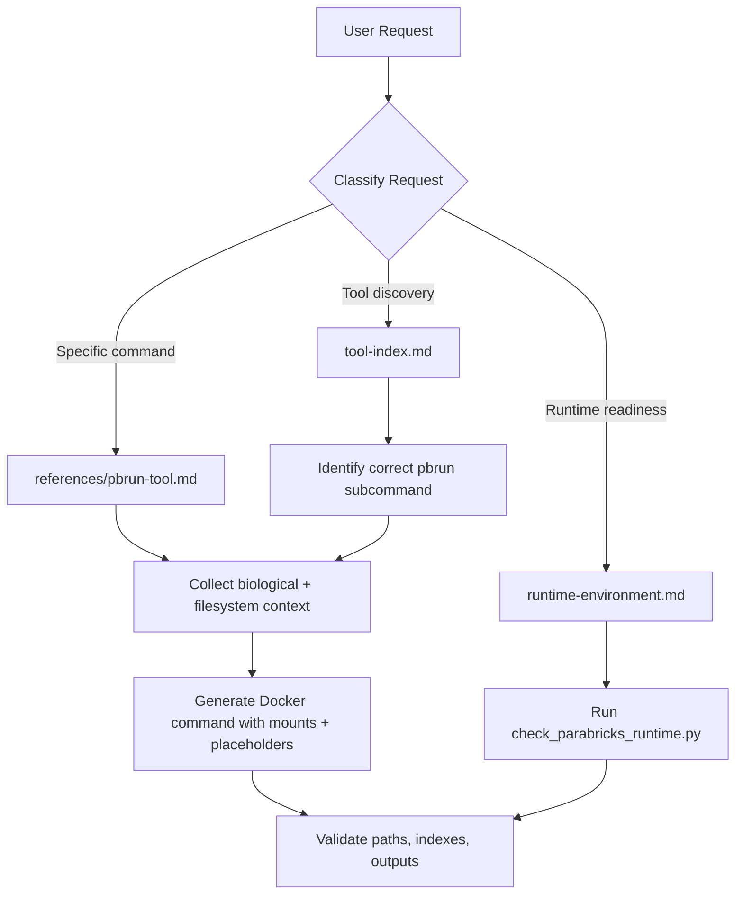

Library Skills are the toolkit's **deepest integration tier** — skills that wrap Python libraries and domain-specific frameworks directly, providing agents with API-correct code generation, runtime guidance, and GPU-optimized workflow patterns. Unlike [NIM Skills](5-nim-skills), which target inference microservice endpoints, or [Open Model Skills](6-open-model-skills), which orchestrate full training/fine-tuning pipelines on open-weight models, library skills operate at the **import level**: they teach an agent how to call `nvmolkit.fingerprints.MorganFingerprintGenerator`, how to subclass `cue.Irrep`, or how to route a `pbrun fq2bam` command with the right flags and Docker mounts. This makes them the most API-surface-intensive skill type in the catalog.

## Available Library Skills

The repository ships four library skills, spanning cheminformatics, equivariant ML, and GPU-accelerated genomics:

| Skill | Domain | Primary Library | GPU Required | License |
|---|---|---|---|---|
| **nvmolkit-usage** | Cheminformatics | `nvmolkit` (nvMolKit) | Yes | Apache-2.0 |
| **cuequivariance** | Equivariant ML | `cuequivariance` (`cue`) | No (CPU algebra) | Apache-2.0 |
| **parabricks** |0 Genomics (per-tool) | `pbrun` CLI | Yes | CC-BY-4.0 AND Apache-2.0 |
| **genomics-workflow-acceleration** | Genomics (pipeline) | Parabricks + framework | Yes | CC-BY-4.0 AND Apache-2.0 |

> [!TIP]
> The two genomics skills are **deliberately split by scope**: `parabricks` handles single-tool routing (`pbrun fq2bam`, `pbrun deepvariant`), while `genomics-workflow-acceleration` handles whole-pipeline inspection, toggle wiring, and A/B comparison. Using the wrong one for a given request violates each skill's guardrails.

Sources: [SKILL.md](library-skills/nvmolkit-usage/SKILL.md#L1-L8), [SKILL.md](library-skills/cuequivariance/SKILL.md#L1-L6), [SKILL.md](library-skills/parabricks/SKILL.md#L1-L7), [SKILL.md](library-skills/genomics-workflow-acceleration/SKILL.md#L1-L10)

## Skill Directory Structure

Every library skill follows a consistent filesystem contract. The minimum viable skill contains a `SKILL.md` and an `evals/` directory; richer skills add `references/` for domain knowledge and `scripts/` for diagnostic tooling:

```
library-skills/<skill-name9>/
├── SKILL.md              # Skill definition, API guidance, recipes (required)
├── evals/
│   ├── evals.json        # Functional correctness evaluations (required)
│   └── trigger_evals.json # Trigger/non-trigger activation tests (optional)
├── references/           # Domain reference documents (optional)
│   ├── <topic>.md        # Tool maps, runtime guides, checklists
│   └── ...
└── scripts/              # Executable diagnostic/utility scripts (optional)
    └── <script>.py
```

The actual distribution across the four skills reflects this tiering:

| Skill | `evals/` | `trigger_evals.json` | `references/` | `scripts/` |
|---|---|---|---|---|
| nvmolkit-usage | 11 functional evals | 5 trigger tests | — | — |
| cuequivariance | 4 functional evals | — | — | — |
| parabricks | 4 functional evals | — | 28 reference docs | 1 script |
| genomics-workflow-acceleration | 4 functional evals | — | 7 reference docs | — |

Sources: [evals.json](library-skills/nvmolkit-usage/evals/evals.json#L1-L174), [evals.json](library-skills/cuequivariance/evals/evals.json#L1-L58), [evals.json](library-skills/parabricks/evals/evals.json#L1-L60), [evals.json](library-skills/genomics-workflow-acceleration/evals/evals.json#L1-L60), [trigger_evals.json](library-skills/nvmolkit-usage/evals/trigger_evals.json#L1-L31)

## SKILL.md Frontmatter and Activation

Each `SKILL.md` opens with YAML frontmatter that the agent toolkit uses for **skill routing** — determining which skill to activate for a given user prompt. The frontmatter fields are:

| Field | Purpose | Example |
|---|---|---|
| `name` | Canonical skill identifier | `nvmolkit-usage` |
| `description` | Activation0 Natural-language trigger criteria | *"Use when the user is importing `nvmolkit.*`…"* |
| `license` | Licensing terms | `Apache-2.0` or `CC-BY-4.0 AND Apache-2.0` |
| `metadata.owner` | Maintainer | `Kevin Boyd (@scal444)` |
| `metadata.tags` | Domain tags for filtering | `genomics`, `parabricks`, `gpu` |
| `metadata.risk_tier` | Risk classification | `skill` |

The **description** field is the activation contract: it explicitly states *when* the skill should trigger and *what is out of scope*. For example, nvmolkit-usage triggers when importing `nvmolkit.*` or debugging an nvMolKit call, but explicitly excludes building from source. The genomics skills use description-level scope boundaries to prevent cross-activation — `parabricks` states *"Do NOT use for inspecting or accelerating whole pipelines — use genomics-workflow-acceleration"* while `genomics-workflow-acceleration` states *"Do NOT use for individual pbrun command routing — use parabricks"*.

Sources: [SKILL.md](library-skills/nvmolkit-usage/SKILL.md#L1-L8), [SKILL.md](library-skills/parabricks/SKILL.md#L1-L7), [SKILL.md](library-skills/genomics-workflow-acceleration/SKILL.md#L1-L10)

## nvmolkit-usage — GPU-Accelerated Cheminformatics

**nvMolKit** provides batched, GPU-parallel implementations of common RDKit operations. APIs mirror RDKit where possible but are **batch-oriented**: they accept `*lists* of `rdkit.Chem.Mol` and process them on one or more GPUs. The skill covers the full API surface:

### Entry Points and Result Types

The skill documents two GPU-resident return types that carry all downstream dataflow implications:

| Return Type | Used By | Key Behavior |
|---|---|---|
| `AsyncGpuResult` | Fingerprints, similarity, RMSD, TFD, Butina | Asynchronous; `result.torch()` returns zero-copy GPU tensor; `result.numpy()` synchronizes and copies to CPU; exposes `__cuda_array_interface__` for zero-copy chaining |
| `Device3DResult` | ETKDG embedding, MMFF/UFF optimization | GPU-resident conformer coordinates in CSR layout; `.per_molecule()` returns nested per-conformer views; `.dense()` materializes padded tensor |

The asynchronous model is the most critical correctness concern: an `AsyncGpuResult` may not have completed when the call returns. Reading values on the host requires explicit synchronization (`torch.cuda.synchronize()` before `.torch()`, or using `.numpy()` which synchronizes implicitly). The skill's evals specifically validate that agents handle this correctly.

### API Surface Summary

| Task | Module | Entry Point |
|---|---|---|
| Morgan fingerprints | `nvmolkit.fingerprints` | `MorganFingerprintGenerator(radius, fpSize).GetFingerprints(mols)` |
| Bulk Tanimoto / cosine similarity | `nvmolkit.similarity` | `crossTanimotoSimilarity(...)`, `*MemoryConstrained` variants |
| ETKDG conformer embedding | `nvmolkit.embedMolecules` | `EmbedMolecules(molecules, params, confsPerMolecule, ...)` |
| MMFF94 / UFF optimization | `nvmolkit.mmffOptimization` / `uffOptimization` | `MMFFOptimizeMoleculesConfs(molecules, ...)` |
| Custom forcefield + constraints | `nvmolkit.batchedForcefield` | `MMFFBatchedForcefield(mols, ...)`, `UFFBatchedForcefield(mols, ...)` |
| Conformer RMSD | `nvmolkit.conformerRmsd` | `GetConformerRMSMatrix(mol)`, `GetConformerRMSMatrixBatch(mols)` |
| Torsion Fingerprint Deviation | `nvmolkit.tfd` | `GetTFDMatrix(mol)`, `GetTFDMatrices(mols)` |
| Butina clustering | `nvmolkit.clustering` | `butina(distance_matrix, cutoff)`, `fused_butina(fingerprints, cutoff)` |
| Substructure search | `nvmolkit.substructure` | `hasSubstructMatch`, `countSubstructMatches`, `getSubstructMatches` |
| Hardware tuning | `nvmolkit.types` / `nvmolkit.autotune` | `HardwareOptions(...)`, `tune_embed_molecules`, etc. |

### When nvMolKit vs. RDKit

The skill explicitly scopes the decision boundary: nvMolKit excels when the workload is a **large batch of molecules processed together** (thousands+), the metric is ***throughput across the batch* (not per-molecule latency), and the same operation repeats identically across the batch. Plain RDKit is the correct choice for single-molecule one-offs or non-batch-expressible workflows. nvMolKit has **no CPU fallback** — if CUDA is unavailable, calls raise.

Sources: [SKILL.md](library-skills/nvmolkit-usage/SKILL.md#L9-L46), [SKILL.md](library-skills/nvmolkit-usage/SKILL.md#L60-L108), [SKILL.md](library-skills/nvmolkit-usage/SKILL.md#L:108-L160)

## cuequivariance — Groups, Irreps,& Segmented Polynomials

**cuequivariance** (imported as `cue`) provides the mathematical foundations for building equivariant neural networks. It exposes two core abstractions:

1. **Group theory** — `Irrep` subclasses define irreducible representations of Lie groups (SO3, O3, SU2, or custom). `Irreps` manages collections with multiplicities.
2. **Segmented polynomials** — `SegmentedTensorProduct` describes tensor contractions over segments of varying shape, linked by `Path` objects carrying Clebsch-Gordan coefficients. Higher-level wrappers attach equivariance metadata: `EquivariantPolynomial` (dense operands) and `IrDictPolynomial` (operands split by irrep).

### Custom Group Definition

Defining a custom group requires subclassing `cue.Irrep` (a frozen dataclass) and implementing all required abstract methods. The skill provides a1 complete worked example (Z₂ parity group) and documents the full contract:

| Method | Returns | Purpose |
|---|---|---|
| `regexp_pattern()` | `re.Pattern` | Parse string form |
| `from_string(s)` | `Irrep` | Construct from matched string |
| `__mul__(a, b)` | `Iterator[Irrep]` | Selection rule for tensor product |
| `clebsch_gordan(a, b, c)` | `ndarray (n, d1, d2, d3)` | CG coefficients |
| `dim` (property) | `int` | Dimension of representation |
| `iterator()` | `Iterator[Irrep]` | All irreps, trivial first |
| `continuous_generators()` | `ndarray` | Lie algebra generators |
| `discrete_generators()` | `ndarray` | Finite symmetry generators |
| `algebra()` |B `ndarray` | Structure constants |

Three built-in groups ship with the library: **`cue.SO3(l)`** (3D rotations), **`cue.O3(l, p)`** (rotations + parity), and **`cue.SU2(j)`** (spin group).

### Descriptors

Descriptors are the primary high-level interface. All come in two variants: **original** (returns `EquivariantPolynomial` with dense operands) and **`_ir_dict`** (returns `IrDictPolynomial` with operands split by irrep). Available descriptors include `fully_connected_tensor_product`, `channelwise_tensor_product`, `full_tensor_product`, `elementwise_tensor_product`, `linear`, `spherical_harmonics`, and `symmetric_contraction` (MACE-style).

Sources: [SKILL.md](library-skills/cuequivariance/SKILL.md#L7-L50), [SKILL.md](library-skills/cuequivariance/SKILL.md#L52-L115), [SKILL.md](library-skills/cuequivariance/SKILL.md#L200-L280)

##7## parabricks — Individual Tool Routing

The **parabricks** skill routes NVIDIA Parabricks `pbrun` commands, assesses GPU/runtime readiness, and provides version-aware command guidance for individual tools. It covers 26 `pbrun` sub-commands across DNA alignment, RNA-seq, variant calling, BAM QC, and GVCF workflows, each documented in a dedicated reference file under `references/`.

### Workflow and Decision Logic



### Runtime Readiness

The skill ships a diagnostic script `check_parabricks_runtime.py` that probes the host for GPU availability, NVIDIA driver version, CUDA compatibility, Docker access, GPU container execution, storage paths, and optional Parabricks container verification. It outputs a structured JSON report with assessments and recommendations.

### Tool Reference Architecture

Each `pbrun` tool has a dedicated reference file (e.g., `references/pbrun-fq2bam.md`) providing version-sensitive flags, I/O specifications, and command shapes. The skill's `SKILL.md` contains a 26-row routing table mapping tool name → reference file → use-when condition, ensuring agents load **only the reference for the selected tool** rather than ingesting the entire reference corpus.

Sources: [SKILL.md](library-skills/parabricks/SKILL.md#L21-L72), [SKILL.md](library-skills/parabricks/SKILL.md#L74-L162), [check_parabricks_runtime.py](library-skills/parabricks/scripts/check_parabricks_runtime.py#L1-L80)

## genomics-workflow-acceleration — Pipeline-Level GPU Wiring

The **genomics-workflow-acceleration** skill operates at a different granularity than `parabricks`: it **inspects an existing genomics workflow**, maps CPU steps to GPU equivalents, and wires **optional** GPU-accelerated steps **in place** alongside the original CPU steps — with the accelerated path **defaulting to off**.

### Supported Workflow Frameworks

| Framework | Detection Markers | Toggle Mechanism | Default |
|---|---|---|---|
| Nextflow | `main.nf`, `nextflow.config`, `modules/`, `include {` | `params.use_parabricks` | `false` |
| Snakemake | `Snakefile`, `rules/`, `config.yaml` | `config["use_parabricks"]` | `false` |
| WDL | `*.wdl`, `workflow {`, `task`, `call` | `Boolean use_parabricks` | `false` |
| Python | `*.py`, `pyproject.toml`, CLI entrypoints | `--use-parabricks` CLI flag / `USE_PARABRICKS` env | off |

### Nine-Step Acceleration Workflow

The skill defines a rigorous nine-step process: (1) Intake and scope, (2) Runtime readiness, (3) Detect and inventory framework, (4) Map steps to Parabricks, (5) Report format, (6) Implement in place with optional accelerated steps, (7) Consolidation iteration, (8) Compare before production, (9) Optional benchmark artifacts. Each step has explicit guardrails — the skill will never delete original CPU steps, never claim bit-identical output without comparison, and always recommends a git branch before in-place edits.

### Reference Documents

Seven reference files provide domain knowledge: `parabricks-tool-map.md` (CPU → GPU mapping), `nf-core-parabricks-map.md` (Nextflow-specific module mapping), `workflow-frameworks.md` (framework detection patterns), `workflow-layout.md` (toggle naming and `ACCELERATION.md` structure), `step-consolidation.md` (merging adjacent GPU steps), `comparison-checklist.md` (toggle-off vs toggle-on validation), and `parabricks-runtime-readiness.md` (runtime assessment).

Sources: [SKILL.md](library-skills/genomics-workflow-acceleration/SKILL.md#L12-L62), [SKILL.md](library-skills/genomics-workflow-acceleration/SKILL.md#L64-L200), [parabricks-tool-map.md](library-skills/genomics-workflow-acceleration/references/parabricks-tool-map.md#L1-L49)

## Evaluation and Quality Model

Library skills use two evaluation layers. **Functional evals** (`evals.json`) verify that an agent produces correct API usage, handles edge cases, and respects guardrails. **Trigger evals** (`trigger_evals.json`) verify that the skill activates only for in-scope prompts and correctly declines out-of-scope requests.

### Functional Eval Structure

Each functional eval contains:

| Field | Purpose |
|---|---|
| `id` | Unique eval identifier |
| `prompt` | The user query presented to the agent |
| `expected_output` | Natural-language description of correct behavior |
| `assertions` | List of verifiable conditions the agent's response must satisfy |
| `expected_skill` | Which skill should activate (`null` for out-of-scope) |
| `expected_script` | Diagnostic script to run (if any) |

The **assertions** are the precision mechanism — they are specific, verifiable statements about the response rather than vague quality judgments. For example, nvmolkit-usage eval `nvmolkit-usage-009` verifies that the agent recognizes tiny-batch GPU overhead, explains synchronization costs, and rewrites to batch-before-host-transfer without running a benchmark.

### Trigger Eval Example

The nvmolkit-usage trigger evals test activation boundaries:

| Prompt | Expected | Rationale |
|---|---|---|
| "Port my RDKit Morgan fingerprint screen to nvMolKit" | `trigger` | Directly requests nvMolKit usage |
| "Write a pandas data cleaning script for a CSV" | `no_trigger` | No nvMolKit relevance |
| "Use RDKit for one descriptor; I have no GPU" | `no_trigger` | Single-molecule, no GPU — RDKit is correct |

Sources: [evals.json](library-skills/nvmolkit-usage/evals/evals.json#L1-L174), [trigger_evals.json](library-skills/nvmolkit-usage/evals/trigger_evals.json#L1-L31), [evals.json](library-skills/cuequivariance/evals/evals.json#L1-L58)

## Compliance and Component Registry

Library skills integrate with two downstream systems. The **component registry** (`components.d/`) maps each skill to its source repository and catalog location — for example, `components.d/nvmolkit.yml` registers the nvmolkit-usage skill under the nvMolKit component with its GitHub source and `library-skills/nvmolkit-usage` catalog path. The **compliance directory** (`compliance.d/library-skills/`) houses skill cards that document risk tiers, known risks and mitigations, output types, evaluation status, and ethical considerations in a structured format suitable for platform review and governance.

Sources: [nvmolkit.yml](components.d/nvmolkit.yml#L1-L10), [skill-card.md](compliance.d/library-skills/nvmolkit-usage/skill-card.md#L1-L72)

## Library Skills vs. Other Skill Types

Library skills occupy a distinct position in the toolkit's skill taxonomy. Understanding the boundaries prevents misrouting:

| Dimension | Library Skills | [NIM Skills](5-nim-skills) | [Open Model Skills](6-open-model-skills) |
|---|---|#---|---|
| **Target** | Python libraries, CLI tools | NIM inference endpoints | Training/fine-tuning workflows |
| **Integration point** | `import` statements, `pbrun` CLI | HTTP API calls | Training scripts, config files |
| **GPU requirement** | Varies (nvMolKit: required; cue: optional) | Required (NIM serves on GPU) | Required (training on GPU) |
| **Typical output** | Code generation + API guidance | API request construction | Training commands + configs |
| **Scope** | API-correct usage of a library | Inference on a deployed model | Full model lifecycle |
| **State** | Stateless (emits code) | Stateful (NIM deployment) | Stateful (checkpoints) |

> [!TIP]
> When a user request spans multiple skill types — for example, "use nvMolKit fingerprints as input to a MolMIM NIM" — the agent should activate the library skill for code generation and the NIM skill for inference separately, chaining outputs explicitly rather than conflating the two APIs.

Sources: [SKILL.md](library-skills/nvmolkit-usage/SKILL.md#L1-L8), [SKILL.md](library-skills/parabricks/SKILL.md#L1-L7), [SKILL.md](library-skills/genomics-workflow-acceleration/SKILL.md#L1-L10), [SKILL.md](library-skills/cuequivariance/SKILL.md#L1-L6)

## Next Steps

- To understand how library skills compare to NIM-based inference skills, see [NIM Skills](5-nim-skills).
- For the internal structure of `SKILL.md` frontmatter and2 and body, see [SKILL.md File Format](11-skill-md-file-format).
- For how evals validate skill quality, see [Evals Configuration](15-evals-configuration).
- For how skills are registered in the component registry and synced, see [Component Registry and Sync](17-component-registry-and-sync).
- For compliance and risk documentation, see [Compliance and Security Model](18-compliance-and-security-model).