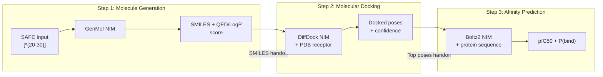

The **Drug Discovery Pipeline** is a meta-skill that orchestrates three NVIDIA BioNeMo NIM microservices into a single computational drug discovery workflow: **GenMol** generates drug-like molecules, **DiffDock** docks them to a protein target, and **Boltz2** predicts binding affinity for the top candidates. This pipeline enables de novo hit discovery, lead optimization, and virtual screening — all composed as a sequential fan-out where each step's output feeds directly into the next.

Sources: [SKILL.md](/nim-skills/meta-skills/drug-discovery-pipeline/SKILL.md#L1-L221)

## Pipeline Architecture

The pipeline follows a strict three-stage fan-out topology. GenMol produces a set of SMILES strings ranked by drug-likeness (QED) or lipophilicity (LogP). Those SMILES are handed off one-by-one to DiffDock, which returns ranked docking poses with confidence scores. The top docking candidates then flow into Boltz2, which predicts structure-based pIC50 affinity and binary binding probability. The fan-out narrows at each stage: generate many molecules, dock the best subset, score only the top docking hits.



The critical data contract between stages is the **SMILES string**: GenMol returns standard SMILES in its `molecules[].smiles` field, and those exact strings are passed as the `ligand` field (with `ligand_file_type: "txt"`) to DiffDock. Boltz2 receives the same SMILES in its `ligands[].smiles` field alongside the protein sequence.

Sources: [SKILL.md](/nim-skills/meta-skills/drug-discovery-pipeline/SKILL.md#L17-L26), [SKILL.md](/nim-skills/meta-skills/drug-discovery-pipeline/SKILL.md#L60-L93)

## Three Use Cases

| Use Case | Starting Point | GenMol Input Pattern | Pipeline Behavior |
|---|---|---|---|
| **De novo hit discovery** | No known scaffold | `[*{20-30}]` (masked SAFE) | Generate novel molecules from scratch, dock all candidates, score top hits |
| **Lead optimization** | Known scaffold SMILES | `safe.encode(scaffold) + ".[*{5-12}]"` | Generate analogs around the core, dock improved variants, rank by affinity |
| **Virtual screening** | Existing SMILES library | Skip GenMol; start at Step 2 | Dock the library against the target, score top docking hits with Boltz2 |

For de novo generation, GenMol requires **SAFE notation** — not raw SMILES. The `[*{min-max}]` syntax specifies a masked fragment with bounded atom counts. For scaffold-based workflows, the `safe-mol` package (`pip install safe-mol`) encodes known SMILES into SAFE notation via `safe.encode()`. Simple ring-only scaffolds may raise `SAFEFragmentationError`; fall back to the original SMILES plus a SAFE mask.

Sources: [SKILL.md](/nim-skills/meta-skills/drug-discovery-pipeline/SKILL.md#L28-L36), [science.md](/nim-skills/genmol-nim/references/science.md#L1-L35)

## Prerequisites and Configuration

Before executing the pipeline, confirm four parameters with the user:

1. **Target protein** — a PDB file (for DiffDock) and/or amino acid sequence (for Boltz2)
2. **Starting point** — de novo (no scaffold) or scaffold decoration (known core SMILES)
3. **Scoring metric** — `QED` (drug-likeness, 0–1) or `LogP` (lipophilicity)
4. **API mode** — hosted NVIDIA API or local Docker deployment

The pipeline requires `NGC_API_KEY` for hosted endpoints (Bearer token auth) and for local Docker registry login. When running local containers, **do not assume all three NIMs run on `localhost:8000` simultaneously**. Either run one container at a time with file-based handoffs, or start each NIM on a distinct host port and configure per-step URLs.

> [!TIP]
> When using hosted NVIDIA APIs, molecule inputs, target protein data, and your `NGC_API_KEY` are transmitted to external NVIDIA-hosted API endpoints on every call. Use local NIM containers for confidential or proprietary data.

Sources: [SKILL.md](/nim-skills/meta-skills/drug-discovery-pipeline/SKILL.md#L38-L53)

## Hosted vs Local Endpoints

The hosted and local endpoint paths **differ significantly** for each NIM. This is a common source of 404 errors.

| Step | NIM Skill | Hosted Endpoint | Local Endpoint |
|---|---|---|---|
| 1 — Generate | `genmol-nim` | `https://health.api.nvidia.com/v1/biology/nvidia/genmol/generate` | `http://localhost:8000/generate` |
| 2 — Dock | `diffdock-nim` | `https://health.api.nvidia.com/v1/biology/mit/diffdock` | `http://localhost:8000/molecular-docking/diffdock/generate` |
| 3 — Predict | `boltz2-nim` | `https://health.api.nvidia.com/v1/biology/mit/boltz2/predict` | `http://localhost:8000/biology/mit/boltz2/predict` |

Hosted requests require `Authorization: Bearer $NGC_API_KEY` on **every** call. Local requests use no auth header after container readiness. DiffDock's hosted path is notably different from its local path — the old `/v1/molecular-docking/diffdock/generate` hosted URL returns 404.

Sources: [api.md](/nim-skills/genmol-nim/references/api.md#L5-L8), [api.md](/nim-skills/diffdock-nim/references/api.md#L5-L10), [api.md](/nim-skills/boltz2-nim/references/api.md#L5-L8)

## Step 1: Generate Molecules with GenMol

GenMol generates drug-like molecules from SAFE notation input and returns standard SMILES with a quality score. Request more molecules than needed (e.g., 30) to compensate for post-generation filtering of invalid or duplicate structures.

```python
import requests, json, os
import safe as sf                          # pip install safe-mol
from pathlib import Path

NGC_API_KEY = os.getenv("NGC_API_KEY")
HOSTED = True

if HOSTED:
    genmol_url = "https://health.api.nvidia.com/v1/biology/nvidia/genmol/generate"
    headers = {"Content-Type": "application/json",
               "Authorization": f"Bearer {NGC_API_KEY}"}
else:
    genmol_url = "http://localhost:8000/generate"
    headers = {"Content-Type": "application/json"}

# De novo generation (no scaffold):
safe_input = "[*{20-30}]"

# Scaffold decoration (known core):
# scaffold_smiles = "c1ccccc1"
# safe_input = sf.encode(scaffold_smiles) + ".[*{5-10}]"

payload = {
    "smiles": safe_input,              # SAFE notation, not raw SMILES
    "num_molecules": 30,
    "scoring": "QED",                  # QED or LogP
    "unique": True,
    "temperature": "1.0",             # string, not float
    "noise": "1.0",                   # string, not float
}

r = requests.post(genmol_url, headers=headers, json=payload)
r.raise_for_status()
molecules = r.json()["molecules"]
molecules_sorted = sorted(molecules, key=lambda x: x["score"], reverse=True)
top_20 = molecules_sorted[:20]
```

### GenMol Payload Reference

| Field | Type | Required | Notes |
|---|---|---|---|
| `smiles` | string | yes | SAFE notation with `[*{min-max}]` masks — **not raw SMILES** |
| `num_molecules` | integer | no | 1–1000; actual output may be fewer after filtering |
| `temperature` | **string** | no | `"0.01"`–`"10"` — **must be string, not float** |
| `noise` | **string** | no | `"0"`–`"2"` — **must be string, not float** |
| `step_size` | integer | no | 1–10; larger may reduce quality |
| `scoring` | string | no | `"QED"` (drug-likeness) or `"LogP"` (lipophilicity) |
| `unique` | boolean | no | Deduplicate output before returning |

> [!TIP]
> The `temperature` and `noise` fields in GenMol's payload must be **quoted strings** (`"1.0"`), not bare floats (`1.0`). This is an API quirk that silently fails or produces unexpected results if violated.

Sources: [SKILL.md](/nim-skills/meta-skills/drug-discovery-pipeline/SKILL.md#L55-L93), [api.md](/nim-skills/genmol-nim/references/api.md#L24-L49)

## Step 2: Dock Molecules with DiffDock

DiffDock performs blind molecular docking — it searches the receptor surface without requiring a user-specified binding pocket. The protein input must contain **only ATOM records** (strip HETATM, waters, and headers). Ligands from GenMol are passed as SMILES with `ligand_file_type: "txt"`.

```python
# Load protein (ATOM records only)
receptor_pdb_raw = Path("target.pdb").read_text()
receptor_pdb = "\n".join(line for line in receptor_pdb_raw.splitlines()
                          if line.startswith("ATOM"))

if HOSTED:
    diffdock_url = "https://health.api.nvidia.com/v1/biology/mit/diffdock"
else:
    diffdock_url = "http://localhost:8000/molecular-docking/diffdock/generate"

docking_results = []

for i, mol in enumerate(top_20):
    payload = {
        "protein": receptor_pdb,
        "ligand": mol["smiles"],
        "ligand_file_type": "txt",     # "txt" for SMILES input
        "num_poses": 5,
        "time_divisions": 20,
        "steps": 18,
        "save_trajectory": False,
    }

    r = requests.post(diffdock_url, headers=headers, json=payload)
    r.raise_for_status()
    result = r.json()

    best_conf = result["position_confidence"][0]  # rank 1 pose
    best_pose = result["ligand_positions"][0]

    docking_results.append({
        "smiles": mol["smiles"],
        "qed_score": mol["score"],
        "docking_confidence": best_conf,
        "best_pose_sdf": best_pose,
    })

# Rank by docking confidence (higher/less-negative = better)
docking_results.sort(key=lambda x: x["docking_confidence"], reverse=True)
```

### DiffDock Payload Reference

| Field | Type | Required | Notes |
|---|---|---|---|
| `protein` | string | yes | PDB content — **ATOM records only** |
| `ligand` | string | yes | SMILES string or SDF/MOL2 content |
| `ligand_file_type` | string | yes | `"txt"` for SMILES, `"sdf"`, or `"mol2"` — **not `"smiles"`** |
| `num_poses` | integer | no | ≤100; number of docking poses to generate |
| `time_divisions` | integer | no | ≤20; diffusion time divisions |
| `steps` | integer | no | ≤18; diffusion steps |
| `save_trajectory` | boolean | no | Include trajectory frames in response |

### DiffDock Confidence Interpretation

DiffDock returns `position_confidence` as **negative floats**. Higher (less negative) values indicate more reliable binding pose predictions. The confidence scores are pose-ranking signals within a single response — they are **not calibrated binding free energies** and should not be reported as pIC50, Kd, or ΔG.

Sources: [SKILL.md](/nim-skills/meta-skills/drug-discovery-pipeline/SKILL.md#L95-L130), [api.md](/nim-skills/diffdock-nim/references/api.md#L14-L41), [science.md](/nim-skills/diffdock-nim/references/science.md#L1-L41)

## Step 3: Predict Binding Affinity with Boltz2

Boltz2 predicts biomolecular complex structures and estimates ligand binding affinity. Unlike DiffDock (which docks against an existing PDB structure), Boltz2 requires the **protein amino acid sequence** — not the PDB file. Affinity is requested by setting `predict_affinity: true` on exactly one ligand per request.

```python
if HOSTED:
    boltz_url = "https://health.api.nvidia.com/v1/biology/mit/boltz2/predict"
else:
    boltz_url = "http://localhost:8000/biology/mit/boltz2/predict"

target_sequence = "<YOUR_TARGET_PROTEIN_SEQUENCE>"

affinity_results = []
for d in docking_results[:5]:  # score top 5 docking hits
    payload = {
        "polymers": [
            {"id": "A", "molecule_type": "protein", "sequence": target_sequence}
        ],
        "ligands": [
            {"id": "L1", "smiles": d["smiles"], "predict_affinity": True}
        ],
        "recycling_steps": 3,
        "sampling_steps": 50,
        "diffusion_samples": 1,
        "output_format": "mmcif",
    }

    r = requests.post(boltz_url, headers=headers, json=payload)
    r.raise_for_status()
    result = r.json()

    aff = result["affinities"]["L1"]
    pic50 = aff["affinity_pic50"][0]
    prob_binding = aff["affinity_probability_binary"][0]

    affinity_results.append({
        **d,
        "pic50": pic50,
        "probability_binding": prob_binding,
    })

# Final ranking by pIC50
affinity_results.sort(key=lambda x: x["pic50"], reverse=True)
```

### Boltz2 Key Fields

| Field | Type | Required | Notes |
|---|---|---|---|
| `polymers` | list | yes | Protein/DNA/RNA chains — **use `polymers`, not `sequences`** |
| `ligands` | list | no | Small molecules with `smiles` or `ccd` identifier |
| `ligands[].predict_affinity` | bool | no | Enable affinity; **max 1 ligand per request** |
| `recycling_steps` | int | no | 1–10; more = better quality, slower |
| `sampling_steps` | int | no | 10–1000; diffusion sampling steps |
| `diffusion_samples` | int | no | 1–25; number of structures to generate |

Sources: [SKILL.md](/nim-skills/meta-skills/drug-discovery-pipeline/SKILL.md#L132-L179), [api.md](/nim-skills/boltz2-nim/references/api.md#L14-L59)

## Interpreting Results

After all three stages complete, the pipeline produces a ranked list of drug candidates with scores from each stage. Understanding what each score means — and what it does not mean — is critical for scientific interpretation.

| Score | Source | Range | Interpretation |
|---|---|---|---|
| **QED** | GenMol | 0–1 | Drug-likeness; >0.5 is considered drug-like |
| **LogP** | GenMol | ~−5 to +7 | Lipophilicity; moderate values (1–3) often preferred |
| **Docking confidence** | DiffDock | Negative floats | Higher (less negative) = more reliable pose; **not a binding free energy** |
| **pIC50** | Boltz2 | ~0–12 | Predicted −log₁₀(IC50); >6 = sub-micromolar, >8 = very potent |
| **P(bind)** | Boltz2 | 0–1 | Binary binding probability; >0.7 = likely binder |

All scores are **model estimates requiring orthogonal validation**. QED and LogP are heuristic properties, not direct activity or toxicity measurements. DiffDock confidence is a pose-ranking signal, not a calibrated affinity. Boltz2 pIC50 and P(bind) are predictions that should be confirmed with experimental assays. Generated molecules always require medicinal chemistry review, synthetic feasibility checks, and liability screening before use.

Sources: [SKILL.md](/nim-skills/meta-skills/drug-discovery-pipeline/SKILL.md#L183-L190), [science.md](/nim-skills/genmol-nim/references/science.md#L14-L22), [science.md](/nim-skills/boltz2-nim/references/science.md#L17-L23)

## Pipeline Gotchas and Critical Type Requirements

The pipeline has several non-obvious API contract requirements that are validated in the evaluation suite. Violating any of these produces silent failures or 422 errors.

| Gotcha | Stage | Detail |
|---|---|---|
| SAFE notation required | GenMol | The `smiles` field accepts SAFE notation, not raw SMILES. De novo uses `[*{20-30}]`; scaffolds must be encoded with `safe-mol` |
| String-typed numerics | GenMol | `temperature` and `noise` must be strings (`"1.0"`), not floats (`1.0`) |
| `ligand_file_type: "txt"` | DiffDock | SMILES input uses `"txt"`, not `"smiles"` or `"sdf"` |
| ATOM records only | DiffDock | Strip HETATM, waters, and headers from PDB before sending |
| `polymers` not `sequences` | Boltz2 | The protein input field is `polymers`; using `sequences` fails with 422 |
| `predict_affinity: true` | Boltz2 | Must be explicitly set on the ligand; max one affinity ligand per request |
| Protein sequence not PDB | Boltz2 | Boltz2 needs the amino acid sequence, not the PDB file content |
| Hosted ≠ local paths | DiffDock | Hosted: `/v1/biology/mit/diffdock`; local: `/molecular-docking/diffdock/generate` |
| Bearer auth on all hosted | All | Every hosted request needs `Authorization: Bearer $NGC_API_KEY` |

Sources: [evals.json](/nim-skills/meta-skills/drug-discovery-pipeline/evals/evals.json#L1-L167)

## Local Docker Deployment

When running the pipeline locally, each NIM runs in its own Docker container with specific GPU, memory, and cache requirements. The containers are started independently, and the pipeline coordinates calls between them.

| NIM | Image | Min GPU VRAM | `--shm-size` | Cache Size |
|---|---|---|---|---|
| GenMol | `nvcr.io/nim/nvidia/genmol:1.0.1` | 16 GB | 2G | ~20 GB |
| DiffDock | `nvcr.io/nim/mit/diffdock:2.2.0` | 24 GB | 2G | ~40 GB |
| Boltz2 | `nvcr.io/nim/mit/boltz2:1.6.0` | 16 GB | 16G | ~30 GB |

All containers require `--runtime=nvidia`, `--ulimit memlock=-1`, `--ulimit stack=67108664`, and the `NGC_API_KEY` environment variable for first-run model downloads. Wait for readiness on `http://localhost:<port>/v1/health/ready` before sending inference requests. Local inference requests use **no auth header** after readiness.

For detailed Docker startup commands, refer to the individual NIM skill references: [GenMol api.md](/nim-skills/genmol-nim/references/api.md#L131-L159), [DiffDock api.md](/nim-skills/diffdock-nim/references/api.md#L97-L126), [Boltz2 api.md](/nim-skills/boltz2-nim/references/api.md#L8-L12).

Sources: [api.md](/nim-skills/genmol-nim/references/api.md#L163-L190), [api.md](/nim-skills/diffdock-nim/references/api.md#L140-L156)

## Evaluation and Quality Assurance

The drug-discovery-pipeline meta-skill includes a comprehensive evaluation suite that validates correct pipeline composition, API contract adherence, and data handoff integrity. The eval configuration uses the `aces_default` grading mode with `NGC_API_KEY` as the required runtime environment variable.

| Eval ID | Scenario | Key Assertions |
|---|---|---|
| `eval-1-de-novo-hit-discovery` | Full hosted pipeline with EGFR receptor | SAFE notation, string temperature/noise, `ligand_file_type: "txt"`, ATOM-only protein, `polymers` field, SMILES handoff |
| `eval-2-lead-optimization-scaffold` (deferred) | Scaffold decoration for CDK2 | SAFE encoding of known SMILES, correct hosted URLs, ATOM filtering, `predict_affinity` flag, pIC50 extraction |
| `eval-3-docking-affinity-scoring` (deferred) | Docking + affinity only (no GenMol) | Negative confidence interpretation, `ligand_file_type: "txt"`, correct local endpoint, `polymers` field, `affinity_probability_binary` extraction, Bearer auth |
| `eval-4-full-hosted-pipeline` (deferred) | Complete Python script for all three stages | Exact hosted URLs for all three NIMs, Bearer auth on every request, string-typed GenMol params, top-hits selection with `polymers` field |

Sources: [evals.json](/nim-skills/meta-skills/drug-discovery-pipeline/evals/evals.json#L1-L167), [config.yml](/nim-skills/meta-skills/drug-discovery-pipeline/evals/config.yml#L1-L10)

## Skill Dependency Map

The drug-discovery-pipeline is a meta-skill that composes three individual NIM skills. Each constituent skill has its own `SKILL.md`, reference documentation, eval suite, and Docker configuration. For API-specific payload details, Docker flags, and scientific limitations beyond what the pipeline documents, consult the individual skill references.

| Step | Skill Name | Location | Key Reference |
|---|---|---|---|
| 1 | `genmol-nim` | `nim-skills/genmol-nim/` | [SKILL.md](/nim-skills/genmol-nim/SKILL.md#L1-L127) |
| 2 | `diffdock-nim` | `nim-skills/diffdock-nim/` | [SKILL.md](/nim-skills/diffdock-nim/SKILL.md#L1-L119) |
| 3 | `boltz2-nim` | `nim-skills/boltz2-nim/` | [SKILL.md](/nim-skills/boltz2-nim/SKILL.md#L1-L147) |

Sources: [SKILL.md](/nim-skills/meta-skills/drug-discovery-pipeline/SKILL.md#L192-L198), [README.md](/nim-skills/meta-skills/README.md#L1-L15)

## Next Steps

- Dive deeper into the individual NIM skills: [NIM Skills](5-nim-skills)
- Explore the other meta-skill pipeline: [MSA Structure Prediction Pipeline](10-msa-structure-prediction-pipeline)
- Understand local deployment specifics: [Hosted vs Local NIM Deployment](12-hosted-vs-local-nim-deployment)
- Learn about the evaluation framework: [Skill Lift Evaluation](14-skill-lift-evaluation)