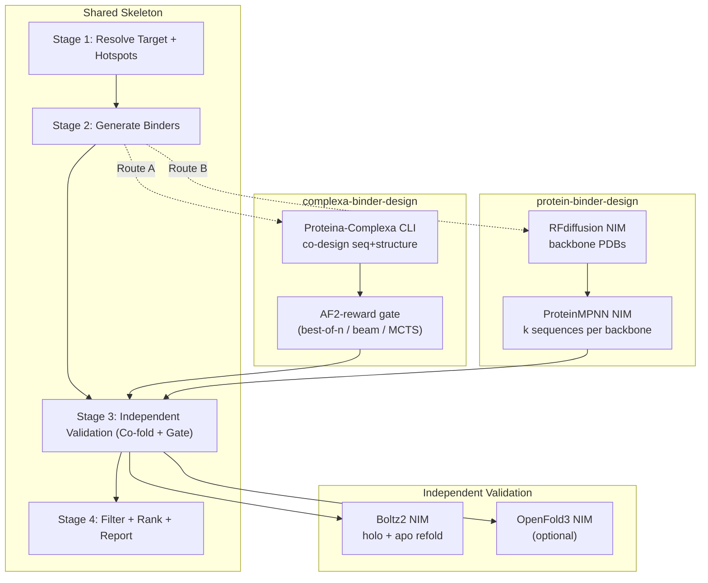

The **Generative Protein Binder Design** workflow provides two independent, composable skill routes for *de novo* protein binder design — each resolving a target structure and hotspots, generating candidate binders, independently co-folding the binder–target complex with a structure predictor, and ranking by interface confidence metrics. The two routes differ in their **generation paradigm**: one uses NVIDIA's Proteina-Complexa for reward-guided co-design of sequence+structure together; the other composes BioNeMo NIMs (RFdiffusion → ProteinMPNN → Boltz2/OpenFold3) in the classic diffusion + inverse-folding pipeline. Both converge on the same validation philosophy: an **independent** structure predictor grades what the generator produced, preventing self-evaluation bias.

Sources: [README.md](/workflows/generative-protein-binder-design/README.md#L1-L16), [workflow-rules.mdc](/workflows/generative-protein-binder-design/workflow-rules.mdc#L1-L36)

## Route Selection

The workflow exposes two skills, selected by the user's preferred generation approach and available backend:

| Dimension | `complexa-binder-design` | `protein-binder-design` |
|---|---|---|
| **Generator** | Proteina-Complexa (reward-guided co-design of sequence+structure) | RFdiffusion backbones → ProteinMPNN sequences |
| **Selection** | Internal AF2-reward gate + test-time search (best-of-n / beam / FK / MCTS) | Filter by co-fold interface metrics |
| **Independent validation** | Boltz2 (default) or OpenFold3 co-fold | Boltz2 / OpenFold3 co-fold |
| **Ranking metrics** | interface confidence, pLDDT, ipSAE, apo/holo stability, hotspot contact | ipTM / ipSAE / pLDDT / apo↔holo RMSD |
| **Backend** | Proteina-Complexa (local) + Boltz2 NIM | BioNeMo NIMs (RFdiffusion, ProteinMPNN, Boltz2/OpenFold3) |
| **Prefer when** | User asks for Proteina-Complexa / reward-guided search | User wants the RFdiffusion + ProteinMPNN NIM pipeline |

Pick based on the generator the user wants (Proteina-Complexa vs RFdiffusion/ProteinMPNN) or which backend is available. Both resolve target + hotspots first, generate binders, co-fold the complex with an independent predictor, and rank by interface metrics.

Sources: [route-selection.mdc](/workflows/generative-protein-binder-design/references/route-selection.mdc#L1-L26)

## Architecture Overview

The following diagram illustrates how both routes share a common four-stage skeleton — target resolution, generation, independent validation, and report — while differing in their generation and selection internals:



> [!TIP]
> Both routes validate with a **different model family** than the generator — Complexa's AF2 reward is not the final judge (Boltz2/OpenFold3 is), and RFdiffusion/ProteinMPNN outputs are independently co-folded. This "generator ≠ validator" principle is the core quality guarantee.

Sources: [workflow-rules.mdc](/workflows/generative-protein-binder-design/workflow-rules.mdc#L1-L36), [protein-binder-design SKILL.md](/workflows/generative-protein-binder-design/protein-binder-design/SKILL.md#L1-L117), [complexa-binder-design SKILL.md](/workflows/generative-protein-binder-design/complexa-binder-design/SKILL.md#L1-L200)

---

## Route A: protein-binder-design (RFdiffusion + ProteinMPNN + Boltz2/OpenFold3)

This skill composes atomic BioNeMo NIMs into a sequential pipeline: diffuse binder backbones, design sequences onto those backbones, co-fold each binder with the target, and rank by interface quality. The skill owns orchestration, handoff contracts, filtering, validation, and the run manifest — it does **not** duplicate per-NIM API details, deferring those to each atomic skill's own `SKILL.md`.

### Composed NIM Skills

| Step | Skill | Owns |
|---|---|---|
| Backbones | `rfdiffusion-nim` | binder backbone PDBs (contigs + hotspots) |
| Sequences | `proteinmpnn-nim` | sequences for each backbone |
| Co-fold / score | `boltz2-nim` or `openfold3-nim` | binder–target complex + confidence / ipTM |
| MSA (optional) | `msa-search-nim` | target A3M for higher-quality folding |

The atomic NIM skills are **recommended companions** but not strictly required — `references/pipeline.md` carries the concrete request shape for every NIM call, so an agent with NIM access can follow this skill standalone.

### Pipeline Stages

**Stage 1 — Target prep:** Obtain the target PDB and epitope; map epitope/hotspot author residue numbers to RFdiffusion `hotspot_res` strings; optionally build a target MSA with `msa-search-nim`. A human-in-the-loop gate confirms target chain, epitope/hotspot set, binder length range, and hosted-vs-local before proceeding.

**Stage 2 — Backbones (RFdiffusion):** Generate N binder backbone PDBs using the target `input_pdb`, a contig combining the target segment and a generated binder segment (e.g. `"E1-200/0 60-90"`), and `hotspot_res` strings like `["E453", "E455", "E486"]`:

```python
payload = {
    "input_pdb": target_pdb,
    "contigs": "E1-200/0 60-90",
    "hotspot_res": ["E453", "E455", "E456", "E486", "E489", "E493", "E501"],
    "diffusion_steps": 50,
}
```

**Stage 3 — Sequences (ProteinMPNN):** For each backbone, design k sequences redesigning the **binder chain only** (`input_pdb_chains=[binder_chain]`) so the target chain stays fixed. **Drop the native/WT row** from `mfasta` and pair scores only with designed rows:

```python
payload = {
    "input_pdb": backbone_pdb,
    "input_pdb_chains": [binder_chain],
    "num_seq_per_target": 8,
    "sampling_temp": [0.1, 0.2],
    "use_soluble_model": True,
}
```

**Stage 4 — Co-fold + score (Boltz2 / OpenFold3):** Co-fold each designed binder with the target as a 2-chain complex. OpenFold3 returns explicit `iptm_score`; Boltz2 returns `confidence_scores` as the fallback complex-confidence signal.

**Stage 5 — Self-consistency RMSD:** Compare the RFdiffusion backbone to the predicted binder chain from the co-folded complex using Kabsch CA-RMSD (`scripts/metrics.py`). Low RMSD indicates the sequence is predicted to fold back into the designed backbone.

**Stage 6 — Filter + rank + report:** Apply thresholds, rank survivors, write manifest + CSV.

### Handoff Contracts

The glue between NIM steps is the most fragile part of the pipeline. Key contracts:

- **RFdiffusion `output_pdb` → ProteinMPNN `input_pdb`** (inline PDB text).
- **ProteinMPNN `mfasta` → Boltz2 binder polymer `sequence`** (exclude the native/WT row; pair scores only with designed rows).
- **Epitope author residue numbers → 1-based sequence indices:** remap with `scripts/pdb_utils.py:remap_to_seq_index`. RFdiffusion `hotspot_res` uses chain+author strings like `"A50"`; Boltz2 pocket/contacts use 1-based indices.
- **Boltz2 complex `.cif` → binder chain → self-consistency RMSD** vs the backbone.

### Default Filters

| Metric | Threshold | Source |
|---|---|---|
| ipTM | ≥ 0.8 | OpenFold3 `iptm_score` / Boltz2 `confidence_scores` |
| Binder pLDDT | ≥ 80 | OpenFold3 / Boltz2 |
| Self-consistency RMSD | ≤ 2.0 Å | `scripts/metrics.py` (Kabsch CA-RMSD) |

Override per campaign and record overrides in the manifest `filters` field.

### Validation Methodology

Always run controls and report a **success rate**, not just top scores. **Negative controls** use composition-preserving scrambled sequences (`scripts/controls.py`); **positive controls** re-score published binders through the identical pipeline. Benchmark targets live in `assets/targets.json` (`scripts/registry.py`). The success rate (fraction of designs passing the filter) is the primary metric for comparing pipeline configurations — absolute scores are not comparable across pipelines.

### Run Manifest

Every campaign writes `manifest.json` + `candidates.csv` under a run directory via `scripts/manifest.py`. The manifest records lineage, params, scores, artifacts, filter status, and controls — enabling ranking, resumability, validation, and the final report:

```text
runs/<campaign>_<date>/
├── manifest.json          # campaign state
├── candidates.csv         # flat table, regenerated from the manifest
├── backbones/             # RFdiffusion output PDBs
├── sequences/             # ProteinMPNN mfasta files
└── complexes/             # Boltz2/OpenFold3 co-folded .cif files
```

The manifest is resumable — an interrupted campaign reloads it and skips candidates that already have the needed scores/artifacts.

Sources: [protein-binder-design SKILL.md](/workflows/generative-protein-binder-design/protein-binder-design/SKILL.md#L1-L117), [pipeline.md](/workflows/generative-protein-binder-design/protein-binder-design/references/pipeline.md#L1-L152), [manifest.md](/workflows/generative-protein-binder-design/protein-binder-design/references/manifest.md#L1-L72), [validation.md](/workflows/generative-protein-binder-design/protein-binder-design/references/validation.md#L1-L70), [manifest.py](/workflows/generative-protein-binder-design/protein-binder-design/scripts/manifest.py#L1-L180), [metrics.py](/workflows/generative-protein-binder-design/protein-binder-design/scripts/metrics.py#L1-L40), [pdb_utils.py](/workflows/generative-protein-binder-design/protein-binder-design/scripts/pdb_utils.py#L1-L92), [controls.py](/workflows/generative-protein-binder-design/protein-binder-design/scripts/controls.py#L1-L27)

---

## Route B: complexa-binder-design (Proteina-Complexa + Boltz2/OpenFold3)

This skill uses NVIDIA's **Proteina-Complexa** — an open model that **co-designs binder sequence + full-atom structure together** (no inverse-folding step) with reward-guided test-time search. Validation uses a **different** model family (Boltz2 / OpenFold3), so the headline confidence is an independent check, not the generator grading its own homework.

### Upstream Model (User-Provided)

- **Code:** [github.com/NVIDIA-Digital-Bio/Proteina-Complexa](https://github.com/NVIDIA-Digital-Bio/Proteina-Complexa) (the `complexa` CLI)
- **Weights (NGC):** `nvidia/clara/proteina_complexa`
- **Paper:** Didi et al., *Scaling Atomistic Protein Binder Design…*, ICLR 2026
- **First-time setup:** `references/setup.md` — full standalone install with **no NIM** required for generation

### Pipeline Stages

**Stage 1 — Resolve target + hotspots (no GPU):** The user provides a target as a name, sequence, and/or structure file. The skill resolves exactly **one** design-ready structure in priority order: (1) experimental PDB (RCSB), (2) AFDB model (UniProt), (3) user-provided file, (4) fold de novo. Hotspots resolve in evidence order:

1. **PDB co-complex interface** (gold standard) — interface residues from a structure where the target contacts a protein partner
2. **UniProt functional residues** — `Mutagenesis` + accessible `Active/Binding/Site`, filtered to the extracellular/accessible range
3. **Literature (Paperclip)** — full-text mining when 1–2 are empty
4. **Unconditioned** (`[]`) only as a documented last resort

Deterministic enforcement then applies: **structure alignment** (drop residues absent from the coordinate file, read back real 3-letter identity), **epitope sanity** (drop outliers > 30 Å from cluster centroid, cap at 15 residues), and **size budget ≤ 500 residues** (Complexa builds an O(n²) pair-feature map over the whole complex). **Preflight** (`scripts/preflight_design.py`) reports the conditioned length, re-aligned hotspots, compactness, budget, and a READY / NEEDS-ATTENTION verdict — review before spending GPU.

**Stage 2 — Generate (Proteina-Complexa CLI):** Register the target, then use `complexa generate` (NOT the full `complexa design`) with reward-guided `best-of-n`:

```bash
python scripts/complexa_design.py run --task-name <name> --run-name <run> \
    --algorithm best-of-n --num-samples <N> --seed 0 --out <run-dir>
```

Search algorithms: `best-of-n` (default) · `beam-search` · `fk-steering` · `mcts`. The AF2 reward (configured via `setup_af2_params.sh` + `AF2_DIR`) AF2-selects the best candidates **during generation** and writes co-designed sequence + structure PDBs to `inference/`. **Use the sequence directly — do not MPNN-redesign it.**

> [!TIP]
> **Do NOT run the full `complexa design`** for this workflow. Its `evaluate` stage re-folds every design with AF2/RF3/ESMFold (redundant — best-of-n already AF2-selected during search) and its `analyze` stage needs `foldseek`/`sc` (usually not installed). The lean `generate` → independent Boltz2 validation is the intended path. No AF2 params? Use `--af2-bypass` and let the Boltz2 gate select.

**Stage 3 — Validate (independent refold + gate):** Per binder, run **two** predictions with one refolder (Boltz2 default): **holo** (binder + target; target MSA, binder single-sequence, `write_full_pae`) and **apo** (binder alone). `scripts/boltz2_refold.py` makes holo calls (retry/backoff for rate limits), then chains `scripts/validate_binders.py` for apo + metrics + gate + rank.

**Stage 4 — Gate + rank + report:** Apply the strict gate, rank survivors, write `ranked_binders.json`/`.csv`, and produce the report.

### Validation Gates (complexa route)

Every gate must hold for a design to pass:

| Metric | Gate | Meaning |
|---|---|---|
| ipTM | ≥ 0.65 | predicted interface quality |
| Complex pLDDT | ≥ 0.70 | overall complex fold confidence |
| Binder pLDDT (holo) | ≥ 0.70 | binder fold confidence in complex |
| Apo binder pLDDT | ≥ 0.70 | binder fold confidence alone |
| ipSAE (min) | ≥ 0.45 | min interface-pSAE over binder↔target |
| Apo↔holo binder RMSD | ≤ 2.5 Å | pre-organization / rigidity signal |
| Hotspot contact | ≥ 20% | fraction of conditioned hotspots contacted (CB–CB < 13 Å) |

**Per-chain conditioning:** binder = single-sequence, no MSA, no template (de novo); target = MSA (via `msa-search-nim` or `scripts/fetch_target_msa_colabfold.py`), optional structural template (via `scripts/pdb_to_boltz_template_cif.py`). Validation is **always unconditioned** — the holo refold receives only sequences, never the hotspot list; hotspot contact is then an independent geometric test.

### Bounded-Budget Loop

The deliverable is **top-N binders ranked by interface confidence** (default 10). Run **at most 2 generation rounds**, then deliver the top-N by score even if fewer than N clear the strict gate — keep each design's `pass`/`failure_reason` flag. **Do not** keep generating just to chase N strict passes. Stop on: N-passed / 2 rounds / budget exhausted / ≥3 consecutive zero-passer rounds. A persistent 0% pass rate is a scientific signal (bad hotspots/length/algorithm) — surface it and propose changes.

### Output Layout

```text
outputs/<target>_<run_id>/
├── target.pdb / target.cif
├── hotspots.json
├── design/                     # Complexa complex PDBs + run config
├── sequences/                  # binder sequences extracted from complexes
├── validation/holo/ , validation/apo/
├── ranked_binders.json / .csv  # every design (pass+fail), all metrics
├── REPORT_<target>_<run_id>.md
└── manifest.json
```

Sources: [complexa-binder-design SKILL.md](/workflows/generative-protein-binder-design/complexa-binder-design/SKILL.md#L1-L200), [complexa pipeline.md](/workflows/generative-protein-binder-design/complexa-binder-design/references/pipeline.md#L1-L124), [complexa validation.md](/workflows/generative-protein-binder-design/complexa-binder-design/references/validation.md#L1-L81), [pipeline.py](/workflows/generative-protein-binder-design/complexa-binder-design/scripts/pipeline.py#L1-L200)

---

## NIM Configuration (Hosted vs Local)

Each NIM in the pipeline is reached over HTTP. Choose **hosted** or **local** once and reuse for every call:

| NIM | Hosted Endpoint | Local Port | Idle GPU | Docker Image |
|---|---|---|---|---|
| RFdiffusion | `health.api.nvidia.com/v1/biology/ipd/rfdiffusion/generate` | 8081 | ~24 GB | `nvcr.io/nim/ipd/rfdiffusion:latest` |
| ProteinMPNN | `health.api.nvidia.com/v1/biology/ipd/proteinmpnn/predict` | 8082 | ~1.5 GB | `nvcr.io/nim/ipd/proteinmpnn:latest` |
| Boltz2 | `health.api.nvidia.com/v1/biology/mit/boltz2/predict` | 8083 | ~8 GB | `nvcr.io/nim/mit/boltz2:latest` |

**Hosted:** set `NVIDIA_API_KEY` (sent as `Authorization: Bearer`). Read keys from the environment — never hardcode them.

**Local:** point each NIM at its local URL (e.g. `http://localhost:8000/...`); no auth header needed. All three NIMs co-fit on one ≥48 GB GPU (~33 GB idle together). Launch each with a persistent cache volume (`/opt/nim/.cache`) so weights download once. Some NIMs (e.g. Boltz2) need `NIM_MODEL_PROFILE` pinned on GPUs with no bundled profile; others (RFdiffusion/ProteinMPNN) auto-select by compute capability.

Sources: [local-nim-setup.md](/workflows/generative-protein-binder-design/protein-binder-design/references/local-nim-setup.md#L1-L81), [rfdiffusion-nim SKILL.md](/nim-skills/rfdiffusion-nim/SKILL.md#L1-L164), [proteinmpnn-nim SKILL.md](/nim-skills/proteinmpnn-nim/SKILL.md#L1-L115), [boltz2-nim SKILL.md](/nim-skills/boltz2-nim/SKILL.md#L1-L147)

---

## Cost Funnel and Human-in-the-Loop

Co-folding is the expensive stage in both routes. Key cost discipline patterns:

- **protein-binder-design:** Co-fold a **capped shortlist** first (e.g. best ProteinMPNN NLL per backbone), review, then expand. Reserve high `recycling_steps`/`diffusion_samples` for final survivors.
- **complexa-binder-design:** Validate only ~**2× the requested N** top candidates by generation/AF2 reward — validating the entire pool wastes GPU/time and trips hosted rate limits.
- **Human-in-the-loop:** Confirm target, epitope/hotspots, binder length range, and hosted-vs-local **before** generating backbones. State the deployment mode once and reuse across all NIM calls.

Sources: [pipeline.md](/workflows/generative-protein-binder-design/protein-binder-design/references/pipeline.md#L93-L110), [complexa SKILL.md](/workflows/generative-protein-binder-design/complexa-binder-design/SKILL.md#L89-L105)

---

## Bundled Scripts

### protein-binder-design scripts

| Script | Purpose |
|---|---|
| `scripts/manifest.py` | Campaign manifest — create / load / score / filter / rank / CSV |
| `scripts/pdb_utils.py` | PDB parse, chain extract, sequence, residue remap, CA coords |
| `scripts/metrics.py` | Kabsch CA-RMSD for self-consistency |
| `scripts/controls.py` | Composition-preserving scrambled negative controls |
| `scripts/registry.py` | Target-registry loader (works with `assets/targets.json`) |

### complexa-binder-design scripts

| Script | Purpose |
|---|---|
| `scripts/pipeline.py` | Orchestrator — Stage-1 resolution + generation + AF2 gate + scoring |
| `scripts/preflight_design.py` | No-GPU target/hotspot/size planner with READY verdict |
| `scripts/hotspot_strategy.py` | Evidence-based hotspot resolution |
| `scripts/pdb_interface.py` | PDB co-complex interface residue extraction |
| `scripts/complexa_design.py` | Thin `complexa generate` driver + output extraction |
| `scripts/boltz2_refold.py` | Holo Boltz2 refolds (retry/backoff + throttle) → chains validator |
| `scripts/validate_binders.py` | Apo + ipSAE + apo↔holo RMSD + hotspot contact + gating + ranking |
| `scripts/setup_af2_params.sh` | Download AF2-Multimer params (public, no auth) |
| `scripts/check_setup.sh` | One-shot environment readiness checklist |

Sources: [protein-binder-design SKILL.md](/workflows/generative-protein-binder-design/protein-binder-design/SKILL.md#L105-L117), [complexa-binder-design SKILL.md](/workflows/generative-protein-binder-design/complexa-binder-design/SKILL.md#L151-L198)

---

## Responsible Use

De novo binder design is dual-use. Both skills decline requests aimed at enhancing pathogen fitness, toxin potency, or bioweapon function; designs are kept to legitimate research and therapeutic intent.

Sources: [protein-binder-design SKILL.md](/workflows/generative-protein-binder-design/protein-binder-design/SKILL.md#L99-L102), [complexa-binder-design SKILL.md](/workflows/generative-protein-binder-design/complexa-binder-design/SKILL.md#L195-L198)

---

## Next Steps

- For the atomic NIM skills composed by the `protein-binder-design` route, see [NIM Skills](5-nim-skills).
- For the Proteina-Complexa open model backing the `complexa-binder-design` route, see [Open Model Skills](6-open-model-skills).
- For the SKILL.md format that defines each skill's interface, see [SKILL.md File Format](11-skill-md-file-format).
- For hosted vs local NIM deployment details, see [Hosted vs Local NIM Deployment](12-hosted-vs-local-nim-deployment).
- For the broader drug discovery context, see [Drug Discovery Pipeline](8-drug-discovery-pipeline).