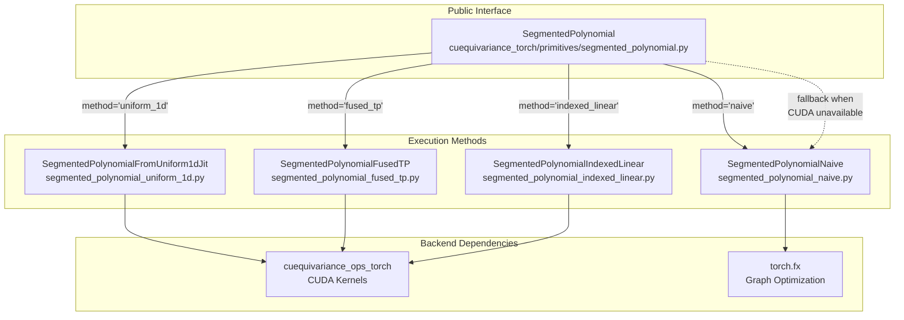
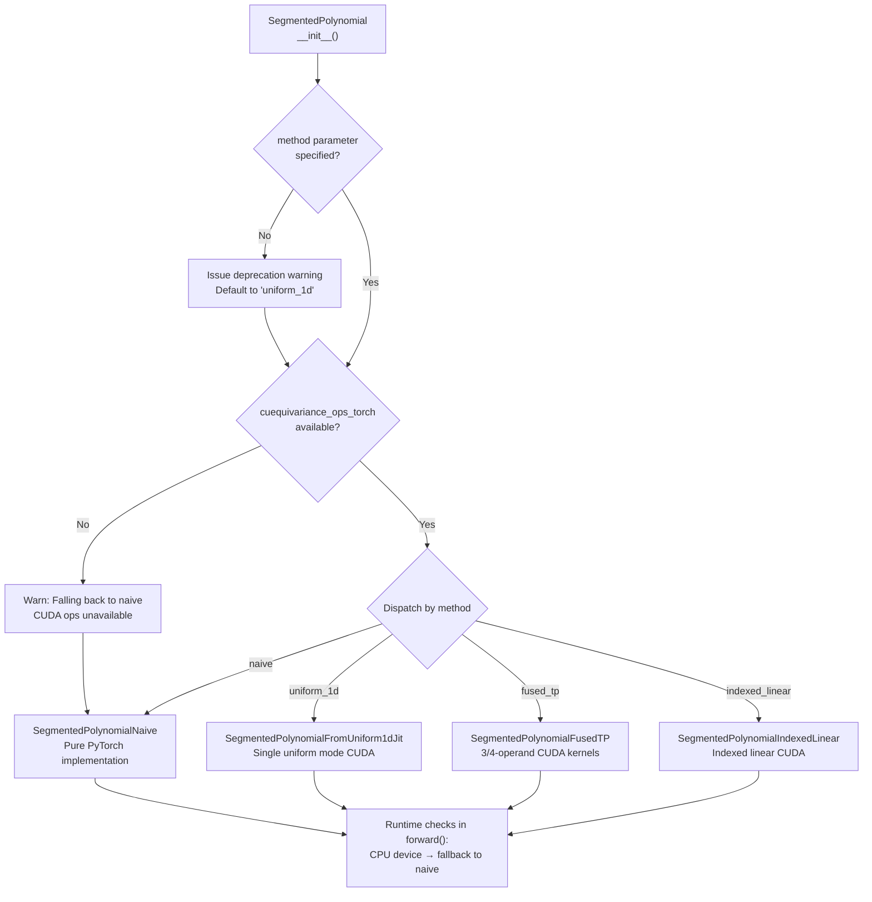
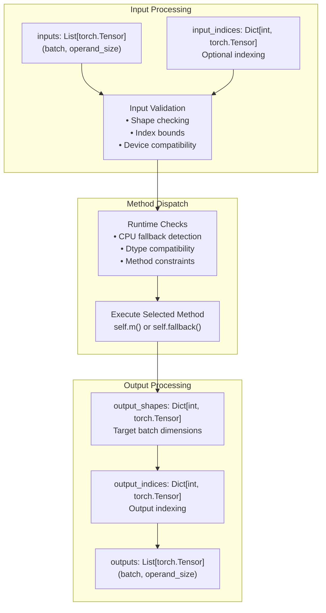

# SegmentedPolynomial

<details>
<summary>Relevant source files</summary>

The following files were used as context for generating this wiki page:

- [cuequivariance_torch/cuequivariance_torch/primitives/segmented_polynomial.py](cuequivariance_torch/cuequivariance_torch/primitives/segmented_polynomial.py)
- [cuequivariance_torch/cuequivariance_torch/primitives/segmented_polynomial_fused_tp.py](cuequivariance_torch/cuequivariance_torch/primitives/segmented_polynomial_fused_tp.py)
- [cuequivariance_torch/cuequivariance_torch/primitives/segmented_polynomial_indexed_linear.py](cuequivariance_torch/cuequivariance_torch/primitives/segmented_polynomial_indexed_linear.py)
- [cuequivariance_torch/cuequivariance_torch/primitives/segmented_polynomial_naive.py](cuequivariance_torch/cuequivariance_torch/primitives/segmented_polynomial_naive.py)
- [cuequivariance_torch/cuequivariance_torch/primitives/segmented_polynomial_uniform_1d.py](cuequivariance_torch/cuequivariance_torch/primitives/segmented_polynomial_uniform_1d.py)
- [cuequivariance_torch/tests/primitives/segmented_polynomial_test.py](cuequivariance_torch/tests/primitives/segmented_polynomial_test.py)
- [docs/api/cuequivariance_torch.rst](docs/api/cuequivariance_torch.rst)

</details>


The PyTorch `SegmentedPolynomial` module provides high-performance computation of segmented polynomials with multiple execution backends. This module serves as the primary interface for executing `cue.SegmentedPolynomial` operations in PyTorch, offering automatic method selection and fallback strategies for optimal performance across different hardware configurations.

For core mathematical concepts and the underlying data structure, see [SegmentedPolynomial](#2.1). For JAX implementation, see [segmented_polynomial](#4.1).

## Architecture Overview

The PyTorch `SegmentedPolynomial` follows a dispatcher pattern that selects the optimal execution method based on the polynomial structure, hardware availability, and user preferences.

**Class Hierarchy and Dispatch Logic**



Sources: [cuequivariance_torch/cuequivariance_torch/primitives/segmented_polynomial.py:44-190]()

## Execution Method Selection

The module automatically selects execution methods based on polynomial characteristics and hardware capabilities, with explicit user control through the `method` parameter.

**Method Selection Decision Tree**



Sources: [cuequivariance_torch/cuequivariance_torch/primitives/segmented_polynomial.py:146-189](), [cuequivariance_torch/cuequivariance_torch/primitives/segmented_polynomial.py:268-275]()

## Forward Method Interface

All execution methods implement a common interface that handles tensor batching, indexing, and shape management.

| Parameter | Type | Description |
|-----------|------|-------------|
| `inputs` | `List[torch.Tensor]` | Input tensors with shape `(batch, operand_size)` |
| `input_indices` | `Optional[Dict[int, torch.Tensor]]` | Index tensors for input operands |
| `output_shapes` | `Optional[Dict[int, torch.Tensor]]` | Target shapes for output tensors |
| `output_indices` | `Optional[Dict[int, torch.Tensor]]` | Index tensors for output operands |

**Data Flow Through Forward Method**



Sources: [cuequivariance_torch/cuequivariance_torch/primitives/segmented_polynomial.py:200-275]()

## Execution Methods

### Naive Method

The naive method provides a pure PyTorch reference implementation using `torch.fx` graph compilation for optimization.

**Key Features:**
- Universal compatibility (CPU/GPU)
- `torch.fx` graph optimization with `opt_einsum_fx` support
- Einstein summation-based tensor contractions
- Automatic differentiation support

**Implementation Details:**
- Converts `SegmentedTensorProduct` operations to `torch.fx` graphs
- Uses `torch.einsum` for coefficient-operand contractions
- Supports variable number of inputs through templated classes (`graph_inputs0` to `graph_inputs6`)
- Optional `math_dtype` conversion for numerical precision control

Sources: [cuequivariance_torch/cuequivariance_torch/primitives/segmented_polynomial_naive.py:298-342](), [cuequivariance_torch/cuequivariance_torch/primitives/segmented_polynomial_naive.py:61-236]()

### Uniform 1D Method

Optimized CUDA implementation for polynomials with single uniform mode segments.

**Constraints:**
- Operands must be 0D or 1D with uniform segment shapes
- All 1D operands must have the same extent
- Scalar coefficients only (`coefficient_subscripts == ""`)
- Requires `cuequivariance_ops_torch` with `tensor_product_uniform_1d_jit`

**Performance Optimizations:**
- Direct CUDA kernel execution
- Batch dimension inference and optimization
- Indexed tensor support with automatic memory layout

Sources: [cuequivariance_torch/cuequivariance_torch/primitives/segmented_polynomial_uniform_1d.py:89-269]()

### Fused Tensor Product Method

CUDA implementation for 3- and 4-operand tensor product contractions with automatic pattern matching.

**Supported Patterns:**
```python
supported_subscripts = [
    "u__uw_w", "_v_vw_w", "u_v_uv_u", "u_v_uv_v", 
    "u_u_uw_w", "u_v_uvw_w", "u_u_u", "u_v_uv", 
    "u_uv_v", "u__u", "_v_v"
]
```

**Key Features:**
- Automatic pattern dispatching with operand permutation
- `FusedTensorProductOp3` and `FusedTensorProductOp4` backend kernels
- Mixed precision support (FP32/FP64)
- Batch processing with scatter-gather operations

Sources: [cuequivariance_torch/cuequivariance_torch/primitives/segmented_polynomial_fused_tp.py:75-159](), [cuequivariance_torch/cuequivariance_torch/primitives/segmented_polynomial_fused_tp.py:105-120]()

### Indexed Linear Method

Specialized CUDA implementation for linear transformations with indexed weight selection.

**Use Cases:**
- Element-specific weight matrices in molecular systems
- Graph neural networks with per-edge weights
- Attention mechanisms with indexed parameters

**Implementation:**
- `indexed_linear` CUDA kernel for efficient weight selection
- Automatic subscript canonicalization and pattern matching
- Sorted index requirement for optimal memory access
- Support for different indexing patterns through `SUBDICT` lookup

Sources: [cuequivariance_torch/cuequivariance_torch/primitives/segmented_polynomial_indexed_linear.py:146-210](), [cuequivariance_torch/cuequivariance_torch/primitives/segmented_polynomial_indexed_linear.py:310-379]()

## Testing Infrastructure

The module includes comprehensive testing across execution methods, data types, and indexing patterns.

**Test Matrix Coverage:**

| Test Category | Coverage |
|---------------|----------|
| **Methods** | `naive`, `uniform_1d`, `fused_tp`, `indexed_linear` |
| **Data Types** | FP16, BF16, FP32, FP64 with mixed precision |
| **Export Modes** | `eager`, `compile`, `script`, `jit`, `export` |
| **Indexing** | Batch, shared, indexed for inputs/outputs |
| **Gradients** | Forward, backward, double backward |

**Key Test Functions:**
- `test_segmented_polynomial_indexing`: Comprehensive indexing pattern validation
- `test_segmented_polynomial_dytpes`: Data type and precision testing
- `test_segmented_polynomial_export`: TorchScript/export compatibility
- `test_segmented_polynomial_indexed_linear`: Specialized linear layer testing

Sources: [cuequivariance_torch/tests/primitives/segmented_polynomial_test.py:322-413](), [cuequivariance_torch/tests/primitives/segmented_polynomial_test.py:464-506]()

## Usage Examples

**Basic Spherical Harmonics:**
```python
import cuequivariance as cue
from cuequivariance_torch import SegmentedPolynomial

poly = cue.descriptors.spherical_harmonics(cue.SO3(1), [0, 1, 2]).polynomial
sp = SegmentedPolynomial(poly, method="uniform_1d")
x = torch.tensor([[0.0, 1.0, 0.0]])
result = sp([x])
```

**Indexed Linear Layer:**
```python
poly = cue.descriptors.linear(input_irreps, output_irreps).polynomial
linear = SegmentedPolynomial(poly, method="indexed_linear")

weights = torch.randn(3, poly.inputs[0].size)  # 3 weight sets
x = torch.randn(5, poly.inputs[1].size)
indices = torch.tensor([0, 1, 0, 2, 1])  # Weight selection

result = linear([weights, x], input_indices={0: indices})
```

Sources: [cuequivariance_torch/cuequivariance_torch/primitives/segmented_polynomial.py:81-128]()

---