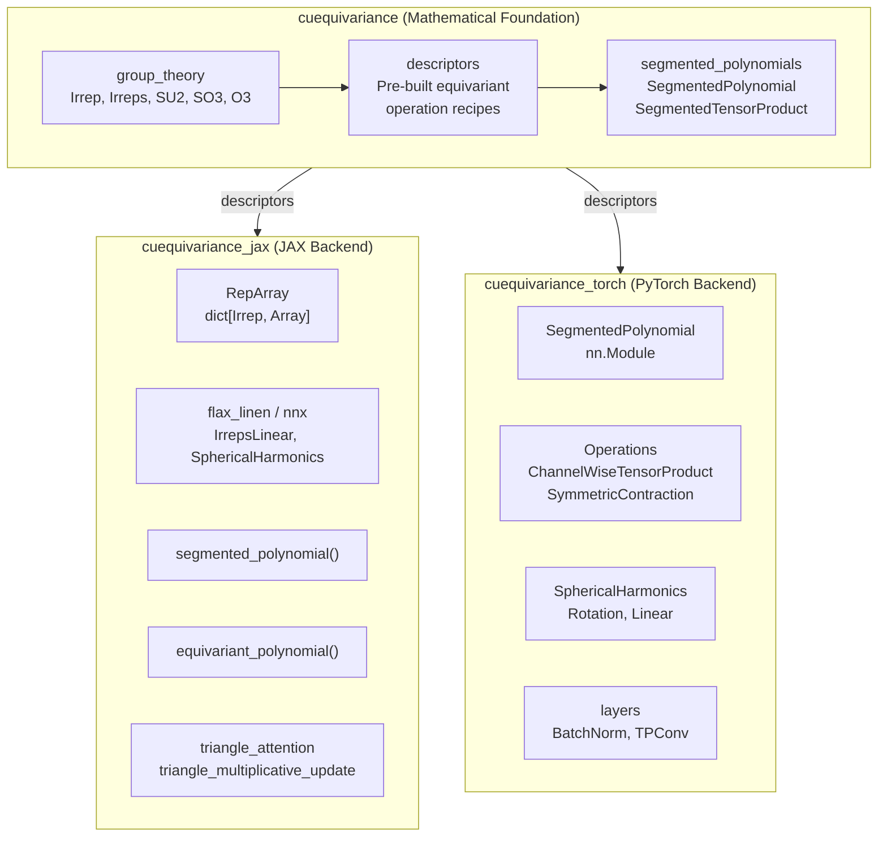
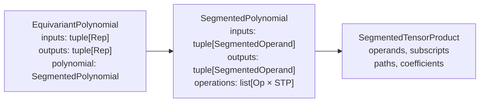

**cuEquivariance** is an NVIDIA library for building high-performance geometric neural networks that respect the physical symmetries of 3D space. By leveraging **segmented polynomials** and **CUDA-optimized kernels**, cuEquivariance provides the mathematical foundation and computational primitives needed to construct equivariant models — networks whose outputs transform predictably when their inputs are rotated or reflected. This property is essential for modeling physical systems in molecular dynamics, materials science, and protein structure prediction.

The library is currently at version **0.10.0rc2** and is in Beta status, meaning its API may evolve. It is open-source under the Apache 2.0 license.

Sources: [VERSION](VERSION#L1-L2), [README.md](README.md#L1-L32)

## Why Equivariance Matters

Equivariance is the mathematical formalization of "respecting symmetries." Physical laws are invariant under rotations and translations — a molecule's energy doesn't change if you rotate the entire system. Neural networks that encode this property directly into their architecture are more **data-efficient** and **physically consistent** than those that must learn these symmetries from data alone. cuEquivariance provides the building blocks to construct such networks with GPU-accelerated performance, offering significant speedups over pure-Python alternatives like e3nn.

The benchmark above compares cuEquivariance against e3nn on a MACE (Multi-Atomic Cluster Expansion) model. The crosses mark the largest system size that fit on a single device before running out of memory, demonstrating cuEquivariance's ability to handle larger simulations with its optimized CUDA kernels.

Sources: [docs/index.rst](docs/index.rst#L31-L45), [docs/_static/mace_benchmark.png](docs/_static/mace_benchmark.png)

## Three-Package Architecture

cuEquivariance is organized into three complementary packages that separate mathematical definitions from ML framework implementations. This design lets you describe equivariant operations once and execute them in either PyTorch or JAX.

The following table summarizes each package's role:

| Package | pip Install | Purpose | Key Dependencies |
|---|---|---|---|
| `cuequivariance` | `pip install cuequivariance` | Core math: irreps, tensor products, descriptors | numpy, scipy, sympy |
| `cuequivariance-jax` | `pip install cuequivariance-jax` | JAX/Flax execution backend | jax ≥ 0.8.1, flax |
| `cuequivariance-torch` | `pip install cuequivariance-torch` | PyTorch execution backend | torch ≥ 2.4.0 |

CUDA kernel packages (`cuequivariance-ops-jax-cu12` / `cuequivariance-ops-torch-cu12`) provide the GPU-accelerated primitives and are available for Linux x86_64 and aarch64. Python 3.10–3.14 is supported.

Sources: [cuequivariance/__init__.py](cuequivariance/cuequivariance/__init__.py#L1-L96), [cuequivariance_jax/__init__.py](cuequivariance_jax/cuequivariance_jax/__init__.py#L1-L79), [cuequivariance_torch/__init__.py](cuequivariance_torch/cuequivariance_torch/__init__.py#L1-L103), [docs/index.rst](docs/index.rst#L62-L68)

## Core Abstraction Hierarchy

At the heart of cuEquivariance lies a three-level descriptor hierarchy that defines how equivariant operations are specified, independent of any ML framework. Understanding this hierarchy is the key to working effectively with the library.

**EquivariantPolynomial** is the top-level descriptor. It wraps a `SegmentedPolynomial` and adds group representation information (`cue.Rep`) for each input and output, guaranteeing that the polynomial respects equivariance constraints. It supports stacking, filtering, transformation, and automatic differentiation (JVP, transpose, backward).

**SegmentedPolynomial** is the framework-agnostic computational graph. It maps input tensors to output tensors through a sequence of `(Operation, SegmentedTensorProduct)` pairs. Each operation specifies *which operands* participate (e.g., "multiply inputs 0, 1, and write to output 2"), while the tensor product defines *how* they combine. This is the object you create from descriptors and then pass to either the PyTorch or JAX backend.

**SegmentedTensorProduct** defines the actual tensor contraction pattern — the subscripts, paths, and coefficients for a single tensor product step. Multiple tensor products of different degrees are composed to form a polynomial.

> [!TIP]
> This descriptor hierarchy is purely mathematical. It has no dependency on PyTorch or JAX and can be evaluated with NumPy for prototyping. Only when you pass the descriptor to `cuex.segmented_polynomial()` (JAX) or `cuet.SegmentedPolynomial` (PyTorch) does it become a differentiable, GPU-accelerated computation.

Sources: [equivariant_polynomial.py](cuequivariance/cuequivariance/group_theory/equivariant_polynomial.py#L28-L75), [segmented_polynomial.py](cuequivariance/cuequivariance/segmented_polynomials/segmented_polynomial.py#L34-L89)

## What You Can Build

cuEquivariance ships with a library of **descriptors** — pre-built recipes for common equivariant operations. These cover the building blocks needed for state-of-the-art architectures like MACE and NequIP.

| Descriptor Category | Examples | Use Case |
|---|---|---|
| Spherical Harmonics | `spherical_harmonics(SO3, degrees)` | Convert 3D vectors to rotation-equivariant features |
| Tensor Products | `channelwise_tensor_product`, `fully_connected_tensor_product` | Learnable equivariant layer operations |
| Symmetric Contractions | `symmetric_contraction` | MACE-style body-ordered equivariant message passing |
| Rotations | `y_rotation`, `xy_rotation`, `inversion` | Data augmentation and frame alignment |
| Linear Maps | `linear(irreps_in, irreps_out)` | Change irreps dimensionality |

For JAX users, the `cuex.nnx` module provides ready-made Flax NNX layers (`IrrepsLinear`, `SphericalHarmonics`, `IrrepsIndexedLinear`, `MLP`) and complete model examples for MACE and NequIP. For PyTorch users, `cuet.ChannelWiseTensorProduct`, `cuet.SymmetricContraction`, `cuet.SphericalHarmonics`, and `cuet.Linear` serve as `nn.Module` building blocks. Both backends also offer triangle kernels (`triangle_attention`, `triangle_multiplicative_update`) for attention-based architectures.

Sources: [descriptors/__init__.py](cuequivariance/cuequivariance/group_theory/descriptors/__init__.py#L1-L53), [nnx.py](cuequivariance_jax/cuequivariance_jax/nnx.py#L77-L259), [mace_nnx.py](cuequivariance_jax/examples/mace_nnx.py#L1-L80), [cuequivariance_torch/__init__.py](cuequivariance_torch/cuequivariance_torch/__init__.py#L1-L103)

## Suggested Reading Path

This overview introduced the architecture and capabilities of cuEquivariance. To start using the library effectively, follow this progression:

1. **[Quick Start](2-quick-start)** — Install the library and run your first equivariant computation
2. **[Installation Guide](3-installation-guide)** — Detailed setup instructions for CUDA kernels and environments
3. **[Three-Package Architecture](4-three-package-architecture)** — Deep dive into how the three packages interact
4. **[Group Representations and Irreps](5-group-representations-and-irreps)** — The mathematical foundations you'll need
5. **[Model Examples: MACE and NequIP](21-model-examples-mace-and-nequip)** — Complete end-to-end model implementations