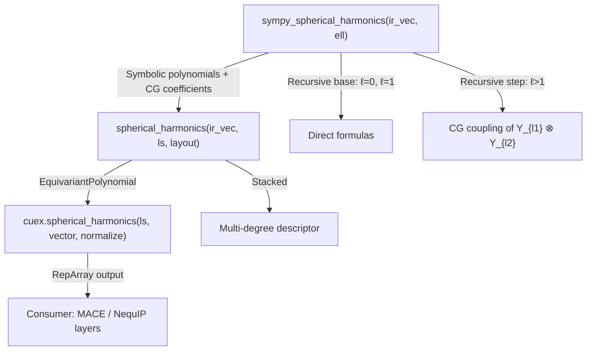
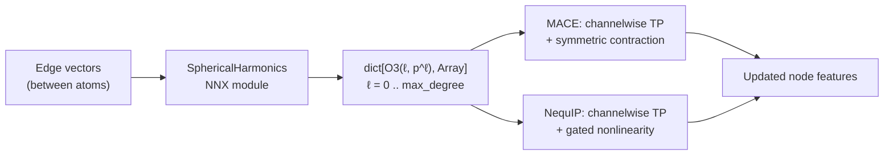

Spherical harmonics descriptors are the foundational geometric primitive in cuEquivariance's equivariant architecture. They transform 3D directional vectors into a hierarchy of polynomial features indexed by degree ℓ, each transforming under a specific irreducible representation of the rotation group. This page traces the full pipeline from symbolic polynomial construction through the descriptor abstraction to the compute-level API that JAX and PyTorch backends consume.

## Conceptual Foundation: What Spherical Harmonics Are

Spherical harmonics are a family of orthogonal polynomials on the sphere. In the context of equivariant neural networks, they serve a precise structural role: the ℓ-th degree spherical harmonic Y_ℓ transforms as the irreducible representation of SO(3) (or O(3)) with angular momentum ℓ and parity (−1)^ℓ. This means that rotating the input vector automatically rotates the output features in a mathematically controlled way—without any learnable parameters. The descriptor system in cuEquivariance encodes this relationship as a pure polynomial descriptor, which the backends then compile into optimized tensor contractions.

The key insight is that spherical harmonics are **polynomials of the input vector components**. The degree-0 harmonic is the constant 1. The degree-1 harmonic is proportional to the vector itself (x, y, z). Higher-degree harmonics are increasingly complex polynomial combinations, constructed recursively via Clebsch-Gordan coupling.

Sources: [spherical_harmonics_.py](/cuequivariance/cuequivariance/group_theory/descriptors/spherical_harmonics_.py#L1-L122), [__init__.py](/cuequivariance/cuequivariance/group_theory/descriptors/__init__.py#L1-L53)

## The Descriptor Construction Pipeline

The descriptor lives at two distinct layers: a **symbolic definition layer** in the core `cuequivariance` package, and a **compute layer** in `cuequivariance_jax`. The relationship between them follows a consistent pattern across all descriptors in cuEquivariance.



At the symbolic layer, the function `descriptors.spherical_harmonics(ir_vec, ls, layout)` produces an [`EquivariantPolynomial`](/cuequivariance/cuequivariance/group_theory/equivariant_polynomial.py#L28-L623)—a declarative description of the polynomial structure, including operand irreps, path coefficients, and symmetrization constraints. This is not a numeric computation; it is a symbolic graph that the compute layer later materializes. When multiple degrees are requested (e.g., `[0, 1, 2]`), the function delegates to single-degree calls and then stacks them via [`EquivariantPolynomial.stack()`](/cuequivariance/cuequivariance/group_theory/equivariant_polynomial.py#L118-L171) with the output operand stacked and the input kept shared.

Sources: [spherical_harmonics_.py](/cuequivariance/cuequivariance/group_theory/descriptors/spherical_harmonics_.py#L35-L79), [equivariant_polynomial.py](/cuequivariance/cuequivariance/group_theory/equivariant_polynomial.py#L118-L171)

## Recursive Construction via Clebsch-Gordan Decomposition

The heart of the symbolic construction is `sympy_spherical_harmonics`, a cached recursive function that builds exact symbolic expressions for each degree ℓ. This function is a direct adaptation of the e3nn-jax recursive implementation, adapted to cuEquivariance's `Irrep` system.

The algorithm has two base cases and one recursive step:

| Degree ℓ | Construction | Output Irrep | Dimension |
|----------|-------------|--------------|-----------|
| 0 | Constant `[1]` | `ir_vec.trivial()` (e.g., `0e` for O3) | 1 |
| 1 | `√3 · (x₀, x₁, x₂)` | `ir_vec` itself (e.g., `1o` for O3) | 3 |
| ℓ > 1 | CG coupling of Y_{ℓ//2} ⊗ Y_{ℓ − ℓ//2} | `max(selection_rule_product(ir1, ir2))` | 2ℓ + 1 |

The recursive step decomposes ℓ into `l1 = ell // 2` and `l2 = ell - l1`, recursively computes both lower-degree harmonics, then couples them using the Clebsch-Gordan coefficients from `ir_vec.clebsch_gordan(ir1, ir2, ir)`. The output irrep is selected as the highest-weight irrep in the Clebsch-Gordan product—this is the standard "highest-coupling" convention that yields the spherical harmonic of degree ℓ.

Normalization is applied after each recursive step: the symbolic polynomial is evaluated at the reference point `(0, 1, 0)` to compute a norm constant, then the result is rescaled so that `∑ₘ Yₗₘ² = ir.dim` at the reference point. This ensures orthonormality properties carry through to the final polynomial descriptor.

Sources: [spherical_harmonics_.py](/cuequivariance/cuequivariance/group_theory/descriptors/spherical_harmonics_.py#L82-L122), [sympy_utils.py](/cuequivariance/cuequivariance/etc/sympy_utils.py#L1-L36)

## From Symbolic Polynomials to Segmented Tensor Products

Once the symbolic expressions are computed, the `spherical_harmonics` function converts them into a `SegmentedTensorProduct` (STP) that cuEquivariance's compute engine can execute. This conversion happens in three stages:

1. **Path extraction**: Each component of the symbolic formula is expanded as a polynomial in `x₀, x₁, x₂` via `sympy.Poly`. The exponent tuple (e.g., `(1, 0, 3)` meaning `x₀¹ · x₂³`) is mapped to a path index sequence via `poly_degrees_to_path_indices`, which expands it to operand indices `(0, 2, 2, 2)`.

2. **STP construction**: An empty STP is created with `ell` input segments (each of size 3 for the vector components) plus one output segment (of size `ir.dim` for the harmonic components). Each path from step 1 is added with its polynomial coefficient.

3. **Symmetrization**: Since the ℓ input operands all represent the same vector, the STP is symmetrized over all input operand indices via `d.symmetrize_operands(range(ell), force=True)`. This is critical: it ensures that the descriptor treats permutations of identical vector copies correctly, which both reduces redundant computation and guarantees the correct polynomial symmetry.

The resulting `EquivariantPolynomial` wraps this STP with the appropriate `IrrepsAndLayout` metadata for both inputs and outputs.

Sources: [spherical_harmonics_.py](/cuequivariance/cuequivariance/group_theory/descriptors/spherical_harmonics_.py#L48-L79)

## Descriptor Structure and Operand Layout

Every spherical harmonics descriptor follows a consistent structural pattern. The subscript notation used in the docstring is `vector[],...,vector[],Yl[]`, meaning the descriptor takes ℓ copies of the same vector operand and produces one output operand for the harmonics.

| Property | Value |
|----------|-------|
| **Input operands** | ℓ copies of `(ir_vec, ir_mul)` with multiplicity 1 |
| **Output operand** | `(ir, layout)` where ir has degree ℓ and parity (−1)^ℓ |
| **Number of paths (ℓ=2)** | 11 |
| **Number of paths (ℓ=3)** | 41 (after stacking) |
| **Layout default** | `cue.ir_mul` |
| **Operand symmetrization** | Full symmetrization over all vector copies |

For a multi-degree request like `[0, 1, 2]`, the stacked descriptor looks like:

```
╭ a=1 -> B=0+1+2
│  []➜B[] ───────── num_paths=1      (ℓ=0: constant)
│  []·a[]➜B[] ───── num_paths=3       (ℓ=1: linear)
╰─ []·a[]·a[]➜B[] ─ num_paths=11      (ℓ=2: quadratic)
```

The shared input operand `a=1` (a single 3D vector) feeds into all three STPs, while the output `B=0+1+2` concatenates all harmonic degrees. The stack method also fuses STPs with identical operations, reducing execution overhead.

> [!TIP]
> The `EquivariantPolynomial.stack()` method used to combine multi-degree harmonics automatically **fuses** segmented tensor products with identical operations. When multiple stacked polynomials share the same STP structure (e.g., two degree-2 harmonic calls), they are merged into a single STP rather than executed separately. This fusion is visible in the [stack docstring example](/cuequivariance/cuequivariance/group_theory/equivariant_polynomial.py#L134-L143).

Sources: [spherical_harmonics_.py](/cuequivariance/cuequivariance/group_theory/descriptors/spherical_harmonics_.py#L35-L79), [equivariant_polynomial.py](/cuequivariance/cuequivariance/group_theory/equivariant_polynomial.py#L134-L143)

## JAX Compute API

The JAX backend provides two levels of API for computing spherical harmonics: a functional API operating on `RepArray` objects, and a module-level API for integration into neural network models.

### Functional API: `cuex.spherical_harmonics`

The function [`cuex.spherical_harmonics(ls, vector, normalize)`](/cuequivariance_jax/cuequivariance_jax/spherical_harmonics.py#L22-L60) is the primary entry point for direct computation. It accepts a `RepArray` containing a single 3-component vector and returns a `RepArray` containing the harmonics for all requested degrees.

```python
import jax
import cuequivariance as cue
import cuequivariance_jax as cuex

# Create a random 3D vector as a RepArray
vector = cuex.randn(
    jax.random.key(0),
    cue.IrrepsAndLayout(cue.Irreps(cue.O3, "1o"), cue.mul_ir)
)

# Compute spherical harmonics for degrees 0, 1, 2
harmonics = cuex.spherical_harmonics([0, 1, 2], vector)
# Output irreps: O3("0e + 1o + 2e")
# Output shape: (...batch, 9)  = 1 + 3 + 5
```

The function performs several validations: it confirms the input is a single irrep with multiplicity 1 and dimension 3, and that all requested degrees are non-negative. When `normalize=True` (the default), it normalizes the input vector before computing harmonics, ensuring the result lies on the unit sphere. Internally, it delegates to `cuex.equivariant_polynomial()` which materializes the descriptor into an actual JAX computation using the `"naive"` method.

Sources: [spherical_harmonics.py](/cuequivariance_jax/cuequivariance_jax/spherical_harmonics.py#L22-L60)

### NNX Module: `SphericalHarmonics`

For integration into Flax NNX models, the [`SphericalHarmonics`](/cuequivariance_jax/cuequivariance_jax/nnx.py#L143-L174) class wraps the functional API into a stateless module suitable for use in model definitions.

| Parameter | Type | Description |
|-----------|------|-------------|
| `max_degree` | `int` | Maximum spherical harmonic degree L |
| `eps` | `float` | Epsilon for safe normalization (default: 0.0) |

The module hardcodes `irreps_in = O3("1o")` and computes `irreps_out` as all degrees from 0 to `max_degree` with automatic parity `(-1)^L`. On each call, it normalizes the input using a safe norm (with epsilon), computes the harmonics, and converts from `RepArray` segments to a `dict[Irrep, Array]` with the `(batch, 1, 2L+1)` shape convention. This `dict` representation is the standard format consumed by the MACE and NequIP model examples.

Sources: [nnx.py](/cuequivariance_jax/cuequivariance_jax/nnx.py#L143-L174)

## Vector Normalization and Norm Computation

Normalization is a critical preprocessing step for spherical harmonics: since these polynomials are defined on the unit sphere, the input direction vector must be normalized. The module provides two utilities for this purpose.

The [`cuex.normalize(array, epsilon)`](/cuequivariance_jax/cuequivariance_jax/spherical_harmonics.py#L62-L87) function divides each irrep's components by their norm. It handles the zero-vector edge case gracefully: when epsilon is 0.0 and the norm is zero, the denominator is replaced with 1.0 to produce a zero output rather than NaN. When epsilon is nonzero, it adds epsilon² to the squared norm before taking the square root, providing a smooth gradient through zero.

The [`cuex.norm(array, squared=False)`](/cuequivariance_jax/cuequivariance_jax/spherical_harmonics.py#L90-L140) function computes the norm per irrep, reducing along the irrep dimension (which varies based on layout: axis −2 for `ir_mul`, axis −1 for `mul_ir`). It returns a `RepArray` with trivial irreps (scalars), mapping each input irrep to a corresponding scalar norm. When `squared=False`, it safely handles the zero case by computing `where(norm² > 0, √norm², 0.0)`.

Both functions operate on `RepArray` segments independently, iterating over `array.segments` and applying the per-segment computation.

Sources: [spherical_harmonics.py](/cuequivariance_jax/cuequivariance_jax/spherical_harmonics.py#L62-L140)

## Integration in Model Architectures

Spherical harmonics appear at the geometry encoding stage of both the MACE and NequIP reference implementations in cuEquivariance. In both cases, relative displacement vectors between atoms are first embedded via a radial basis function, then transformed into spherical harmonic features that capture angular information.

In the [MACE example](/cuequivariance_jax/examples/mace_nnx.py#L1-L80), the `SphericalHarmonics` module is instantiated with a configurable `max_degree` and its output feeds into a channelwise tensor product for message passing between atoms. The spherical harmonics are computed once per edge in the molecular graph and then combined with node features via gather/scatter operations.

In the [NequIP example](/cuequivariance_jax/examples/nequip_nnx.py#L1-L80), the pattern is identical: the `SphericalHarmonics` NNX module converts edge vectors into angular features, which are then mixed with learned node features through tensor products. The difference lies in how these mixed features are subsequently processed—MACE uses symmetric contractions for body-order expansion, while NequIP uses a simpler channelwise approach with gating.



Sources: [mace_nnx.py](/cuequivariance_jax/examples/mace_nnx.py#L1-L80), [nequip_nnx.py](/cuequivariance_jax/examples/nequip_nnx.py#L1-L80)

## Testing and Validation

The test suite for spherical harmonics verifies both the structural properties of the output and the correctness of supporting utilities. The [`test_spherical_harmonics`](/cuequivariance_jax/tests/spherical_harmonics_test.py#L24-L30) test parameterizes over various batch shapes—including the degenerate `(10, 0, 3)` case with zero elements—and confirms that the output shape equals the input batch shape extended by the total output dimension (1 + 3 + 5 = 9 for degrees `[0, 1, 2]`), and that the output irreps are `O3("0e + 1o + 2e")` (even parity for even ℓ, odd parity for odd ℓ).

The [`test_norm`](/cuequivariance_jax/tests/spherical_harmonics_test.py#L33-L63) test validates both squared and unsquared norm computation against known analytical values (e.g., norm of `[3, 4, 0]` equals 5.0, norm of `[0, 0, 0]` equals 0.0), and confirms the output irreps are trivial scalars.

Sources: [spherical_harmonics_test.py](/cuequivariance_jax/tests/spherical_harmonics_test.py#L24-L63)

## Summary: API Reference

| Function / Class | Package | Purpose |
|-----------------|---------|---------|
| `descriptors.spherical_harmonics(ir_vec, ls, layout)` | `cuequivariance` | Build the symbolic `EquivariantPolynomial` descriptor |
| `descriptors.sympy_spherical_harmonics(ir_vec, ell)` | `cuequivariance` | Low-level symbolic recursive construction |
| `cuex.spherical_harmonics(ls, vector, normalize)` | `cuequivariance_jax` | Compute harmonics from a `RepArray` vector |
| `cuex.normalize(array, epsilon)` | `cuequivariance_jax` | Safe normalization of a `RepArray` |
| `cuex.norm(array, squared)` | `cuequivariance_jax` | Compute irrep-wise norms as trivial scalars |
| `nnx.SphericalHarmonics(max_degree, eps)` | `cuequivariance_jax` | Flax NNX module for model integration |

For the next step in understanding the descriptor system, see how spherical harmonics feed into the full tensor product machinery in [Tensor Product Descriptors](9-tensor-product-descriptors), or continue to [Rotation and Symmetric Contraction](11-rotation-and-symmetric-contraction) to see how descriptors are composed for body-order expansion in MACE-style architectures.