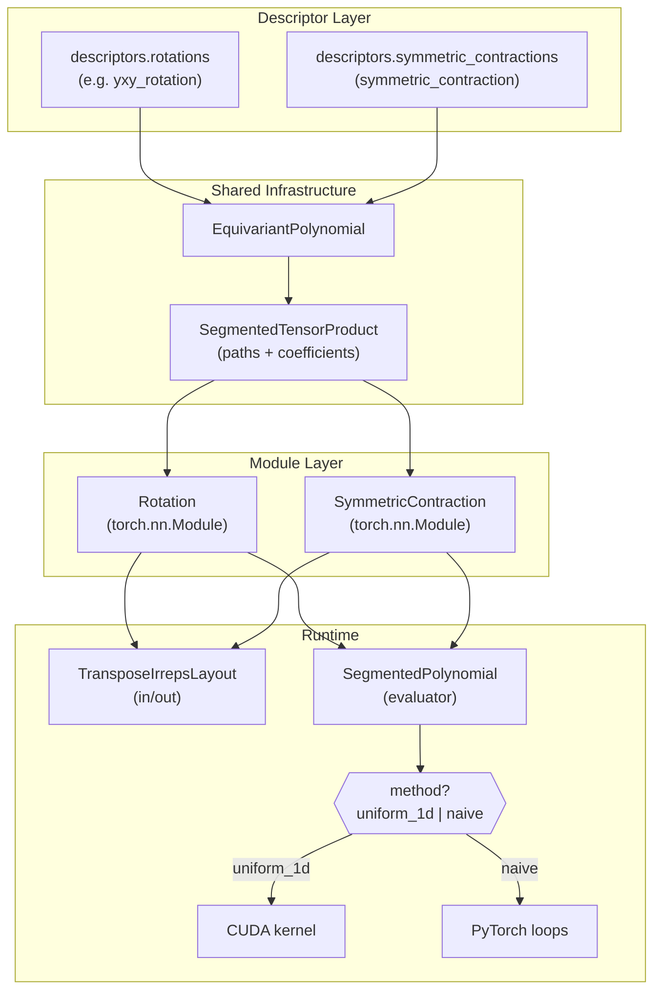

This page documents two foundational equivariant operations in cuEquivariance: **rotation** — the act of transforming feature tensors under SO(3) or O(3) group actions — and **symmetric contraction** — the body-ordered polynomial reduction introduced by MACE for efficient, expressive message passing. Both operations share a common architectural pattern: a descriptor defines the mathematical structure, and a PyTorch module wraps it with layout transposition, method dispatch, and CUDA acceleration. Understanding these two operations in tandem reveals how cuEquivariance converts representation-theoretic specifications into high-performance differentiable layers.

Sources: [__init__.py](cuequivariance_torch/cuequivariance_torch/__init__.py#L38-L42), [descriptors/__init__.py](cuequivariance/cuequivariance/group_theory/descriptors/__init__.py#L9-L20)

## The Descriptor–Module Pipeline

Both rotation and symmetric contraction follow a two-tier architecture. At the foundation, a **descriptor** function in `cuequivariance.group_theory.descriptors` constructs an `EquivariantPolynomial` — a symbolic specification of the segmented tensor product network, including operand layouts, subscripts, and coefficient paths. At the surface, a **PyTorch module** in `cuequivariance_torch.operations` consumes this descriptor, handles memory layout transposition, instantiates the `SegmentedPolynomial` evaluator, and dispatches to either the `uniform_1d` CUDA kernel or the `naive` PyTorch fallback.



The method selection logic is identical across both modules: if all segments in the descriptor share the same shape (`all_same_segment_shape()` returns `True`), the default is `"uniform_1d"` (the optimized CUDA kernel). Otherwise, a warning is emitted and `"naive"` is used. The deprecated `use_fallback` parameter is mapped to these methods for backward compatibility.

Sources: [rotation.py](cuequivariance_torch/cuequivariance_torch/operations/rotation.py#L80-L99), [symmetric_contraction.py](cuequivariance_torch/cuequivariance_torch/operations/symmetric_contraction.py#L158-L183)

## Rotation: Transforming Features Under Group Actions

### Euler Angle Convention and Angle Encoding

The `Rotation` module implements rotation for **SO(3)** and **O(3)** irreps using the **Y-X-Y Euler angle convention**: first a rotation by angle γ around the y-axis, then by β around the x-axis, then by α around the y-axis again. This three-angle decomposition is universal — any rotation in SO(3) can be expressed this way.

To feed angles into the segmented polynomial network, each angle is encoded into a tensor of cosine and sine harmonics:

```
encoding(x) = [cos(l·x), cos((l-1)·x), ..., cos(x), 1, sin(x), sin(2·x), ..., sin(l·x)]
```

where `l` is the maximum degree (ℓ_max) across all irreps in the input. This encoding transforms the continuous rotation parameter into a discrete set of trigonometric basis functions that the segmented tensor products consume as scalar operands. The `encode_rotation_angle` function implements this directly and is also exported as a public utility.

Sources: [rotations.py](cuequivariance/cuequivariance/group_theory/descriptors/rotations.py#L134-L149), [rotation.py](cuequivariance_torch/cuequivariance_torch/operations/rotation.py#L161-L178)

### Descriptor Composition: From Single-Axis to Full Rotation

The rotation descriptors are built compositionally from elementary building blocks. The most fundamental is `y_rotation`, which constructs a `SegmentedTensorProduct` with subscript `"i_ju_ku+ijk"` — where operand 0 carries the angle encoding (size `2·lmax + 1`), operand 1 carries the input features, and operand 2 carries the output. Paths are added to handle three cases for each irrep (ℓ): the cosine terms coupling upper-triangular components, sine terms coupling upper-to-lower components, and the scalar (ℓ=0) identity path.

The `x_rotation` descriptor is not implemented from scratch. Instead, it is derived from `y_rotation` via conjugation with a fixed 90° rotation around the z-axis, exploiting the group property `R_x = R_z(π/2) · R_y · R_z(π/2)`. This is implemented using `segmented_polynomials.dot` to compose the STPs.

The full `yxy_rotation` composes three descriptors through two `dot` operations and operand reordering (`move_operand`), producing an `EquivariantPolynomial` with four inputs (γ, β, α, input features) and one output (rotated features).

| Descriptor | Subscripts | Inputs | Purpose |
|---|---|---|---|
| `y_rotation` | `i_ju_ku+ijk` | angle, input, output | Single-axis rotation around y |
| `x_rotation` | `i_ju_ku+ijk` | angle, input, output | Single-axis rotation around x (derived from y) |
| `xy_rotation` | `gamma[],beta[],input[u],output[u]` | 2 angles + input | Two-step: y then x |
| `yx_rotation` | `phi[],theta[],input[u],output[u]` | 2 angles + input | Two-step: x then y |
| `yxy_rotation` | `gamma[],beta[],alpha[],input[u],output[u]` | 3 angles + input | Full Euler rotation |
| `fixed_axis_angle_rotation` | `input[u],output[u]` | input only | Known angle + axis (no parameter) |
| `inversion` | `input[u],output[u]` | input only | O(3) parity flip |

Sources: [rotations.py](cuequivariance/cuequivariance/group_theory/descriptors/rotations.py#L51-L87), [rotations.py](cuequivariance/cuequivariance/group_theory/descriptors/rotations.py#L203-L236)

### The Rotation Module

The `Rotation` class in `cuequivariance_torch.operations` wraps the `yxy_rotation` descriptor into a `torch.nn.Module`. Its constructor performs five key steps: (1) validates that the irreps belong to SO(3) or O(3); (2) constructs the descriptor via `descriptors.yxy_rotation(irreps)`; (3) creates input and output `TransposeIrrepsLayout` primitives to handle arbitrary memory layouts; (4) selects the evaluation method; and (5) instantiates the `SegmentedPolynomial` evaluator.

The forward pass accepts three angle tensors (γ, β, α) and the input feature tensor. Each angle is encoded via `encode_rotation_angle`, the input is layout-transposed, the segmented polynomial is evaluated, and the output is layout-transposed back.

Sources: [rotation.py](cuequivariance_torch/cuequivariance_torch/operations/rotation.py#L48-L135)

### Inversion for O(3) Representations

For models that operate over the full O(3) group (including reflections), the `Inversion` module applies the parity operation. Its descriptor uses the subscript `"iu_ju+ji"` and applies the parity matrix `H = ir.H[0]` (the handedness matrix of each irrep) as the path coefficient. This is a linear operation — no trigonometric encoding is needed. The module follows the same TransposeIrrepsLayout + SegmentedPolynomial pattern as `Rotation`.

> [!TIP]
> The `Inversion` module is exclusively for **O(3)** irreps. Passing SO(3) irreps will raise a `ValueError` because SO(3) irreps do not have a well-defined parity transformation. If your model only uses even/even and odd/odd representations under O(3), ensure the irreps are constructed with the `O3` irrep class.

Sources: [rotations.py](cuequivariance/cuequivariance/group_theory/descriptors/rotations.py#L237-L253), [rotation.py](cuequivariance_torch/cuequivariance_torch/operations/rotation.py#L212-L311)

### Vector-to-Euler-Angles Utility

The `vector_to_euler_angles` function converts a batch of 3D unit vectors into the (β, α) Euler angles that satisfy `R_y(α) R_x(β) ê_y = v`. This is useful when rotations are parameterized by directional vectors (e.g., interatomic displacement vectors) rather than explicit angles. It handles the singularity at the poles (y = ±1) with explicit `torch.where` guards.

Sources: [rotation.py](cuequivariance_torch/cuequivariance_torch/operations/rotation.py#L180-L211)

## Symmetric Contraction: Body-Ordered Polynomial Reduction

### Mathematical Foundation

Symmetric contraction, introduced in the MACE framework ([arXiv:2206.07697](https://arxiv.org/abs/2206.07697)), computes an equivariant output as a weighted sum of the input contracted with itself multiple times. For contraction degree `ν`, the operation computes:

```
output = Σ_weights W · ⊗^ν (input)
```

where `⊗^ν` denotes the ν-fold symmetric tensor product, projected onto the output irrep space. This is fundamentally different from a simple tensor product: the symmetric contraction enforces permutation symmetry among the `ν` copies of the input, dramatically reducing the number of free parameters while preserving expressiveness. The weight tensor is indexed by **element type** (e.g., chemical species), enabling element-dependent learned interactions.

Sources: [symmetric_contractions.py](cuequivariance/cuequivariance/group_theory/descriptors/symmetric_contractions.py#L20-L56)

### The Descriptor: From Irreps to Segmented Polynomial

The `symmetric_contraction` descriptor function constructs an `EquivariantPolynomial` with subscript `"weights[u],input[u],output[u]"`. Its implementation follows a carefully structured process:

1. **Multiplicity normalization**: The input and output irreps must all share the same multiplicity `mul`. The descriptor strips this multiplicity, computes the single-channel contraction, then re-attaches it via `append_modes_to_all_operands("u", {"u": mul})`.

2. **Reduced symmetric tensor product basis**: For each output irrep, the descriptor calls `cue.reduced_symmetric_tensor_product_basis(irreps_in, degree, keep_ir=irreps_out)` to obtain the basis vectors that project the ν-fold symmetric product onto the output space. These basis vectors become the path coefficients.

3. **Multi-degree stacking**: When multiple degrees are requested (e.g., `(1, 2, 3)`), the descriptor stacks the individual-degree polynomials using `EquivariantPolynomial.stack`, with the weight operand marked as stackable (`True`) while input and output are not (`False`).

The total weight dimension per element type grows with degree. For example, with `irreps_in = "16x0e + 16x1o + 16x2e"`, `irreps_out = "16x0e + 16x1o"`, and degrees `(1, 2, 3)`, the weight sizes are 32 (degree 1), 80 (degree 2), and 176 (degree 3) per element type.

Sources: [symmetric_contractions.py](cuequivariance/cuequivariance/group_theory/descriptors/symmetric_contractions.py#L56-L133)

### The SymmetricContraction Module

The `SymmetricContraction` class wraps the descriptor into a trainable `torch.nn.Module`. Its design has two modes controlled by the `original_mace` flag:

**Standard mode** (`original_mace=False`): The weight tensor has shape `(num_elements, etp.inputs[0].dim // mul, mul)`, where the first dimension indexes chemical elements and the remaining dimensions parameterize the contraction. The weight is flattened and passed directly to the segmented polynomial evaluator.

**MACE-compatible mode** (`original_mace=True`): An additional projection matrix `p` is extracted from the experimental MACE descriptor (`cuequivariance.group_theory.experimental.mace.symmetric_contraction`), stored as a buffer, and applied via Einstein summation `einsum("zau,ab->zbu", weight, projection)` before evaluation. This reproduces the original MACE weight parameterization, facilitating exact migration from MACE to cuEquivariance.

The forward pass accepts the input tensor `x` of shape `(batch, irreps_in.dim)` and an `indices` tensor of shape `(batch,)` that maps each batch element to its element type. The segmented polynomial evaluator uses `input_indices={0: indices}` to perform a gather on the weight operand, selecting the appropriate element-specific weights for each input.

> [!TIP]
> The `input_indices` mechanism in `SegmentedPolynomial.forward` performs a gather (not a multiply) on the specified operand. This means the first operand (weights) is indexed per-batch-element by `indices`, allowing different chemical species to use different learned contraction weights without materializing a dense `(batch, ...)` weight tensor.

Sources: [symmetric_contraction.py](cuequivariance_torch/cuequivariance_torch/operations/symmetric_contraction.py#L32-L243)

### Uniform Multiplicity Constraint

Both the descriptor and the module enforce that **all multiplicities in the input and output irreps must be identical**. This constraint arises because the symmetric contraction treats all channels within a multiplicity as parallel independent streams — the contraction is performed channel-wise, and the multiplicity dimension is appended after the fact. If your irreps have varying multiplicities (e.g., `"4x0e + 8x1o + 2x2e"`), you must pad or restructure them to a uniform multiplicity before using this layer.

Sources: [symmetric_contraction.py](cuequivariance_torch/cuequivariance_torch/operations/symmetric_contraction.py#L140-L142), [symmetric_contractions.py](cuequivariance/cuequivariance/group_theory/descriptors/symmetric_contractions.py#L72-L74)

## Comparison: Rotation vs. Symmetric Contraction

| Aspect | Rotation | Symmetric Contraction |
|---|---|---|
| **Group** | SO(3) or O(3) | Any (SO(3), O(3), etc.) |
| **Learnable parameters** | None (angles are inputs) | Yes — per-element weight tensor |
| **Inputs** | 3 angle tensors + feature tensor | Feature tensor + element index tensor |
| **Descriptor subscripts** | `gamma[],beta[],alpha[],input[u],output[u]` | `weights[u],input[u],output[u]` |
| **Core mathematical object** | Wigner D-matrices (via STP composition) | Reduced symmetric tensor product basis |
| **MACE compatibility** | N/A | `original_mace` flag with projection matrix |
| **Multiplicity constraint** | None | All muls must be identical |
| **Method selection** | `uniform_1d` / `naive` | `uniform_1d` / `naive` |

## Usage Examples

### Rotating Features with the Rotation Module

```python
import torch
import cuequivariance as cue
import cuequivariance_torch as cuet

device = torch.device("cuda" if torch.cuda.is_available() else "cpu")
irreps = cue.Irreps("O3", "8x0e + 8x1o + 8x2e")

rotation = cuet.Rotation(irreps, layout=cue.ir_mul, device=device)

# Input features: (batch, irreps.dim)
x = torch.randn(64, irreps.dim, device=device)

# Euler angles: broadcastable to batch
gamma = torch.randn(64, device=x.device)
beta = torch.randn(64, device=x.device)
alpha = torch.randn(64, device=x.device)

x_rotated = rotation(gamma, beta, alpha, x)  # (64, irreps.dim)
```

### Symmetric Contraction with Element-Indexed Weights

```python
irreps_in = cue.Irreps("O3", "32x0e + 32x1o + 32x2e")
irreps_out = cue.Irreps("O3", "32x0e + 32x1o")

layer = cuet.SymmetricContraction(
    irreps_in=irreps_in,
    irreps_out=irreps_out,
    contraction_degree=3,
    num_elements=10,          # e.g., 10 chemical element types
    layout_in=cue.ir_mul,
    layout_out=cue.mul_ir,
    dtype=torch.float32,
    device=device,
)

# Features: (num_nodes, irreps_in.dim)
node_feats = torch.randn(128, irreps_in.dim, device=device)

# Element type index per node: (num_nodes,)
element_index = torch.randint(0, 10, (128,), dtype=torch.int32, device=device)

output = layer(node_feats, element_index)  # (128, irreps_out.dim)
```

### MACE-Compatible Migration

```python
# Reproduce original MACE weight parameterization
layer_mace = cuet.SymmetricContraction(
    irreps_in=irreps_in,
    irreps_out=irreps_out,
    contraction_degree=3,
    num_elements=10,
    original_mace=True,       # Adds projection matrix for MACE compatibility
    dtype=torch.float64,
    device=device,
)
```

Sources: [rotation.py](cuequivariance_torch/cuequivariance_torch/operations/rotation.py#L29-L135), [symmetric_contraction.py](cuequivariance_torch/cuequivariance_torch/operations/symmetric_contraction.py#L42-L99)

## Continuing the Exploration

Rotation and symmetric contraction represent two complementary facets of equivariant deep learning: rotation transforms existing features while preserving their equivariance structure, and symmetric contraction creates new, higher-order equivariant features from lower-order ones. Together they form the backbone of architectures like MACE and NequIP.

To understand how these operations fit into the broader tensor product ecosystem, proceed to the [Tensor Product Descriptors](9-tensor-product-descriptors) page. For the PyTorch implementation details of the symmetric contraction as a layer in a full network, see the [Symmetric Contraction Layer](14-symmetric-contraction-layer) page. To explore how these operations are combined in real model architectures, consult the [Model Examples: MACE and NequIP](21-model-examples-mace-and-nequip) page. For the mathematical foundation of the irreps used throughout, revisit [Group Representations and Irreps](5-group-representations-and-irreps).