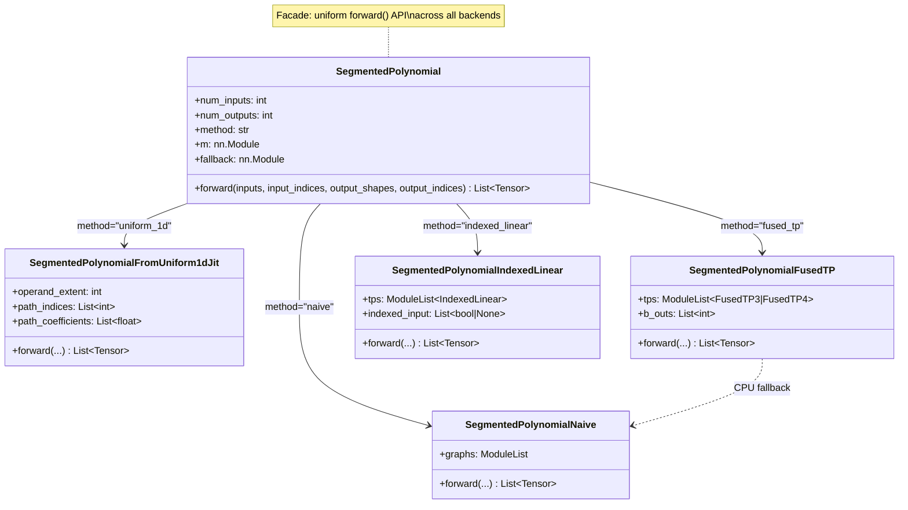
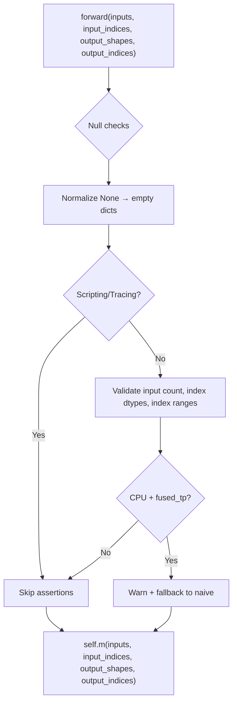
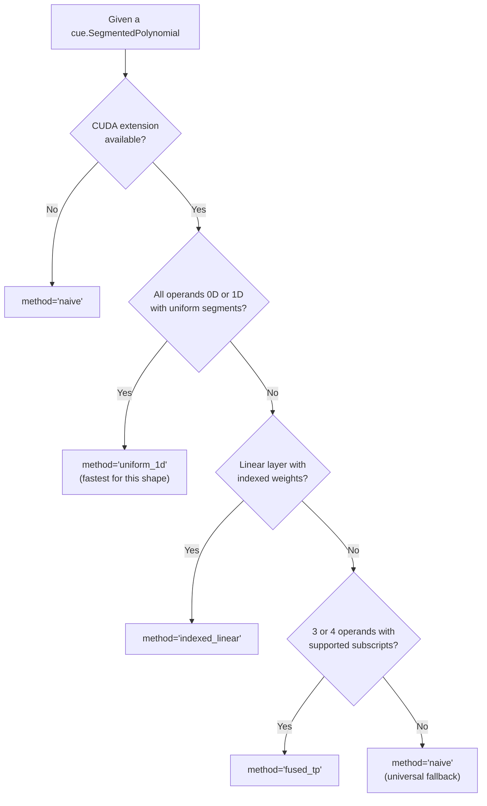

The `SegmentedPolynomial` class is the primary PyTorch interface for evaluating segmented polynomials — the mathematical backbone of equivariant neural network operations in cuEquivariance. It acts as a **unified dispatch layer** that accepts a `cue.SegmentedPolynomial` descriptor from the core library and routes computation to one of four backend implementations, each optimized for different polynomial structures and hardware targets. This page examines the module's architecture, construction behavior, forward-pass mechanics, and the trade-offs between its backend strategies.

Sources: [segmented_polynomial.py](cuequivariance_torch/cuequivariance_torch/primitives/segmented_polynomial.py#L44-L138), [__init__.py](cuequivariance_torch/cuequivariance_torch/__init__.py#L21-L22)

## Architectural Overview

The `SegmentedPolynomial` module follows a **strategy dispatch pattern**: it wraps an internal backend module `self.m` and optionally a fallback module `self.fallback`. At construction time, the `method` parameter selects which backend handles computation. The public API exposed through `forward()` is identical regardless of the chosen backend, making it straightforward to swap implementations for testing or performance tuning.



The module is exported at the package level via `cuequivariance_torch/__init__.py`, making it directly importable as `from cuequivariance_torch import SegmentedPolynomial` without referencing the `primitives` subpackage [Sources: [__init__.py](cuequivariance_torch/cuequivariance_torch/__init__.py#L22)]

Sources: [segmented_polynomial.py](cuequivariance_torch/cuequivariance_torch/primitives/segmented_polynomial.py#L140-L206)

## Constructor Parameters

The `__init__` method accepts a `cue.SegmentedPolynomial` descriptor and configures the computation backend. Understanding each parameter is critical for correct usage, since the constructor performs validation and pre-processing that constrains what the forward pass can accept.

| Parameter | Type | Default | Description |
|-----------|------|---------|-------------|
| `polynomial` | `cue.SegmentedPolynomial` | *required* | The segmented polynomial descriptor. Must be an instance of `cue.SegmentedPolynomial`, not a raw descriptor — call `.polynomial` on descriptors before passing. |
| `method` | `str` | `""` | Backend selection: `"naive"`, `"uniform_1d"`, `"fused_tp"`, or `"indexed_linear"`. Leaving empty triggers a deprecation warning and defaults to `"uniform_1d"`. |
| `math_dtype` | `str \| torch.dtype` | `None` | Precision for internal computation. Support varies by method — see the backend details section below. |
| `output_dtype_map` | `List[int]` | `None` | Per-output-buffer dtype inheritance. Each entry specifies which input buffer index to inherit dtype from (`-1` means use `math_dtype`). Defaults to all-zeros if inputs exist. |
| `name` | `str` | `"segmented_polynomial"` | Label for the operation, used primarily in CUDA kernel identification and debugging. |
| `options` | `Dict[str, Any]` | `None` | Method-specific options dictionary. Currently only consumed by the `uniform_1d` backend. |

A critical validation step occurs immediately: if `polynomial` is not a `cue.SegmentedPolynomial` instance, the constructor raises a `ValueError` with the hint `"Did you forget to call .polynomial on the descriptor?"` [Sources: [segmented_polynomial.py](cuequivariance_torch/cuequivariance_torch/primitives/segmented_polynomial.py#L171-L175)]. This is the single most common user error, since descriptors like `cue.descriptors.spherical_harmonics(...)` return descriptor objects that require the `.polynomial` accessor.

The constructor also checks whether `cuequivariance_ops_torch` is importable. If a CUDA-backed method is requested but the extension is not installed, it silently falls back to `"naive"` and emits a warning [Sources: [segmented_polynomial.py](cuequivariance_torch/cuequivariance_torch/primitives/segmented_polynomial.py#L177-L181)].

Sources: [segmented_polynomial.py](cuequivariance_torch/cuequivariance_torch/primitives/segmented_polynomial.py#L140-L206)

## Backend Methods: Capabilities and Constraints

Each backend targets a different polynomial structure. The table below summarizes the key distinctions that determine which method is appropriate for a given descriptor.

| Feature | `"naive"` | `"uniform_1d"` | `"fused_tp"` | `"indexed_linear"` |
|---------|-----------|-----------------|--------------|---------------------|
| **Requires CUDA extension** | No | Yes | Yes | Yes |
| **Operand dimensions** | Any (via einsum) | 0D or 1D only | Any (3–4 operands) | 2 inputs + 1 output |
| **Segment uniformity** | No constraint | All segments must share same shape per operand | No constraint | No constraint |
| **Supported `math_dtype`** | Any `torch.dtype` | `float32`, `float64` | `float32`, `float64` | Ignored |
| **Input indexing** | Not in FX graph | Full support (sorted) | Manual indexing via Python | Full support (sorted required) |
| **Fallback on CPU** | — | Falls to naive | Falls to naive | — |
| **Performance** | Baseline (reference) | Fastest for uniform 1D | Fast for 3/4-operand STPs | Optimized for indexed linear layers |

### Naive Backend (`"naive"`)

The naive backend constructs a `torch.fx.GraphModule` for each tensor-product operation in the polynomial. During construction, it iterates over every path in each `SegmentedTensorProduct`, slices input tensors to extract segments, computes the path via `torch.einsum` with the appropriate coefficient tensor, then concatenates results across paths that share the same output segment [Sources: [segmented_polynomial_naive.py](cuequivariance_torch/cuequivariance_torch/primitives/segmented_polynomial_naive.py#L61-L161)]. This approach supports arbitrary subscript patterns and operand shapes because it decomposes the computation into elementary einsum operations. It is the only backend that works on CPU and without the CUDA extension, making it the universal fallback.

> [!TIP]
> The naive backend applies `remove_zero_paths()` and `remove_empty_segments()` during graph construction [segmented_polynomial_naive.py#L72-L73], which can meaningfully reduce computation for descriptors with sparsity. When using the naive method for debugging or testing, verify that your descriptor doesn't silently lose structure to these optimizations.

### Uniform 1D Backend (`"uniform_1d"`)

This is the default backend (as of v0.6.0) and the most performant option for polynomials whose operands are either scalars (0D) or share a single uniform segment extent (1D). At construction, the backend validates three strict preconditions: all operands must be 0D or 1D, all segments within an operand must have identical shape, and all 1D operands must share the same segment extent [Sources: [segmented_polynomial_uniform_1d.py](cuequivariance_torch/cuequivariance_torch/primitives/segmented_polynomial_uniform_1d.py#L117-L149)]. If the polynomial has coefficient modes, the constructor automatically calls `flatten_coefficient_modes()` before further processing [Sources: [segmented_polynomial_uniform_1d.py](cuequivariance_torch/cuequivariance_torch/primitives/segmented_polynomial_uniform_1d.py#L101-L114)].

The forward pass serializes all polynomial metadata (path indices, coefficients, segment counts, buffer dimensions) into flat lists and passes them to `torch.ops.cuequivariance.uniform_1d`, a single fused CUDA kernel that handles the entire polynomial in one launch [Sources: [segmented_polynomial_uniform_1d.py](cuequivariance_torch/cuequivariance_torch/primitives/segmented_polynomial_uniform_1d.py#L273-L295)]. This kernel also natively supports batched, shared, and indexed buffer dimensions via the `batch_dim` flags.

> [!TIP]
> When segment extents are non-uniform but share a greatest common divisor, you can call `.split_mode()` on the polynomial before construction to factor out that divisor. However, choosing a very small GCD (e.g., extents `[64, 128, 2]` with gcd=2) creates many short segments that are inefficient on GPU — aim for segment extents ≥ 32 that are divisible by 32 [segmented_polynomial_uniform_1d.py#L131-L139].

### Fused Tensor Product Backend (`"fused_tp"`)

The fused TP backend targets polynomials composed of 3- or 4-operand tensor product operations with specific subscript patterns. At construction, each operation's `SegmentedTensorProduct` is matched against a whitelist of supported subscript targets including patterns like `"u__uw_w"`, `"u_v_uvw_w"`, and `"u_v_uv"` [Sources: [segmented_polynomial_fused_tp.py](cuequivariance_torch/cuequivariance_torch/primitives/segmented_polynomial_fused_tp.py#L112-L127)]. The dispatch system attempts to permute the operand order to match a supported target using `cue.segmented_polynomials.dispatch()` [Sources: [segmented_polynomial_fused_tp.py](cuequivariance_torch/cuequivariance_torch/primitives/segmented_polynomial_fused_tp.py#L145-L155)].

Each matched operation is wrapped in either a `FusedTP3` or `FusedTP4` module, which instantiates `ops.FusedTensorProductOp3` or `ops.FusedTensorProductOp4` from `cuequivariance_ops_torch` [Sources: [segmented_polynomial_fused_tp.py](cuequivariance_torch/cuequivariance_torch/primitives/segmented_polynomial_fused_tp.py#L27-L72)]. The forward pass iterates over these fused TP modules, applies input indexing manually in Python, accumulates results into output buffers, and handles output scatter-addition for indexed outputs [Sources: [segmented_polynomial_fused_tp.py](cuequivariance_torch/cuequivariance_torch/primitives/segmented_polynomial_fused_tp.py#L190-L244)].

Notably, this is the only backend that constructs a separate fallback `self.fallback = SegmentedPolynomialNaive(...)`. When the forward pass detects that inputs are on CPU (and the method is `"fused_tp"`), it automatically routes to the naive fallback [Sources: [segmented_polynomial.py](cuequivariance_torch/cuequivariance_torch/primitives/segmented_polynomial.py#L299-L309)].

### Indexed Linear Backend (`"indexed_linear"`)

This backend is specialized for linear-layer operations where weights are looked up per-element via index tensors — the core pattern in message-passing neural networks like MACE and NequIP. It supports twelve specific subscript patterns defined in the `SUBDICT` constant, covering all permutations of 2-input-1-output matrix multiplications [Sources: [segmented_polynomial_indexed_linear.py](cuequivariance_torch/cuequivariance_torch/primitives/segmented_polynomial_indexed_linear.py#L326-L395)].

Each operation is wrapped in an `IndexedLinear` module that pre-computes path groupings using `compressed_path_segment()` and registers coefficient tensors as buffers [Sources: [segmented_polynomial_indexed_linear.py](cuequivariance_torch/cuequivariance_torch/primitives/segmented_polynomial_indexed_linear.py#L45-L70)]. The `apply_linear` function delegates to `cuequivariance_ops_torch.indexed_linear` for the actual CUDA kernel launch [Sources: [segmented_polynomial_indexed_linear.py](cuequivariance_torch/cuequivariance_torch/primitives/segmented_polynomial_indexed_linear.py#L130-L156)]. The `math_dtype` parameter is explicitly ignored for this backend [Sources: [segmented_polynomial_indexed_linear.py](cuequivariance_torch/cuequivariance_torch/primitives/segmented_polynomial_indexed_linear.py#L172-L176)].

A distinctive constraint: the `indexed_linear` backend requires index tensors to be **sorted**. The forward pass asserts this via `torch.all(v[1:] - v[:-1] >= 0)` and uses `torch.bincount()` to compute per-index occurrence counts for the CUDA kernel [Sources: [segmented_polynomial_indexed_linear.py](cuequivariance_torch/cuequivariance_torch/primitives/segmented_polynomial_indexed_linear.py#L249-L268)].

Sources: [segmented_polynomial_naive.py](cuequivariance_torch/cuequivariance_torch/primitives/segmented_polynomial_naive.py#L298-L357), [segmented_polynomial_uniform_1d.py](cuequivariance_torch/cuequivariance_torch/primitives/segmented_polynomial_uniform_1d.py#L82-L220), [segmented_polynomial_fused_tp.py](cuequivariance_torch/cuequivariance_torch/primitives/segmented_polynomial_fused_tp.py#L75-L245), [segmented_polynomial_indexed_linear.py](cuequivariance_torch/cuequivariance_torch/primitives/segmented_polynomial_indexed_linear.py#L159-L320)

## Forward Pass Mechanics

The `forward()` method provides a uniform signature across all backends, accepting input tensors and optional indexing/shaping dictionaries. Its design is constrained by `torch.jit.trace` requirements — optional arguments must use `Dict` rather than `Optional[Tensor]`, and shapes must be passed via tensors rather than plain integers [Sources: [segmented_polynomial.py](cuequivariance_torch/cuequivariance_torch/primitives/segmented_polynomial.py#L211-L216)].



**Input tensors** follow a `(batch, operand_size)` convention. Each tensor's last dimension must match the corresponding operand size defined in the descriptor. A batch dimension of `1` indicates a shared (broadcast) operand. In the indexed case, tensors use `(index_pool_size, operand_size)` where `index_pool_size` is the number of distinct parameter vectors [Sources: [segmented_polynomial.py](cuequivariance_torch/cuequivariance_torch/primitives/segmented_polynomial.py#L227-L232)].

**`input_indices`** enables per-element weight lookup. Each entry maps an input position to a 1D integer tensor specifying which rows of the indexed input to select for each batch element. Indices must be `int32` or `int64`, 1D, and satisfy `0 <= index[i] < input.shape[0]`. The `indexed_linear` method additionally requires sorted indices [Sources: [segmented_polynomial.py](cuequivariance_torch/cuequivariance_torch/primitives/segmented_polynomial.py#L233-L241)].

**`output_shapes`** and **`output_indices`** control output buffer dimensions and indexed output scattering. When `output_indices` is provided, `output_shapes` is mandatory — the framework reads only `shape_tensor.shape[0]` from the shape tensor to determine the output batch dimension [Sources: [segmented_polynomial.py](cuequivariance_torch/cuequivariance_torch/primitives/segmented_polynomial.py#L242-L247)].

Sources: [segmented_polynomial.py](cuequivariance_torch/cuequivariance_torch/primitives/segmented_polynomial.py#L217-L311)

## Practical Usage Patterns

### Computing Spherical Harmonics

The simplest use case is a single-input polynomial such as spherical harmonics, where the descriptor produces a polynomial with one input and one output:

```python
import torch
import cuequivariance as cue
from cuequivariance_torch import SegmentedPolynomial

poly = cue.descriptors.spherical_harmonics(cue.SO3(1), [0, 1, 2]).polynomial
sp = SegmentedPolynomial(poly, method="naive")

x = torch.tensor([[0.0, 1.0, 0.0]])       # unit vector along y-axis
result = sp([x])
# result[0].shape → torch.Size([1, 9])     # 1 + 3 + 5 = 9 SH coefficients
```

Sources: [segmented_polynomial.py](cuequivariance_torch/cuequivariance_torch/primitives/segmented_polynomial.py#L90-L104)

### Indexed Linear Transformations

For equivariant linear layers with per-element weights, the `indexed_linear` method provides optimized CUDA kernels. Index tensors specify which weight row each element uses:

```python
input_irreps = cue.Irreps(cue.O3, "5x0e + 3x1o")
output_irreps = cue.Irreps(cue.O3, "4x0e + 2x1o")
poly = cue.descriptors.linear(input_irreps, output_irreps).polynomial

linear = SegmentedPolynomial(poly, method="indexed_linear")

weights = torch.randn(3, poly.inputs[0].size)  # 3 distinct weight sets
x = torch.randn(5, poly.inputs[1].size)        # 5 input vectors
weight_indices = torch.tensor([0, 1, 0, 2, 1]) # sorted: required

result = linear([weights, x], input_indices={0: weight_indices})
# result[0].shape → torch.Size([5, 10])
```

Sources: [segmented_polynomial.py](cuequivariance_torch/cuequivariance_torch/primitives/segmented_polynomial.py#L126-L137)

### Choosing the Right Method



Sources: [segmented_polynomial.py](cuequivariance_torch/cuequivariance_torch/primitives/segmented_polynomial.py#L157-L206)

## Compatibility and Integration Notes

The `SegmentedPolynomial` module is designed to work within PyTorch's compilation ecosystem. The forward pass detects `torch.jit.is_scripting()`, `torch.jit.is_tracing()`, `torch.compiler.is_compiling()`, and `torch.fx._symbolic_trace.is_fx_tracing()` to conditionally skip runtime assertions during graph capture [Sources: [segmented_polynomial.py](cuequivariance_torch/cuequivariance_torch/primitives/segmented_polynomial.py#L264-L269)]. The naive backend constructs individual `graph_inputs{N}` classes for 0–6 inputs specifically to satisfy TorchScript requirements, since `torch.jit.script` does not support variable-length `List[torch.Tensor]` parameters directly [Sources: [segmented_polynomial_naive.py](cuequivariance_torch/cuequivariance_torch/primitives/segmented_polynomial_naive.py#L249-L287)].

The package also provides `onnx_custom_translation_table()` and `register_tensorrt_plugins()` for deployment scenarios requiring ONNX or TensorRT export [Sources: [__init__.py](cuequivariance_torch/cuequivariance_torch/__init__.py#L50-L75)].

For higher-level abstractions built on top of `SegmentedPolynomial`, see the symmetric contraction layer in [Symmetric Contraction Layer](14-symmetric-contraction-layer), or examine how CUDA primitives are implemented in [CUDA Primitive Implementations](13-cuda-primitive-implementations). The mathematical foundations of the polynomial descriptors are covered in [Segmented Polynomials](7-segmented-polynomials) and [Equivariant Polynomial Hierarchy](8-equivariant-polynomial-hierarchy).