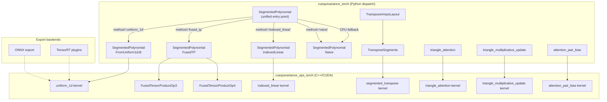

The PyTorch backend of cuEquivariance provides a collection of hand-optimized CUDA kernels that form the computational backbone for equivariant polynomial evaluation, irreps layout transposition, and triangle-shaped attention operations. These primitives are implemented as C++/CUDA extensions in the separate `cuequivariance_ops_torch` package, exposed through a clean Python dispatch layer in `cuequivariance_torch/primitives/`. This page documents the architecture of each primitive family, their dispatch contracts, constraints, and integration points for advanced developers building on top of cuEquivariance.

## Primitives Architecture Overview

The primitives subsystem follows a **Strategy pattern** where a unified entry point delegates to specialized backends based on the `method` parameter and runtime conditions (CUDA availability, device placement, tensor shapes). All CUDA kernels live in `cuequivariance_ops_torch`, which is imported lazily at initialization time to allow graceful degradation.

The `SegmentedPolynomial` class at [segmented_polynomial.py](cuequivariance_torch/cuequivariance_torch/primitives/segmented_polynomial.py#L44-L312) serves as the primary facade. It detects `cuequivariance_ops_torch` availability at import time via a try/except guard at [L36-L41](cuequivariance_torch/cuequivariance_torch/primitives/segmented_polynomial.py#L36-L41), setting the `HAS_CUE_OPS` flag that determines whether CUDA backends can be instantiated.

Sources: [segmented_polynomial.py](cuequivariance_torch/cuequivariance_torch/primitives/segmented_polynomial.py#L1-L44), [__init__.py](cuequivariance_torch/cuequivariance_torch/__init__.py#L21-L45)

## Segmented Polynomial CUDA Methods

The `SegmentedPolynomial` module supports four execution methods, each designed for different polynomial structures and hardware characteristics. The table below summarizes the key design tradeoffs:

| Method | CUDA Kernel | Operand Constraints | Precision | Best For |
|--------|------------|-------------------|-----------|----------|
| `uniform_1d` | `uniform_1d` | 0D/1D operands, uniform segment shapes, scalar coefficients | FP32, FP64 | Spherical harmonics, single-mode descriptors |
| `fused_tp` | `FusedTensorProductOp3`/`Op4` | 3 or 4 operands, subscript patterns from supported set | FP32, FP64 | General 3-/4-operand contractions |
| `indexed_linear` | `indexed_linear` | 2-input linear patterns from `SUBDICT` | Input dtype | Per-element weight lookup in graph neural networks |
| `naive` | None (PyTorch) | None | Any | Testing, fallback, CPU execution |

### The `uniform_1d` Method

The `uniform_1d` backend, implemented by [`SegmentedPolynomialFromUniform1dJit`](cuequivariance_torch/cuequivariance_torch/primitives/segmented_polynomial_uniform_1d.py#L82-L296), targets polynomials where all segments within each operand share the **same shape** along a single mode dimension. This is the primary CUDA path for spherical harmonics and many equivariant tensor products encountered in practice.

At construction time, the module performs a sequence of polynomial transformations to satisfy kernel constraints. It first calls `polynomial.flatten_coefficient_modes()` at [L103](cuequivariance_torch/cuequivariance_torch/primitives/segmented_polynomial_uniform_1d.py#L103) to eliminate coefficient modes (rejecting polynomials where automatic flattening fails), then `polynomial.squeeze_modes()` at [L115](cuequivariance_torch/cuequivariance_torch/primitives/segmented_polynomial_uniform_1d.py#L115). It then validates that all operands are 0D or 1D ([L119-L127](cuequivariance_torch/cuequivariance_torch/primitives/segmented_polynomial_uniform_1d.py#L119-L127)), that all segments within an operand have identical shapes ([L128-L140](cuequivariance_torch/cuequivariance_torch/primitives/segmented_polynomial_uniform_1d.py#L128-L140)), and that all 1D operands share the same segment extent ([L141-L149](cuequivariance_torch/cuequivariance_torch/primitives/segmented_polynomial_uniform_1d.py#L141-L149)). Coefficients must be scalar (empty `coefficient_subscripts`).

The forward pass delegates to `torch.ops.cuequivariance.uniform_1d(...)` at [L273-L295](cuequivariance_torch/cuequivariance_torch/primitives/segmented_polynomial_uniform_1d.py#L273-L295), which accepts a flat parameter list describing the polynomial's structure: operand extents, segment counts, batch dimension types (`BATCH_DIM_AUTO`, `BATCH_DIM_SHARED`, `BATCH_DIM_BATCHED`, `BATCH_DIM_INDEXED`), path indices, and path coefficients. Input and output indices are folded into the batch dimension specification before dispatch.

> [!TIP]
> When segment extents are non-uniform but share a non-trivial GCD, you can call `split_mode()` on the corresponding mode to factor out the divisor and obtain uniform segment extents. However, choosing a very small GCD relative to the largest extent (e.g., extents [64, 128, 2] with gcd=2) creates many short segments that degrade GPU throughput — segment extents smaller than 32 or not divisible by 32 are generally inefficient.

### The `fused_tp` Method

The `fused_tp` backend, implemented by [`SegmentedPolynomialFusedTP`](cuequivariance_torch/cuequivariance_torch/primitives/segmented_polynomial_fused_tp.py#L75-L245), handles 3- and 4-operand tensor product contractions using dedicated CUDA operations `FusedTensorProductOp3` and `FusedTensorProductOp4`.

During initialization, each operation in the polynomial is checked against a **supported target set** of subscript patterns defined at [L113-L127](cuequivariance_torch/cuequivariance_torch/primitives/segmented_polynomial_fused_tp.py#L113-L127). The dispatch mechanism at [L144-L155](cuequivariance_torch/cuequivariance_torch/primitives/segmented_polynomial_fused_tp.py#L144-L155) attempts to permute the operation's subscripts to match one of these targets via `cue.segmented_polynomials.dispatch(d, supported_targets, "permute_all_but_last")`. If no match is found, a `NotImplementedError` is raised with the full list of supported subscripts. The supported patterns include common contractions like `"u_v_uv_u"`, `"u_v_uvw_w"`, `"u_u_u"`, and `"u_v_uv"`.

The forward pass at [L167-L244](cuequivariance_torch/cuequivariance_torch/primitives/segmented_polynomial_fused_tp.py#L167-L244) processes each operation sequentially, applying input indexing, computing the fused tensor product via the specialized `FusedTP3`/`FusedTP4` modules, and then accumulating results into output buffers using `scatter_add_` for indexed outputs or direct addition for batched outputs. A critical constraint is that float32 math_dtype cannot be mixed with float64 inputs ([L183-L188](cuequivariance_torch/cuequivariance_torch/primitives/segmented_polynomial_fused_tp.py#L183-L188)).

When the parent `SegmentedPolynomial` detects that fused_tp is selected but inputs reside on CPU, it transparently falls back to the naive implementation ([L299-L309](cuequivariance_torch/cuequivariance_torch/primitives/segmented_polynomial.py#L299-L309)), since the fused CUDA kernels require GPU tensors.

### The `indexed_linear` Method

The `indexed_linear` backend, implemented by [`SegmentedPolynomialIndexedLinear`](cuequivariance_torch/cuequivariance_torch/primitives/segmented_polynomial_indexed_linear.py#L159-L320), targets linear operations with per-element weight indexing — a pattern common in message-passing neural networks where each node selects weights based on element type.

This method delegates to the `indexed_linear` CUDA kernel from `cuequivariance_ops_torch` via the [`apply_linear`](cuequivariance_torch/cuequivariance_torch/primitives/segmented_polynomial_indexed_linear.py#L116-L156) function at [L130](cuequivariance_torch/cuequivariance_torch/primitives/segmented_polynomial_indexed_linear.py#L130). The kernel accepts two input tensors, a counts tensor (derived from `torch.bincount` of sorted indices), and metadata describing the subscript pattern, dimensions, and coefficient.

The supported subscript patterns are enumerated in the [`SUBDICT`](cuequivariance_torch/cuequivariance_torch/primitives/segmented_polynomial_indexed_linear.py#L326-L395) dictionary at module scope. Each entry maps a canonicalized subscript string (e.g., `"uv,u,v"`, `"u,v,uv"`, `"uv,wv,uw"`) to a tuple encoding the permutation of operands, indices for Z/C/u/v/w dimensions, and reshape flags. At initialization ([L196-L200](cuequivariance_torch/cuequivariance_torch/primitives/segmented_polynomial_indexed_linear.py#L196-L200)), each operation's subscripts are canonicalized and looked up in `SUBDICT`; unsupported patterns raise `NotImplementedError`.

A mandatory runtime constraint is that **indices must be sorted** — this is enforced at [L249-L251](cuequivariance_torch/cuequivariance_torch/primitives/segmented_polynomial_indexed_linear.py#L249-L251) and [L263-L265](cuequivariance_torch/cuequivariance_torch/primitives/segmented_polynomial_indexed_linear.py#L263-L265) via assertions on both input and output indices. The `math_dtype` parameter is silently ignored ([L172-L176](cuequivariance_torch/cuequivariance_torch/primitives/segmented_polynomial_indexed_linear.py#L172-L176)).

Sources: [segmented_polynomial_uniform_1d.py](cuequivariance_torch/cuequivariance_torch/primitives/segmented_polynomial_uniform_1d.py#L82-L296), [segmented_polynomial_fused_tp.py](cuequivariance_torch/cuequivariance_torch/primitives/segmented_polynomial_fused_tp.py#L75-L245), [segmented_polynomial_indexed_linear.py](cuequivariance_torch/cuequivariance_torch/primitives/segmented_polynomial_indexed_linear.py#L159-L396)

## Irreps Layout Transposition

The `TransposeIrrepsLayout` class at [transpose.py](cuequivariance_torch/cuequivariance_torch/primitives/transpose.py#L23-L80) performs efficient layout conversion between the two irreps storage conventions: **ir_mul** (irreps within multiplicities) and **mul_ir** (multiplicities within irreps).

The constructor at [L32-L58](cuequivariance_torch/cuequivariance_torch/primitives/transpose.py#L32-L58) maps the source→target layout pair to a `TransposeSegments` operation. For `mul_ir → ir_mul`, each `(mul, ir.dim)` pair from the irreps becomes a segment; for the reverse, each `(ir.dim, mul)` pair is used. When source equals target, a `torch.nn.Identity()` is returned. The underlying `TransposeSegments` class at [L83-L131](cuequivariance_torch/cuequivariance_torch/primitives/transpose.py#L83-L131) selects between the CUDA `segmented_transpose` kernel and a `torch.fx`-generated fallback.

The CUDA path constructs a `_transpose` module at [L177-L183](cuequivariance_torch/cuequivariance_torch/primitives/transpose.py#L177-L183) that wraps the `segmented_transpose` kernel from `cuequivariance_ops_torch`. The kernel receives a precomputed `info` tensor of shape `(num_segments, 4)` containing `[offset, u, v, -1]` for each segment, built by [`_transpose_info`](cuequivariance_torch/cuequivariance_torch/primitives/transpose.py#L155-L168). Trivially transposable layouts (where all segments have `u==1` or `v==1`) short-circuit to `torch.nn.Identity()`.

The fallback path at [L134-L152](cuequivariance_torch/cuequivariance_torch/primitives/transpose.py#L134-L152) uses `torch.fx.Graph` to programmatically construct a module that slices each segment, reshapes to `(u, v)`, transposes, and concatenates — functionally identical to the CUDA kernel but with no GPU acceleration.

Sources: [transpose.py](cuequivariance_torch/cuequivariance_torch/primitives/transpose.py#L23-L184)

## Triangle Attention Kernels

The triangle primitives implement the attention mechanisms used in pair-representation networks such as AlphaFold2. These are **standalone functions** (not `nn.Module` subclasses) that directly invoke CUDA kernels from `cuequivariance_ops_torch`.

### `triangle_attention`

The [`triangle_attention`](cuequivariance_torch/cuequivariance_torch/primitives/triangle.py#L34-L135) function implements masked triangular attention with the formulation:

$$\text{Attention}_q(Q, K, V, B, M) = \sum_k \left[\text{softmax}_k\left(\begin{cases} s \cdot Q_q \cdot K_k + B_{qk} & \text{if } M_k = 1 \\ -10^9 & \text{otherwise}\end{cases}\right) V_k \right]$$

It accepts 5D tensors of shape `(B, N, H, Q/K, D)` where B is batch, N is token count, H is heads, and D is the attention dimension. The kernel automatically saves context for backward passes. Hardware constraints include: hidden_dim ≤ 32 (divisible by 4) for tf32/fp32, and hidden_dim ≤ 128 (divisible by 8) for bf16/fp16 on standard kernels. Blackwell GPUs (sm100f, compute capability 10.0/10.3) support hidden_dim ≤ 256 for forward passes, but require N to be a multiple of 8.

### `triangle_multiplicative_update`

The [`triangle_multiplicative_update`](cuequivariance_torch/cuequivariance_torch/primitives/triangle.py#L138-L262) function performs the triangular multiplicative update from AlphaFold2, accepting an input tensor of shape `(B, N, N, D)` with optional normalization weights/biases, projection weights/biases, and gating weights/biases for both input and output stages. The `direction` parameter selects between `"outgoing"` and `"incoming"` triangular projections. The hidden dimension must be a multiple of 32.

This kernel features a sophisticated auto-tuning system controlled by environment variables:

| Variable | Behavior |
|----------|----------|
| (default) | Look up cached tuning configs; fall back to defaults if none found |
| `CUEQ_TRITON_TUNING="ONDEMAND"` | Auto-tune for new shapes on first run (may take minutes) |
| `CUEQ_TRITON_TUNING="AOT"` | Full ahead-of-time tuning for optimal performance (may take hours) |
| `CUEQ_TRITON_IGNORE_EXISTING_CACHE` | Ignore cached settings and regenerate |
| `CUEQ_TRITON_CACHE_DIR` | Custom cache directory path |

### `attention_pair_bias`

The [`attention_pair_bias`](cuequivariance_torch/cuequivariance_torch/primitives/triangle.py#L265-L452) function computes attention with pairwise bias for diffusion models. It automatically selects between optimized Triton kernels (for long sequences) and a PyTorch fallback (for sequences ≤ `CUEQ_ATTENTION_PAIR_BIAS_FALLBACK_THRESHOLD`). The kernel supports variable leading batch dimensions and provides superior performance when the head dimension (DH) is a multiple of 32.

Sources: [triangle.py](cuequivariance_torch/cuequivariance_torch/primitives/triangle.py#L34-L452)

## Dispatch and Fallback Mechanism

The `SegmentedPolynomial` forward method at [L217-L311](cuequivariance_torch/cuequivariance_torch/primitives/segmented_polynomial.py#L217-L311) implements a multi-layered dispatch strategy:

1. **Validation layer**: When not in scripting/tracing/compiling mode, it asserts input count matches polynomial expectations, validates index tensors are 1D with integral dtypes, and checks output shape tensors are 2D.
2. **Device fallback**: If `fused_tp` is selected but inputs are on CPU ([L300-L309](cuequivariance_torch/cuequivariance_torch/primitives/segmented_polynomial.py#L300-L309)), the method falls back to the naive backend with a warning.
3. **Construction-time fallback**: If `cuequivariance_ops_torch` is not installed, any non-naive method silently downgrades at [L177-L181](cuequivariance_torch/cuequivariance_torch/primitives/segmented_polynomial.py#L177-L181).
4. **No-method fallback**: When `method=""` (legacy code path), a deprecation warning is emitted and `"uniform_1d"` is used by default at [L157-L169](cuequivariance_torch/cuequivariance_torch/primitives/segmented_polynomial.py#L157-L169).

> [!TIP]
> The `fused_tp` method is the only backend that maintains a separate fallback module (`SegmentedPolynomialNaive`) at construction time via `self.fallback`. All other methods set `self.fallback = self.m`, meaning they cannot degrade gracefully at runtime — they will raise errors if their constraints are violated.

The `TransposeSegments` class follows a similar but simpler pattern: it attempts to import `cuequivariance_ops_torch` and instantiate the CUDA kernel, falling back to the `torch.fx`-generated implementation if CUDA is unavailable or `use_fallback=True` is specified ([L95-L108](cuequivariance_torch/cuequivariance_torch/primitives/transpose.py#L95-L108)).

Sources: [segmented_polynomial.py](cuequivariance_torch/cuequivariance_torch/primitives/segmented_polynomial.py#L157-L311), [transpose.py](cuequivariance_torch/cuequivariance_torch/primitives/transpose.py#L83-L131)

## Export and Deployment Support

The primitives support two production deployment paths through helper functions in [`cuequivariance_torch/__init__.py`](cuequivariance_torch/cuequivariance_torch/__init__.py#L50-L75):

- **ONNX export**: The [`onnx_custom_translation_table()`](cuequivariance_torch/cuequivariance_torch/__init__.py#L50-L62) function returns an ONNX custom operator translation table from `cuequivariance_ops_torch.onnx.op_table`, to be passed as the `custom_translation_table` argument to `torch.onnx.export()`.
- **TensorRT plugins**: The [`register_tensorrt_plugins()`](cuequivariance_torch/cuequivariance_torch/__init__.py#L65-L75) function registers TensorRT plugins for the custom operations, enabling inference optimization through NVIDIA TensorRT.

Export mode testing in [primitive_export_test.py](cuequivariance_torch/tests/primitives/primitive_export_test.py#L1-L60) validates that `ChannelWiseTensorProduct` modules can be exported through `torch.compile`, confirming the primitives are compatible with graph capture and compilation toolchains.

Sources: [__init__.py](cuequivariance_torch/cuequivariance_torch/__init__.py#L50-L75), [primitive_export_test.py](cuequivariance_torch/tests/primitives/primitive_export_test.py#L1-L60)

## Deprecated API Migration

The [`deprecated.py`](cuequivariance_torch/cuequivariance_torch/primitives/deprecated.py#L16-L168) module provides stub classes for four removed primitives: `TensorProduct`, `EquivariantTensorProduct`, `SymmetricTensorProduct`, and `IWeightedSymmetricTensorProduct`. Each stub inherits from [`_DeprecatedClass`](cuequivariance_torch/cuequivariance_torch/primitives/deprecated.py#L25-L31), which raises `ImportError` on instantiation with a detailed migration message showing the old → new code pattern.

The migration path is uniform across all four classes: the old `TensorProduct(descriptor, device=device, math_dtype=dtype)` pattern becomes `SegmentedPolynomial(eval_last_operand(descriptor), method='uniform_1d', math_dtype=dtype)`, or the high-level operation APIs (`ChannelWiseTensorProduct`, `FullyConnectedTensorProduct`, `SymmetricContraction`) can be used directly.
