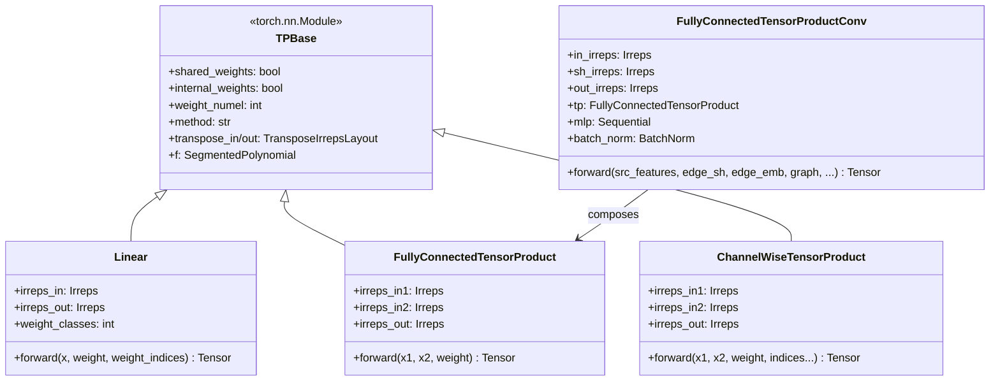
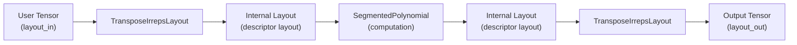

Tensor product operations form the computational backbone of any equivariant neural network — they are the mechanism by which geometric information propagates while respecting rotational symmetry. In cuEquivariance's PyTorch backend, these operations are implemented as `torch.nn.Module` subclasses that internally leverage the **descriptor system** to define their polynomial structure and the **SegmentedPolynomial** engine to execute the computation. This page covers the three core operation classes, the composite message-passing convolution layer, and the shared architectural patterns that unify them all.

## Operation Landscape

The PyTorch operations module at `cuequivariance_torch/operations/` provides a layered hierarchy of equivariant building blocks. Each class follows a consistent design: it obtains a descriptor from the `cuequivariance.descriptors` API, sets up layout transposition layers to convert between user-facing and internal irreps layouts, and delegates the actual computation to `SegmentedPolynomial` with a chosen execution method.



The three core operations differ in how they couple input irreps to output irreps, which directly determines their mathematical structure, weight tensor shapes, and applicable CUDA kernels.

Sources: [tp_fully_connected.py](cuequivariance_torch/cuequivariance_torch/operations/tp_fully_connected.py#L30-L31), [tp_channel_wise.py](cuequivariance_torch/cuequivariance_torch/operations/tp_channel_wise.py#L30-L31), [linear.py](cuequivariance_torch/cuequivariance_torch/operations/linear.py#L30-L31)

## Mathematical Structure and Descriptor Subscripts

Every tensor product operation is defined by its **Einstein subscript notation**, which specifies exactly how operands are contracted. Understanding these subscripts is the key to choosing the right operation for your architecture.

**FullyConnectedTensorProduct** uses the subscript `"uvw,iu,jv,kw+ijk"` [tp_fully_connected.py](cuequivariance_torch/cuequivariance_torch/operations/tp_fully_connected.py#L106). Here, three input operands — weight (`u,v,w`), first feature (`i,u`), and second feature (`j,v`) — are contracted through shared indices to produce the output (`i,j,k`). Each path from input to output has its own independent weight, giving maximum expressivity: every valid Clebsch-Gordan coupling path between `irreps_in1`, `irreps_in2`, and `irreps_out` receives a separate learnable scalar.

**ChannelWiseTensorProduct** uses `"uv,iu,jv,kuv+ijk"` [tp_channel_wise.py](cuequivariance_torch/cuequivariance_torch/operations/tp_channel_wise.py#L110). The critical difference is that the weight operand shares the `u,v` indices with the inputs rather than having an independent `w` dimension. This means the weight tensor has a coupled structure — the number of weight parameters equals the number of valid coupling paths, not the full Cartesian product. This makes the channel-wise variant more parameter-efficient when output irreps are filtered or constrained.

**Linear** reduces the problem to a single operand with subscript `"uv,iu,iv"` [linear.py](cuequivariance_torch/cuequivariance_torch/operations/linear.py#L92). The weight `u,v` maps input irreps `i,u` directly to output irreps `i,v` without mixing different irrep degrees — this is the equivariant analog of a standard linear layer, preserving the irrep degree of each channel.

| Operation | Subscript | Inputs | Weight Coupling | Use Case |
|---|---|---|---|---|
| `FullyConnectedTensorProduct` | `uvw,iu,jv,kw+ijk` | Two feature tensors | Fully independent per path | NequIP-style message passing |
| `ChannelWiseTensorProduct` | `uv,iu,jv,kuv+ijk` | Two feature tensors | Coupled to input degrees | MACE, PaiNN |
| `Linear` | `uv,iu,iv` | One feature tensor | Per-degree mixing | Irrep mixing, equivariant MLP |

Sources: [tp_fully_connected.py](cuequivariance_torch/cuequivariance_torch/operations/tp_fully_connected.py#L106), [tp_channel_wise.py](cuequivariance_torch/cuequivariance_torch/operations/tp_channel_wise.py#L110), [linear.py](cuequivariance_torch/cuequivariance_torch/operations/linear.py#L92)

## FullyConnectedTensorProduct

The `FullyConnectedTensorProduct` is the most general form of equivariant bilinear operation. It takes two input tensors of arbitrary irreps, couples them through all valid Clebsch-Gordan paths, and produces output features whose irreps are user-specified. This operation is the direct counterpart to `e3nn.nn.FullyConnectedTensorProduct`, with the key difference that cuEquivariance defaults to the `"fused_tp"` CUDA kernel for maximum throughput.

### Constructor and Configuration

The constructor accepts two input irreps and one output irreps, plus a family of layout and execution parameters [tp_fully_connected.py](cuequivariance_torch/cuequivariance_torch/operations/tp_fully_connected.py#L58-L75):

```python
tp = cuet.FullyConnectedTensorProduct(
    irreps_in1="4x0e + 4x1o",
    irreps_in2="0e + 1o",
    irreps_out="4x0e + 4x1o",
    layout=cue.mul_ir,       # e3nn-compatible layout
    shared_weights=True,      # share weights across batch
    internal_weights=True,    # create nn.Parameter internally
    method="fused_tp",        # CUDA kernel (default)
    math_dtype=torch.float32, # precision for computation
)
```

The `method` parameter controls which execution backend is used. When set to `"fused_tp"` (the default when CUDA is available), a custom fused CUDA kernel handles the entire segmented tensor product in a single launch. The deprecated `use_fallback=True` maps to `method="naive"`, which uses a pure PyTorch implementation based on scatter/gather operations [tp_fully_connected.py](cuequivariance_torch/cuequivariance_torch/operations/tp_fully_connected.py#L128-L141).

### Weight Modes

The operation supports two weight management patterns. With `internal_weights=True` (the default when `shared_weights=True`), the module creates a `torch.nn.Parameter` of shape `(1, weight_numel)` and manages it internally. With `internal_weights=False`, the user must supply weights at forward time, enabling scenarios where weights are computed dynamically by a separate network [tp_fully_connected.py](cuequivariance_torch/cuequivariance_torch/operations/tp_fully_connected.py#L117-L127):

```python
# Internal weights — simplest usage
tp = cuet.FullyConnectedTensorProduct(irreps_in1, irreps_in2, irreps_out)
output = tp(x1, x2)

# External weights — for dynamic weight generation
tp = cuet.FullyConnectedTensorProduct(irreps_in1, irreps_in2, irreps_out, internal_weights=False)
weights = mlp(edge_embeddings)  # shape: (num_edges, weight_numel)
output = tp(x1_per_edge, x2_per_edge, weight=weights)
```

> [!TIP]
> When using `shared_weights=False` with external weights, the weight tensor must have shape `(batch_size, weight_numel)` — each element in the batch gets its own set of path weights. This is the pattern used inside `FullyConnectedTensorProductConv` where per-edge weights are generated by an MLP.

Sources: [tp_fully_connected.py](cuequivariance_torch/cuequivariance_torch/operations/tp_fully_connected.py#L58-L141), [tp_fully_connected.py](cuequivariance_torch/cuequivariance_torch/operations/tp_fully_connected.py#L166-L207)

## ChannelWiseTensorProduct

The `ChannelWiseTensorProduct` imposes a tighter coupling between inputs and weights. Rather than assigning an independent weight to every `(irrep_in1, irrep_in2, irrep_out)` path, it restricts weights to depend only on the `(irrep_in1, irrep_in2)` pair. This reduces parameter count and is the operation used in MACE and PaiNN architectures.

### Filter Irreps and Output Control

The constructor accepts an optional `filter_irreps_out` parameter that controls which irrep degrees appear in the output. When `None`, all valid output irreps from coupling `irreps_in1` with `irreps_in2` are included. When specified as a sequence of `Irrep` objects, only those degrees are retained [tp_channel_wise.py](cuequivariance_torch/cuequivariance_torch/operations/tp_channel_wise.py#L59-L63):

```python
# All valid output irreps from coupling
tp = cuet.ChannelWiseTensorProduct(
    irreps_in1="16x0e + 16x1o + 16x2e",
    irreps_in2="0e + 1o",
)

# Only specific output degrees
tp = cuet.ChannelWiseTensorProduct(
    irreps_in1="16x0e + 16x1o + 16x2e",
    irreps_in2="0e + 1o",
    filter_irreps_out=[cue.Irrep("O3", "0e"), cue.Irrep("O3", "1o")],
)
```

### Uniform Segment Constraint and Method Selection

A critical implementation detail is that the `"uniform_1d"` CUDA kernel requires all polynomial segments to have the same shape. The constructor checks this condition via `e2.all_same_segment_shape()` and falls back to `"naive"` with a warning if segments are non-uniform [tp_channel_wise.py](cuequivariance_torch/cuequivariance_torch/operations/tp_channel_wise.py#L115-L148). If you explicitly request `"uniform_1d"` with non-uniform segments, a `ValueError` is raised.

### Indexed Forward Pass

Unlike `FullyConnectedTensorProduct`, the channel-wise variant supports **index-based gathering and scattering** through optional `indices_1`, `indices_2`, and `indices_out` parameters [tp_channel_wise.py](cuequivariance_torch/cuequivariance_torch/operations/tp_channel_wise.py#L231-L256). These enable efficient message-passing patterns where only a subset of channels participate per edge or node, avoiding materializing full intermediate tensors.

Sources: [tp_channel_wise.py](cuequivariance_torch/cuequivariance_torch/operations/tp_channel_wise.py#L59-L148), [tp_channel_wise.py](cuequivariance_torch/cuequivariance_torch/operations/tp_channel_wise.py#L186-L258)

## Equivariant Linear Layer

The `Linear` operation is the equivariant generalization of a standard `nn.Linear`. It maps between two irreps spaces while preserving irrep degree — scalars map to scalars, vectors to vectors, and so on. Within each irrep degree, an independent linear transformation mixes the multiplicity channels.

### Weight Classes

A distinctive feature of `Linear` is the `weight_classes` parameter, which enables **multiple distinct weight matrices** that can be selected per batch element via `weight_indices` at forward time [linear.py](cuequivariance_torch/cuequivariance_torch/operations/linear.py#L64). This is useful in architectures like MACE where different chemical elements use different linear projections:

```python
linear = cuet.Linear(
    irreps_in="16x0e + 16x1o",
    irreps_out="16x0e + 16x1o",
    weight_classes=5,  # e.g., 5 chemical elements
)
output = linear(x, weight_indices=element_ids)  # per-node element assignment
```

When `weight_classes > 1`, the internal weight parameter has shape `(weight_classes, weight_numel)` and `weight_indices` must be provided at forward time. This mechanism avoids materializing per-element copies of the full input tensor [linear.py](cuequivariance_torch/cuequivariance_torch/operations/linear.py#L163-L183).

### Execution Methods

The `Linear` layer supports three execution methods — `"naive"` (default), `"fused_tp"`, and `"indexed_linear"` — as verified by the test suite [linear_test.py](cuequivariance_torch/tests/operations/linear_test.py#L279). The `"indexed_linear"` method is particularly relevant when `weight_classes > 1`, as it can use optimized indexed GEMM operations rather than gathering per-class weights into a dense matrix.

Sources: [linear.py](cuequivariance_torch/cuequivariance_torch/operations/linear.py#L54-L192), [linear_test.py](cuequivariance_torch/tests/operations/linear_test.py#L276-L288)

## Shared Architectural Patterns

All three operations share a consistent internal architecture that is worth understanding as a unified pattern.

### Layout Transposition Pipeline

Every operation constructs `TransposeIrrepsLayout` modules for its inputs and outputs. These modules convert between the user-specified layout (e.g., `cue.mul_ir` for e3nn compatibility) and the internal layout required by the descriptor's `SegmentedPolynomial` [tp_fully_connected.py](cuequivariance_torch/cuequivariance_torch/operations/tp_fully_connected.py#L122-L141). This transposition happens on every forward call and is the mechanism that makes the operations agnostic to the irreps memory layout:



### Descriptor-Driven Instantiation

Each operation follows the same initialization sequence: (1) call a `descriptors.*` function to obtain a `Descriptor` object, (2) assert the expected subscript pattern, (3) extract `weight_numel` from the descriptor's polynomial operands, (4) construct layout transposers, and (5) instantiate `SegmentedPolynomial` with the chosen method. This pattern ensures that the mathematical definition lives in `cuequivariance.descriptors` (see [Tensor Product Descriptors](9-tensor-product-descriptors)) while the PyTorch operation layer handles device management, parameter storage, and layout conversion.

### Deprecated Fallback Parameter

All operations accept a deprecated `use_fallback` parameter that is being migrated to the explicit `method` parameter. The mapping is straightforward: `use_fallback=True` → `method="naive"`, `use_fallback=False` or `None` → the operation's default CUDA method (`"fused_tp"` or `"uniform_1d"`) [tp_fully_connected.py](cuequivariance_torch/cuequivariance_torch/operations/tp_fully_connected.py#L128-L141).

Sources: [tp_fully_connected.py](cuequivariance_torch/cuequivariance_torch/operations/tp_fully_connected.py#L100-L153), [tp_channel_wise.py](cuequivariance_torch/cuequivariance_torch/operations/tp_channel_wise.py#L122-L163), [linear.py](cuequivariance_torch/cuequivariance_torch/operations/linear.py#L89-L134)

## FullyConnectedTensorProductConv: Message Passing Layer

While the three operations above are primitive building blocks, `FullyConnectedTensorProductConv` in `cuequivariance_torch/layers/` is a **composite layer** that combines a `FullyConnectedTensorProduct` with graph scatter operations and an optional MLP, implementing the full message-passing update used in architectures like DiffDock.

### Mathematical Formulation

The layer computes a per-node feature update by gathering messages from neighbor nodes, applying a tensor product with edge spherical harmonics, and reducing over the neighborhood [tp_conv_fully_connected.py](cuequivariance_torch/cuequivariance_torch/layers/tp_conv_fully_connected.py#L29-L97):

$$\mathbf{h}_a \leftarrow \text{BatchNorm}\left(\frac{1}{|\mathcal{N}_a|} \sum_{b \in \mathcal{N}_a} \left[\mathbf{h}_b \otimes_{\psi_{ab}} Y(\hat{r}_{ab})\right] \cdot c_{ab}\right)$$

where `ψ_ab` are path weights generated by an optional MLP from edge and node embeddings, and `c_ab` is an optional edge envelope attenuation factor.

### Internal Composition

The layer internally composes several components [tp_conv_fully_connected.py](cuequivariance_torch/cuequivariance_torch/layers/tp_conv_fully_connected.py#L139-L153):

- A `FullyConnectedTensorProduct` with `shared_weights=False` (per-edge weights)
- An optional `nn.Sequential` MLP that maps edge embeddings to tensor product weights
- An optional `BatchNorm` applied to the aggregated output
- Graph scatter/reduce utilities (`scatter_reduce`) for message aggregation

### Three MLP Usage Patterns

The constructor supports three patterns for weight generation, controlled by the `mlp_channels` parameter:

1. **No MLP** (`mlp_channels=None`): Edge embeddings are used directly as tensor product weights. Their last dimension must exactly equal `tp.weight_numel`.
2. **Single embedding input**: The MLP transforms the full edge embedding into weights. The MLP's last layer outputs `weight_numel` features.
3. **Split scalar inputs**: When `src_scalars` and `dst_scalars` are provided at forward time, the first MLP layer's weight matrix is split into three sections (edge, source, destination). Each section performs a separate linear projection before indexing, enabling more efficient computation by avoiding concatenation of large node feature tensors [tp_conv_fully_connected.py](cuequivariance_torch/cuequivariance_torch/layers/tp_conv_fully_connected.py#L221-L245).

```python
# Pattern 1: No MLP — direct weight mapping
conv = cuet.FullyConnectedTensorProductConv(
    in_irreps, sh_irreps, out_irreps,
    mlp_channels=None,
)
output = conv(node_features, edge_sh, edge_weights, graph)

# Pattern 2: MLP with hidden layers
conv = cuet.FullyConnectedTensorProductConv(
    in_irreps, sh_irreps, out_irreps,
    mlp_channels=[6, 16, 16],
    mlp_activation=nn.ReLU(),
)
output = conv(node_features, edge_sh, edge_emb, graph)

# Pattern 3: Split scalar inputs for efficient GEMM
output = conv(node_features, edge_sh, edge_emb, graph,
              src_scalars=node_scalar_feats, dst_scalars=node_scalar_feats)
```

Sources: [tp_conv_fully_connected.py](cuequivariance_torch/cuequivariance_torch/layers/tp_conv_fully_connected.py#L29-L167), [tp_conv_fully_connected.py](cuequivariance_torch/cuequivariance_torch/layers/tp_conv_fully_connected.py#L200-L265), [layers/__init__.py](cuequivariance_torch/cuequivariance_torch/layers/__init__.py#L15-L21)

## Method Selection Guide

Choosing the right execution method involves understanding the trade-offs between CUDA kernel availability, segment uniformity, and numerical precision.

| Method | Operation | Requirement | Performance | Precision Control |
|---|---|---|---|---|
| `"fused_tp"` | FCTP, Linear | CUDA available | Best (single kernel launch) | `math_dtype` |
| `"uniform_1d"` | CWTP | Uniform segment shapes | Good (specialized kernel) | `math_dtype` |
| `"naive"` | All | None (pure PyTorch) | Baseline | Follows input dtype |
| `"indexed_linear"` | Linear | `weight_classes > 1` | Optimized for indexing | `math_dtype` |

The `math_dtype` parameter controls the precision of internal computations. When set to `None`, the default behavior varies by method: `"fused_tp"` falls back to the weight `dtype` [tp_fully_connected.py](cuequivariance_torch/cuequivariance_torch/operations/tp_fully_connected.py#L143), while `"naive"` follows the input tensor dtype. Setting `math_dtype="float64"` forces double-precision accumulation, which can be important for numerical stability in higher-order irreps.

> [!TIP]
> For production deployments, prefer `method="fused_tp"` (FCTP/Linear) or `method="uniform_1d"` (CWTP) whenever possible. The `"naive"` method should only be used for debugging, CPU execution, or when the uniform segment constraint cannot be satisfied. The test suite exercises all method/layout/precision combinations to verify correctness [fully_connected_test.py](cuequivariance_torch/tests/operations/fully_connected_test.py#L43-L54).

Sources: [tp_fully_connected.py](cuequivariance_torch/cuequivariance_torch/operations/tp_fully_connected.py#L128-L153), [tp_channel_wise.py](cuequivariance_torch/cuequivariance_torch/operations/tp_channel_wise.py#L131-L163), [linear_test.py](cuequivariance_torch/tests/operations/linear_test.py#L276-L288)

## Export and TorchScript Compatibility

All three core operations support TorchScript export via `torch.jit.script`, `torch.jit.trace`, and `torch.compile`. The test suite verifies this across all layout/weight configurations through a parameterized `test_export` function [fully_connected_test.py](cuequivariance_torch/tests/operations/fully_connected_test.py#L99-L114), [channel_wise_test.py](cuequivariance_torch/tests/operations/channel_wise_test.py#L97-L114), [linear_test.py](cuequivariance_torch/tests/operations/linear_test.py#L205-L220). The `extra_repr` methods are decorated with `@torch.jit.ignore` to avoid scripting issues with string formatting [tp_channel_wise.py](cuequivariance_torch/cuequivariance_torch/operations/tp_channel_wise.py#L178).

## Continuing the Exploration

The tensor product operations documented here are the consumer-facing API that delegates to lower-level primitives. To understand how these operations achieve their performance characteristics, see [CUDA Primitive Implementations](13-cuda-primitive-implementations) for the kernel-level details. For the mathematical foundations that define which irrep couplings are valid and how descriptors encode them, refer to [Tensor Product Descriptors](9-tensor-product-descriptors). To see how these operations compose into complete equivariant architectures, continue to [Symmetric Contraction Layer](14-symmetric-contraction-layer) and [Model Examples: MACE and NequIP](21-model-examples-mace-and-nequip).