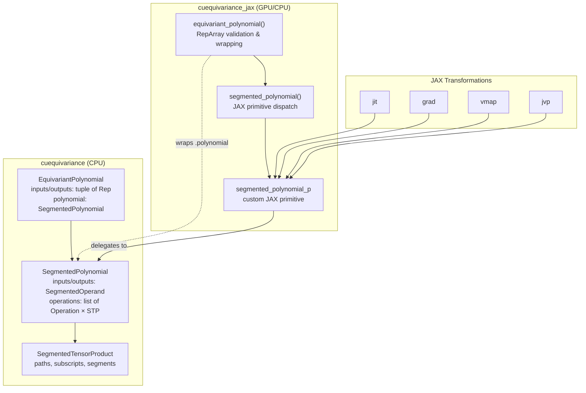
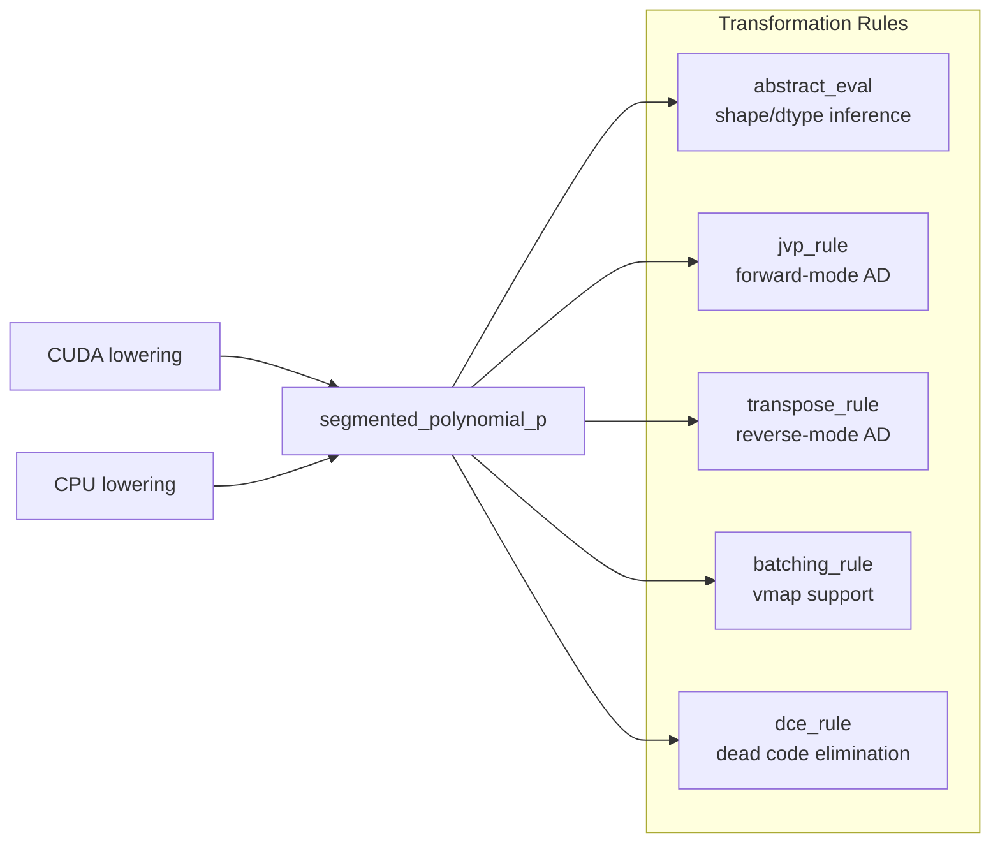

The `cuex.equivariant_polynomial` function is the primary entry point for computing **group-equivariant polynomial transformations** in cuEquivariance's JAX backend. It wraps the lower-level `segmented_polynomial` primitive with representation-aware input validation, automatic output shape inference, and seamless `RepArray` handling — letting you focus on the mathematical structure of your equivariant layers rather than the mechanics of buffer management.

## Architecture: Where It Sits

The equivariant polynomial system in JAX spans two packages and three conceptual layers. Understanding this stack is essential because each layer has a distinct role: **descriptors** define *what* to compute, the **primitive** defines *how* JAX compiles it, and `equivariant_polynomial()` bridges the two with **type safety**.



The `EquivariantPolynomial` descriptor lives in the core `cuequivariance` package and carries group representation metadata (`inputs` and `outputs` as `cue.Rep` objects) alongside a `SegmentedPolynomial` that encodes the actual computation graph [equivariant_polynomial.py](cuequivariance/cuequivariance/group_theory/equivariant_polynomial.py#L28-L75). The JAX wrapper function extracts `.polynomial` for computation while using the representation metadata for input validation and output labeling.

## Function Signature and Parameters

The `equivariant_polynomial` function accepts an `EquivariantPolynomial` descriptor and a list of `RepArray` (or plain `jax.Array` for scalar inputs), then returns typed `RepArray` outputs.

Sources: [equivariant_polynomial.py](cuequivariance_jax/cuequivariance_jax/equivariant_polynomial.py#L25-L38)

| Parameter | Type | Required | Description |
|---|---|---|---|
| `poly` | `cue.EquivariantPolynomial` | Yes | The equivariant polynomial descriptor defining the computation and representation constraints |
| `inputs` | `list[RepArray \| jax.Array]` | Yes | Input tensors; each must be a `RepArray` with matching representation, or a plain `jax.Array` for scalar representations |
| `outputs_shape_dtype` | `list[ShapeDtypeStruct] \| ShapeDtypeStruct \| None` | No | Shape/dtype for outputs. When `None`, shapes are inferred from inputs. Last dimension accepts `-1` for auto-inference from the descriptor |
| `indices` | `list[None \| jax.Array \| tuple] \| None` | No | Per-operand index arrays for scatter/gather. Length must equal `poly.num_operands`. Use `None` for unindexed operands |
| `method` | `str` | Yes* | Computation backend: `"naive"`, `"uniform_1d"`, or `"indexed_linear"` |
| `math_dtype` | `str \| None` | No | Overrides computation dtype. See [`segmented_polynomial`](cuequivariance_jax/cuequivariance_jax/segmented_polynomials/segmented_polynomial.py#L84-L96) for supported values per method |
| `options` | `dict \| None` | No | Method-specific options, including `"math_dtype"` and other configuration keys |
| `name` | `str \| None` | No | Operation name for profiling and debugging. Defaults to `"equivariant_polynomial"` |

*The `method` parameter became required starting in v0.6.0. Passing `""` raises a descriptive error guiding migration [segmented_polynomial.py](cuequivariance_jax/cuequivariance_jax/segmented_polynomials/segmented_polynomial.py#L165-L170).

## Input Validation Pipeline

Before any computation begins, `equivariant_polynomial` performs a rigorous validation pass. This is a key differentiator from calling `segmented_polynomial` directly — the representation-aware wrapper catches type mismatches early.

The validation proceeds through three stages. First, input count is checked against `poly.num_inputs` [equivariant_polynomial.py](cuequivariance_jax/cuequivariance_jax/equivariant_polynomial.py#L114-L117). Second, each input is verified: `RepArray` inputs must have `rep(-1) == poly.inputs[i]`, while plain `jax.Array` inputs are only permitted for scalar representations (and must have `x.shape[-1] == rep.dim`) [equivariant_polynomial.py](cuequivariance_jax/cuequivariance_jax/equivariant_polynomial.py#L119-L134). Third, indices length must equal `poly.num_operands` [equivariant_polynomial.py](cuequivariance_jax/cuequivariance_jax/equivariant_polynomial.py#L141-L144).

After validation, `RepArray` inputs are unwrapped to their underlying `jax.Array` via `getattr(x, "array", x)` [equivariant_polynomial.py](cuequivariance_jax/cuequivariance_jax/equivariant_polynomial.py#L136), and the raw arrays are dispatched to `segmented_polynomial`. The raw output arrays are then re-wrapped as `RepArray` objects using the descriptor's output representations [equivariant_polynomial.py](cuequivariance_jax/cuequivariance_jax/equivariant_polynomial.py#L198).

## Automatic Output Shape Inference

When `outputs_shape_dtype` is `None`, the function automatically infers output shapes by broadcasting the batch dimensions of all inputs, accounting for index configurations. This inference handles both unindexed and indexed operands, and even `Repeats` objects for repeated-index patterns [equivariant_polynomial.py](cuequivariance_jax/cuequivariance_jax/equivariant_polynomial.py#L148-L176).

The inference logic broadcasts shapes across all indexed and unindexed inputs using `jnp.broadcast_shapes`, then appends the representation dimension from `rep.dim` for each output. The dtype is inferred via `jnp.result_type(*inputs)`. A single-output polynomial automatically unwraps from list to scalar return; multi-output polynomials always return a list.

Two constraints apply to inference: output indices cannot be provided without explicit `outputs_shape_dtype`, and zero-input polynomials require explicit shape specification [equivariant_polynomial.py](cuequivariance_jax/cuequivariance_jax/equivariant_polynomial.py#L148-L156).

> [!TIP]
> When providing output indices for scatter patterns (e.g., message-passing on graphs), you **must** specify `outputs_shape_dtype` explicitly. The function cannot infer output sizes when indices determine the scatter target, because the broadcast shape depends on index structure rather than input shapes alone.

## Computation Methods

The underlying `segmented_polynomial` dispatches to one of three implementation strategies. Method selection is driven by the polynomial structure and hardware availability.

Sources: [segmented_polynomial.py](cuequivariance_jax/cuequivariance_jax/segmented_polynomials/segmented_polynomial.py#L518-L549)

| Method | Backend | Use Case | Index Support |
|---|---|---|---|
| `"naive"` | JAX (any platform) | Reference implementation, always works, used for correctness validation | Full (including slice indices) |
| `"uniform_1d"` | CUDA | High-performance path for polynomials with a single uniform mode | Partial (integer index arrays) |
| `"indexed_linear"` | CUDA | Optimized for linear layers with partitioned/repeated weights | Partial (Repeats mode) |

When `"uniform_1d"` or `"indexed_linear"` is requested on a non-CUDA platform, the system falls back to `"naive"` with a warning [segmented_polynomial.py](cuequivariance_jax/cuequivariance_jax/segmented_polynomials/segmented_polynomial.py#L519-L525). The `Repeats` indexing mode is only supported by `"naive"` and `"indexed_linear"` [segmented_polynomial.py](cuequivariance_jax/cuequivariance_jax/segmented_polynomials/segmented_polynomial.py#L537-L541).

## JAX Transformation Support

The computation is implemented as a custom JAX primitive (`segmented_polynomial_p`) with full transformation rule coverage. This is what enables `jit`, `grad`, and `vmap` to work transparently through `equivariant_polynomial`.

Sources: [segmented_polynomial.py](cuequivariance_jax/cuequivariance_jax/segmented_polynomials/segmented_polynomial.py#L780-L801)



Each rule is registered at the primitive level [segmented_polynomial.py](cuequivariance_jax/cuequivariance_jax/segmented_polynomials/segmented_polynomial.py#L780-L801):

- **Abstract eval** (`segmented_polynomial_abstract_eval`): Provides shape and dtype information during JAX tracing [segmented_polynomial.py](cuequivariance_jax/cuequivariance_jax/segmented_polynomials/segmented_polynomial.py#L467-L476)
- **JVP** (`segmented_polynomial_jvp`): Forward-mode automatic differentiation, computing tangent outputs from primal and tangent inputs [segmented_polynomial.py](cuequivariance_jax/cuequivariance_jax/segmented_polynomials/segmented_polynomial.py#L552-L612)
- **Transpose** (`segmented_polynomial_transpose`): Reverse-mode AD for gradient computation via `jax.grad` [segmented_polynomial.py](cuequivariance_jax/cuequivariance_jax/segmented_polynomials/segmented_polynomial.py#L613-L675)
- **Batching** (`segmented_polynomial_batching`): Maps a batch dimension across inputs/outputs for `jax.vmap` [segmented_polynomial.py](cuequivariance_jax/cuequivariance_jax/segmented_polynomials/segmented_polynomial.py#L676-L729)
- **DCE** (`segmented_polynomial_dce`): Dead code elimination removes unused operands during partial evaluation [segmented_polynomial.py](cuequivariance_jax/cuequivariance_jax/segmented_polynomials/segmented_polynomial.py#L731-L778)

The DCE rule is particularly noteworthy — it filters out unused inputs and outputs at the JAXpr level, preventing unnecessary computation during partial evaluation (e.g., when `grad` only needs gradients for some inputs).

## Practical Usage Examples

### Basic Spherical Harmonics

The simplest usage pattern creates a descriptor, prepares a `RepArray` input, and calls the function. The spherical harmonics descriptor computes rotation-equivariant features from a 3D vector.

Sources: [equivariant_polynomial.py](cuequivariance_jax/cuequivariance_jax/equivariant_polynomial.py#L67-L83)

```python
import cuequivariance as cue
import cuequivariance_jax as cuex
import jax.numpy as jnp

# Create descriptor for SO(3) spherical harmonics up to degree 2
e = cue.descriptors.spherical_harmonics(cue.SO3(1), [0, 1, 2])

# Prepare input: a unit vector along y-axis as an l=1 (vector) RepArray
with cue.assume(cue.SO3, cue.ir_mul):
    x = cuex.RepArray("1", jnp.array([0.0, 1.0, 0.0]))

# Compute — returns a RepArray with irreps 0+1+2
result = cuex.equivariant_polynomial(e, [x], method="naive")
```

### Indexed Computation for Message Passing

In graph neural networks, node features are indexed by edge lists. The `indices` parameter enables this pattern directly, scattering results into per-node output buffers.

Sources: [equivariant_polynomial.py](cuequivariance_jax/cuequivariance_jax/equivariant_polynomial.py#L86-L104), [equivariant_polynomial_test.py](cuequivariance_jax/tests/equivariant_polynomial_test.py#L60-L118)

```python
from cuequivariance_jax import segmented_polynomials as sp

# Describe a symmetric contraction for a MACE-like architecture
e = cue.descriptors.symmetric_contraction(
    64 * cue.Irreps("SO3", "0 + 1 + 2"),
    64 * cue.Irreps("SO3", "0 + 1"),
    [0, 1, 2, 3]
)

num_nodes, num_edges = 30, 100
inputs = [
    cuex.randn(jax.random.key(0), rep, (Z,), jnp.float64)
    for Z, rep in zip([num_edges] * e.num_inputs, e.inputs)
]
# Override first input batch to num_nodes (node features)
inputs[0] = cuex.randn(jax.random.key(0), e.inputs[0], (num_nodes,), jnp.float64)

# Edge index arrays for scatter/gather
indices = [None] * e.num_operands
indices[0] = jax.random.randint(jax.random.key(1), (num_edges,), 0, num_nodes, jnp.int32)
indices[-1] = jax.random.randint(jax.random.key(1), (num_edges,), 0, num_nodes, jnp.int32)

output_spec = jax.ShapeDtypeStruct((num_nodes, e.outputs[0].dim), jnp.float64)
result = cuex.equivariant_polynomial(e, inputs, output_spec, indices, method="uniform_1d")
```

### Differentiation

The custom primitive rules enable full `jax.grad` support, including higher-order derivatives as validated by the test suite [equivariant_polynomial_test.py](cuequivariance_jax/tests/equivariant_polynomial_test.py#L24-L38).

```python
def loss(w, x):
    return cuex.equivariant_polynomial(e, [w, x], method="naive").array.sum() ** 2

# Single backward
grad_fn = jax.grad(loss, argnums=0)
grads = grad_fn(w, x)

# Double backward is also supported
grad_of_grad = jax.grad(lambda w, x: jax.grad(loss, 1)(w, x).array.sum() ** 2, argnums=0)
```

## Relationship to Segmented Polynomial

The `equivariant_polynomial` function is intentionally thin. Its entire computational body delegates to `segmented_polynomial`, extracting `poly.polynomial` (the underlying `SegmentedPolynomial`) and passing the unwrapped array data [equivariant_polynomial.py](cuequivariance_jax/cuequivariance_jax/equivariant_polynomial.py#L187-L197). The value it adds is:

1. **Type safety**: Verifies that `RepArray` inputs carry the correct group representations
2. **Convenience**: Automatically infers output shapes and wraps results back into `RepArray`
3. **Single/multi output normalization**: Returns a scalar `RepArray` for single-output polynomials and a list for multi-output, matching the descriptor structure

For scenarios requiring direct control over raw `jax.Array` buffers — such as custom JAXpr transformations or integration with non-representation-aware code — calling `segmented_polynomial` directly is the appropriate path. See [JAX Segmented Polynomial Variants](17-jax-segmented-polynomial-variants) for the full details on that layer.

> [!TIP]
> The `precision` parameter is deprecated in favor of `math_dtype`. Passing any value other than `"undefined"` (the default) raises a `ValueError` directing you to use `math_dtype` or `options` instead [equivariant_polynomial.py](cuequivariance_jax/cuequivariance_jax/equivariant_polynomial.py#L109-L112).

## Performance Considerations

The `uniform_1d` CUDA method provides significant speedup over `naive` for suitable polynomial structures (those with a single uniform mode). The test suite validates numerical equivalence between `"naive"` and `"uniform_1d"` at `float64` precision with tight tolerances (`atol=1e-12`), confirming both forward and backward passes produce identical results [equivariant_polynomial_test.py](cuequivariance_jax/tests/equivariant_polynomial_test.py#L92-L118).

For multi-device scenarios, the underlying CUDA kernel requires manual sharding via `jax.shard_map` to achieve proper performance — automatic sharding is not supported for this custom primitive [segmented_polynomial.py](cuequivariance_jax/cuequivariance_jax/segmented_polynomials/segmented_polynomial.py#L157-L162).

## Next Steps

- **[JAX Segmented Polynomial Variants](17-jax-segmented-polynomial-variants)** — Deep dive into the three implementation methods (`naive`, `uniform_1d`, `indexed_linear`) and their index configuration system
- **[RepArray System](19-reparray-system)** — Understanding the representation-aware array type that flows through `equivariant_polynomial`
- **[Equivariant Polynomial Hierarchy](8-equivariant-polynomial-hierarchy)** — How `EquivariantPolynomial` relates to `SegmentedPolynomial` and `SegmentedTensorProduct` in the descriptor system
- **[Automatic Differentiation Support](20-automatic-differentiation-support)** — Detailed analysis of JVP, transpose, and batching rules
- **[Model Examples: MACE and NequIP](21-model-examples-mace-and-nequip)** — End-to-end model implementations using `equivariant_polynomial`