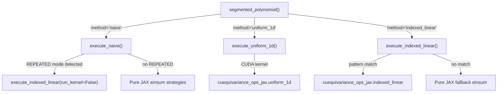
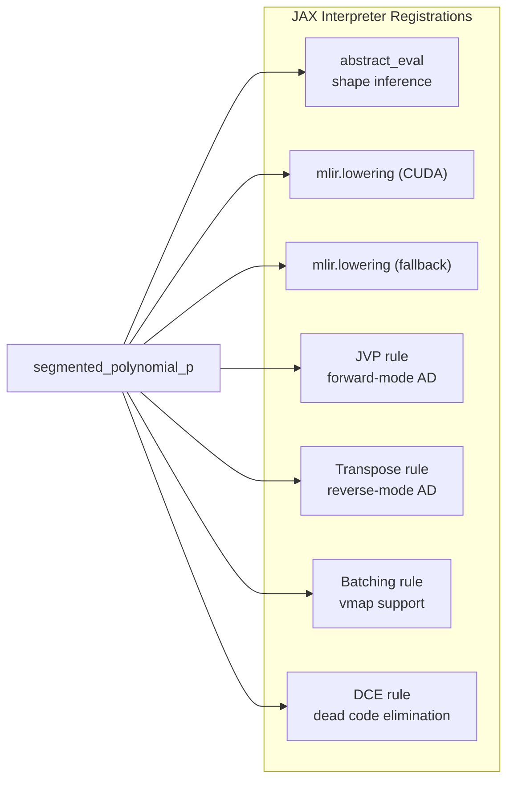
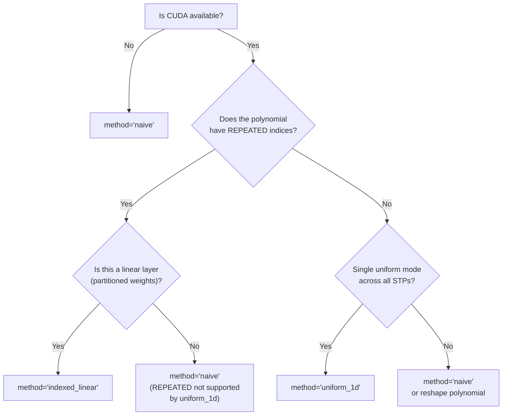

The JAX backend exposes a single entry point — `segmented_polynomial()` — that dispatches to one of three carefully stratified execution backends. Each variant occupies a distinct niche in the performance–flexibility spectrum, from pure-JAX portability to GPU-native fused kernels. This page documents their internal architectures, dispatch logic, and the JAX transformation machinery that unifies them behind a shared primitive.

## Variant Landscape and Dispatch Architecture

All three variants converge on a single `segmented_polynomial` function in [segmented_polynomial.py](cuequivariance_jax/cuequivariance_jax/segmented_polynomials/segmented_polynomial.py#L51-L62). The `method` parameter — now mandatory since v0.6.0 — selects the execution strategy at call time. The dispatch decision is enforced inside the implementation handler at [segmented_polynomial_impl](cuequivariance_jax/cuequivariance_jax/segmented_polynomials/segmented_polynomial.py#L482-L549), which also applies a platform guard: if a CUDA-only method is requested on a non-CUDA backend, it silently falls back to `"naive"` with a warning.

The following table summarises the core trade-offs at a glance:

| Variant | Backend | Indexing Modes Supported | Typical Use Case |
|---|---|---|---|
| `"naive"` | Pure JAX (all platforms) | All three modes | Testing, prototyping, non-CUDA environments |
| `"uniform_1d"` | CUDA via `cuequivariance_ops_jax` | `BATCHED_OR_SHARED`, `INDEXED` only | Single-mode tensor products with uniform segment shapes |
| `"indexed_linear"` | CUDA + JAX fallback | All three modes | Linear layers with partitioned/repeated weights |

Sources: [segmented_polynomial.py](cuequivariance_jax/cuequivariance_jax/segmented_polynomials/segmented_polynomial.py#L51-L62), [segmented_polynomial.py](cuequivariance_jax/cuequivariance_jax/segmented_polynomials/segmented_polynomial.py#L530-L549)

## The Indexing Mode System

Before examining each variant, it is essential to understand the indexing infrastructure defined in [indexing_mode.py](cuequivariance_jax/cuequivariance_jax/segmented_polynomials/indexing_mode.py#L18-L26). Each buffer (input or output) can carry an optional multi-axis index, and each axis of that index is classified by one of three `IndexingMode` values. This classification drives both correctness semantics and kernel selection.

| Mode | Meaning | Example |
|---|---|---|
| `BATCHED_OR_SHARED` | No explicit index; the dimension participates in broadcasting or is shared across buffers | Standard batched tensor product |
| `INDEXED` | A JAX integer array that selects along this dimension | Per-atom indexing in molecular graphs |
| `REPEATED` | A `Repeats` object specifying variable replication counts per element | Partitioned weight matrices where each partition has a different count |

The `Repeats` dataclass in [utils.py](cuequivariance_jax/cuequivariance_jax/segmented_polynomials/utils.py#L76-L98) wraps a repeat-count array and is registered as a JAX pytree node, making it transparent to JAX's tree utilities. During index sanitisation in the main function (lines 271–298), `Repeats` objects are unwrapped to their underlying arrays while retaining the `REPEATED` mode classification in the parallel `index_mode` structure.

Sources: [indexing_mode.py](cuequivariance_jax/cuequivariance_jax/segmented_polynomials/indexing_mode.py#L18-L26), [utils.py](cuequivariance_jax/cuequivariance_jax/segmented_polynomials/utils.py#L76-L98), [segmented_polynomial.py](cuequivariance_jax/cuequivariance_jax/segmented_polynomials/segmented_polynomial.py#L271-L298)

## Naive Variant: Pure JAX Execution

The `execute_naive` function in [segmented_polynomial_naive.py](cuequivariance_jax/cuequivariance_jax/segmented_polynomials/segmented_polynomial_naive.py#L39-L127) is the universal fallback. It operates entirely through JAX primitives — primarily `jnp.einsum`, `jnp.take`, `jnp.stack`, and `jnp.sum` — making it compatible with any platform JAX targets (CPU, GPU, TPU). The implementation iterates over each `operation` in the polynomial, scatters indexed inputs into a common batch coordinate space via `scatter()`, computes the segmented tensor product via `tp_list_list()`, concatenates the result segments back to full operand size via `sum_cat_list_list()`, and then gathers the output back into the original index space via `gather()`.

### Einsum Strategies

The `tp_list_list` function at [line 172](cuequivariance_jax/cuequivariance_jax/segmented_polynomials/segmented_polynomial_naive.py#L172-L415) is the computational core. It dynamically selects one of six algorithms based on segment shape uniformity and path count:

| Algorithm | Condition | Strategy |
|---|---|---|
| `"sliced"` | Non-uniform segment shapes | Direct slicing per path — no reshaping required |
| `"stacked"` | Uniform shapes, path count ≤ threshold | Reshape operands to `(batch, num_segments, segment_dim)`, `jnp.take` per path |
| `"compact_stacked"` | Uniform shapes, path count > threshold | Vectorise accumulated einsum over path groups to reduce launch overhead |
| `"indexed_vmap"` | Non-uniform shapes, many paths | `jax.vmap` over paths with `at[].add()` scatter |
| `"indexed_compact"` | Non-uniform shapes, many paths | Fully vectorised einsum with `at[].add()` scatter |
| `"indexed_for_loop"` | Non-uniform shapes, fallback | `jax.lax.fori_loop` — least XLA-friendly, last resort |

The threshold for switching from `"stacked"`/`"sliced"` to compact strategies is controlled by the `CUEQUIVARIANCE_MAX_PATH_UNROLL` environment variable, defaulting to 1000 paths.

### REPEATED Mode Delegation

When any buffer carries `IndexingMode.REPEATED`, `execute_naive` immediately delegates to `execute_indexed_linear` with `run_kernel=False` ([line 83](cuequivariance_jax/cuequivariance_jax/segmented_polynomials/segmented_polynomial_naive.py#L83-L87)). This fallback uses the indexed_linear variant's pure-JAX einsum path rather than its CUDA kernel, keeping the naive variant fully platform-portable while reusing the REPEATED handling logic.

### Math Dtype Configuration

The `math_dtype_for_naive` helper in [utils.py](cuequivariance_jax/cuequivariance_jax/segmented_polynomials/utils.py#L102-L119) maps the `math_dtype` option to a JAX compute dtype and `jax.lax.Precision` enum. Setting `math_dtype="tensor_float32"` yields `jnp.float32` with `Precision.HIGH` (TF32 mode on Ampere+ GPUs). Any standard JAX dtype name (e.g., `"float16"`, `"bfloat16"`) is resolved to its JAX counterpart with `Precision.HIGHEST`.

Sources: [segmented_polynomial_naive.py](cuequivariance_jax/cuequivariance_jax/segmented_polynomials/segmented_polynomial_naive.py#L39-L127), [segmented_polynomial_naive.py](cuequivariance_jax/cuequivariance_jax/segmented_polynomials/segmented_polynomial_naive.py#L172-L415), [utils.py](cuequivariance_jax/cuequivariance_jax/segmented_polynomials/utils.py#L102-L119)

## Uniform 1D Variant: CUDA Fused Kernel

The `execute_uniform_1d` function in [segmented_polynomial_uniform_1d.py](cuequivariance_jax/cuequivariance_jax/segmented_polynomials/segmented_polynomial_uniform_1d.py#L35-L198) targets maximum throughput for a specific but common case: polynomials composed of segmented tensor products that share exactly one uniform mode across all operands. This variant delegates entirely to `cuequivariance_ops_jax.uniform_1d`, a precompiled CUDA kernel.

### Precondition Pipeline

Before invoking the kernel, the function applies a rigorous validation and transformation pipeline:

1. **Coefficient flattening** ([line 80](cuequivariance_jax/cuequivariance_jax/segmented_polynomials/segmented_polynomial_uniform_1d.py#L80-L87)): All coefficient modes are flattened — `coefficient_subscripts` must become empty. This fails fast with a descriptive error if coefficient modes exist.

2. **Mode squeezing and canonicalisation** ([line 88](cuequivariance_jax/cuequivariance_jax/segmented_polynomials/segmented_polynomial_uniform_1d.py#L88-L89)): Singleton modes are removed and subscripts are canonicalised.

3. **Single-mode enforcement** ([line 91](cuequivariance_jax/cuequivariance_jax/segmented_polynomials/segmented_polynomial_uniform_1d.py#L91-L93)): If an STP has zero modes, a dummy mode `u` with extent 1 is appended.

4. **Uniform segment shape validation** ([line 107](cuequivariance_jax/cuequivariance_jax/segmented_polynomials/segmented_polynomial_uniform_1d.py#L107-L121)): Every operand in every STP must have uniform segment shapes within that STP. When this fails, the error message computes the GCD of mode extents and suggests applying `split_mode()` as a resolution.

5. **Single uniform extent** ([line 141](cuequivariance_jax/cuequivariance_jax/segmented_polynomials/segmented_polynomial_uniform_1d.py#L141-L145)): All STPs must share the same mode extent (e.g., `u=3` everywhere).

6. **Buffer reshaping** ([line 121](cuequivariance_jax/cuequivariance_jax/segmented_polynomials/segmented_polynomial_uniform_1d.py#L121-L127)): Buffers are reshaped from `(*batch, operand_size)` to `(*batch, num_segments, segment_size)` based on STP operand metadata.

### Kernel Invocation

After validation, the polynomial's operations and paths are converted to plain data objects (`Operation`, `Path` from `cuequivariance_ops_jax`) and passed to the `uniform_1d` CUDA function ([line 172](cuequivariance_jax/cuequivariance_jax/segmented_polynomials/segmented_polynomial_uniform_1d.py#L172-L189)). The `math_dtype` option is limited to standard floating-point types: `float32`, `float64`, `float16`, `bfloat16`. The name is sanitised to alphanumeric characters for use as a CUDA kernel identifier.

> [!TIP]
> The `uniform_1d` method requires the `cuequivariance_ops_jax` package (version ≥ 0.4.0.dev). If your polynomial has multiple modes or non-uniform segment shapes, apply `polynomial.flatten_modes()` or `polynomial.split_mode()` before calling this variant to meet its preconditions.

Sources: [segmented_polynomial_uniform_1d.py](cuequivariance_jax/cuequivariance_jax/segmented_polynomials/segmented_polynomial_uniform_1d.py#L35-L198)

## Indexed Linear Variant: Hybrid CUDA + JAX

The `execute_indexed_linear` function in [segmented_polynomial_indexed_linear.py](cuequivariance_jax/cuequivariance_jax/segmented_polynomials/segmented_polynomial_indexed_linear.py#L42-L127) is the most architecturally interesting variant. It is designed for equivariant linear layers where weight matrices are partitioned by irrep type with variable partition sizes — the pattern used in MACE and NequIP-style models.

### Execution Flow

The outer loop in [execute_indexed_linear](cuequivariance_jax/cuequivariance_jax/segmented_polynomials/segmented_polynomial_indexed_linear.py#L42-L127) iterates over the polynomial's operations. For each operation, it calls `tp_list_list` ([line 138](cuequivariance_jax/cuequivariance_jax/segmented_polynomials/segmented_polynomial_indexed_linear.py#L138-L196)), which slices input and output `Buffer` objects per path and invokes the central `ein` function. Unlike the naive variant, results are accumulated via `io_buffers[b_out] += out` rather than scatter/gather, because the indexed linear pattern always operates in a shared batch space.

### Pattern-Matched CUDA Kernel Dispatch

The `ein` function at [line 198](cuequivariance_jax/cuequivariance_jax/segmented_polynomials/segmented_polynomial_indexed_linear.py#L198-L427) is where the critical dispatch occurs. It constructs an Einstein summation formula from the subscripts and batch dimensions, then checks whether the formula **and** the indexing mode combination match one of several hardcoded patterns. Each pattern corresponds to a specific linear algebra primitive:

| Formula Pattern | Mode Signature | Operation |
|---|---|---|
| `,Auv,Au->Av` | `(REPEATED, BATCHED, BATCHED)` | Partitioned weight right-multiply |
| `,Auv,Av->Au` | `(REPEATED, BATCHED, BATCHED)` | Partitioned weight left-multiply |
| `,Auv,Awu->Awv` | `(REPEATED, BATCHED, BATCHED)` | Partitioned right-multiply with extra mode |
| `,Au,Auv->Av` | `(BATCHED, REPEATED, BATCHED)` | Input left, weight repeated |
| `,Auv,Awv->Auw` | `(BATCHED, REPEATED, BATCHED)` | Input with extra mode, weight repeated |
| `,Au,Av->Auv` | `(BATCHED, BATCHED, REPEATED)` | Outer product into partitioned output |
| `,Auv,Auw->Awv` | `(BATCHED, BATCHED, REPEATED)` | Outer product with extra modes |

When a pattern matches and `run_kernel=True`, the function calls `cuequivariance_ops_jax.indexed_linear` with the appropriate layout strings. When no pattern matches, it falls through to a pure-JAX `jnp.einsum` call, preserving correctness across all input configurations.

### The `run_kernel` Parameter

The `run_kernel` flag controls whether CUDA kernel dispatch is attempted. The naive variant calls `execute_indexed_linear` with `run_kernel=False` to reuse the REPEATED-mode logic on non-CUDA platforms, while the direct `method="indexed_linear"` path sets it to `True` by default.

Sources: [segmented_polynomial_indexed_linear.py](cuequivariance_jax/cuequivariance_jax/segmented_polynomials/segmented_polynomial_indexed_linear.py#L42-L127), [segmented_polynomial_indexed_linear.py](cuequivariance_jax/cuequivariance_jax/segmented_polynomials/segmented_polynomial_indexed_linear.py#L198-L427)

## JAX Primitive and Transformation Rules

All three variants are unified behind a single custom JAX primitive, `segmented_polynomial_p`, defined at [line 334](cuequivariance_jax/cuequivariance_jax/segmented_polynomials/segmented_polynomial.py#L334-L335). This primitive is registered with the full suite of JAX transformation interpreters, enabling transparent use inside `jit`, `grad`, and `vmap` contexts.

### Forward-Mode AD (JVP)

The [segmented_polynomial_jvp](cuequivariance_jax/cuequivariance_jax/segmented_polynomials/segmented_polynomial.py#L552-L612) rule computes forward-mode derivatives by generating a JVP polynomial from the base polynomial using `polynomial.jvp()`, which selects which inputs have non-zero tangents. The tangent computation shares the primals as additional inputs and remaps the index configuration via `_remap_indices_and_config` to account for the enlarged input set. Both primal and tangent outputs are computed via `segmented_polynomial_prim`, and zeros are passed through for inputs with `ad.Zero` tangents.

### Reverse-Mode AD (Transpose)

The [segmented_polynomial_transpose](cuequivariance_jax/cuequivariance_jax/segmented_polynomials/segmented_polynomial.py#L613-L673) rule implements the VJP by constructing a transposed polynomial via `polynomial.transpose()`. Cotangents replace outputs as inputs, and undefined primal inputs become the new outputs. The transposed polynomial is then executed through the same `segmented_polynomial_prim` pathway, inheriting whatever method was specified for the forward pass.

### Batching (vmap)

The [segmented_polynomial_batching](cuequivariance_jax/cuequivariance_jax/segmented_polynomials/segmented_polynomial.py#L676-L728) rule handles `jax.vmap` by inserting a new batch axis at dimension 0 for all inputs (using `jnp.expand_dims` for unbatched operands or `jnp.moveaxis` for already-batched ones). The new batch axis is marked as `BATCHED_OR_SHARED` in the index configuration, meaning it is never indexed — it simply broadcasts through the computation. The output batch axis is reported at position 0.

### Dead Code Elimination

The [segmented_polynomial_dce](cuequivariance_jax/cuequivariance_jax/segmented_polynomials/segmented_polynomial.py#L731-L777) rule is the most sophisticated transformation handler. It operates at the JAXpr equation level, responding to JAX's partial evaluation pass. When some outputs are unused, the DCE rule:

1. Calls `polynomial.compute_only(used_outputs)` to prune unnecessary paths and operations.
2. Determines which inputs are still required via `polynomial.used_inputs()`.
3. Remaps the index configuration to eliminate unused index buffers.
4. Returns the modified equation with filtered inputs, outputs, and polynomial.

If **all** outputs are unused, the entire operation is eliminated, returning `None` for the equation and marking all inputs as unused.

> [!TIP]
> The DCE rule is what makes `jax.grad` efficient: when computing gradients with respect to only a subset of inputs, the transpose rule produces cotangents only for those inputs, and the DCE rule then eliminates all computation paths that don't contribute to those specific gradients. This can dramatically reduce the polynomial's operation count in the backward pass.

Sources: [segmented_polynomial.py](cuequivariance_jax/cuequivariance_jax/segmented_polynomials/segmented_polynomial.py#L334-L335), [segmented_polynomial.py](cuequivariance_jax/cuequivariance_jax/segmented_polynomials/segmented_polynomial.py#L552-L612), [segmented_polynomial.py](cuequivariance_jax/cuequivariance_jax/segmented_polynomials/segmented_polynomial.py#L613-L673), [segmented_polynomial.py](cuequivariance_jax/cuequivariance_jax/segmented_polynomials/segmented_polynomial.py#L676-L728), [segmented_polynomial.py](cuequivariance_jax/cuequivariance_jax/segmented_polynomials/segmented_polynomial.py#L731-L777), [segmented_polynomial.py](cuequivariance_jax/cuequivariance_jax/segmented_polynomials/segmented_polynomial.py#L780-L801)

## Practical Usage Patterns

### Selecting the Right Variant

The variant choice is driven by the polynomial's structure and the deployment environment. The following decision flow covers common scenarios:

### Math Dtype Options by Variant

| Option Key | `"naive"` | `"uniform_1d"` | `"indexed_linear"` |
|---|---|---|---|
| `"float32"` / `"float64"` / `"float16"` / `"bfloat16"` | ✓ | ✓ | — |
| `"tensor_float32"` | ✓ (TF32 mode) | — | — |
| `"CUBLAS_COMPUTE_32F"` / `"CUBLAS_COMPUTE_32F_FAST_TF32"` / `"CUBLAS_COMPUTE_64F"` etc. | — | — | ✓ |

When `math_dtype` is not specified, the compute dtype is automatically inferred from the input and output buffer dtypes.

### Multi-Device Sharding

The segmented polynomial primitive uses custom CUDA kernels that are not automatically sharded by JAX's implicit sharding. For multi-device execution, explicit sharding via `jax.shard_map` is required. Without it, computation will be redundantly replicated across devices, degrading rather than improving performance.
