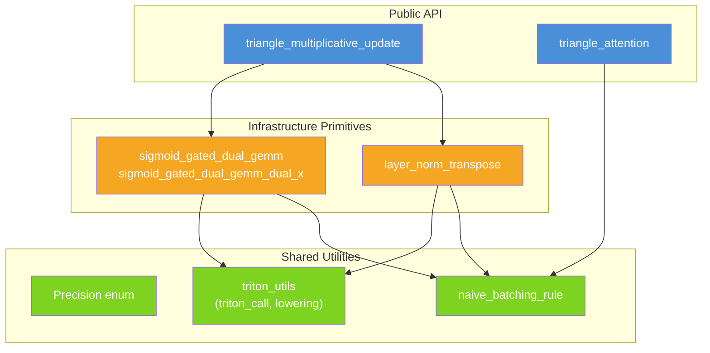
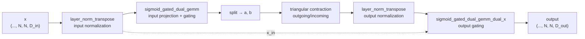

The `cuequivariance_jax.triangle` module provides a family of high-performance, fully differentiable triangle-structured neural network primitives targeting equivariant molecular modeling architectures such as AlphaFold2. These kernels encapsulate triangular attention and triangular multiplicative update operations — both operating on pairwise representations of shape `(N, N, D)` — with custom CUDA/Triton backends, custom JAX VJP rules, and `vmap`-compatible batching semantics. The module bridges the gap between research-grade equivariant models and production-grade GPU throughput.

## Module Architecture

The triangle subsystem is composed of four layers: the user-facing API (`triangle_multiplicative_update`, `triangle_attention`), two shared infrastructure primitives (`layer_norm_transpose`, `sigmoid_gated_dual_gemm`), and a cross-cutting utility layer handling precision enums, naive batching rules, and Triton-JAX interop. The public surface is intentionally narrow — only two functions and the `Precision` enum are exported from `__init__.py` [^1].

Sources: [__init__.py](cuequivariance_jax/cuequivariance_jax/triangle/__init__.py#L21-L25)

## Precision Modes

All triangle kernels accept a `Precision` enum that controls the arithmetic precision of internal matrix multiplications. This enum maps directly to JAX dot-algorithm presets, providing fine-grained control over throughput versus numerical accuracy tradeoffs [^2].

| Enum Value | JAX Equivalent | Behavior |
|---|---|---|
| `Precision.DEFAULT` | `jax.lax.Precision.DEFAULT` | JAX default (typically TF32 on Ampere+) |
| `Precision.TF32` | `DotAlgorithmPreset.TF32_TF32_F32` | Explicit TF32 matmul, FP32 accumulation |
| `Precision.TF32x3` | `DotAlgorithmPreset.TF32_TF32_F32_X3` | TF32 with 3× accumulation channels |
| `Precision.IEEE` | `DotAlgorithmPreset.F32_F32_F32` | Full IEEE 754 FP32 throughout |

The `TF32x3` mode exploits tensor core instructions that accumulate three TF32 products per cycle, offering higher throughput at marginal precision cost — particularly relevant for the large-batch training regimes common in molecular dynamics.

Sources: [_utils.py](cuequivariance_jax/cuequivariance_jax/triangle/_utils.py#L22-L37)

## Triangle Attention

`triangle_attention` implements scaled dot-product attention over pairwise representations with per-node masking. Unlike standard multi-head attention, this variant operates on tensors of shape `[B, N, H, S_qo, D]` where `N` indexes nodes (atoms/residues) and `S_qo`/`S_kv` index sequence positions within each node's neighborhood. The mask is per-node and broadcast across heads and query positions [^3].

### Mathematical Definition

The operation computes:

$$\text{Attention}_a(Q, K, V, M, T) = \sum_b \mathrm{softmax}_b\left(M_b \cdot (Q_a K_b^T + T_{ab}) + (1 - M_b) \cdot (-10^9)\right) V_b$$

where `Q`, `K`, `V` are query/key/value tensors, `M` is the boolean mask, and `T` is the additive bias (passed as `bias`). The softmax is stabilized via log-sum-exp with explicit max subtraction [^4].

### Tensor Shape Contract

| Parameter | Shape | Description |
|---|---|---|
| `q` | `[B, N, H, S_qo, D]` | Query tensor |
| `k` | `[B, N, H, S_kv, D]` | Key tensor |
| `v` | `[B, N, H, S_kv, D]` | Value tensor |
| `bias` | `[B, 1, H, S_qo, S_kv]` | Additive attention bias |
| `mask` | `[B, N, 1, 1, S_kv]` | Boolean mask (`True` = valid) |
| **output** | `[B, N, H, S_qo, D]` | Attention output |

The reference JAX implementation first scales queries, computes the `einsum` dot product, adds bias, applies the mask with a large negative fill value (`-1e9`), casts to float32 for the softmax (numerically stable via `logsumexp`), then casts back and projects through values [^4].

### Backend Dispatch and Custom Differentiation

The forward and backward passes are registered as separate JAX primitives (`triangle_attention_fwd` and `triangle_attention_bwd`) with platform-specific lowering. On CUDA, they delegate to `cuequivariance_ops_jax.triangle_attention_cuda_fwd/bwd` custom kernels; on CPU or when the ops package is unavailable, the pure-JAX reference path is used [^5].

A `custom_vjp` wrapper connects the two primitives for automatic differentiation, with `scale` and `precision` as non-differentiable arguments. The backward primitive takes the output gradient, attention output, log-sum-exp, and all original inputs to compute gradients for `q`, `k`, `v`, and `bias` [^6].

### Blackwell GPU Constraints

On Blackwell GPUs (compute capability 10.0/10.3), the specialized `sm100f` kernel imposes dimension constraints: hidden dimension ≤ 256 for forward and ≤ 128 for backward (bf16/fp16 only, divisible by 8), and `S_kv` must be a multiple of 8 for the forward kernel [^3].

> [!TIP]
> When using `triangle_attention` across multiple devices, manual sharding via `jax.shard_map` is required. Without explicit sharding, JAX's default replication strategy causes significant performance degradation due to cross-device communication overhead.

Sources: [_triangle_attention.py](cuequivariance_jax/cuequivariance_jax/triangle/_triangle_attention.py#L35-L77), [_triangle_attention.py](cuequivariance_jax/cuequivariance_jax/triangle/_triangle_attention.py#L84-L113), [_triangle_attention.py](cuequivariance_jax/cuequivariance_jax/triangle/_triangle_attention.py#L161-L194), [_triangle_attention.py](cuequivariance_jax/cuequivariance_jax/triangle/_triangle_attention.py#L248-L279)

## Triangle Multiplicative Update

`triangle_multiplicative_update` is the higher-level composite operation that implements the AlphaFold2-style triangular multiplicative module. It orchestrates four sub-steps: input layer normalization, sigmoid-gated dual linear projection, triangular contraction, output layer normalization, and output gating — all within a single differentiable function [^7].

### Computational Pipeline

**Step 1 — Input normalization**: Layer normalization over the feature dimension using `layer_norm_transpose` with layout `"bijd->bijd"` (identity layout for 4D batch-sequence-sequence-feature tensors) [^7].

**Step 2 — Gated input projection**: A fused sigmoid-gated dual GEMM projects the normalized input through two weight matrices simultaneously — one for gating (`g_in_weight`) and one for the linear path (`p_in_weight`). The result `σ(x·g_in^T + b_g) · (x·p_in^T + b_p)` is transposed (via `transpose_out=True`) and split into tensors `a` and `b`, each of shape `[batch, 2·D_in, N, N]` reshaped to `[batch, D_in, N, N]` [^7].

**Step 3 — Triangular contraction**: Depending on the `direction` parameter, the contraction aggregates information along one axis of the pairwise matrix. For `"outgoing"`: `x[b,i,j] = Σ_k a[b,k,i] · b[b,k,j]`. For `"incoming"`: `x[b,i,j] = Σ_k a[b,i,k] · b[b,j,k]`. Both use `jnp.einsum` for the reduction [^7].

**Step 4 — Output normalization and gating**: The contracted result is normalized with a second `layer_norm_transpose` (layout `"dbij->bijd"`, transposing feature dimension to the last axis), then gated against the saved input-normalized activations `x_in` via `sigmoid_gated_dual_gemm_dual_x`, which takes two separate input tensors [^7].

### Parameter Contract

The function accepts 16 optional weight/bias parameters organized in four groups. When any weight is `None`, a JAX PRNG key must be provided for on-the-fly initialization:

| Group | Weight | Shape | Default Init |
|---|---|---|---|
| Input norm | `norm_in_weight` | `(D_in,)` | Ones |
| Input norm | `norm_in_bias` | `(D_in,)` | Zeros |
| Input projection | `p_in_weight` | `(2·D_in, D_in)` | LeCun normal |
| Input projection | `p_in_bias` | `(2·D_in,)` | None (no bias) |
| Input gating | `g_in_weight` | `(2·D_in, D_in)` | LeCun normal |
| Input gating | `g_in_bias` | `(2·D_in,)` | None (no bias) |
| Output norm | `norm_out_weight` | `(D_in,)` | Ones |
| Output norm | `norm_out_bias` | `(D_in,)` | Zeros |
| Output projection | `p_out_weight` | `(D_out, D_in)` | LeCun normal |
| Output projection | `p_out_bias` | `(D_out,)` | None (no bias) |
| Output gating | `g_out_weight` | `(D_out, D_in)` | LeCun normal |
| Output gating | `g_out_bias` | `(D_out,)` | None (no bias) |

The output dimension `D_out` defaults to `D_in` when neither `p_out_weight` nor `g_out_weight` is provided, but can differ if output weights with a different first dimension are supplied — enabling dimension-changing projections [^7].

### Fallback Threshold

The `fallback` parameter controls whether to use Triton-optimized or reference JAX implementations for the underlying `layer_norm_transpose` and `sigmoid_gated_dual_gemm` calls. When `fallback=None`, the system consults the environment variable `CUEQ_TRIMUL_FALLBACK_THRESHOLD` (default 100): if `seq_len ≤ threshold`, the reference path is used, otherwise the optimized path activates. This heuristic avoids Triton kernel launch overhead for small problem sizes [^8].

Sources: [_triangle_multiplicative_update.py](cuequivariance_jax/cuequivariance_jax/triangle/_triangle_multiplicative_update.py#L109-L128), [_triangle_multiplicative_update.py](cuequivariance_jax/cuequivariance_jax/triangle/_triangle_multiplicative_update.py#L310-L423), [_triangle_multiplicative_update.py](cuequivariance_jax/cuequivariance_jax/triangle/_triangle_multiplicative_update.py#L31-L33)

## Infrastructure: Layer Norm Transpose

`layer_norm_transpose` is a layout-aware layer normalization primitive that supports flexible memory layout permutations between input and output tensors. It is exposed through the `layer_norm_transpose` function with a string-based layout specification (e.g., `"bijd->bijd"`, `"dbij->bijd"`) [^9].

### Layout System

The layout is specified as a string `"src->dst"` where each character represents a dimension. The `Layout` enum defines five concrete layout modes as integer codes used internally by the Triton kernels [^10].

| Layout String | Enum | Input Axes | Output Axes | Feature Dim Position |
|---|---|---|---|---|
| `"nd->nd"` | `BND_BND` (0) | `(N, D)` | `(N, D)` | Last |
| `"bdn->bnd"` | `BDN_BND` (1) | `(B, D, N)` | `(B, N, D)` | Last |
| `"bnd->bdn"` | `BND_BDN` (2) | `(B, N, D)` | `(B, D, N)` | Middle |
| `"dbn->bnd"` | `DBN_BND` (3) | `(D, B, N)` | `(B, N, D)` | First → Last |
| `"bnd->dbn"` | `BND_DBN` (4) | `(B, N, D)` | `(D, B, N)` | Last → First |

The forward and backward passes are implemented as separate JAX primitives with custom abstract evaluation, Triton kernel lowering for GPU, and a pure JAX reference implementation for CPU. Custom VJP rules preserve the log-sum-exp and reciprocal-standard-deviation intermediates needed for numerically stable backpropagation [^9].

Sources: [_layer_norm_transpose.py](cuequivariance_jax/cuequivariance_jax/triangle/_layer_norm_transpose.py#L36-L48), [_layer_norm_transpose.py](cuequivariance_jax/cuequivariance_jax/triangle/_layer_norm_transpose.py#L497-L499)

## Infrastructure: Sigmoid-Gated Dual GEMM

The `sigmoid_gated_dual_gemm` family implements a fused operation that computes `σ(x·W_g^T + b_g) · (x·W_p^T + b_p)` — a sigmoid-gated linear projection — in a single kernel launch. Two variants exist: `sigmoid_gated_dual_gemm` (single input `x`) and `sigmoid_gated_dual_gemm_dual_x` (separate inputs `x1`, `x2`) [^11].

### Core Operation

For `sigmoid_gated_dual_gemm`, given input `x` of shape `(*, M, K)`:

1. Compute gate path: `g = x @ W_g^T + b_g` → shape `(*, M, N)`
2. Compute projection path: `p = x @ W_p^T + b_p` → shape `(*, M, N)`
3. Apply sigmoid gating: `output = sigmoid(g) * p`

The `dual_x` variant takes separate `x1` (for gating) and `x2` (for projection), enabling the output gating step in `triangle_multiplicative_update` where the gate is computed from normalized input and the projection from the contracted output [^12].

### Triton Autotuning

The GPU implementation uses Triton kernels with compile-time autotuning over tile sizes (`TILE_M`, `TILE_N`, `TILE_K`), pipeline stages, and warp counts. The autotuning system includes:

- **Config pruning**: Filters out configurations where tile dimensions don't divide the problem dimensions, avoiding launch-time failures [^13].
- **Cache key generation**: Inputs are hashed by shape, dtype, and precision to avoid redundant tuning for identical workloads [^14].
- **Decoy/benchmark helpers**: Validate configurations with dummy inputs before full benchmarking, gracefully handling shared memory limit errors [^15].

> [!TIP]
> The `CUEQ_TRITON_TUNING` environment variable controls autotuning strategy. Setting it to `"AOT"` enables ahead-of-time tuning at import time (slowest import, fastest runtime), `"ONDEMAND"` tunes on first use, and `None` (default) defers to Triton's built-in autotuner.

### Vmap-Compatible Batching

Both `sigmoid_gated_dual_gemm` and `layer_norm_transpose` support JAX's `vmap` through registered batching rules. The shared `naive_batching_rule` utility handles the general case: it fuses the vmap batch dimension with the primitive's native batch dimension, invokes the primitive once with the combined batch size, then unfuses the output dimensions — trading kernel launch overhead for a single larger invocation [^16].

Sources: [_sigmoid_gated_dual_gemm.py](cuequivariance_jax/cuequivariance_jax/triangle/_sigmoid_gated_dual_gemm.py#L1086-L1098), [_sigmoid_gated_dual_gemm.py](cuequivariance_jax/cuequivariance_jax/triangle/_sigmoid_gated_dual_gemm.py#L1142-L1154), [_sigmoid_gated_dual_gemm.py](cuequivariance_jax/cuequivariance_jax/triangle/_sigmoid_gated_dual_gemm.py#L578-L660), [_sigmoid_gated_dual_gemm.py](cuequivariance_jax/cuequivariance_jax/triangle/_sigmoid_gated_dual_gemm.py#L381-L462), [_naive_batching.py](cuequivariance_jax/cuequivariance_jax/triangle/_naive_batching.py#L20-L91)

## Triton-JAX Integration Layer

The `triton_utils` module provides the low-level bridge between JAX's XLA compiler and Triton GPU kernels. It is inspired by NVIDIA's TransformerEngine architecture and handles kernel compilation, PTX caching, dtype mapping, and MLIR lowering [^17].

The key abstraction is `triton_call`, a high-level function that wraps a Triton kernel callable into a JAX-compatible operation. It handles shape/dtype inference through abstract evaluation, GPU-specific lowering through `triton_call_lowering` (which generates MLIR call operations to compiled Triton kernels), and manages a kernel compilation cache keyed by compute capability, kernel hash, and compile parameters [^18].

Sources: [triton_utils.py](cuequivariance_jax/cuequivariance_jax/triangle/triton_utils.py#L16-L22), [triton_utils.py](cuequivariance_jax/cuequivariance_jax/triangle/triton_utils.py#L339-L373)

## Testing and Validation

The triangle subsystem maintains comprehensive test coverage across four test files, each validating a different layer of the stack [^19]:

| Test File | Scope | Key Tests |
|---|---|---|
| `triangle_attention_test.py` | Attention correctness | Gradient finite differences, dtype support (f32/f16/bf16), vmap batching, multi-head shapes |
| `triangle_multiplicative_update_test.py` | End-to-end TMU | PyTorch cross-implementation comparison, shape broadcasting, bias functionality, gradient accuracy, JIT compilation |
| `sigmoid_gated_dual_gemm_test.py` | Gated GEMM primitive | Manual computation verification, gradient correctness across backends, Triton autotuning modes, vmap forward/backward |
| `layer_norm_transpose_test.py` | Layer norm primitive | Layout permutation correctness, elementwise_affine toggle, vmap with fallback toggle |

The TMU tests explicitly compare JAX output against the PyTorch `cuequivariance_torch` implementation, establishing cross-framework numerical equivalence — a critical property for mixed-framework training pipelines [^20].

Sources: [triangle_attention_test.py](cuequivariance_jax/tests/triangle_attention_test.py#L68-L147), [triangle_multiplicative_update_test.py](cuequivariance_jax/tests/triangle_multiplicative_update_test.py#L66-L70), [sigmoid_gated_dual_gemm_test.py](cuequivariance_jax/tests/sigmoid_gated_dual_gemm_test.py#L197-L509), [layer_norm_transpose_test.py](cuequivariance_jax/tests/layer_norm_transpose_test.py#L25-L49)

## Next Steps

- **[RepArray System](19-reparray-system)** — Understand the `RepArray` abstraction that provides irreps-aware tensor operations, which complements the triangle kernels by managing equivariant data layouts.
- **[JAX Segmented Polynomial Variants](17-jax-segmented-polynomial-variants)** — Explore the segmented polynomial infrastructure that powers the equivariant polynomial computations these triangle kernels operate within.
- **[Model Examples: MACE and NequIP](21-model-examples-mace-and-nequip)** — See how triangle kernels are integrated into end-to-end equivariant architectures for molecular simulation.