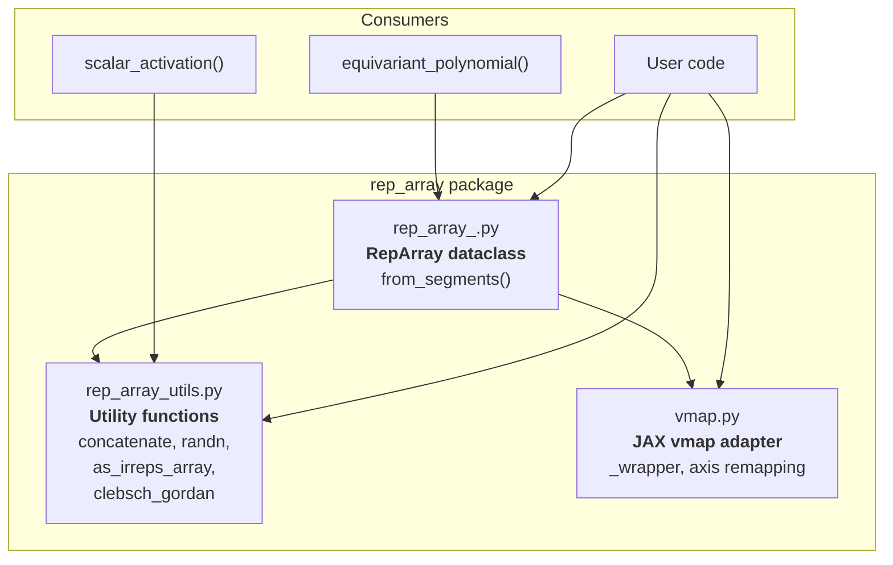
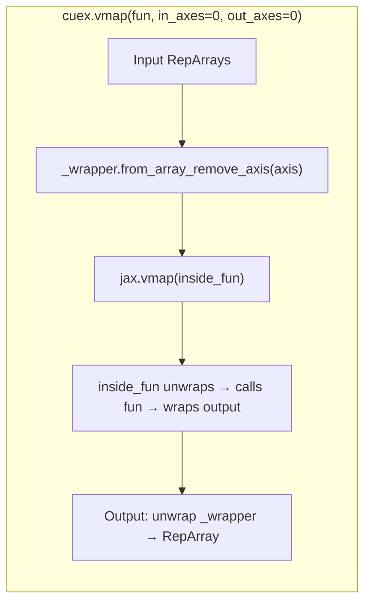

The RepArray system is the foundational data abstraction in cuEquivariance's JAX backend, providing a type-safe bridge between raw `jax.Array` tensors and their group-theoretic representation metadata. At its core, a `RepArray` is a frozen dataclass that pairs a standard JAX array with a dictionary mapping selected axes to their corresponding `cue.Rep` objects — encoding *which axes transform under a group representation* and *how they transform*. This system replaces raw tensor manipulation with equivariance-enforcing operations, catching representation mismatches at construction time rather than at some downstream computation.

## Architecture Overview

The `RepArray` subsystem lives entirely within `cuequivariance_jax/rep_array/` and is composed of three modules, each with a clearly delineated responsibility. The design mirrors a layered architecture: the core data class at the bottom, utility functions in the middle, and a JAX-compatible vectorization adapter on top.

Sources: [__init__.py](/cuequivariance_jax/cuequivariance_jax/__init__.py#L30-L33), [rep_array/](/cuequivariance_jax/cuequivariance_jax/rep_array)



The public surface is deliberately minimal — five symbols are re-exported from the package root ([__init__.py](/cuequivariance_jax/cuequivariance_jax/__init__.py#L30-L37)): `RepArray`, `from_segments`, `vmap`, and the four utility functions `concatenate`, `randn`, `as_irreps_array`, `clebsch_gordan`.

## Core Data Model: `RepArray`

A `RepArray` holds exactly two pieces of state: a `dict[int, cue.Rep]` called `reps` and a `jax.Array` called `array`. The `reps` dictionary maps axis indices (non-negative, resolved at construction) to `cue.Rep` objects that describe the group representation living along that axis. The class is a frozen dataclass, making instances immutable and hashable — a requirement for safe use as JAX pytree leaves and in functional transform pipelines.

Sources: [rep_array_.py](/cuequivariance_jax/cuequivariance_jax/rep_array/rep_array_.py#L28-L92)

### Construction

The constructor accepts a flexible union of types for the `reps` argument, normalizing all input into a `dict[int, cue.Rep]`. This flexibility is critical for ergonomics, as it lets callers use the most concise notation available for their context.

| Input format | Behavior | Example |
|---|---|---|
| `dict[int, cue.Rep]` | Used directly | `{0: cue.SO3(1), 1: cue.SO3(1)}` |
| `dict[int, str]` | Strings converted to `cue.Irreps`, then wrapped in `IrrepsAndLayout` | `{0: "1", 1: "2"}` |
| Single `cue.Rep` or `cue.Irreps` or `str` | Mapped to axis `-1` (last axis), then resolved to a non-negative index | `"2x0"` → axis `ndim-1` |
| `dict[int, cue.Irreps]` | Each `Irreps` wrapped in `IrrepsAndLayout` with the provided layout | — |

Negative axis indices are resolved relative to the array's `ndim` at construction time ([rep_array_.py](/cuequivariance_jax/cuequivariance_jax/rep_array/rep_array_.py#L129-L131)). A validation pass then checks that every axis with a `Rep` has a matching dimension in the array shape ([rep_array_.py](/cuequivariance_jax/cuequivariance_jax/rep_array/rep_array_.py#L138-L148)), raising a `ValueError` if a mismatch is detected. Critically, constructing a `RepArray` from another `RepArray` is explicitly rejected ([rep_array_.py](/cuequivariance_jax/cuequivariance_jax/rep_array/rep_array_.py#L150-L153)), preventing accidental double-wrapping.

```python
# Direct Rep specification
cuex.RepArray({0: cue.SO3(1), 1: cue.SO3(1)}, jnp.eye(3))
# {0: 1, 1: 1}
# [[1. 0. 0.]
#  [0. 1. 0.]
#  [0. 0. 1.]]

# String shorthand with assumed group and layout
with cue.assume(cue.SO3, cue.ir_mul):
    x = cuex.RepArray("2x0", jnp.array([1.0, 2.0]))
# {0: 2x0} [1. 2.]
```

### IrrepsArray: The Specialized Sub-concept

An **IrrepsArray** is not a separate class but a *protocol* that a `RepArray` may satisfy. A `RepArray` qualifies as an IrrepsArray when exactly one axis carries an `IrrepsAndLayout` and that axis is the last axis. The `is_irreps_array()` method performs this check ([rep_array_.py](/cuequivariance_jax/cuequivariance_jax/rep_array/rep_array_.py#L173-L184)). When the check passes, additional properties become available: `irreps` (the `Irreps` object) and `layout` (the `IrrepsLayout`), both delegating to the rep on the last axis ([rep_array_.py](/cuequivariance_jax/cuequivariance_jax/rep_array/rep_array_.py#L193-L215)).

This design choice — a protocol rather than a subclass — means IrrepsArray-specific methods like `segments`, `filter`, `sort`, `regroup`, `change_layout`, and `slice_by_mul` assert the invariant at call time, keeping the type hierarchy flat while still providing a rich operation set for the common case.

Sources: [rep_array_.py](/cuequivariance_jax/cuequivariance_jax/rep_array/rep_array_.py#L55-L76)

## Equivariant Arithmetic

The `RepArray` class overloads Python's arithmetic operators with equivariance constraints baked in. These are not free-form operations — they enforce the algebraic rules required by group representation theory.

**Addition** requires both operands to carry identical `reps` dictionaries ([rep_array_.py](/cuequivariance_jax/cuequivariance_jax/rep_array/rep_array_.py#L269-L284)). Adding a `RepArray` to any non-zero scalar or to a `RepArray` with different representations raises a `ValueError`. This ensures that adding two tensors only occurs when they live in the *same representation space*, a necessary condition for equivariance.

**Scalar multiplication** (`*` and `/`) accepts any `jax.Array` as the right-hand operand, broadcasting it against the non-representation axes ([rep_array_.py](/cuequivariance_jax/cuequivariance_jax/rep_array/rep_array_.py#L295-L310)). The implementation asserts that every axis in `self.reps` has size 1 in the broadcast operand, guaranteeing that the scalar does not mix representation channels. Negation (`__neg__`) is a straightforward application of this pattern ([rep_array_.py](/cuequivariance_jax/cuequivariance_jax/rep_array/rep_array_.py#L266-L267)).

| Operation | Constraint | Representation propagation |
|---|---|---|
| `x + y` | `x.reps == y.reps` | Identical reps preserved |
| `x - y` | `x.reps == y.reps` | Identical reps preserved |
| `c * x` | `c` has size 1 on all rep axes | `x.reps` preserved |
| `x / c` | `c` has size 1 on all rep axes | `x.reps` preserved |
| `-x` | None | `x.reps` preserved |

Sources: [rep_array_.py](/cuequivariance_jax/cuequivariance_jax/rep_array/rep_array_.py#L266-L311)

## Group Transformations

The `transform(v)` method applies a group element to the array, computing the matrix representation of the element and contracting it along every annotated axis ([rep_array_.py](/cuequivariance_jax/cuequivariance_jax/rep_array/rep_array_.py#L312-L375)). The input `v` is a vector of angles parameterizing the group element. For each annotated axis, the method:

1. Constructs the anti-Hermitian generator matrix `X` from `rep.X` (asserting it is anti-Hermitian).
2. Forms `iX` as a linear combination of generators weighted by the angles `v`.
3. Diagonalizes via `jnp.linalg.eigh`, computes `exp(-i·m)` for the eigenvalues, and reconstructs the unitary representation matrix `R = V @ diag(phase) @ V†`.
4. Contracts `R` along the axis using `jnp.einsum`.

For IrrepsArrays, the contraction respects the layout: `mul_ir` layouts contract as `R_ij · ...ju → ...ui`, while `ir_mul` layouts contract as `R_ij · ...uj → ...uj`. The matrix is kept real via `jnp.real(R)`.

> [!TIP]
> The `transform` method currently asserts that `X` is anti-Hermitian (`X ≈ -X†`), which restricts it to orthogonal/SO(3) representations. Other group types would require generalizing this check.

Sources: [rep_array_.py](/cuequivariance_jax/cuequivariance_jax/rep_array/rep_array_.py#L312-L375)

## Irreps Manipulation Methods

These methods are available only on IrrepsArrays and operate on the segment structure of the last axis. Each method splits the array into per-irrep segments, transforms the segment list, and reassembles via `from_segments`.

### Segmentation and Reconstruction

The `segments` property splits the last axis into a list of per-irrep tensors ([rep_array_.py](/cuequivariance_jax/cuequivariance_jax/rep_array/rep_array_.py#L378-L399)). Each segment has shape `(...leading, mul, ir.dim)` for `mul_ir` layout or `(...leading, ir.dim, mul)` for `ir_mul` layout. This is the fundamental building block for all higher-level operations.

The `from_segments` function is the inverse operation: it takes a list of per-irrep tensors (with an extra trailing dimension for the irrep dimension), reshapes each to flatten `mul × ir.dim`, concatenates along the last axis, and wraps the result in a `RepArray` ([rep_array_.py](/cuequivariance_jax/cuequivariance_jax/rep_array/rep_array_.py#L612-L666)). Validation ensures the number of segments matches the number of irreps, and all segments have the expected rank.

Sources: [rep_array_.py](/cuequivariance_jax/cuequivariance_jax/rep_array/rep_array_.py#L378-L399), [rep_array_.py](/cuequivariance_jax/cuequivariance_jax/rep_array/rep_array_.py#L612-L666)

### Filtering

The `filter()` method removes or keeps specific irreps from the last axis ([rep_array_.py](/cuequivariance_jax/cuequivariance_jax/rep_array/rep_array_.py#L401-L458)). It accepts three mutually composable modes: `keep` (irreps to retain), `drop` (irreps to remove), and `mask` (a boolean mask over the segments). The `keep` and `drop` arguments delegate mask generation to `irreps.filter_mask` from the base library. When all mask entries are true, the original array is returned as-is; when all are false, a zero-dimensional array with the correct dtype is produced.

```python
x = cuex.RepArray(cue.Irreps("SO3", "2x0 + 1"), jnp.array([1., 2., 0., 0., 0.]), cue.ir_mul)
x.filter(keep="0")    # {0: 2x0} [1. 2.]
x.filter(drop="0")    # {0: 1}    [0. 0. 0.]
x.filter(mask=[True, False])  # {0: 2x0} [1. 2.]
```

### Sorting, Simplification, and Regrouping

**`sort()`** reorders segments so that irreps are sorted by their irrep type (typically by degree), using the permutation returned by `irreps.sort()` to rearrange the segment list ([rep_array_.py](/cuequivariance_jax/cuequivariance_jax/rep_array/rep_array_.py#L460-L489)).

**`simplify()`** merges adjacent segments that share the same irrep type, producing a canonical form. For `mul_ir` layout, simplification is a no-op on the array (only the irreps metadata changes) because multiplicities are already contiguous. For `ir_mul` layout, adjacent same-type segments must be concatenated along the multiplicity dimension ([rep_array_.py](/cuequivariance_jax/cuequivariance_jax/rep_array/rep_array_.py#L491-L514)).

**`regroup()`** is simply `sort().simplify()` — a convenience that produces the canonical representation where irreps are sorted and merged ([rep_array_.py](/cuequivariance_jax/cuequivariance_jax/rep_array/rep_array_.py#L516-L533)).

```python
x = cuex.RepArray(cue.Irreps("SO3", "0 + 1 + 0"), jnp.array([0., 1., 2., 3., -1.]), cue.ir_mul)
x.regroup()
# {0: 2x0+1} [ 0. -1.  1.  2.  3.]
```

### Layout Operations

**`change_layout(layout)`** swaps between `mul_ir` and `ir_mul` by transposing the last two dimensions of each segment and reassembling ([rep_array_.py](/cuequivariance_jax/cuequivariance_jax/rep_array/rep_array_.py#L535-L553)).

**`move_axis_to_mul(axis)`** absorbs an arbitrary non-representation axis into the multiplicity dimension of the irreps. For `ir_mul` layout, it moves the target axis to the last position and reshapes, effectively multiplying the multiplicities by the axis size ([rep_array_.py](/cuequivariance_jax/cuequivariance_jax/rep_array/rep_array_.py#L555-L594)). This is useful when batch dimensions need to be folded into the representation structure.

### Multiplicity Slicing

The `slice_by_mul` property returns a `_MulIndexSliceHelper` that interprets slice indices in *multiplicity space* rather than flat index space ([rep_array_.py](/cuequivariance_jax/cuequivariance_jax/rep_array/rep_array_.py#L245-L264), [rep_array_.py](/cuequivariance_jax/cuequivariance_jax/rep_array/rep_array_.py#L669-L715)). For example, given `"2x0 + 1"` (three total multiplicities), `slice_by_mul[1:4]` selects multiplicities 1 through 3, potentially splitting the `2x0` irrep to yield `1x0 + 1`. The implementation walks through multiplicities, handling three cases: fully contained segments, non-overlapping segments, and boundary-crossing slices.

Sources: [rep_array_.py](/cuequivariance_jax/cuequivariance_jax/rep_array/rep_array_.py#L401-L594)

## JAX Pytree Integration

`RepArray` is registered as a JAX pytree node via `jax.tree_util.register_pytree_node` ([rep_array_.py](/cuequivariance_jax/cuequivariance_jax/rep_array/rep_array_.py#L597-L609)). The `reps` dictionary is classified as **static** (trace-time constant), while the `array` is the **dynamic** child. This means:

- JAX transformations (`jit`, `grad`, `vmap`) can trace through `RepArray`-containing pytrees.
- The representation metadata (which axes carry which irreps) is baked into the compiled computation graph and cannot change across calls.
- Only the array data participates in differentiation and batching.

> [!TIP]
> Because `reps` is static, changing the representation structure (e.g., calling `filter` with different masks) inside a `jit`-decorated function will trigger recompilation. Keep representation-shaping operations outside `jit` boundaries.

## Vectorized Mapping: `cuex.vmap`

Standard `jax.vmap` cannot handle `RepArray` directly because it would incorrectly treat the rep-annotated axes as batch dimensions. The `cuex.vmap` wrapper solves this by temporarily stripping representation metadata, delegating to JAX's native `vmap`, and then restoring the metadata with axis indices shifted to account for the new batch dimension.

Sources: [vmap.py](/cuequivariance_jax/cuequivariance_jax/rep_array/vmap.py#L43-L103)



The mechanism uses an internal `_wrapper` frozen dataclass that holds a `reps` dict and a bare `jax.Array`. The `remove_axis` function validates that the batch axis does not carry a representation ([vmap.py](/cuequivariance_jax/cuequivariance_jax/rep_array/vmap.py#L28-L36)) — attempting to vmap over an irrep axis raises a clear error. After `remove_axis` shifts all axis indices above the batch axis down by one, the `add_axis` function performs the inverse shift on the output ([vmap.py](/cuequivariance_jax/cuequivariance_jax/rep_array/vmap.py#L39-L40)). The `_wrapper` class is itself a registered pytree node ([vmap.py](/cuequivariance_jax/cuequivariance_jax/rep_array/vmap.py#L130-L134)), ensuring compatibility with nested tree structures.

## Utility Functions

Four utility functions complement the core `RepArray` class, each exported at the package level.

**`concatenate(arrays)`** joins a list of IrrepsArrays along the last axis, summing their irreps and concatenating the underlying arrays ([rep_array_utils.py](/cuequivariance_jax/cuequivariance_jax/rep_array/rep_array_utils.py#L26-L60)). It validates that all inputs share the same layout, dimensionality, and group.

**`randn(key, rep, leading_shape, dtype)`** generates a random `RepArray` sampled from a standard normal distribution ([rep_array_utils.py](/cuequivariance_jax/cuequivariance_jax/rep_array/rep_array_utils.py#L63-L89)). It is particularly useful for testing equivariance properties and initializing learnable parameters.

**`as_irreps_array(input, layout, like)`** converts arbitrary inputs to an IrrepsArray, treating plain arrays as scalars in the trivial representation of the current group scope ([rep_array_utils.py](/cuequivariance_jax/cuequivariance_jax/rep_array/rep_array_utils.py#L92-L132)). The `like` parameter allows inheriting the layout and group from an existing `RepArray`.

**`clebsch_gordan(rep1, rep2, rep3)`** computes Clebsch-Gordan coefficients as a `RepArray` with three annotated axes ([rep_array_utils.py](/cuequivariance_jax/cuequivariance_jax/rep_array/rep_array_utils.py#L135-L173)). The output has shape `(num_solutions, dim1, dim2, dim3)` and carries the invariant property that `C.transform(v).array ≈ C.array` for any group element `v`, which can be verified numerically as shown in the docstring.

Sources: [rep_array_utils.py](/cuequivariance_jax/cuequivariance_jax/rep_array/rep_array_utils.py#L26-L173)

| Function | Input | Output | Key constraint |
|---|---|---|---|
| `concatenate` | `list[RepArray]` | `RepArray` | Same layout, ndim, group |
| `randn` | `key, rep, shape` | `RepArray` | None |
| `as_irreps_array` | `Any` | `RepArray` | Scalar assumption for plain arrays |
| `clebsch_gordan` | `3 × Irrep` | `RepArray` | Valid coupling triple |

## Integration with the Ecosystem

The RepArray system serves as the input and output type for the JAX backend's higher-level APIs. The `equivariant_polynomial()` function accepts `RepArray` inputs and returns `RepArray` outputs, propagating representation metadata through the entire polynomial computation ([equivariant_polynomial.py](/cuequivariance_jax/cuequivariance_jax/equivariant_polynomial.py#L25-L38)). Similarly, `scalar_activation()` calls `as_irreps_array()` to normalize its input before applying per-irrep activation functions ([activation.py](/cuequivariance_jax/cuequivariance_jax/activation.py#L93-L102)). This means that any code building on these APIs naturally operates within the type-safe representation framework without manual bookkeeping.

For the next step in understanding how RepArrays flow through the full computation pipeline, see [JAX Equivariant Polynomial](16-jax-equivariant-polynomial). For a deeper treatment of the representation algebra that `RepArray` wraps, refer to [Group Representations and Irreps](5-group-representations-and-irreps).