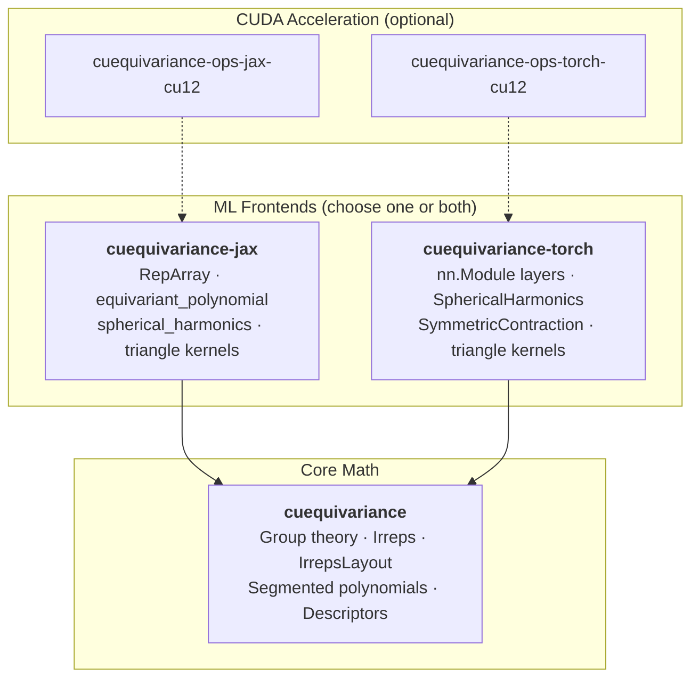

Welcome to the **cuEquivariance** Quick Start guide. This page will walk you through installing the library, understanding its three-package architecture, and writing your first equivariant neural network operations with either PyTorch or JAX. By the end, you will have a clear mental model of how cuEquivariance maps mathematical symmetry operations to high-performance CUDA kernels, and you will be ready to build on this foundation with the deeper topics in this documentation.

## Prerequisites

cuEquivariance requires **Python ≥ 3.10** and one of its ML frontends: **PyTorch** or **JAX ≥ 0.8.1**. A CUDA-capable GPU is strongly recommended for performance, though the library falls back to CPU implementations when CUDA kernels are unavailable. The core package has no ML framework dependency and runs on NumPy and SciPy alone [cuequivariance/pyproject.toml](/cuequivariance/pyproject.toml#L30-L36).


## Architecture at a Glance

cuEquivariance is organized as a **three-layer stack**: a framework-agnostic math core, and two optional ML frontends that wrap it with framework-native APIs. Understanding this separation is the single most important concept before writing any code.



Each package plays a distinct role. The **core** (`cuequivariance`) defines the mathematical vocabulary: irreducible representations (irreps), layouts, group theory, and segmented polynomial descriptors. The **JAX frontend** (`cuequivariance-jax`) introduces `RepArray` — a JAX array annotated with equivariance metadata — and functional operations like `equivariant_polynomial`. The **PyTorch frontend** (`cuequivariance-torch`) exposes `torch.nn.Module` layers such as `SphericalHarmonics` and `SymmetricContraction` that slot directly into standard PyTorch model pipelines.

| Package | PyPI Name | Framework | Key Abstractions |
|---------|-----------|-----------|-----------------|
| Core | `cuequivariance` | NumPy | `Irreps`, `IrrepsLayout`, `EquivariantPolynomial`, `descriptors` |
| JAX | `cuequivariance-jax` | JAX | `RepArray`, `equivariant_polynomial`, `spherical_harmonics` |
| PyTorch | `cuequivariance-torch` | PyTorch | `SphericalHarmonics`, `SymmetricContraction`, `SegmentedPolynomial` |

Sources: [README.md](/README.md#L11-L23), [cuequivariance/__init__.py](/cuequivariance/cuequivariance/__init__.py#L28-L52), [cuequivariance_jax/__init__.py](/cuequivariance_jax/cuequivariance_jax/__init__.py#L17-L48), [cuequivariance_torch/__init__.py](/cuequivariance_torch/cuequivariance_torch/__init__.py#L28-L55)

## Installation

Install only the packages you need. Each ML frontend automatically pulls in the core as a dependency, so you never install the core separately unless you are doing pure mathematical work without a framework.

```bash
# For JAX users
pip install cuequivariance-jax

# For PyTorch users
pip install cuequivariance-torch

# Optional: CUDA kernels for GPU acceleration
pip install cuequivariance-ops-jax-cu12   # JAX, CUDA 12.x
pip install cuequivariance-ops-torch-cu12 # PyTorch, CUDA 12.x
```

> [!TIP]
> The CUDA ops packages (`cuequivariance-ops-*`) are **optional**. Without them, all operations fall back to correct but slower pure-framework implementations. Install them for production workloads where throughput matters.

Sources: [README.md](/README.md#L15-L21), [cuequivariance_jax/pyproject.toml](/cuequivariance_jax/pyproject.toml#L23-L28), [cuequivariance_torch/pyproject.toml](/cuequivariance_torch/pyproject.toml#L23-L25)

## First Steps with JAX

The JAX frontend centers on the **`RepArray`** concept — a JAX array that carries representation metadata (which axes transform under which group). The simplest entry point is computing **spherical harmonics** from 3D vectors.

### Computing Spherical Harmonics

Spherical harmonics decompose a 3D vector into rotation-equivariant components at specified degrees. This is the foundational operation in virtually all equivariant architectures:

```python
import jax
import cuequivariance as cue
import cuequivariance_jax as cuex

# Set default group and layout context
with cue.assume(cue.SO3, cue.ir_mul):
    # Create a random 3D vector wrapped as a RepArray
    vector = cuex.randn(jax.random.key(0), cue.Irreps("1o"))
    # Compute spherical harmonics up to degree 2
    harmonics = cuex.spherical_harmonics([0, 1, 2], vector)
```

The `cue.assume` context manager sets the default group (`SO3` for continuous rotations) and layout (`ir_mul` — irrep dimension last) so you can use shorthand notation like `"1o"` instead of fully specifying `Irreps("O3", "1o")`. The resulting `harmonics` is a `RepArray` whose last axis carries irreps `0+1+2` (one scalar, three vectors, five second-order components).

### Using Equivariant Polynomials Directly

For more control, you can work with **equivariant polynomial descriptors** — symbolic descriptions of symmetry-respecting operations that get compiled into efficient CUDA kernels or JAX programs:

```python
import jax.numpy as jnp

# Define the spherical harmonics descriptor
descriptor = cue.descriptors.spherical_harmonics(cue.SO3(1), [0, 1, 2])

# Create input as a RepArray
with cue.assume(cue.SO3, cue.ir_mul):
    x = cuex.RepArray("1", jnp.array([0.0, 1.0, 0.0]))

# Evaluate the polynomial
result = cuex.equivariant_polynomial(descriptor, [x], method="naive")
```

The descriptor system separates **what** to compute from **how** to compute it. The same `descriptor` object can be evaluated with different methods (`"naive"` for portability, `"uniform_1d"` for CUDA acceleration).

### RepArray Utilities

The library provides essential utilities for working with equivariant arrays. Concatenation respects representation metadata, random generation follows the correct statistical properties for each irrep, and Clebsch-Gordan coefficients bridge the algebraic and computational layers:

```python
# Concatenate equivariant arrays
with cue.assume(cue.SO3, cue.ir_mul):
    x = cuex.RepArray("3x0", jnp.array([1.0, 2.0, 3.0]))
    y = cuex.RepArray("1x1", jnp.array([0.0, 0.0, 0.0]))
    z = cuex.concatenate([x, y])
    # Result: irreps "3x0+1" — automatically computed

# Compute Clebsch-Gordan coefficients
C = cuex.clebsch_gordan(cue.SO3(1), cue.SO3(1), cue.SO3(2))
# Shape: (1, 3, 3, 5) — one solution, dims of each irrep
```

Sources: [cuequivariance_jax/spherical_harmonics.py](/cuequivariance_jax/cuequivariance_jax/spherical_harmonics.py#L27-L55), [cuequivariance_jax/equivariant_polynomial.py](/cuequivariance_jax/cuequivariance_jax/equivariant_polynomial.py#L29-L110), [cuequivariance_jax/rep_array/rep_array_utils.py](/cuequivariance_jax/cuequivariance_jax/rep_array/rep_array_utils.py#L14-L49), [cuequivariance_jax/rep_array/rep_array_.py](/cuequivariance_jax/cuequivariance_jax/rep_array/rep_array_.py#L36-L55)

## First Steps with PyTorch

The PyTorch frontend exposes operations as standard `torch.nn.Module` classes, so they integrate naturally with `nn.Sequential`, training loops, and optimizers. There is no `RepArray` equivalent — instead, equivariance metadata lives in the module's configuration.

### Spherical Harmonics Module

The `SphericalHarmonics` module computes spherical harmonics of input vectors as a differentiable torch layer:

```python
import torch
import cuequivariance_torch as cuet

# Define which degrees of spherical harmonics to compute
sh = cuet.SphericalHarmonics(ls=[0, 1, 2], normalize=True)

# Input: (batch, 3) tensor of 3D vectors
vectors = torch.randn(16, 3)

# Output: (batch, 9) tensor with irreps 0+1+2 (1+3+5=9 components)
result = sh(vectors)
```

### Symmetric Contraction Layer

The `SymmetricContraction` layer implements the body-order-raising operation used in MACE and similar architectures. It contracts equivariant features through a learned weight indexed by species:

```python
import cuequivariance as cue

# Define irreps for input and output
irreps_in = cue.Irreps("SO3", "16x0e+16x1o+16x2e")
irreps_out = cue.Irreps("SO3", "16x0e+16x1o+16x2e")

# Create the contraction layer
contraction = cuet.SymmetricContraction(
    irreps_in=irreps_in,
    irreps_out=irreps_out,
    contraction_degree=3,   # body order
    num_elements=10,         # number of species
)

# Forward pass: input features + per-atom species index
x = torch.randn(32, irreps_in.dim)  # (batch, irreps dim)
species = torch.randint(0, 10, (32,))  # species index per atom
out = contraction(x, species)
```

### Tensor Product Layers

cuEquivariance provides two primary tensor product modules that form the backbone of equivariant message passing:

```python
# Channel-wise tensor product: each irrep channel computed independently
tp_cw = cuet.ChannelWiseTensorProduct(
    irreps_in1="32x0e+32x1o",
    irreps_in2="1x0e+1x1o+1x2e",
    irreps_out="32x0e+32x1o+32x2e",
)

# Fully connected tensor product: full mixing across channels
tp_fc = cuet.FullyConnectedTensorProduct(
    irreps_in1="32x0e+32x1o",
    irreps_in2="1x0e+1x1o+1x2e",
    irreps_out="32x0e+32x1o+32x2e",
)
```

> [!TIP]
> All PyTorch modules support a `method` parameter that controls the computation backend. Use `method="uniform_1d"` (the default when CUDA ops are installed) for maximum GPU performance, or `method="naive"` for debugging and CPU-only environments.

Sources: [cuequivariance_torch/operations/spherical_harmonics.py](/cuequivariance_torch/cuequivariance_torch/operations/spherical_harmonics.py#L23-L82), [cuequivariance_torch/operations/symmetric_contraction.py](/cuequivariance_torch/cuequivariance_torch/operations/symmetric_contraction.py#L106-L223), [cuequivariance_torch/__init__.py](/cuequivariance_torch/cuequivariance_torch/__init__.py#L35-L48)

## Key Concepts in Five Minutes

Before going deeper, internalize these foundational ideas. They recur throughout every page of this documentation.

**Irreducible Representations (Irreps)**: The mathematical building blocks. An irrep is labeled by its degree `l` and parity (`e` for even, `o` for odd under inversion). For example, `"1o"` is a degree-1 odd-parity irrep (a pseudovector, dimension 3), and `"0e"` is a degree-0 even-parity irrep (a scalar, dimension 1). An `Irreps` object is a list of `(multiplicity, irrep)` pairs, e.g., `"16x0e+16x1o"` means 16 scalars and 16 vectors.

**Layout**: How the components of an irreps are arranged in memory. The two layouts are `ir_mul` (irrep dimension first, then multiplicity) and `mul_ir` (multiplicity first, then irrep dimension). This distinction matters for correctness — every operation must know which layout it receives.

**Segmented Polynomials**: The computational backbone. An equivariant operation is compiled into a polynomial with segments — each segment computes one output irrep. The descriptor system generates these polynomials symbolically; the frontends evaluate them with the optimal available backend.

**Descriptors**: Symbolic recipes. Functions like `cue.descriptors.spherical_harmonics()` and `cue.descriptors.symmetric_contraction()` return `EquivariantPolynomial` objects that fully describe the mathematics. Both the JAX and PyTorch frontends consume the same descriptors, ensuring mathematical consistency across frameworks.

## Complete Example: End-to-End JAX Pipeline

Here is a self-contained example that demonstrates the full workflow — from descriptor definition to model evaluation — using the JAX frontend with the functional API:

```python
import jax
import jax.numpy as jnp
import cuequivariance as cue
import cuequivariance_jax as cuex

# 1. Set the equivariance context
with cue.assume(cue.SO3, cue.ir_mul):

    # 2. Create random input: 8 atoms, each with features "4x0e+4x1o"
    node_feats = cuex.randn(
        jax.random.key(0),
        cue.Irreps("4x0e+4x1o"),
        leading_shape=(8,),
    )

    # 3. Compute spherical harmonics from displacement vectors
    vectors = cuex.randn(jax.random.key(1), cue.Irreps("1o"), leading_shape=(8,))
    sh = cuex.spherical_harmonics([0, 1, 2], vectors)

    # 4. Normalize node features per-irrep
    feats_normed = cuex.normalize(node_feats)

    print(f"Input irreps:  {node_feats.irreps}")  # 4x0e+4x1o
    print(f"SH irreps:     {sh.irreps}")           # 0+1+2
    print(f"Normalized shape: {feats_normed.shape}")
```

## Complete Example: End-to-End PyTorch Pipeline

And here is the equivalent pipeline using PyTorch modules — note how the modules manage layout internally, so you only provide `torch.Tensor` objects:

```python
import torch
import cuequivariance as cue
import cuequivariance_torch as cuet

# 1. Define model components
sh = cuet.SphericalHarmonics(ls=[0, 1, 2], normalize=True)
linear = cuet.Linear(
    irreps_in=cue.Irreps("SO3", "16x0e+16x1o"),
    irreps_out=cue.Irreps("SO3", "8x0e+8x1o+8x2e"),
)

# 2. Forward pass
vectors = torch.randn(32, 3)            # (batch, 3)
features = torch.randn(32, 48)          # (batch, 16*1 + 16*3 = 64) → actually dim of 16x0e+16x1o

sh_output = sh(vectors)                 # (32, 9) — 1+3+5 components
# linear_out = linear(features)         # (32, 8*1 + 8*3 + 8*5 = 72) components

print(f"SH output shape: {sh_output.shape}")  # torch.Size([32, 9])
```

## Where to Go Next

You now have the essentials installed and running. The logical next step depends on your background and goals:

- **[Installation Guide](3-installation-guide)** — Troubleshooting, version compatibility, and advanced setup with CUDA ops
- **[Three-Package Architecture](4-three-package-architecture)** — Deep dive into how the three packages interconnect and share the descriptor system
- **[Group Representations and Irreps](5-group-representations-and-irreps)** — The mathematical foundations behind the irreps notation used throughout
- **[Model Examples: MACE and NequIP](21-model-examples-mace-and-nequip)** — Full reference implementations of production equivariant architectures

For PyTorch users, the **[PyTorch Segmented Polynomial Module](12-pytorch-segmented-polynomial-module)** page explains the low-level primitive that powers all higher-level modules. For JAX users, the **[JAX Equivariant Polynomial](16-jax-equivariant-polynomial)** page covers the functional API in full detail. Both paths converge on the shared **descriptor system**, which is the architectural spine of the entire library.