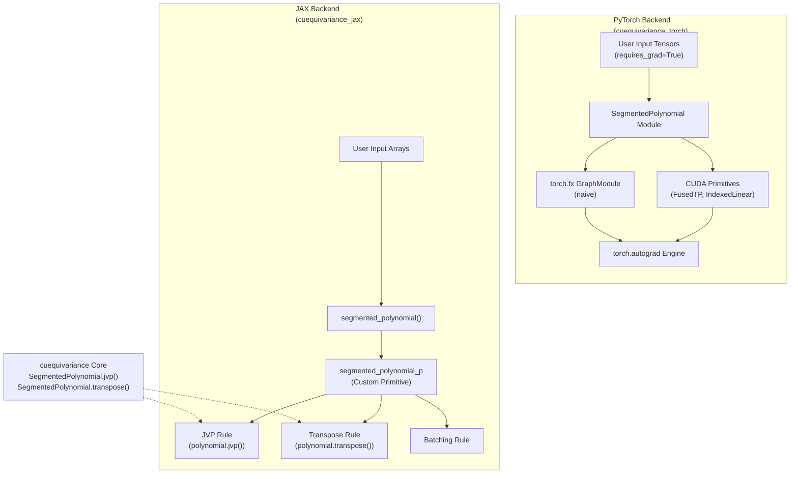

This page documents how cuEquivariance integrates with automatic differentiation (AD) systems across its PyTorch and JAX backends. The two backends employ fundamentally different strategies: PyTorch relies on native autograd composition through differentiable CUDA primitives, while JAX defines explicit JVP and transpose (VJP) rules at the primitive level. Understanding these mechanisms is essential for implementing custom equivariant architectures that require gradient-based optimization, higher-order derivatives, or reverse-mode differentiation through complex computational graphs.

## Differentiation Architecture Overview

cuEquivariance provides two distinct but mathematically equivalent AD pathways depending on the chosen backend. The diagram below illustrates the structural differences between these approaches and how they map to each framework's differentiation engine.

Sources: [segmented_polynomial.py](/cuequivariance_jax/cuequivariance_jax/segmented_polynomials/segmented_polynomial.py#L334-L801), [segmented_polynomial.py](/cuequivariance_torch/cuequivariance_torch/primitives/segmented_polynomial.py#L44-L312)

## PyTorch: Native Autograd Composition

The PyTorch backend achieves automatic differentiation by ensuring every computation primitive is composed from autograd-compatible operations. There is no custom `torch.autograd.Function` with explicit `backward()` definitions — instead, each implementation method constructs its forward pass using standard PyTorch ops that the autograd engine can already differentiate.

### Naive Method: `torch.fx` Graph-Based Differentiability

The `SegmentedPolynomialNaive` implementation builds its computation graph using `torch.fx.GraphModule`, generating einsum-based tensor products that are inherently differentiable. The `_tensor_product_fx` function constructs a symbolic graph where each path in the segmented tensor product is expressed as a chain of reshape, transpose, and einsum operations [segmented_polynomial_naive.py](/cuequivariance_torch/cuequivariance_torch/primitives/segmented_polynomial_naive.py#L61-L237). Because all of these operations are standard PyTorch primitives with registered autograd rules, the resulting graph module is fully differentiable without any additional effort.

This naive implementation serves as the **reference implementation for gradient verification**. All AD tests in the test suite compare the gradients of optimized methods against the naive method to confirm correctness [segmented_polynomial_test.py](/cuequivariance_torch/tests/primitives/segmented_polynomial_test.py#L236-L249).

### CUDA Methods: Differentiable Primitive Wrappers

The CUDA-accelerated methods (`fused_tp`, `indexed_linear`, `uniform_1d`) wrap custom CUDA kernels in `torch.nn.Module` subclasses. Differentiation support for these methods is provided by the `cuequivariance_ops_torch` extension, which registers the underlying CUDA operations as autograd-compatible functions. The forward pass delegates to custom kernels (`ops.FusedTensorProductOp3`, `ops.FusedTensorProductOp4`, `indexed_linear`, `segmented_transpose`), and the extension library supplies the corresponding backward passes [segmented_polynomial_fused_tp.py](/cuequivariance_torch/cuequivariance_torch/primitives/segmented_polynomial_fused_tp.py#L27-L72).

The key architectural insight is that the `FusedTP3` and `FusedTP4` classes are thin wrappers around `cuequivariance_ops_torch.FusedTensorProductOp3/4` objects. These objects receive static metadata (path indices, path coefficients, operand layouts) at construction time and accept dynamic tensors at forward time, keeping the autograd tape lightweight [segmented_polynomial_fused_tp.py](/cuequivariance_torch/cuequivariance_torch/primitives/segmented_polynomial_fused_tp.py#L27-L72). The `IndexedLinear` class similarly wraps `cuequivariance_ops_torch.indexed_linear`, with additional Python-side slicing and reshape operations that remain autograd-transparent [segmented_polynomial_indexed_linear.py](/cuequivariance_torch/cuequivariance_torch/primitives/segmented_polynomial_indexed_linear.py#L26-L156).

### Transpose Operations and Autograd

The layout transpose primitives (`TransposeIrrepsLayout`, `TransposeSegments`) follow the same pattern. When CUDA is available, they wrap the `segmented_transpose` custom operation from `cuequivariance_ops_torch` [transpose.py](/cuequivariance_torch/cuequivariance_torch/primitives/transpose.py#L177-L184). When falling back, they construct a `torch.fx.GraphModule` that applies reshape-transpose-reshape sequences per segment — operations that are natively differentiable [transpose.py](/cuequivariance_torch/cuequivariance_torch/primitives/transpose.py#L134-L165).

### Gradient Computation Modes

The test infrastructure validates gradients across multiple compilation modes. A helper `Grad` module wraps any `SegmentedPolynomial` module and computes gradients using `torch.autograd.grad` with `create_graph=True`, enabling both first-order and higher-order gradient computation [segmented_polynomial_test.py](/cuequivariance_torch/tests/primitives/segmented_polynomial_test.py#L129-L159). The following table summarizes AD support across PyTorch export modes:

| Export Mode | Forward AD | Backward AD | Double Backward | Notes |
|---|---|---|---|---|
| **Eager** | ✅ | ✅ | ✅ | Default PyTorch execution |
| **`torch.compile`** | ✅ | ✅ | ✅ | Dynamo + Inductor compilation |
| **`torch.jit.script`** | ✅ | ✅ | ✅ | TorchScript serialization |
| **`torch.jit.trace`** | ❌ | N/A | N/A | Inline autograd incompatible with tracing |
| **`torch.export`** | ✅ | ✅ | ✅ | AOT export via Dynamo |

Sources: [transpose_test.py](/cuequivariance_torch/tests/primitives/transpose_test.py#L68-L89), [segmented_polynomial_test.py](/cuequivariance_torch/tests/primitives/segmented_polynomial_test.py#L208-L265)

### dtype Considerations for Gradients

The interaction between input dtype and `math_dtype` has direct implications for gradient computation. When `math_dtype` is specified, internal buffers operate at that precision, but gradient flow follows the input tensor dtype. The `output_dtype_map` parameter controls per-output dtype inheritance, which determines the dtype of output tensors and consequently the dtype of any downstream gradient signals [segmented_polynomial.py](/cuequivariance_torch/cuequivariance_torch/primitives/segmented_polynomial.py#L140-L200).

For the `fused_tp` method, a notable restriction applies: when `math_dtype=torch.float32`, float64 inputs are not supported — this constraint propagates to gradient computation since gradients inherit the computation dtype [segmented_polynomial_fused_tp.py](/cuequivariance_torch/cuequivariance_torch/primitives/segmented_polynomial_fused_tp.py#L183-L188). Additionally, `indexed_linear` does not support explicit `math_dtype` specification, instead inheriting computation precision from input tensors [segmented_polynomial_indexed_linear.py](/cuequivariance_torch/cuequivariance_torch/primitives/segmented_polynomial_indexed_linear.py#L172-L176).

> [!TIP]
> When verifying gradient correctness in PyTorch, the test suite uses the naive method as the ground truth and applies relaxed tolerances (`10× atol/rtol`) to gradient comparisons, accounting for the accumulated numerical differences between optimized and reference implementations. This tolerance scaling is critical when comparing fp16/bf16 gradients.

Sources: [segmented_polynomial_test.py](/cuequivariance_torch/tests/primitives/segmented_polynomial_test.py#L270-L306), [segmented_polynomial_fused_tp.py](/cuequivariance_torch/cuequivariance_torch/primitives/segmented_polynomial_fused_tp.py#L100-L103)

## JAX: Explicit Primitive Differentiation Rules

The JAX backend takes a fundamentally different approach by defining a custom JAX primitive (`segmented_polynomial_p`) and registering explicit differentiation rules. This provides fine-grained control over how derivatives propagate through the segmented polynomial computation, which is essential because the forward pass invokes non-trivial CUDA kernels that JAX cannot automatically differentiate.

### Primitive Registration

The `segmented_polynomial_p` primitive is declared as a multiple-results primitive, reflecting that segmented polynomials produce a list of output buffers [segmented_polynomial.py](/cuequivariance_jax/cuequivariance_jax/segmented_polynomials/segmented_polynomial.py#L334-L335). The primitive's differentiation and batching behavior is fully specified through four rule registrations at lines 798–801:

| Rule | Registration | Purpose |
|---|---|---|
| **JVP** (forward-mode) | `ad.primitive_jvps[segmented_polynomial_p]` | Computes tangent propagation for `jax.grad`-style forward AD |
| **Transpose** (reverse-mode) | `ad.primitive_transposes[segmented_polynomial_p]` | Computes cotangent propagation for `jax.value_and_grad`-style reverse AD |
| **Batching** | `batching.primitive_batchers[segmented_polynomial_p]` | Enables `jax.vmap` over the primitive |
| **DCE** | `partial_eval.dce_rules[segmented_polynomial_p]` | Dead code elimination for partial evaluation |

Sources: [segmented_polynomial.py](/cuequivariance_jax/cuequivariance_jax/segmented_polynomials/segmented_polynomial.py#L780-L801)

### Forward-Mode AD: The JVP Rule

The JVP rule (`segmented_polynomial_jvp`) implements forward-mode automatic differentiation. Its strategy is both elegant and efficient: rather than symbolically differentiating the polynomial, it constructs a **new segmented polynomial** that represents the derivative using `polynomial.jvp()` [segmented_polynomial.py](/cuequivariance_jax/cuequivariance_jax/segmented_polynomials/segmented_polynomial.py#L586).

The implementation proceeds in three phases. First, it separates the primal inputs from their tangent vectors, asserting that index buffers have zero tangents (indices are integer-valued and non-differentiable) [segmented_polynomial.py](/cuequivariance_jax/cuequivariance_jax/segmented_polynomials/segmented_polynomial.py#L564-L572). Second, it evaluates the primal forward pass by calling `segmented_polynomial_prim` with the original polynomial [segmented_polynomial.py](/cuequivariance_jax/cuequivariance_jax/segmented_polynomials/segmented_polynomial.py#L574-L584). Third, it constructs a derivative polynomial via `polynomial.jvp([not isinstance(t, ad.Zero) for t in tangents])` — this method on the core `SegmentedPolynomial` class generates a new polynomial whose paths correspond to the directional derivatives of the original paths. The non-zero tangent vectors are appended to the primal inputs to form the input set for this derivative polynomial, and the remapped indices are constructed via `_remap_indices_and_config` [segmented_polynomial.py](/cuequivariance_jax/cuequivariance_jax/segmented_polynomials/segmented_polynomial.py#L586-L608).

This design means that the JVP is computed using the same optimized kernels as the forward pass — the derivative polynomial is just another segmented polynomial that dispatches to `naive`, `uniform_1d`, or `indexed_linear` implementations identically.

### Reverse-Mode AD: The Transpose Rule

The transpose rule (`segmented_polynomial_transpose`) implements reverse-mode automatic differentiation (backpropagation). It mirrors the JVP rule's structure but uses `polynomial.transpose()` instead of `polynomial.jvp()` to construct the adjoint polynomial [segmented_polynomial.py](/cuequivariance_jax/cuequivariance_jax/segmented_polynomials/segmented_polynomial.py#L632-L635).

The transpose rule receives cotangents (gradient signals from downstream) and partially-defined primal inputs (some are `ad.UndefinedPrimal`, indicating they need gradients). It constructs a transposed polynomial that maps the cotangents back through the original computation graph. The undefined primals become the outputs of this transposed computation, and the cotangents become inputs alongside the defined (known) primals [segmented_polynomial.py](/cuequivariance_jax/cuequivariance_jax/segmented_polynomials/segmented_polynomial.py#L649-L665). The index remapping follows the same `_remap_indices_and_config` utility, but with a different mapping order: defined primals first, then non-zero cotangents, then undefined primals as the output targets [segmented_polynomial.py](/cuequivariance_jax/cuequivariance_jax/segmented_polynomials/segmented_polynomial.py#L636-L647).

An important detail is that the transpose rule handles the case where a transposed output may be empty (no gradient flows to a particular input) by returning `ad.Zero` rather than a zero-valued array. This is more efficient than materializing zeros and correctly signals to JAX's partial evaluation that the corresponding input does not participate in the gradient computation [segmented_polynomial.py](/cuequivariance_jax/cuequivariance_jax/segmented_polynomials/segmented_polynomial.py#L667-L673).

### Index Handling in Differentiation Rules

Both JVP and transpose rules must handle the indexing system that allows segmented polynomials to operate with shared, batched, indexed, or repeated buffer access patterns. The `_remap_indices_and_config` function performs the critical task of mapping the original index configuration to the derivative polynomial's index configuration [segmented_polynomial.py](/cuequivariance_jax/cuequivariance_jax/segmented_polynomials/segmented_polynomial.py#L434-L465). Index arrays are integer-valued and non-differentiable — the JVP rule asserts this explicitly — so they pass through differentiation unchanged but must be remapped to correspond to the correct buffer positions in the derivative polynomial's operand layout.

### Method Dispatch in Differentiation

All three execution methods (`naive`, `uniform_1d`, `indexed_linear`) share the same JVP and transpose rules. The `method` parameter is passed through the differentiation rules to `segmented_polynomial_prim`, which dispatches the derivative polynomial to the same kernel type as the original computation [segmented_polynomial.py](/cuequivariance_jax/cuequivariance_jax/segmented_polynomials/segmented_polynomial.py#L543-L549). This means that choosing a more optimized method for the forward pass automatically gives you the corresponding optimized gradient computation.

Sources: [segmented_polynomial.py](/cuequivariance_jax/cuequivariance_jax/segmented_polynomials/segmented_polynomial.py#L552-L673)

## Gradient Verification Strategy

The test suites for both backends employ the same fundamental verification strategy: **compare optimized-method gradients against naive-method gradients**. This approach is necessary because manually computing analytical gradients for segmented tensor products with arbitrary path structures is impractical.

### PyTorch Gradient Test Architecture

The PyTorch test infrastructure constructs a `Grad` wrapper module that computes `torch.autograd.grad` with `create_graph=True`, enabling verification of both first-order and second-order gradients [segmented_polynomial_test.py](/cuequivariance_torch/tests/primitives/segmented_polynomial_test.py#L129-L159). The `assert_close_recursive` function performs deep comparison of outputs and their `.grad` attributes with progressively relaxed tolerances at each gradient level [segmented_polynomial_test.py](/cuequivariance_torch/tests/primitives/segmented_polynomial_test.py#L166-L205).

The test matrix covers the full combinatorial space of:

- **Data types**: FP32, FP64, FP16, BF16 inputs with various `math_dtype` settings
- **Indexing modes**: All combinations of shared/batched/indexed input and output indexing
- **Compilation modes**: Eager, compile, script, JIT trace, and export
- **Gradient depth**: Forward-only, backward, and double backward

Tests with many non-default options are skipped using a complexity scoring system to keep total test count manageable [segmented_polynomial_test.py](/cuequivariance_torch/tests/primitives/segmented_polynomial_test.py#L382-L396).

> [!TIP]
> Double backward (second-order gradients) with fp16/bf16 inputs is explicitly skipped in the test suite due to insufficient numerical precision. For architectures requiring second-order optimization (e.g., Hessian-free methods), use at least FP32 inputs with FP64 `math_dtype` to ensure gradient accuracy.

Sources: [segmented_polynomial_test.py](/cuequivariance_torch/tests/primitives/segmented_polynomial_test.py#L208-L399)

## Backends Compared: AD Feature Matrix

The following table provides a comprehensive comparison of AD capabilities across the two backends:

| Feature | PyTorch (`cuequivariance_torch`) | JAX (`cuequivariance_jax`) |
|---|---|---|
| **AD Mechanism** | Native autograd through differentiable ops | Custom primitive with explicit JVP/transpose rules |
| **Forward-Mode AD** | ✅ via `torch.autograd.forward_ad` | ✅ via `segmented_polynomial_jvp` |
| **Reverse-Mode AD** | ✅ via `torch.autograd.grad` | ✅ via `segmented_polynomial_transpose` |
| **Higher-Order AD** | ✅ (double backward verified) | ✅ (JVP rules compose naturally) |
| **vmap / Batched AD** | ✅ via batch dimensions | ✅ via `segmented_polynomial_batching` |
| **JIT Compilation + AD** | ✅ `torch.compile`, `torch.jit.script` | ✅ via XLA lowering |
| **Gradient Verification** | Against naive method | Against naive method |
| **Custom Gradient Override** | ❌ (uses standard autograd) | ✅ (primitive rules can be customized) |
| **Dead Code Elimination** | N/A | ✅ via `segmented_polynomial_dce` |
| **CUDA Required for AD** | No (naive always works) | No (falls back to naive on CPU) |

Sources: [segmented_polynomial_test.py](/cuequivariance_torch/tests/primitives/segmented_polynomial_test.py#L270-L314), [segmented_polynomial.py](/cuequivariance_jax/cuequivariance_jax/segmented_polynomials/segmented_polynomial.py#L780-L801)

## Practical Guidance

When working with automatic differentiation in cuEquivariance, the choice between PyTorch and JAX should consider not only the differentiation API surface but also how gradient computation performance scales with your model architecture.

For **PyTorch users**, the simplest path is to enable `requires_grad=True` on input tensors and rely on standard `loss.backward()` or `torch.autograd.grad` calls. The CUDA primitives handle backward pass registration transparently. If you encounter gradient mismatches during debugging, temporarily switch to `method="naive"` to obtain a reference gradient, then compare against the optimized method with relaxed tolerances.

For **JAX users**, the explicit primitive rules mean that `jax.grad` and `jax.value_and_grad` work seamlessly with `segmented_polynomial()`. The derivative polynomials generated by `polynomial.jvp()` and `polynomial.transpose()` are themselves valid segmented polynomials, so they benefit from the same kernel optimizations as the forward pass. The batching rule ensures that `jax.vmap(jax.grad(f))` composes correctly for batched gradient computations.

For advanced scenarios requiring mixed-method differentiation — where, for example, the forward pass uses `fused_tp` but you want the backward pass to use `naive` for numerical stability — the PyTorch backend's autograd approach supports this via `torch.autograd.graph.saved_tensors_hooks` or custom `torch.autograd.Function` wrappers around the primitive modules. The JAX backend's method parameter flows through both JVP and transpose rules, so all derivative computations use the same method as the forward pass.
