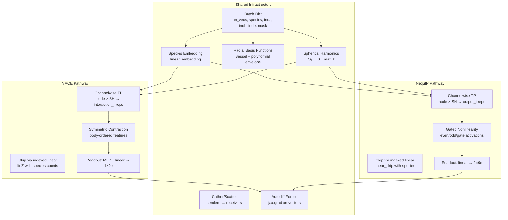
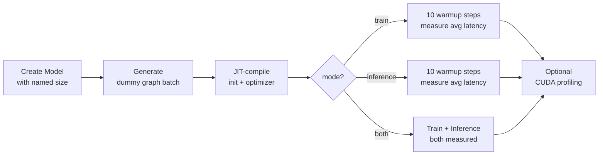

This page documents two complete equivariant neural network implementations — **MACE** and **NequIP** — provided as end-to-end examples in cuEquivariance's JAX backend. Each model is offered in two Flax API variants (Linen and NNX), uses real cuEquivariance primitives for all equivariant operations, and ships with benchmarking harnesses and cross-variant weight-transfer tests. These examples serve as both architectural references for how production-grade equivariant architectures compose cuEquivariance building blocks, and as validated starting points for custom model development.

## Architectural Landscape

Both MACE and NequIP operate on graph-structured molecular data, predicting per-graph energies and per-atom forces through equivariant message passing. Despite sharing a common graph neural network skeleton, they differ fundamentally in how they construct and contract their feature spaces. The following diagram maps the shared infrastructure and the divergent computational pathways:



Both pipelines ingest the same batch dictionary format and output `(E, F)` — graph-level energies and per-atom forces. The force computation uses `jax.grad` on the vector positions, making both models fully differentiable with respect to atomic coordinates [mace_linen.py#L285-L286](cuequivariance_jax/examples/mace_linen.py#L285-L286), [nequip_linen.py#L252-L253](cuequivariance_jax/examples/nequip_linen.py#L252-L253).

## Two API Variants: Linen vs NNX

Every model example is implemented twice — once using **Flax Linen** (functional, stateless parameter management) and once using **Flax NNX** (object-oriented, stateful references). This duality is not merely cosmetic; the two variants employ different irreps representation systems, which has consequences for how equivariant operations are dispatched.

| Dimension | Linen Variant | NNX Variant |
|---|---|---|
| **Irreps representation** | `RepArray` — batched tensor with `.irreps` metadata | `dict[Irrep, Array]` — per-irrep keyed dictionary |
| **Parameter system** | `self.param()` with functional `apply(params, batch)` | `nnx.Param` with mutable state, direct `model(batch)` |
| **Polynomial dispatch** | `cuex.equivariant_polynomial()` — unified API with layout awareness | `cuex.ir_dict.segmented_polynomial_uniform_1d()` — dict-native segmented ops |
| **Linear layers** | Inline descriptor + polynomial calls within `__call__` | Dedicated `IrrepsLinear`, `IrrepsIndexedLinear` modules |
| **Activation** | `cuex.scalar_activation()` on `RepArray` | `scalar_activation()` on `dict[Irrep, Array]` with `cuex.normalize_function` |

> [!TIP]
> The test suite guarantees **numerical equivalence** between Linen and NNX variants via explicit weight-transfer functions. After converting Linen parameter dictionaries into NNX module state, both forward passes produce bit-identical outputs, and training with the same optimizer yields identical parameters — validating that the representation switch is lossless.

## MACE: Multi-Body Atomic Cluster Expansion

MACE (Higher-Order Equivariant Message Passing Neural Networks) achieves high accuracy through body-ordered features constructed via symmetric contraction. The key architectural distinction from NequIP is the **symmetric contraction** step that produces higher-order (body-ordered) correlations from pairwise tensor products.

### Layer Architecture (MACELayer)

Each `MACELayer` implements a five-stage pipeline: linear projection → channelwise tensor product message passing → linear projection → symmetric contraction → skip connection with readout [mace_linen.py#L62-L202](cuequivariance_jax/examples/mace_linen.py#L62-L202).

**Stage 1 — Skip connection (pre-message):** If enabled (all layers except optionally the first), an `IrrepsIndexedLinear` (`linZ`) transforms the input features using per-species weight matrices. The descriptor `cue.descriptors.linear(...) * (1.0 / num_species**0.5)` applies the standard embedding normalization, and the polynomial is evaluated with `method="indexed_linear"` to route species-indexed weights via `Repeats(num_species)` [mace_linen.py#L101-L115](cuequivariance_jax/examples/mace_linen.py#L101-L115).

**Stage 2 — Message passing:** Input features are linearly projected, then combined with spherical harmonics through a channelwise tensor product. The radial part is mixed by a 3-layer MLP (`[64, 64, 64, weight_dim]`) applied to Bessel radial basis embeddings. The polynomial evaluation uses `method="uniform_1d"` with `senders`/`receivers` index arrays to perform the gather-scatter message aggregation in a single fused operation [mace_linen.py#L130-L147](cuequivariance_jax/examples/mace_linen.py#L130-L147).

**Stage 3 — Symmetric contraction:** This is MACE's signature operation. Higher-order features are contracted using `symmetric_contraction` from `cuequivariance.group_theory.experimental.mace`, which returns both a descriptor and a projection matrix. The projection is applied to species-indexed weights via `jnp.einsum("zau,ab->zbu", w, projection)`, and the resulting contracted polynomial is evaluated with `method="uniform_1d"` [mace_linen.py#L160-L187](cuequivariance_jax/examples/mace_linen.py#L160-L187). The correlation order (typically 3) determines the body-order of the resulting features.

**Stage 4 — Post-contraction and skip:** A post-contraction linear layer is applied, then the skip connection from Stage 1 is added. For the final layer, an additional MLP readout (`16×0e`) with SiLU activation precedes the scalar output projection to `1×0e` [mace_linen.py#L189-L201](cuequivariance_jax/examples/mace_linen.py#L189-L201).

### NNX Component Decomposition

The NNX variant decomposes these stages into dedicated, reusable modules [mace_nnx.py#L77-L357](cuequivariance_jax/examples/mace_nnx.py#L77-L357):

| Module | Responsibility | Key cuEquivariance API |
|---|---|---|
| `MessagePassing` | Channelwise TP with gather/scatter | `split_operand_by_irrep`, `segmented_polynomial_uniform_1d` |
| `SymmetricContraction` | Body-ordered feature contraction | `mace_symmetric_contraction`, `einsum` on projection |
| `IrrepsLinear` | Standard equivariant linear map | Flat weight matrix per `(ir_in, ir_out)` pair |
| `IrrepsIndexedLinear` | Species-indexed equivariant linear | Per-species weight expansion via `jnp.repeat` |
| `SphericalHarmonics` | Real spherical harmonics up to `max_ℓ` | `cuex.SphericalHarmonics` |

The `MessagePassing` module in the NNX variant explicitly decomposes the polynomial operand using `.split_operand_by_irrep(2).split_operand_by_irrep(1).split_operand_by_irrep(-1)` before calling `segmented_polynomial_uniform_1d` with `einops.rearrange` for axis management — giving fine-grained control over the data layout that the Linen `equivariant_polynomial` wrapper abstracts away [mace_nnx.py#L101-L137](cuequivariance_jax/examples/mace_nnx.py#L101-L137).

### Model Size Configurations

MACE supports six named configurations spanning two architectural families — **MP** (message-passing with skip on first layer) and **OFF** (off-diagonal, no first-layer skip) [mace_linen.py#L312-L350](cuequivariance_jax/examples/mace_linen.py#L312-L350):

| Size | `num_features` | `hidden_irreps` | `skip_connection_first_layer` | Typical Use |
|---|---|---|---|---|
| **MP-S** | 128 | `0e` | `True` | Small, equivariant-only |
| **MP-M** | 128 | `0e+1o` | `True` | Medium, with vector features |
| **MP-L** | 128 | `0e+1o+2e` | `True` | Large, full tensor channel |
| **OFF-S** | 96 | `0e` | `False` | Off-diagonal equivariant |
| **OFF-M** | 128 | `0e+1o` | `False` | Off-diagonal medium |
| **OFF-L** | 192 | `0e+1o+2e` | `False` | Off-diagonal large |

All MACE configurations share `interaction_irreps = 0e+1o+2e+3o`, `max_ell=3`, `correlation=3`, `num_radial_basis=8`, and `num_layers=2`. The `epsilon` parameter is set to `1/avg_num_neighbors` (default: 1/20) for message normalization [mace_linen.py#L320-L350](cuequivariance_jax/examples/mace_linen.py#L320-L350).

## NequIP: E(3)-Equivariant Graph Neural Network

NequIP differs from MACE primarily in its treatment of nonlinearities — using **gated activations** on per-irrep channels rather than symmetric contraction — and in maintaining full `0e+1o+2e+3o` features throughout all layers rather than collapsing to scalar-only hidden irreps.

### Layer Architecture (NEQUIPLayer)

Each `NEQUIPLayer` implements: linear up-projection → channelwise tensor product → radial MLP mixing → gated skip connection → gated activation → even/odd scalar activation [nequip_linen.py#L61-L181](cuequivariance_jax/examples/nequip_linen.py#L61-L181).

**Message passing:** The tensor product convolution combines up-projected node features with spherical harmonics to produce output features of dimension `num_features × (0e+1o+2e+3o)`. The output irreps are augmented with an extra `0e` channel to serve as radial weight channels. A `MultiLayerPerceptron` with configurable hidden dimensions (`mlp_n_hidden=64`, `mlp_n_layers=2`) processes Bessel radial basis functions to produce per-edge mixing weights [nequip_linen.py#L104-L134](cuequivariance_jax/examples/nequip_linen.py#L104-L134).

**Skip connections:** Both the convolution output (`linear_down`) and the input features (`linear_skip`) are projected into a gated irreps structure containing scalar channels, non-scalar channels, and gate channels. The skip connection uses species-indexed weights, identical in pattern to MACE's `linZ` [nequip_linen.py#L141-L157](cuequivariance_jax/examples/nequip_linen.py#L141-L157).

**Gated nonlinearity:** This is NequIP's core inductive bias. The skip-added features are decomposed into three groups under the `ir_mul` assumption: scalar features (even/odd `0e`/`0o`), gate features (additional `0e` channels equal in count to non-scalar irreps), and non-scalar features (everything else). Gates are activated via `gate_activation` (SiLU), then applied element-wise to non-scalar features through an `elementwise_tensor_product`. Scalar channels receive separate even (`silu`) and odd (`tanh`) activations [nequip_linen.py#L160-L180](cuequivariance_jax/examples/nequip_linen.py#L160-L180).

### NNX Gated Linear Modules

The NNX variant introduces two specialized modules for the gated activation pattern [nequip_nnx.py#L74-L207](cuequivariance_jax/examples/nequip_nnx.py#L74-L207):

- **`GatedLinear`**: Outputs a dictionary with `0e` entries split into `(scalars, gates)` concatenated along the multiplicity axis, plus separate non-scalar entries. Weight matrices are stored in Linen-compatible layout to facilitate cross-variant testing [nequip_nnx.py#L74-L126](cuequivariance_jax/examples/nequip_nnx.py#L74-L126).
- **`GatedIndexedLinear`**: Same structure but with per-species (per-index) weight matrices, expanded via `jnp.repeat` for species-count-based broadcasting. Returns zero arrays for irreps absent from the input [nequip_nnx.py#L129-L207](cuequivariance_jax/examples/nequip_nnx.py#L129-L207).

The NNX `NEQUIPLayer.__call__` explicitly reconstructs the gated activation by slicing `0e` features into `scalars` and `gates`, normalizing the gate activation, then multiplying gates into non-scalar features irrep-by-irrep — a manual version of the Linen variant's `cue.assume(cue.O3, cue.ir_mul)` dispatch [nequip_nnx.py#L369-L387](cuequivariance_jax/examples/nequip_nnx.py#L369-L387).

### Model Size Configurations

NequIP offers three sizes with a consistent `max_ell=3` and `num_layers=3` [nequip_linen.py#L266-L292](cuequivariance_jax/examples/nequip_linen.py#L266-L292):

| Size | `num_features` | Output Irreps per Layer |
|---|---|---|
| **S** | 64 | `64×(0e+1o+2e+3o)` |
| **M** | 128 | `128×(0e+1o+2e+3o)` |
| **L** | 256 | `256×(0e+1o+2e+3o)` |

Unlike MACE, NequIP maintains the full irreps spectrum (`0e+1o+2e+3o`) at every layer, which increases expressiveness at the cost of higher per-layer dimensionality compared to MACE's scalar-only hidden irreps.

## Shared Input/Output Protocol

Both models share an identical batch dictionary format, designed for efficient GPU processing with graph padding:

```python
batch = dict(
    nn_vecs=vecs,       # (num_edges, 3) — displacement vectors between neighbors
    species=species,     # (num_atoms,) — integer species indices
    inda=senders,        # (num_edges,) — source atom indices
    indb=receivers,      # (num_edges,) — target atom indices
    inde=graph_index,    # (num_atoms,) — graph membership index
    nats=nats,           # (num_graphs,) — atom counts per graph
    mask=mask,           # (num_edges,) — binary mask (1.0 for real, 0.0 for padding)
)
```

Both models sort atoms by species at the start of forward pass, remap edge indices accordingly, and invert the permutation for force output — ensuring that species-count-based operations (embeddings, indexed linears) operate on contiguous species blocks for numerical stability [mace_linen.py#L232-L235](cuequivariance_jax/examples/mace_linen.py#L232-L235), [nequip_linen.py#L204-L208](cuequivariance_jax/examples/nequip_linen.py#L204-L208).

Force computation follows the same pattern in both models: the energy function is defined as a closure over the forward pass, and `jax.grad(forward, has_aux=True)` returns both the force terms and per-atom energies. Forces are masked to zero out padded edges, then assembled via scatter-addition from sender and receiver contributions with appropriate sign conventions [mace_linen.py#L285-L300](cuequivariance_jax/examples/mace_linen.py#L285-L300).

## cuEquivariance Primitive Usage Map

The examples collectively exercise the full spectrum of cuEquivariance's descriptor and polynomial APIs. This table summarizes which primitives each model variant invokes:

| Primitive | MACE Linen | MACE NNX | NequIP Linen | NequIP NNX |
|---|---|---|---|---|
| `cue.descriptors.linear` | `lin()`, `linZ()` | `IrrepsLinear` | `linear_up/down/skip` | `IrrepsLinear` |
| `cue.descriptors.channelwise_tensor_product` | ✅ (convolution) | ✅ (`MessagePassing`) | ✅ (convolution) | ✅ (`MessagePassing`) |
| `cue.descriptors.elementwise_tensor_product` | — | — | ✅ (gated activation) | Manual gate multiply |
| `symmetric_contraction` | ✅ (from mace module) | ✅ (`SymmetricContraction`) | — | — |
| `cuex.equivariant_polynomial` | ✅ (all linear/TP ops) | — | ✅ (all linear/TP ops) | — |
| `cuex.ir_dict.segmented_polynomial_uniform_1d` | — | ✅ (message + SC) | — | ✅ (message) |
| `cuex.spherical_harmonics` | ✅ | ✅ (`SphericalHarmonics`) | ✅ | ✅ (`SphericalHarmonics`) |
| `cuex.scalar_activation` | ✅ | ✅ (`scalar_activation`) | ✅ (dual even/odd) | ✅ (`scalar_activation`) |

> [!TIP]
> The `method` parameter on `equivariant_polynomial` controls the underlying implementation strategy: `"naive"` for standard evaluation, `"uniform_1d"` for gather-scatter operations (message passing), and `"indexed_linear"` for species-indexed weight application. Choosing the correct method is essential for correctness — using `"naive"` where `"uniform_1d"` is needed will omit the gather-scatter entirely.

## Benchmarking Infrastructure

Both models include self-contained benchmarking functions that measure training step latency, inference latency, and JIT compilation time [mace_linen.py#L305-L455](cuequivariance_jax/examples/mace_linen.py#L305-L455), [nequip_linen.py#L266-L397](cuequivariance_jax/examples/nequip_linen.py#L266-L397). The benchmarking follows an identical pattern:



The training step computes a combined energy/force MSE loss with Adam (`lr=1e-2`). Benchmark sizes are configurable per model family: MACE defaults to `3,000 atoms / 160,000 edges` (MP) or `4,000 / 70,000` (OFF), with a `--larger` flag for 4× scaling. Each benchmark invocation prints parameter count, per-step latency in milliseconds, and JIT compilation time in seconds.

## Running the Examples

All four example files are directly executable and support standard CLI arguments for dtype, model size, and mode selection. The benchmarking harness also supports `--nodes` and `--edges` for custom problem sizes, and `--larger` for 4× scaled benchmarks:

```bash
# MACE Linen — medium message-passing model, float32, train + inference
python -m cuequivariance_jax.examples.mace_linen --model MP-M --dtype float32

# NequIP NNX — large model, float64, training only
python -m cuequivariance_jax.examples.nequip_nnx --model L --dtype float64 --mode train

# Custom problem size with CUDA profiling (requires libcudart.so)
python -m cuequivariance_jax.examples.mace_nnx --model OFF-L --nodes 8000 --edges 140000
```

The test suite validates forward pass output shapes, Linen↔NNX weight-transfer equivalence, and training convergence parity via `pytest` in `cuequivariance_jax/examples/test_examples.py` [test_examples.py#L29-L595](cuequivariance_jax/examples/test_examples.py#L29-L595).

## Suggested Next Steps

- For the underlying equivariant polynomial engine that powers all tensor product operations in these examples, see [JAX Equivariant Polynomial](16-jax-equivariant-polynomial).
- For the descriptor system used to construct `linear`, `channelwise_tensor_product`, and `elementwise_tensor_product` operations, see [Tensor Product Descriptors](9-tensor-product-descriptors).
- For spherical harmonics generation used by both models, see [Spherical Harmonics Descriptors](10-spherical-harmonics-descriptors).
- For symmetric contraction — MACE's body-ordered feature construction — see [Segmented Polynomials](7-segmented-polynomials).
- For the `RepArray` data structure used in the Linen variants, see [RepArray System](19-reparray-system).
- To understand how automatic differentiation propagates through these models to produce forces, see [Automatic Differentiation Support](20-automatic-differentiation-support).