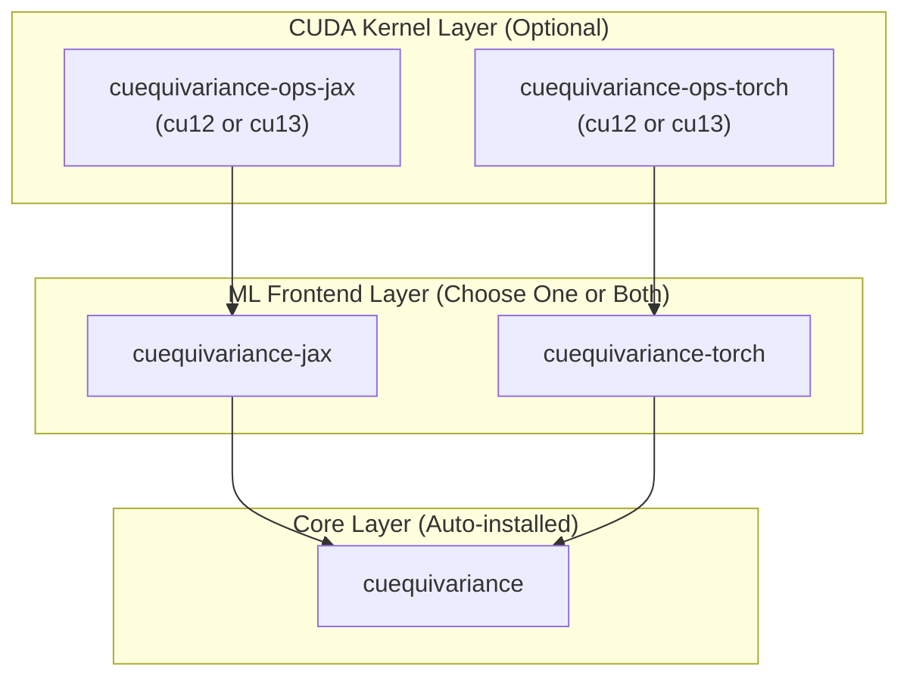
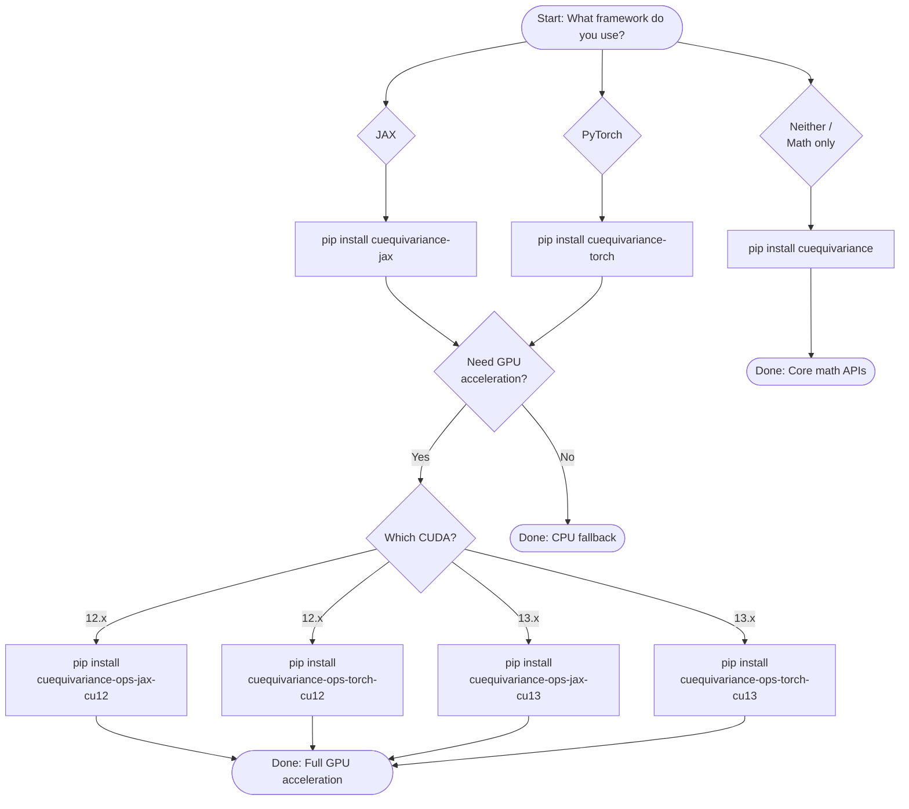

This guide walks you through installing cuEquivariance, NVIDIA's library for building high-performance equivariant geometric neural networks. The project is distributed as three complementary Python packages — a framework-agnostic core and two ML frontend adapters — along with optional CUDA kernel packages for accelerated computation. By the end of this guide, you will have a working installation tailored to your chosen deep learning framework.

## Prerequisites

Before installing cuEquivariance, ensure your environment meets the baseline requirements. The project requires **Python 3.10 or later**, with official support extending through Python 3.14 [Sources: [pyproject.toml](/cuequivariance/pyproject.toml#L33-L39)].

Depending on which frontend you plan to use, you will also need a compatible version of your deep learning framework. The JAX frontend requires **JAX ≥ 0.8.1** [Sources: [pyproject.toml](/cuequivariance_jax/pyproject.toml#L30-L35)], while the PyTorch frontend requires **PyTorch** (installed automatically as a dependency of the CUDA ops package). A CUDA-capable GPU is strongly recommended for production workloads, though the library does include pure-Python fallback implementations that run on CPU for testing and prototyping.

The three-package architecture means you should think about your install in terms of layers:



The **core package** (`cuequivariance`) is always pulled in automatically as a dependency of either frontend package. You only need to install it directly if you want the mathematical foundations — group theory, irreps, segmented tensor products — without any ML framework bindings.

## Package Overview

The table below summarizes each package's purpose, its pip-installable name, and what it provides at import time:

| Package | pip install name | Import name | Purpose |
|---|---|---|---|
| Core | `cuequivariance` | `cuequivariance` | Group theory (`SU2`, `SO3`, `O3`, `Irreps`), segmented tensor products, equivariant polynomial descriptors, and math utilities (`numpy`, `scipy`, `opt_einsum`, `sympy`, `networkx`) |
| JAX Frontend | `cuequivariance-jax` | `cuequivariance_jax` | `RepArray`, `segmented_polynomial`, `equivariant_polynomial`, `spherical_harmonics`, triangle kernels, Flax Linen and NNX modules |
| PyTorch Frontend | `cuequivariance-torch` | `cuequivariance_torch` | `SegmentedPolynomial` (with multiple CUDA methods), `Linear`, `SymmetricContraction`, `ChannelWiseTensorProduct`, `FullyConnectedTensorProduct`, triangle attention/multiplication, ONNX and TensorRT support |

Sources: [README.md](/README.md#L18-L24), [cuequivariance __init__.py](/cuequivariance/cuequivariance/__init__.py#L29-L96), [cuequivariance_jax __init__.py](/cuequivariance_jax/cuequivariance_jax/__init__.py#L29-L78), [cuequivariance_torch __init__.py](/cuequivariance_torch/cuequivariance_torch/__init__.py#L29-L102)

## Quick Install

The simplest installation is a single pip command. Choose the line that matches your framework:

```bash
# For JAX users
pip install cuequivariance-jax

# For PyTorch users
pip install cuequivariance-torch
```

Each of these commands automatically installs the core `cuequivariance` package as a dependency [Sources: [pyproject.toml (JAX)](/cuequivariance_jax/pyproject.toml#L30), [pyproject.toml (Torch)](/cuequivariance_torch/pyproject.toml#L30)]. After installation, verify it worked:

```python
# JAX verification
import cuequivariance_jax as cue_jax
print(cue_jax.__version__)

# PyTorch verification
import cuequivariance_torch as cue_torch
print(cue_torch.__version__)
```

## Adding CUDA Kernel Acceleration

Without CUDA kernel packages, both frontends still function — the PyTorch `SegmentedPolynomial` module automatically falls back to a `"naive"` pure-PyTorch implementation when `cuequivariance_ops_torch` is not found [Sources: [segmented_polynomial.py](/cuequivariance_torch/cuequivariance_torch/primitives/segmented_polynomial.py#L126-L133)]. However, for real-world performance, you should install the matching CUDA ops package:

```bash
# JAX CUDA kernels — choose your CUDA version
pip install cuequivariance-ops-jax-cu12   # CUDA 12.x
pip install cuequivariance-ops-jax-cu13   # CUDA 13.x

# PyTorch CUDA kernels — choose your CUDA version
pip install cuequivariance-ops-torch-cu12 # CUDA 12.x
pip install cuequivariance-ops-torch-cu13 # CUDA 13.x
```

Sources: [README.md](/README.md#L20-L24)

> [!TIP]
> **Choosing between CUDA 12 and CUDA 13**: Use `-cu12` if your system runs CUDA 12.x (most common as of early 2026), and `-cu13` for CUDA 13.x. Some advanced features — notably Blackwell-optimized BF16/FP16 triangle attention kernels — are only available in CUDA 13 builds [Sources: [CHANGELOG.md](/CHANGELOG.md#L65-L69)]. Check your CUDA version with `nvcc --version` or `nvidia-smi` before installing.

### Available Compute Methods (PyTorch)

Once the CUDA ops package is installed, the PyTorch `SegmentedPolynomial` module unlocks four computation methods. Each targets a different polynomial structure for optimal GPU utilization:

| Method | Description | Requirement |
|---|---|---|
| `"naive"` | Pure PyTorch, always works, not optimized | None (always available) |
| `"uniform_1d"` | CUDA kernel for single uniform-mode polynomials | `cuequivariance-ops-torch` |
| `"fused_tp"` | CUDA kernel for 3- and 4-operand tensor product contractions | `cuequivariance-ops-torch` |
| `"indexed_linear"` | CUDA kernel for linear layers with indexed weights | `cuequivariance-ops-torch` |

Sources: [segmented_polynomial.py](/cuequivariance_torch/cuequivariance_torch/primitives/segmented_polynomial.py#L69-L75)

## Installation Decision Flowchart

Use this flowchart to determine exactly which packages to install for your use case:



## Core-Only Installation

If you are interested in the mathematical foundations — group representations, irreducible representations (irreps), Clebsch-Gordan coefficients, and segmented polynomial descriptors — without any ML framework dependency, install just the core:

```bash
pip install cuequivariance
```

This brings in `numpy`, `scipy`, `opt_einsum`, `sympy`, and `networkx` as dependencies [Sources: [pyproject.toml](/cuequivariance/pyproject.toml#L30-L36)] and exposes the full group theory and descriptor API:

```python
import cuequivariance as cue

# Access group definitions and irreps
print(cue.SO3, cue.O3, cue.SU2)
irreps = cue.Irreps(cue.O3, "32x0e + 16x1o + 8x2e")

# Build descriptors
desc = cue.descriptors.spherical_harmonics(cue.SO3(1), [0, 1, 2])
```

Sources: [cuequivariance __init__.py](/cuequivariance/cuequivariance/__init__.py#L29-L96)

## Development Installation

If you intend to contribute to cuEquivariance or modify its source code, install from the repository. The project uses [hatchling](https://hatch.pypa.io/) as its build backend [Sources: [pyproject.toml](/cuequivariance/pyproject.toml#L26-L28)], and the contribution workflow requires [pre-commit](https://pre-commit.com/) for code consistency [Sources: [CONTRIBUTING.md](/CONTRIBUTING.md#L19-L22)]:

```bash
# Clone the repository
git clone https://github.com/NVIDIA/cuEquivariance.git
cd cuEquivariance

# Install pre-commit hooks (required for contributors)
pip install pre-commit
pre-commit install

# Install packages in editable mode
pip install -e ./cuequivariance          # Core
pip install -e ./cuequivariance_jax      # JAX frontend (optional)
pip install -e ./cuequivariance_torch    # PyTorch frontend (optional)
```

For running the test suite, the core package exposes a `dev` optional dependency that installs `pytest` and `graphviz` [Sources: [pyproject.toml](/cuequivariance/pyproject.toml#L44-L47)]:

```bash
pip install -e "./cuequivariance[dev]"
```

## Verifying Your Installation

After completing installation, run a quick smoke test to confirm everything is wired up correctly:

```python
import cuequivariance as cue
print(f"cuEquivariance core version: {cue.__version__}")

# Test core math
from cuequivariance import Irreps, SO3
irreps = Irreps(SO3, "4x0e + 2x1o")
print(f"Irreps: {irreps}, dim={irreps.dim}")
```

For the JAX frontend:

```python
import cuequivariance_jax as cue_jax
print(f"JAX frontend version: {cue_jax.__version__}")

# Test spherical harmonics
import jax.numpy as jnp
sh = cue_jax.spherical_harmonics(cue_jax.SphericalHarmonics(cue.SO3(2)), jnp.array([[0.0, 0.0, 1.0]]))
print(f"Spherical harmonics shape: {sh.shape}")
```

For the PyTorch frontend:

```python
import cuequivariance_torch as cue_torch
print(f"PyTorch frontend version: {cue_torch.__version__}")

# Test a segmented polynomial with spherical harmonics
import torch
from cuequivariance_torch import SegmentedPolynomial
desc = cue.descriptors.spherical_harmonics(cue.SO3(1), [0, 1, 2])
sp = SegmentedPolynomial(desc.polynomial, method="naive")
result = sp([torch.randn(1, 3)])
print(f"Output shape: {result[0].shape}")
```

## Troubleshooting

| Issue | Cause | Solution |
|---|---|---|
| `ImportError: cannot import name 'cuequivariance_ops_torch'` | CUDA ops package not installed | Install `cuequivariance-ops-torch-cu12` or `-cu13`; the module gracefully falls back to `"naive"` [Sources: [segmented_polynomial.py](/cuequivariance_torch/cuequivariance_torch/primitives/segmented_polynomial.py#L126-L133)] |
| `UserWarning: cuequivariance_ops_torch is not available. Falling back to naive implementation.` | Same as above | Same — install the matching CUDA ops package for GPU acceleration |
| `ValueError: The polynomial is not a cue.SegmentedPolynomial` | Passing a descriptor instead of its `.polynomial` attribute | Use `desc.polynomial` not `desc` when constructing `SegmentedPolynomial` [Sources: [segmented_polynomial.py](/cuequivariance_torch/cuequivariance_torch/primitives/segmented_polynomial.py#L135-L139)] |
| `Fused TP is not supported on CPU. Falling back to naive implementation.` | Using `method="fused_tp"` with CPU tensors | Switch to `method="naive"` for CPU, or move tensors to GPU [Sources: [segmented_polynomial.py](/cuequivariance_torch/cuequivariance_torch/primitives/segmented_polynomial.py#L282-L287)] |

## Next Steps

With cuEquivariance installed, you are ready to explore the library's capabilities:

- **[Quick Start](2-quick-start)** — Run your first equivariant polynomial computation with a minimal code example.
- **[Three-Package Architecture](4-three-package-architecture)** — Understand how the core, JAX, and PyTorch packages relate to each other at the source level.
- **[Group Representations and Irreps](5-group-representations-and-irreps)** — Learn the mathematical vocabulary (`Irreps`, `SO3`, `O3`, Clebsch-Gordan coefficients) that underpins every operation in the library.