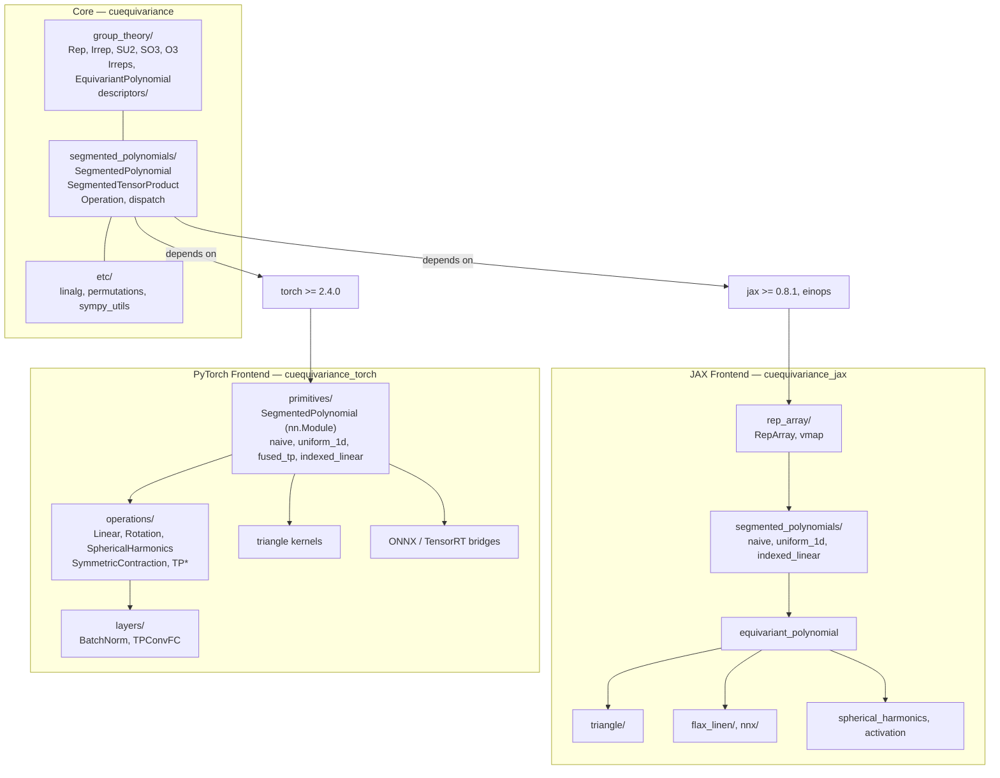
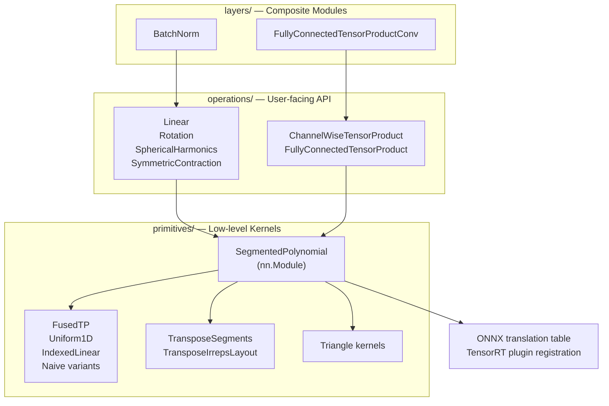
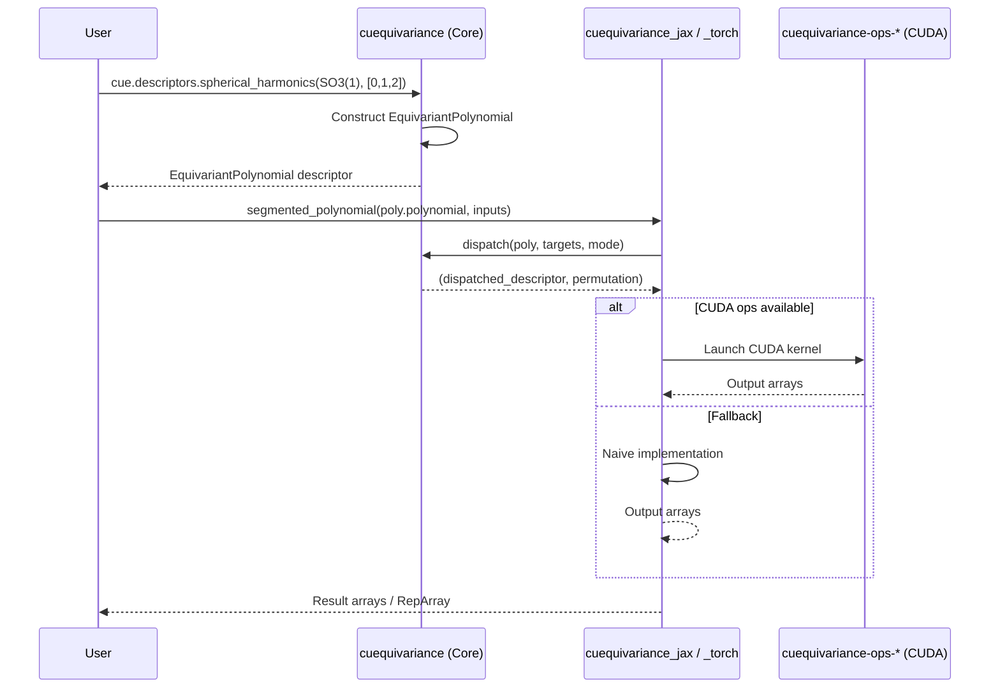

cuEquivariance separates its functionality across three distinct Python packages, each serving a clear role in the stack. This page examines how they relate, what lives inside each, and how data flows from a mathematical descriptor down to a framework-specific CUDA kernel.


## Architectural Overview

The library is organized as a strict dependency hierarchy. The core package `cuequivariance` holds all mathematical definitions and descriptor types with zero ML framework dependencies. The two frontend packages—`cuequivariance_jax` and `cuequivariance_torch`—each depend exclusively on the core and on their respective framework, forming a clean fan-out from a shared mathematical foundation.



The key architectural insight is that the core package defines a **descriptor protocol**—immutable data structures that fully specify a mathematical operation—while the frontend packages **interpret** those descriptors into executable code within their respective ML frameworks.

Sources: [README.md](/README.md#L1-L32), [docs/index.rst](/docs/index.rst#L75-L102)

## The Core Package: `cuequivariance`

The core package is a pure-Python, framework-agnostic library. Its only dependencies are NumPy, SciPy, opt_einsum, SymPy, and NetworkX—no JAX, no PyTorch. It is pip-installable as `cuequivariance` or `pip install cuequivariance` and ships version 0.10.0rc2 on the current main branch.

Sources: [pyproject.toml](/cuequivariance/pyproject.toml#L22-L29), [VERSION](/VERSION#L1-L2)

### Two Subdomains: `group_theory` and `segmented_polynomials`

The core is divided into two major subpackages plus a utilities module:

| Subpackage | Responsibility | Key Exports |
|---|---|---|
| `group_theory` | Group representations, irreps algebra, equivariance constraints | `Rep`, `Irrep`, `SU2`, `SO3`, `O3`, `MulIrrep`, `Irreps`, `IrrepsLayout`, `NumpyIrrepsArray`, `EquivariantPolynomial` |
| `segmented_polynomials` | Polynomial composition, tensor product structure, dispatch | `SegmentedPolynomial`, `SegmentedTensorProduct`, `SegmentedOperand`, `Operation`, `Subscripts`, `Path`, `dispatch` |
| `etc` | Internal math utilities | `linalg`, `permutations`, `sympy_utils` |

Sources: [cuequivariance/__init__.py](/cuequivariance/cuequivariance/__init__.py#L24-L93), [group_theory/__init__.py](/cuequivariance/cuequivariance/group_theory/__init__.py#L1-L76), [segmented_polynomials/__init__.py](/cuequivariance/cuequivariance/segmented_polynomials/__init__.py#L1-L43)

### The Descriptor Hierarchy

The core package defines three levels of descriptors that form the backbone of every operation in cuEquivariance. Understanding this hierarchy is essential because every frontend package ultimately consumes these descriptors.

**Level 1 — `Operation`**: An immutable dataclass that maps a sequence of buffer indices to tensor product operand positions. An operation like `Operation((0, 1, 2))` means "take buffers 0, 1, and 2 as the three operands of a single tensor product." Operations are grouped to describe how multiple tensor products share buffers within one polynomial evaluation.

Sources: [operation.py](/cuequivariance/cuequivariance/segmented_polynomials/operation.py#L44-L70)

**Level 2 — `SegmentedTensorProduct`**: A single tensor product segment, defined by its subscripts (using Einstein-like notation), input/output operands, and path structure. It captures the full combinatorial structure of one contraction pattern.

Sources: [segmented_polynomials/__init__.py](/cuequivariance/cuequivariance/segmented_polynomials/__init__.py#L19-L22)

**Level 3 — `SegmentedPolynomial`**: A frozen dataclass that composes multiple `SegmentedTensorProduct` instances with their associated `Operation` descriptors. This is the unit of work that frontends consume. A `SegmentedPolynomial` specifies a set of input buffers, a set of output buffers, and a list of `(Operation, SegmentedTensorProduct)` pairs that define how to transform inputs into outputs.

Sources: [segmented_polynomial.py](/cuequivariance/cuequivariance/segmented_polynomials/segmented_polynomial.py#L24-L51)

**Level 4 — `EquivariantPolynomial`**: Wraps a `SegmentedPolynomial` with group representation metadata (`Rep` objects) for each input and output. This is the highest-level descriptor in the core and encodes the full equivariance constraints. The constructor validates that each operand's size matches its representation dimension.

Sources: [equivariant_polynomial.py](/cuequivariance/cuequivariance/group_theory/equivariant_polynomial.py#L30-L78)


### The Dispatch System

The core also provides a `dispatch` function in `segmented_polynomials` that takes a `SegmentedTensorProduct` descriptor and a list of target subscript patterns, then yields all viable dispatches—each being a (descriptor, permutation) pair. This is the mechanism by which a high-level descriptor gets matched to specific CUDA kernel signatures. The dispatcher supports multiple permutation modes (`"permute_none"`, `"permute_all"`, `"permute_all_but_last"`) and progressively flattens descriptor modes when exact subscript matches fail.

Sources: [dispatch.py](/cuequivariance/cuequivariance/segmented_polynomials/dispatch.py#L14-L93)

> [!TIP]
> The `dispatch` function is the bridge between the mathematical descriptor layer and the CUDA kernel layer. Every backend package calls it (directly or indirectly) to determine which implementation variant to invoke for a given polynomial descriptor.

### The Descriptors Subpackage

Within `group_theory`, the `descriptors/` subpackage provides factory functions that construct `EquivariantPolynomial` instances for common operations. These factories—`spherical_harmonics`, `irreps_tp` (irreducible tensor products), `rotations`, `symmetric_contractions`, `linear`, and `transposition`—are the primary entry points for users building equivariant layers. Each factory encapsulates the non-trivial construction logic of mapping group-theoretic constraints into a valid `SegmentedPolynomial`.

Sources: [group_theory/__init__.py](/cuequivariance/cuequivariance/group_theory/__init__.py#L1-L76), [descriptors/ structure](/cuequivariance/cuequivariance/group_theory/descriptors)

## The JAX Frontend: `cuequivariance_jax`

The JAX package depends on `cuequivariance`, `jax>=0.8.1`, `einops`, and `packaging`. It provides two fundamental execution functions and a rich set of utilities built around JAX's functional programming model.

Sources: [cuequivariance_jax/pyproject.toml](/cuequivariance_jax/pyproject.toml#L22-L28)

### Execution Functions

The package exposes two primary computation entry points at its top level:

- **`segmented_polynomial(polynomial, inputs, outputs_shape_dtype, ...)`**: A direct execution function that takes a core `cue.SegmentedPolynomial` descriptor and a list of JAX arrays, returning output arrays. It supports multiple methods (`"naive"`, `"uniform_1d"`, `"indexed_linear"`, `""` for auto-selection), configurable `math_dtype`, and method-specific `options`. This function integrates with JAX's compiler infrastructure including `jax.jit`, `jax.vmap`, and `jax.grad`.

- **`equivariant_polynomial(poly, inputs, ...)`**: A higher-level wrapper that accepts a `cue.EquivariantPolynomial` descriptor along with `RepArray` inputs. It provides type checking and representation-aware handling, then delegates to `segmented_polynomial` internally. Returns `RepArray` objects carrying representation metadata alongside the computed arrays.

Sources: [segmented_polynomial.py](/cuequivariance_jax/cuequivariance_jax/segmented_polynomials/segmented_polynomial.py#L30-L60), [equivariant_polynomial.py](/cuequivariance_jax/cuequivariance_jax/equivariant_polynomial.py#L28-L78)

### Implementation Variants

The JAX package mirrors the same four implementation strategies found in the core's dispatch targets:

| Method | Module | Description |
|---|---|---|
| `"naive"` | `segmented_polynomial_naive.py` | Pure-JAX implementation using `jax.numpy` operations. Always works but not GPU-optimized. |
| `"uniform_1d"` | `segmented_polynomial_uniform_1d.py` | CUDA kernel implementation for polynomials with a single uniform mode. Requires `cuequivariance-ops-jax`. |
| `"indexed_linear"` | `segmented_polynomial_indexed_linear.py` | CUDA kernel for linear layers with indexed weight lookups. Requires `cuequivariance-ops-jax`. |
| `""` (auto) | dispatch logic | Automatically selects the best available method based on descriptor structure and installed ops package. |

Sources: [JAX segmented_polynomials/](/cuequivariance_jax/cuequivariance_jax/segmented_polynomials)

### Framework Integration

Beyond the core execution path, the JAX package provides deep integration with the broader JAX ecosystem:

- **`rep_array/`**: The `RepArray` class extends JAX arrays with irreps metadata, enabling operations that are aware of representation structure. Includes `vmap` support for batched transformations and utility functions like `randn`, `concatenate`, and `clebsch_gordan`.

- **`flax_linen/` and `nnx/`**: Integration modules for Flax's Linen API and the newer JAX NNX neural network API, providing layer norms and other building blocks.

- **`triangle/`**: Optimized implementations of triangle attention and triangle multiplicative update—operations common in protein structure prediction architectures—with Triton kernel utilities.

- **`activation.py` and `spherical_harmonics.py`**: Convenience functions for normalization, scalar activations, and spherical harmonics computation directly in JAX.

Sources: [cuequivariance_jax/__init__.py](/cuequivariance_jax/cuequivariance_jax/__init__.py#L1-L79)

## The PyTorch Frontend: `cuequivariance_torch`

The PyTorch package depends on `cuequivariance` and `torch`. Unlike the JAX frontend—which uses functional execution—the PyTorch frontend centers on `nn.Module` subclasses that integrate naturally with PyTorch's stateful training paradigm, `torch.compile`, and ONNX/TensorRT export paths.

Sources: [cuequivariance_torch/pyproject.toml](/cuequivariance_torch/pyproject.toml#L22-L25)

### The `SegmentedPolynomial` Module

The central class is `SegmentedPolynomial(nn.Module)`, which wraps a core `cue.SegmentedPolynomial` descriptor into a PyTorch module. It accepts the same four method choices as JAX (`"naive"`, `"uniform_1d"`, `"fused_tp"`, `"indexed_linear"`), with `"fused_tp"` being a PyTorch-specific CUDA kernel variant for 3- and 4-operand contractions. The module manages learnable weights, dtype handling via `math_dtype`, and supports `torch.compile` and automatic differentiation.

When the optional `cuequivariance_ops_torch` package is installed (detected via a graceful import check), CUDA-accelerated methods become available; otherwise, the module falls back to the `"naive"` pure-PyTorch path.

Sources: [segmented_polynomial.py](/cuequivariance_torch/cuequivariance_torch/primitives/segmented_polynomial.py#L30-L105)

### Three Abstraction Layers

The PyTorch package organizes its code across three distinct layers of abstraction:



**`primitives/`** contains the low-level building blocks. `SegmentedPolynomial` dispatches to variant implementations (`naive`, `fused_tp`, `uniform_1d`, `indexed_linear`). `TransposeSegments` and `TransposeIrrepsLayout` handle layout conversions. `triangle.py` provides triangle attention and multiplicative update kernels. A `deprecated.py` module maintains backward compatibility with older API names (`TensorProduct`, `EquivariantTensorProduct`, `SymmetricTensorProduct`).

**`operations/`** provides high-level, user-facing modules that encapsulate common equivariant operations. Each operation constructs an appropriate descriptor via the core package's `descriptors` factories and wraps it in a `SegmentedPolynomial` module. `Linear` handles equivariant linear transformations, `Rotation` encodes rotations and inversions, `SphericalHarmonics` computes SH basis functions, `SymmetricContraction` implements symmetric tensor contractions, and `ChannelWiseTensorProduct` / `FullyConnectedTensorProduct` provide tensor product layers.

**`layers/`** offers composite modules that combine multiple primitives into full neural network building blocks. `BatchNorm` provides equivariant batch normalization, and `FullyConnectedTensorProductConv` integrates fully connected tensor products with convolutional semantics.

Sources: [cuequivariance_torch/__init__.py](/cuequivariance_torch/cuequivariance_torch/__init__.py#L1-L103), [layers/__init__.py](/cuequivariance_torch/cuequivariance_torch/layers/__init__.py#L1-L22)

### Deployment Bridges

The PyTorch package uniquely provides deployment pathways not available in the JAX frontend. The `onnx_custom_translation_table()` function returns an ONNX translation table for `torch.onnx.export`, mapping custom cuEquivariance operations to standard ONNX representations. The `register_tensorrt_plugins()` function registers TensorRT plugins for accelerated inference. Both functions are gated behind the optional `cuequivariance_ops_torch` dependency.

Sources: [cuequivariance_torch/__init__.py](/cuequivariance_torch/cuequivariance_torch/__init__.py#L67-L87)

## Cross-Package Data Flow

Understanding how data moves across the three packages clarifies why the separation exists and what each package is responsible for.



1. The user calls a descriptor factory in the core package (e.g., `cue.descriptors.spherical_harmonics`). The core constructs an `EquivariantPolynomial` with full mathematical specification—no computation occurs.

2. The user passes the descriptor (or its inner `SegmentedPolynomial`) to a frontend execution function. The frontend invokes the core's `dispatch` to find matching kernel signatures.

3. Based on dispatch results and runtime availability of `cuequivariance-ops-*` packages, the frontend either launches a CUDA kernel or falls back to a naive implementation.

4. Results are returned as framework-native arrays (with optional `RepArray` metadata in JAX).

> [!TIP]
> The descriptor is a pure data object. You can serialize it, inspect it, print it, or pass it across processes without any framework overhead. Only the execution step requires JAX or PyTorch.

## Package Comparison at a Glance

| Dimension | `cuequivariance` | `cuequivariance_jax` | `cuequivariance_torch` |
|---|---|---|---|
| **Install command** | `pip install cuequivariance` | `pip install cuequivariance-jax` | `pip install cuequivariance-torch` |
| **ML dependency** | None (NumPy only) | JAX ≥ 0.8.1 | PyTorch ≥ 2.4.0 |
| **Execution model** | Descriptors only (no execution) | Functional (`segmented_polynomial`, `equivariant_polynomial`) | Module-based (`nn.Module`) |
| **Auto-diff** | Not applicable | Native via JAX | Native via PyTorch |
| **CUDA kernels** | Not applicable | `cuequivariance-ops-jax-cu12` | `cuequivariance-ops-torch-cu12` |
| **Deployment export** | Not applicable | Not provided | ONNX + TensorRT |
| **Framework integration** | None | Flax Linen, NNX | Native `nn.Module`, `torch.compile` |
| **Triangle kernels** | Not applicable | `triangle_multiplicative_update`, `triangle_attention` | Same, plus Triton utilities |
| **Unique APIs** | `Irreps`, `IrrepsLayout`, `NumpyIrrepsArray`, `descriptors.*`, `visualize_polynomial` | `RepArray`, `vmap`, `scalar_activation`, `normalspace` | `Linear`, `Rotation`, `SphericalHarmonics`, `BatchNorm`, `SymmetricContraction` |

Sources: [README.md](/README.md#L18-L26), [cuequivariance/pyproject.toml](/cuequivariance/pyproject.toml#L22-L29), [cuequivariance_jax/pyproject.toml](/cuequivariance_jax/pyproject.toml#L22-L28), [cuequivariance_torch/pyproject.toml](/cuequivariance_torch/pyproject.toml#L22-L25)

## Installation and Dependency Management

Each package is independently versioned and available on PyPI. The core `cuequivariance` package is the only mandatory shared dependency; the two frontends never depend on each other. CUDA kernel packages (`cuequivariance-ops-jax-*` and `cuequivariance-ops-torch-*`) are optional but strongly recommended for production performance—they provide the `uniform_1d`, `fused_tp`, and `indexed_linear` implementations that deliver the library's benchmarked speedups over e3nn.

```bash
# Minimal: core only (descriptors, no execution)
pip install cuequivariance

# JAX workflow
pip install cuequivariance-jax
pip install cuequivariance-ops-jax-cu12   # CUDA kernels (optional but recommended)

# PyTorch workflow
pip install cuequivariance-torch
pip install cuequivariance-ops-torch-cu12  # CUDA kernels (optional but recommended)
```

The core package is open-source on GitHub. The CUDA ops packages are distributed as pre-built wheels for Linux x86_64 and aarch64, with Python 3.10–3.14 support.

Sources: [README.md](/README.md#L18-L26), [docs/index.rst](/docs/index.rst#L55-L70)

## Suggested Reading Path

Having understood the three-package structure, you can explore the system at any depth that matches your needs:

- To understand the mathematical types that flow between packages, proceed to **[Group Representations and Irreps](5-group-representations-and-irreps)** for the `Rep`/`Irrep`/`Irreps` hierarchy defined in the core package.
- To see how the core's descriptor factories produce executable polynomials, read **[Segmented Polynomials](7-segmented-polynomials)** for the `SegmentedPolynomial` abstraction.
- For hands-on PyTorch usage of the architecture described here, see **[PyTorch Segmented Polynomial Module](12-pytorch-segmented-polynomial-module)**.
- For the JAX execution path, see **[JAX Equivariant Polynomial](16-jax-equivariant-polynomial)**.
- For concrete model examples that compose these packages end-to-end, jump to **[Model Examples: MACE and NequIP](21-model-examples-mace-and-nequip)**.