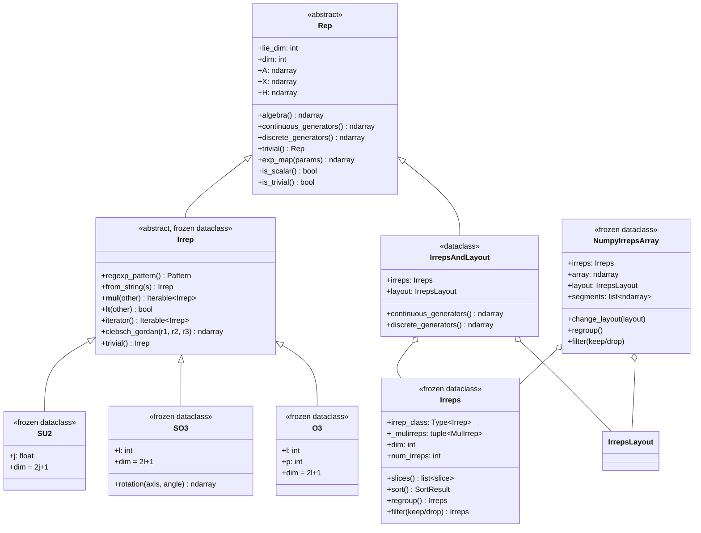

This page provides a structured exposition of how cuEquivariance encodes mathematical group representations in software. It covers the abstract representation hierarchy, the three built-in irrep families (SU(2), SO(3), O(3)), the direct-sum container `Irreps`, data layout conventions, and the data-bearing `NumpyIrrepsArray` — all of which form the algebraic foundation that every higher-level operation (tensor products, polynomials, equivariant layers) builds upon. After reading this page, you will understand how to define, compose, and inspect irreducible representations programmatically, and how those abstractions map to concrete tensor shapes in memory.

## The Representation Hierarchy

cuEquivariance models group representations through a disciplined class hierarchy that mirrors the mathematical relationship between representations and their irreducible building blocks. At the top sits the abstract `Rep` class, which defines the contract every concrete representation must fulfill: dimension queries, algebra/generator access, and an exponential map from Lie-algebra parameters to group matrices. Beneath it, `Irrep` adds the operations unique to irreducible representations — Clebsch-Gordan coefficients, tensor-product selection rules, a canonical ordering, and a string parser — making it the central extensibility point for the library. Three concrete irrep families ship with the package: `SU2`, `SO3`, and `O3`.



The `Rep` base class ([rep.py](/cuequivariance/cuequivariance/group_theory/representations/rep.py#L22-L172)) is intentionally minimal. It carries only the information that *any* representation — reducible or irreducible — must provide: a Lie-algebra dimension `lie_dim`, the representation dimension `dim`, the structure constants `A` (shape `(lie_dim, lie_dim, lie_dim)`), the continuous generators `X` (shape `(lie_dim, dim, dim)`), and the discrete generators `H` (shape `(num_H, dim, dim)`). The `exp_map` method combines these generators with parameter vectors to produce a concrete representation matrix.

`Irrep` ([irrep.py](/cuequivariance/cuequivariance/group_theory/representations/irrep.py#L29-L194)) extends `Rep` with five abstract methods that encode the combinatorial and algebraic structure unique to irreducible representations. The `__mul__` operator returns the *selection rule* — the set of output irreps that appear when two irreps are tensored together. The `clebsch_gordan` classmethod returns the explicit Clebsch-Gordan coefficient tensor of shape `(num_paths, dim1, dim2, dim3)`, which is the mathematical object that actually *implements* the decomposition of a tensor product into irreducible subspaces. The `__lt__` operator establishes a canonical sort order (ascending by dimension), and `iterator` yields all irreps of the group starting from the trivial one. A `regexp_pattern`/`from_string` pair enables serialization to and from human-readable labels.

## The Three Built-In Irrep Families

cuEquivariance ships with concrete implementations for three groups that are central to equivariant machine learning and physics. Each is a frozen dataclass with a small number of label parameters and complete implementations of every `Irrep` method.

### SU(2) — The double-cover of SO(3)

The `SU2` class ([irrep_su2.py](/cuequivariance/cuequivariance/group_theory/representations/irrep_su2.py#L30-L149)) labels each irrep by a non-negative half-integer *j* ∈ {0, ½, 1, 3/2, …}. The dimension is 2j + 1, and the continuous generators are constructed directly from the angular-momentum raising and lowering operators. The selection rule follows the familiar coupling rule from quantum mechanics: *j*₁ ⊗ *j*₂ yields all *j* from |*j*₁ − *j*₂| to *j*₁ + *j*₂ in integer steps. The Clebsch-Gordan coefficients are computed by the helper function `clebsch_gordanSU2mat` ([irrep_su2.py](/cuequivariance/cuequivariance/group_theory/representations/irrep_su2.py#L188-L218)) which implements the Racah formula in pure Python.

### SO(3) — Rotations in 3D

The `SO3` class ([irrep_so3.py](/cuequivariance/cuequivariance/group_theory/representations/irrep_so3.py#L46-L156)) labels irreps by a non-negative integer *l*. It is a special case of SU(2) restricted to integer *j*, but it works entirely in the **real** (spherical-harmonic) basis rather than the complex angular-momentum basis. The basis-change matrix `change_basis_real_to_complex` ([irrep_so3.py](/cuequivariance/cuequivariance/group_theory/representations/irrep_so3.py#L29-L42)) converts between the two, and the Clebsch-Gordan coefficients are obtained by transforming the SU(2) coefficients through this basis change. SO(3) has no discrete generators (the group is connected), so `discrete_generators` returns an empty array. A convenience method `rotation(axis, angle)` ([irrep_so3.py](/cuequivariance/cuequivariance/group_theory/representations/irrep_so3.py#L125-L146)) computes the Wigner D-matrix for a specific axis-angle rotation.

### O(3) — Rotations and reflections

The `O3` class ([irrep_o3.py](/cuequivariance/cuequivariance/group_theory/representations/irrep_o3.py#L29-L113)) extends each SO(3) irrep with a parity label *p* ∈ {+1, −1}, written as `e` (even) or `o` (odd) in string notation. The dimension is still 2*l* + 1 — parity does not change the dimensionality, it only controls behavior under inversion. The continuous generators are delegated directly to the underlying SO(3) irrep ([irrep_o3.py](/cuequivariance/cuequivariance/group_theory/representations/irrep_o3.py#L96-L97)), while the discrete generator is simply *p* · 𝕀 ([irrep_o3.py](/cuequivariance/cuequivariance/group_theory/representations/irrep_o3.py#L99-L100)). The selection rule multiplies the parities: the tensor product of (*l*₁, *p*₁) and (*l*₂, *p*₂) yields SO(3) irreps *l* from |*l*₁ − *l*₂| to *l*₁ + *l*₂, each with parity *p*₁ · *p*₂ ([irrep_o3.py](/cuequivariance/cuequivariance/group_theory/representations/irrep_o3.py#L62-L68)). If the parity constraint is violated, the Clebsch-Gordan tensor is returned as zeros ([irrep_o3.py](/cuequivariance/cuequivariance/group_theory/representations/irrep_o3.py#L74-L77)).

| Property | `SU2` | `SO3` | `O3` |
|---|---|---|---|
| Label | half-integer *j* | integer *l* | (*l*, *p*) |
| String format | `"0"`, `"1/2"`, `"1"` | `"0"`, `"1"`, `"2"` | `"0e"`, `"1o"`, `"2e"` |
| Dimension | 2*j* + 1 | 2*l* + 1 | 2*l* + 1 |
| Discrete generators | none | none | parity ±1 |
| Selection rule | \|*j*₁−*j*₂\| ≤ *j* ≤ *j*₁+*j*₂ (step 1) | same (integer only) | same + parity product |
| Use case | spinor systems, full SU(2) equivariance | rotation-equivariant networks | molecules with inversion symmetry |

## `Irreps` — Direct Sums with Multiplicities

While a single `Irrep` describes one indivisible representation channel, real equivariant networks operate on **direct sums** of many irreps, each potentially appearing with a multiplicity greater than one. The `Irreps` class ([irreps.py](/cuequivariance/cuequivariance/group_theory/irreps_array/irreps.py#L40-L469)) captures exactly this: an ordered sequence of `(multiplicity, irrep)` pairs, internally stored as a tuple of `MulIrrep` dataclasses.

### Construction patterns

`Irreps` accepts several construction idioms. The most common is the string notation `"mul x irrep + ..."`, which mirrors the mathematical convention of writing a direct sum as a sum of terms:

```python
import cuequivariance as cue

# Full specification
irreps = cue.Irreps("SO3", "32x0 + 16x1 + 4x2")
# → 32 copies of l=0, 16 copies of l=1, 4 copies of l=2

# Using the assume context to avoid repeating the group
with cue.assume("SO3"):
    irreps = cue.Irreps("16x0 + 4x1")
```

You can also pass tuples of `(mul, irrep)` or `(mul, irrep_label_string)` pairs, or even pass another `Irreps` object ([irreps.py](/cuequivariance/cuequivariance/group_theory/irreps_array/irreps.py#L71-L156)). The parser validates each irrep label against the `regexp_pattern` of the group, raising `ValueError` on mismatch ([irreps.py](/cuequivariance/cuequivariance/group_theory/irreps_array/irreps.py#L111-L114)).

### Dimension and slicing

The total dimension of an `Irreps` is the weighted sum of constituent dimensions ([irreps.py](/cuequivariance/cuequivariance/group_theory/irreps_array/irreps.py#L200-L209)):

```python
irreps = cue.Irreps("SO3", "100x0 + 10x1")
irreps.dim          # 100×1 + 10×3 = 130
irreps.num_irreps   # 100 + 10 = 110
irreps.slices()     # [slice(0, 100), slice(100, 130)]
```

The `slices()` method ([irreps.py](/cuequivariance/cuequivariance/group_theory/irreps_array/irreps.py#L233-L247)) returns a list of `slice` objects that partition the flat last dimension of a tensor into contiguous segments — one per `(mul, irrep)` entry. This is the fundamental bridge between the algebraic `Irreps` descriptor and actual memory layout.

### Structural operations

`Irreps` supports a rich set of structural transformations that are essential when building equivariant layers:

- **`simplify()`** removes zero multiplicities and merges consecutive identical irreps ([irreps.py](/cuequivariance/cuequivariance/group_theory/irreps_array/irreps.py#L326-L334)).
- **`sort()`** rearranges segments in canonical irrep order and returns a `SortResult` containing forward and inverse permutations ([irreps.py](/cuequivariance/cuequivariance/group_theory/irreps_array/irreps.py#L336-L355)).
- **`regroup()`** is the composition of `sort()` and `simplify()` — it fully canonicalizes the descriptor ([irreps.py](/cuequivariance/cuequivariance/group_theory/irreps_array/irreps.py#L357-L365)).
- **`filter(keep=...)` / `filter(drop=...)`** selects or excludes specific irreps ([irreps.py](/cuequivariance/cuequivariance/group_theory/irreps_array/irreps.py#L377-L403)).
- **`layout_insensitive()`** returns `True` when no irrep with `dim > 1` has multiplicity > 1, meaning the data layout does not affect correctness ([irreps.py](/cuequivariance/cuequivariance/group_theory/irreps_array/irreps.py#L455-L469)).

```python
irreps = cue.Irreps("SO3", "1 + 2 + 0 + 1")
irreps.regroup()        # "0+2x1+2"
irreps.filter(keep="0+1")  # "1+2+0+1" → filtered to only l=0 and l=1
```

> [!TIP]
> **Why does order matter?** `Irreps` is a *tag* for real tensor data. The segment order in the `Irreps` object must match the physical order of channels in the last dimension of the associated tensor. Swapping segments without permuting the corresponding data will silently produce incorrect results downstream — every equivariant layer relies on this correspondence.

## Data Layout: `IrrepsLayout`

When an irrep has multiplicity > 1, the corresponding segment of the data tensor is a 2D block of shape `(mul, dim)` — but the question of *which axis is which* has two valid answers. cuEquivariance resolves this with the `IrrepsLayout` enum ([irreps_layout.py](/cuequivariance/cuequivariance/group_theory/irreps_array/irreps_layout.py#L23-L89)), which has exactly two values:

- **`mul_ir`** — shape `(mul, dim)` — multiplicity is the leading axis. This is the default.
- **`ir_mul`** — shape `(dim, mul)` — the irrep dimension is the leading axis.

For an irrep with `dim = 1` (a scalar), the two layouts are identical. The distinction only matters for higher-dimensional irreps with multiplicity > 1. The layout affects how generators and Clebsch-Gordan coefficients are contracted with data, and `IrrepsAndLayout` handles this automatically via Kronecker products in different orders ([irreps_and_layout.py](/cuequivariance/cuequivariance/group_theory/irreps_array/irreps_and_layout.py#L106-L113)).

The layout can be set globally with the `assume` context manager or per-object at construction time:

```python
with cue.assume("SO3", cue.ir_mul):
    rep = cue.IrrepsAndLayout("2x1")   # layout = ir_mul within this block
```

## `IrrepsAndLayout` — A Concrete `Rep` from Direct Sums

`IrrepsAndLayout` ([irreps_and_layout.py](/cuequivariance/cuequivariance/group_theory/irreps_array/irreps_and_layout.py#L26-L142)) bridges the gap between the symbolic `Irreps` descriptor and the `Rep` interface expected by operations that need actual generator matrices. It combines an `Irreps` object with an `IrrepsLayout` and implements the `Rep` contract by constructing block-diagonal generator matrices.

For continuous generators, each segment contributes a block formed by a Kronecker product — `np.kron(np.eye(mul), ir.X)` in `mul_ir` layout or `np.kron(ir.X, np.eye(mul))` in `ir_mul` layout ([irreps_and_layout.py](/cuequivariance/cuequivariance/group_theory/irreps_array/irreps_and_layout.py#L106-L113)). Discrete generators follow the same pattern ([irreps_and_layout.py](/cuequivariance/cuequivariance/group_theory/irreps_array/irreps_and_layout.py#L115-L125)). The resulting matrices have shape `(lie_dim, irreps.dim, irreps.dim)` and can be passed to `exp_map` to compute explicit representation matrices for any group element.

Notably, `IrrepsAndLayout` is the *only* non-irrep subclass of `Rep` — it is the representation type you use when describing a full channel structure (e.g., the input features of an equivariant layer), while the `Irrep` subclasses describe individual channels.

## `NumpyIrrepsArray` — Data That Transforms as Irreps

`NumpyIrrepsArray` ([numpy_irreps_array.py](/cuequivariance/cuequivariance/group_theory/irreps_array/numpy_irreps_array.py#L28-L219)) is the concrete data container. It pairs a NumPy array with an `Irreps` descriptor and an `IrrepsLayout`, enforcing that the last dimension of the array matches `irreps.dim` at construction time ([numpy_irreps_array.py](/cuequivariance/cuequivariance/group_theory/irreps_array/numpy_irreps_array.py#L54-L57)).

Its most important structural property is `segments` ([numpy_irreps_array.py](/cuequivariance/cuequivariance/group_theory/irreps_array/numpy_irreps_array.py#L88-L94)), which returns a list of views — one per `(mul, irrep)` entry — each reshaped to `(leading_dims..., mul, dim)` in `mul_ir` layout. This decomposition is the mechanism by which layout-sensitive operations access individual channels.

The container mirrors every structural operation of `Irreps`: `sort()`, `regroup()`, `filter()`, and `change_layout()`. The `change_layout` method ([numpy_irreps_array.py](/cuequivariance/cuequivariance/group_theory/irreps_array/numpy_irreps_array.py#L215-L219)) performs a transpose (`np.moveaxis`) on each segment independently and reconstructs the array via `from_segments`. The `simplify` method ([numpy_irreps_array.py](/cuequivariance/cuequivariance/group_theory/irreps_array/numpy_irreps_array.py#L115-L119)) is layout-aware: in `mul_ir` it can simplify in-place, but in `ir_mul` it temporarily converts to `mul_ir` to avoid incorrect merging of segments with different leading shapes.

> [!TIP]
> **`NumpyIrrepsArray` vs. framework arrays.** In the JAX backend, the analogous container is `RepArray` (covered in [RepArray System](19-reparray-system)), and in the PyTorch backend, raw tensors are tagged with `Irreps` descriptors at the layer level. `NumpyIrrepsArray` is the CPU/NumPy reference implementation used for testing, basis computation, and cross-framework interop.

## The `assume` Context Manager

The `assume` class ([context_decorator.py](/cuequivariance/cuequivariance/group_theory/irreps_array/context_decorator.py#L31-L81)) serves a dual purpose as both a context manager and a function decorator. It temporarily pushes an irrep class and/or a layout onto thread-local stacks managed by `context_irrep_class.py` ([context_irrep_class.py](/cuequivariance/cuequivariance/group_theory/irreps_array/context_irrep_class.py#L20-L44)) and `context_layout.py` ([context_layout.py](/cuequivariance/cuequivariance/group_theory/irreps_array/context_layout.py#L19-L41)). Any `Irreps` or `IrrepsAndLayout` constructed inside the scope will read from these stacks when no explicit group or layout is provided.

```python
# As a context manager
with cue.assume(cue.O3):
    irreps = cue.Irreps("16x0e + 4x1o")

# As a decorator
@cue.assume(cue.SO3, cue.ir_mul)
def build_layer(irreps_in: str, irreps_out: str):
    ...
```

This mechanism eliminates repetition in model definitions where every layer shares the same group and layout convention.

## Irrep Algebra: Selection Rules and Clebsch-Gordan Coefficients

Two free functions complement the per-class `clebsch_gordan` methods. The module-level `clebsch_gordan(rep1, rep2, rep3)` function ([irrep.py](/cuequivariance/cuequivariance/group_theory/representations/irrep.py#L197-L238)) dispatches to the appropriate classmethod, while `selection_rule_product` ([irrep.py](/cuequivariance/cuequivariance/group_theory/representations/irrep.py#L240-L259)) returns the set of output irreps for a tensor product of one or two input irreps. These functions are the building blocks for the reduced tensor product basis computations used throughout the library.

The `selection_rule_product` function accepts single irreps, sequences of irreps, or `None` (interpreted as all irreps of the group), and returns a `frozenset` of irreps that appear in the decomposition. This is used extensively by the descriptor system to determine which output channels a tensor product operation produces.

## Reduced Tensor Product Bases

The `reduced_tensor_product_basis` function ([reduced_tensor_product.py](/cuequivariance/cuequivariance/group_theory/irreps_array/reduced_tensor_product.py#L53-L141)) computes the basis for the equivariant subspace of a tensor product of representations. Given a formula string (e.g., `"ij=j"`) and a dict of `Irreps` for each variable, it returns a `NumpyIrrepsArray` whose segments are the basis vectors for each output irrep. This is the mathematical core behind every segmented polynomial and equivariant layer in the library.

Specialized variants handle the symmetric (`reduced_symmetric_tensor_product_basis`) and antisymmetric (`reduced_antisymmetric_tensor_product_basis`) cases, with an optimized recursive implementation for the symmetric case that exploits permutation symmetry to reduce computation ([reduced_tensor_product.py](/cuequivariance/cuequivariance/group_theory/irreps_array/reduced_tensor_product.py#L467-L635)).

## Navigation

This page covered the algebraic substrate. To see how these representations are laid out in GPU memory for efficient computation, continue to [Layout](0-layout). To understand how irreps are combined through the segmented tensor product — the fundamental operation that powers all equivariant layers — proceed to [Segmented Tensor Products](6-segmented-tensor-products).