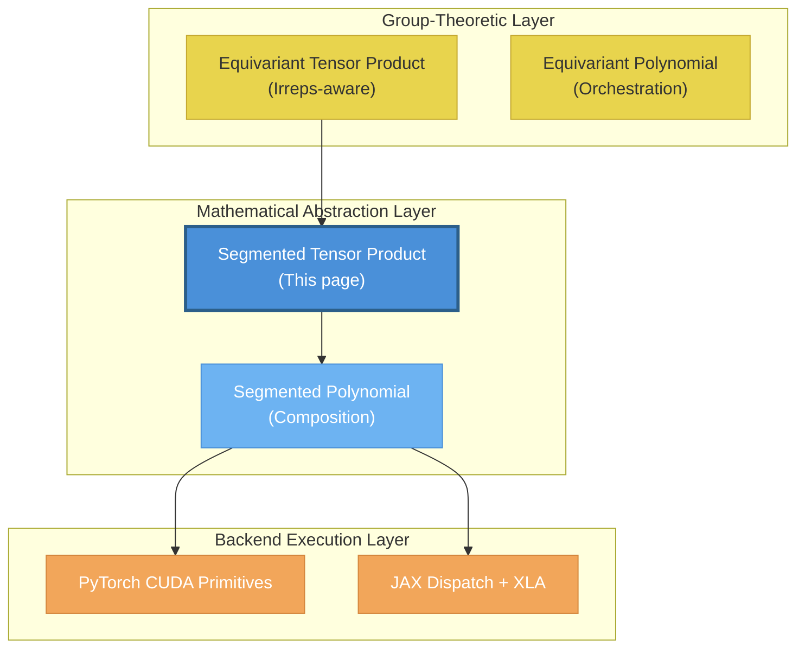

The Segmented Tensor Product (STP) is the foundational mathematical abstraction in cuEquivariance — an **irrep-agnostic, dataflow-agnostic blueprint** that describes how block-structured tensors contract across sparse, segmented connections. It encodes *what* to compute without prescribing *how* or *where* to compute it, serving as the compilation target that both the JAX and PyTorch backends eventually dispatch against.

## The STP Positioning in cuEquivariance

STP occupies a critical layer in the abstraction stack. It sits below the group-theoretic descriptors (which inject Clebsch-Gordan coefficients and symmetry constraints) and above the backend-specific execution engines (which compile the blueprint into fused CUDA kernels or JAX/XLA primitives). This separation is deliberate: a single STP descriptor can be evaluated on CPU via NumPy, on GPU via custom PyTorch CUDA kernels, or inside a JAX traced computation — all without modification.



The relationship between STP and the [Segmented Polynomial](7-segmented-polynomials) is compositional: a SegmentedPolynomial is an ordered sequence of STP operations (plus optional channel manipulations between them). Understanding STP is therefore a prerequisite for understanding the full polynomial pipeline.

## Anatomy of the Three Core Components

An STP descriptor is an immutable dataclass composed of three pillars, each implemented as a dedicated class in the `segmented_polynomials` package.

### Subscripts — The Contraction Grammar

The `Subscripts` class is a string subclass that defines the index contraction rules for the tensor product, closely mirroring Einstein summation notation. Its syntax uses three delimiters:

| Delimiter | Meaning | Example |
|-----------|---------|---------|
| `,` | Separates operands | `"uv,ui,vj"` — three operands |
| `+` | Introduces coefficient modes (free indices) | `"+ij"` — coefficients with modes `i` and `j` |
| Lowercase letters | Individual modes (contraction axes) | `"u"`, `"v"`, `"i"` |

A mode must appear in **at least two positions** across the full subscript string — once in some operand and once in either another operand (contracting it) or in the coefficient subscript (preserving it as output). The validation logic enforces this: modes that appear only once are rejected at construction time [segmented_tensor_product.py](cuequivariance/cuequivariance/segmented_polynomials/segmented_tensor_product.py#L124-L128).

Concrete examples from the codebase illustrate the pattern language:
- `"ui,uv,vi"` — an equivariant linear layer with shared weights, where `u` and `v` are contracted and `i` passes through.
- `"ui,vj,uvk+ijk"` — a full tensor product with Clebsch-Gordan coefficients, where `u`, `v`, `w` are contracted between operands and `i`, `j`, `k` are the output (coefficient) dimensions [subscripts.py](cuequivariance/cuequivariance/segmented_polynomials/subscripts.py#L27-L30).

The `Subscripts` class also provides a **canonicalization** procedure that normalizes mode names — contracted modes receive labels from `uvwabcdefghxyz`, while coefficient modes receive labels from `ijklmnopqrst` — enabling structural equivalence checks between descriptors that use different letters for the same mathematical operation [subscripts.py](cuequivariance/cuequivariance/segmented_polynomials/subscripts.py#L147-L186).

### SegmentedOperand — The Block Structure

Each operand in an STP is a `SegmentedOperand`: an ordered list of segment shapes. A segment is simply a tuple of integers representing the dimensions of one block within that operand. The class tracks per-axis dimension sets internally via a `_dims` dictionary, enabling fast dimension compatibility checks across paths [segmented_operand.py](cuequivariance/cuequivariance/segmented_polynomials/segmented_operand.py#L23-L54).

```
SegmentedOperand(ndim=2, segments=[(2, 3), (2, 5), (2, 4)])
│
├── segment 0: shape (2, 3)  →  6 elements
├── segment 1: shape (2, 5)  → 10 elements
└── segment 2: shape (2, 4)  →  8 elements

Total flat size: 24 elements
Segment slices: [slice(0,6), slice(6,16), slice(16,24)]
```

The `size` property computes the total flattened element count, accounting for heterogeneous segment shapes. The `segment_slices()` method returns the slice objects needed to index into a flat tensor — a critical piece of infrastructure for the evaluation loop that extracts and inserts segments by offset [segmented_operand.py](cuequivariance/cuequivariance/segmented_polynomials/segmented_operand.py#L166-L180).

### Path — The Sparse Connection

A `Path` links one segment from each operand together with a coefficient array. It is the atomic unit of computation: each path specifies a single contraction term that contributes to the output. The class is deliberately frozen (immutable) and stores both integer segment indices and a NumPy coefficient array [path.py](cuequivariance/cuequivariance/segmented_polynomials/path.py#L32-L51).

```python
# A path connecting segment 0 of operand 0, segment 1 of operand 1,
# segment 0 of operand 2, weighted by a (4, 6) coefficient matrix:
Path(indices=(0, 1, 0), coefficients=np.ones((4, 6)))
# Renders as: op0[0]*op1[1]*op2[0]*[[1. 1. ...]]
```

When the coefficient array is scalar (0-dimensional), it represents a simple multiplicative weight. When it is multi-dimensional, its axes correspond to the coefficient subscript modes, and those dimensions must match the segment dimensions along the corresponding axes in all involved operands. This constraint is verified during `assert_valid()` [segmented_tensor_product.py](cuequivariance/cuequivariance/segmented_polynomials/segmented_tensor_product.py#L136-L139).

## Building a Descriptor Step by Step

The canonical construction flow starts from `from_subscripts()`, then progressively adds segments and paths. The factory method creates empty operands with the correct dimensionality inferred from the subscript string [segmented_tensor_product.py](cuequivariance/cuequivariance/segmented_polynomials/segmented_tensor_product.py#L154-L178).


**Segment creation** accepts either explicit shape tuples or dictionaries mapping mode names to dimensions. When using a dictionary, the method automatically extracts dimensions in the order dictated by that operand's subscript, providing a more readable interface [segmented_tensor_product.py](cuequivariance/cuequivariance/segmented_polynomials/segmented_tensor_product.py#L814-L821).

**Path creation** via `add_path()` supports flexible segment specification: integer indices reference existing segments, `None` auto-creates new segments with dimensions inferred from the coefficient shape and other operands, and explicit shape tuples define entirely new segments. The method performs dimension unification across all specified segments and coefficients, raising on ambiguity [segmented_tensor_product.py](cuequivariance/cuequivariance/segmented_polynomials/segmented_tensor_product.py#L744-L784).

> [!TIP]
> The `add_path()` method with `None` segments enables a declarative "fill in the blanks" workflow: you specify the coefficient shape and let the descriptor infer the missing segment dimensions. This is particularly useful when constructing descriptors programmatically from group-theoretic rules, where the segment sizes are determined by the irreps multiplicities.

## Normalization — Variance Stabilization

In deep learning, uncontrolled signal scaling through tensor products causes gradient explosion or vanishing. The `normalize_paths_for_operand()` method addresses this by computing, for each segment in the target operand, the cumulative variance contributed by all paths touching that segment, then dividing each path's coefficients by the square root of that cumulative variance [segmented_tensor_product.py](cuequivariance/cuequivariance/segmented_polynomials/segmented_tensor_product.py#L1235-L1276).

The variance computation follows a precise formula. For a given path, the contracted modes (all modes not belonging to the normalization operand) determine the multiplicative factor. The method identifies contracted modes by scanning every operand and coefficient subscript except the target operand's, then discarding any modes shared with the target operand. The cumulative variance for a segment is the sum, over all paths touching that segment, of `mean(coefficients²) × product(contracted mode dimensions)` [segmented_tensor_product.py](cuequivariance/cuequivariance/segmented_polynomials/segmented_tensor_product.py#L1249-L1262).

## Optimization Transforms

Before execution, an STP descriptor typically passes through a sequence of optimization transforms. These are pure functions that return new `SegmentedTensorProduct` instances (the class is frozen/immutable), enabling safe pipelining.

### Path Consolidation

`consolidate_paths()` is a compound operation that performs three steps in one pass: (1) fuse paths with identical segment indices by summing their coefficients, (2) remove paths whose coefficients are all zero, and (3) sort the remaining paths lexicographically by indices. The result is a canonical, minimal representation [segmented_tensor_product.py](cuequivariance/cuequivariance/segmented_polynomials/segmented_tensor_product.py#L1302-L1324).

### Mode Flattening

`flatten_modes()` removes specified modes by expanding segments and subdividing paths. For each mode to be flattened, the method takes the product of its dimension with adjacent modes, splits each affected segment into multiple sub-segments (one per index value along the flattened mode), and creates new paths indexed into these sub-segments. This is the critical transform that reduces multi-dimensional contractions into simpler element-wise or matrix-multiply operations that CUDA kernels can handle efficiently [segmented_tensor_product.py](cuequivariance/cuequivariance/segmented_polynomials/segmented_tensor_product.py#L1464-L1615).

A particularly efficient variant, `flatten_coefficient_modes()`, specifically targets the coefficient subscript modes. When combined with `skip_zeros=True`, it can dramatically reduce the number of non-trivial paths by eliminating coefficient entries that are zero [segmented_tensor_product.py](cuequivariance/cuequivariance/segmented_polynomials/segmented_tensor_product.py#L1617-L1629).

### Mode Squeezing and Consolidation

`squeeze_modes()` removes modes whose dimension is universally 1 across all segments, reducing the operand dimensionality without changing the mathematical operation. `consolidate_modes()` goes further by merging adjacent modes within operands when they always co-occur — for example, consolidating modes `u` and `v` in a subscript like `"uv,uv"` into a single `u` mode by multiplying their dimensions [segmented_tensor_product.py](cuequivariance/cuequivariance/segmented_polynomials/segmented_tensor_product.py#L1090-L1733).

> [!TIP]
> The dispatch system in [dispatch.py](cuequivariance/cuequivariance/segmented_polynomials/dispatch.py#L23-L93) automates the selection of optimization transforms. Given a descriptor and a set of target subscripts (representing the operations that backend kernels support), `dispatch()` progressively flattens modes until the descriptor's subscript becomes a subset of some target, yielding each viable dispatch candidate along with the required operand permutation.

## Evaluation — Executing the Blueprint

The `compute_last_operand()` function is the reference NumPy implementation that evaluates an STP descriptor against actual data. It computes the last operand by contracting all preceding operands according to the descriptor's paths [evaluate.py](cuequivariance/cuequivariance/segmented_polynomials/evaluate.py#L25-L85).

The evaluation loop operates path-by-path:
1. Extract the relevant segment slice from each input operand.
2. Reshape inputs to their logical segment shapes (undoing the flat storage).
3. Compute `np.einsum(formula, coeff, *input_segments)` where the formula is dynamically constructed from the operand and coefficient subscripts.
4. Add the result into the corresponding output segment slice.

The primitive version, `primitive_compute_last_operand()`, exposes all internal arrays (segment shapes, offsets, sizes, path indices, and coefficients) as separate arguments, making it the target for backend-specific reimplementation [evaluate.py](cuequivariance/cuequivariance/segmented_polynomials/evaluate.py#L87-L140).

## Serialization and Interoperability

STP descriptors support multiple serialization formats for storage, transfer, and cross-language interop:

| Method | Format | Use Case |
|--------|--------|----------|
| `to_dict()` / `from_dict()` | Python dict | In-process construction and inspection |
| `to_json()` / `from_json()` | JSON string | Human-readable persistence, REST APIs |
| `to_bytes()` / `from_bytes()` | zlib-compressed ASCII | Efficient binary storage |
| `to_base64()` / `from_base64()` | Base64-encoded compressed | Embedding in strings, config files |

The `to_dict(extended=True)` variant includes additional metadata: per-operand flop costs, segment offsets and sizes, and total memory usage — useful for profiling and kernel selection [segmented_tensor_product.py](cuequivariance/cuequivariance/segmented_polynomials/segmented_tensor_product.py#L401-L459).

## Cost Analysis

The `flop()` method computes the floating-point operation count for evaluating a specific operand, using `opt_einsum.contract_path` to find the optimal contraction order for each path independently. It supports both "optimal" and "naive" cost models [segmented_tensor_product.py](cuequivariance/cuequivariance/segmented_polynomials/segmented_tensor_product.py#L607-L649). The `memory()` method returns the total flat element count across all operands given per-operand batch sizes [segmented_tensor_product.py](cuequivariance/cuequivariance/segmented_polynomials/segmented_tensor_product.py#L651-L654).

Both metrics are exposed in the human-readable `to_text()` output alongside operand structures and path indices, making it a valuable debugging tool for understanding the computational profile of a descriptor before execution [segmented_tensor_product.py](cuequivariance/cuequivariance/segmented_polynomials/segmented_tensor_product.py#L328-L399).

## Summary

| Aspect | Detail |
|--------|--------|
| **Identity** | Irrep-agnostic, dataflow-agnostic tensor contraction blueprint |
| **Core Classes** | `SegmentedTensorProduct`, `Subscripts`, `SegmentedOperand`, `Path` |
| **Construction** | `from_subscripts()` → `add_segment()` → `add_path()` |
| **Normalization** | `normalize_paths_for_operand()` for variance stabilization |
| **Optimization** | `consolidate_paths()`, `flatten_modes()`, `squeeze_modes()`, `consolidate_modes()` |
| **Execution** | `compute_last_operand()` (NumPy reference), `dispatch()` (backend routing) |
| **Serialization** | dict, JSON, compressed bytes, base64 |

The STP descriptor is the central contract between cuEquivariance's mathematical layer and its execution backends. By keeping it free of group-theoretic knowledge, the same dispatch and optimization infrastructure serves every equivariant architecture — from MACE to NequIP to entirely novel models. The next step in the pipeline is to understand how individual STP operations compose into full [Segmented Polynomials](7-segmented-polynomials), and how group-theoretic descriptors produce these blueprints via the [Tensor Product Descriptors](9-tensor-product-descriptors) system.
