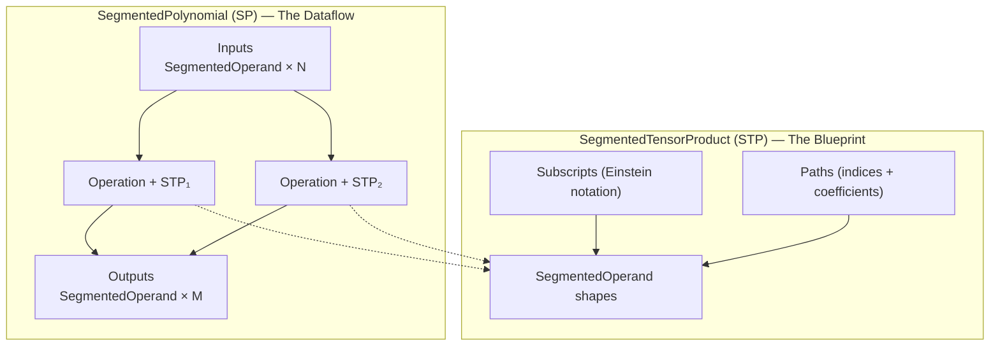
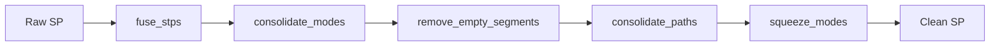

A **Segmented Polynomial (SP)** is the executable dataflow layer of cuEquivariance — it wires mathematical blueprints (`SegmentedTensorProduct`) to real input and output tensors through a graph of operations. While the STP defines *what* to compute, the SP defines *how data flows* between those computations. This page covers the core `SegmentedPolynomial` abstraction, its construction, transformation pipeline, and execution strategies.

## The STP–SP Relationship

The architecture separates two concerns cleanly: mathematical specification and data routing. A `SegmentedTensorProduct` (STP) is a purely symbolic object — it describes contraction patterns, subscripts, paths, and coefficients but holds no data. A `SegmentedPolynomial` (SP) is the execution graph that binds one or more STPs to concrete input/output operands through wiring instructions called `Operation` objects.



The SP is **group-theory agnostic** — it operates on segmented tensors regardless of whether they carry irreducible representation structure. This generality is what allows the same polynomial machinery to power SO(3) equivariant models, O(3) models, and even non-equivariant tensor operations.

## Core Data Structures

### SegmentedPolynomial

The central class is an immutable frozen dataclass defined at [segmented_polynomial.py#L34-L51](cuequivariance/cuequivariance/segmented_polynomials/segmented_polynomial.py#L34-L51). It holds three fields:

| Field | Type | Purpose |
|-------|------|---------|
| `inputs` | `tuple[SegmentedOperand, ...]` | Shape descriptors for all input tensors |
| `outputs` | `tuple[SegmentedOperand, ...]` | Shape descriptors for all output tensors |
| `operations` | `tuple[tuple[Operation, SegmentedTensorProduct], ...]` | Ordered list of (wiring, math) pairs |

During construction ([`__init__`](cuequivariance/cuequivariance/segmented_polynomials/segmented_polynomial.py#L57-L89)), the initializer validates that every `Operation`'s buffer indices reference valid operands and that all STP operands match the corresponding `SegmentedOperand`. Operations are then **sorted by output buffer ID**, ensuring deterministic ordering regardless of insertion sequence.

### Operation

The [`Operation`](cuequivariance/cuequivariance/segmented_polynomials/operation.py#L50-L73) class is the wiring descriptor. It maps each STP operand to a global buffer index using a tuple of integers. For example, `Operation((0, 0, 1))` means: STP operand 0 reads from global input 0, STP operand 1 reads from global input 0 (reuse), and STP operand 2 writes to global output buffer 1. The class provides methods for permuting operands, extracting input/output buffers, and computing AD derivatives (`jvp`, `transpose`).

### SegmentedOperand

A [`SegmentedOperand`](cuequivariance/cuequivariance/segmented_polynomials/segmented_operand.py#L24-L28) describes the shape structure of a tensor. Each operand contains a tuple of segment shapes — the tensor is logically divided into segments, each with its own multi-dimensional shape. This is critical because equivariant tensor products naturally produce outputs with heterogeneous segment dimensions (e.g., different irreps have different dimensionalities). Key properties include [`all_same_segment_shape()`](cuequivariance/cuequivariance/segmented_polynomials/segmented_operand.py#L190-L192) for detecting the high-performance uniform case, [`segment_shape`](cuequivariance/cuequivariance/segmented_polynomials/segmented_operand.py#L194-L199) for accessing uniform dimensions, and [`slice_by_segment`](cuequivariance/cuequivariance/segmented_polynomials/segmented_operand.py#L226-L228) for operand splitting.

## Constructing Polynomials

### Direct Construction

The most explicit construction pattern pairs STPs with operations:

```python
import cuequivariance as cue

stp = cue.SegmentedTensorProduct.from_subscripts("i,j,ij")
stp.add_segment(0, (3,))    # Left operand shape
stp.add_segment(1, (3,))    # Right operand shape
stp.add_segment(2, (3, 3))  # Output segment shape
stp.add_path(0, 0, 0, c=1.0)

sp = cue.SegmentedPolynomial(
    inputs=[stp.operands[0]],
    outputs=[stp.operands[2]],
    operations=[(cue.Operation([0, 0, 1]), stp)]
)
```

The `Operation([0, 0, 1])` wires global input 0 to both STP operands 0 and 1, creating a quadratic (squaring) function from a binary tensor product — this is the "wiring reuse" pattern that makes polynomials possible.

### Factory Methods

| Method | Purpose | Source |
|--------|---------|--------|
| [`eval_last_operand(stp)`](cuequivariance/cuequivariance/segmented_polynomials/segmented_polynomial.py#L150-L164) | Direct evaluation: all STP operands except the last are inputs, the last is the output | Simplest construction |
| [`stack(polys, stacked)`](cuequivariance/cuequivariance/segmented_polynomials/segmented_polynomial.py#L167-L233) | Combine multiple SPs by stacking specified operands, auto-fusing STPs | Merging descriptor degrees |
| [`stack_tensor_products(inputs, outputs, operations)`](cuequivariance/cuequivariance/segmented_polynomials/segmented_polynomial.py#L235-L261) | Wrap multiple STPs into a single SP, auto-inferring shared operands | Tensor product assembly |
| [`concatenate(inputs, outputs, polys)`](cuequivariance/cuequivariance/segmented_polynomials/segmented_polynomial.py#L263-L308) | Join SPs with explicit operand mapping | Multi-output pipelines |

The [`stack`](cuequivariance/cuequivariance/segmented_polynomials/segmented_polynomial.py#L167-L233) method is particularly powerful for descriptor construction — it merges multiple polynomials (e.g., spherical harmonics at different degrees) by stacking specified operands while sharing others. The resulting SP automatically calls [`.consolidate()`](cuequivariance/cuequivariance/segmented_polynomials/segmented_polynomial.py#L646-L659) which fuses STPs with identical operations and removes empty segments.

### The `_from_default_operands` Pattern

The classmethod [`_from_default_operands`](cuequivariance/cuequivariance/segmented_polynomials/segmented_polynomial.py#L91-L108) accepts `None` placeholders in the inputs/outputs lists. When an operand is `None`, the constructor infers its shape from the first STP operation that references it. This pattern is used internally by `stack_tensor_products` and by the [`apply_fn`](cuequivariance/cuequivariance/segmented_polynomials/segmented_polynomial.py#L590-L611) transformation method to allow STP-level transformations to reshape operands transparently.

## The Dataflow Representation

When you print a `SegmentedPolynomial`, the `__repr__` method produces a structured diagram ([`__repr__`](cuequivariance/cuequivariance/segmented_polynomials/segmented_polynomial.py#L314-L335)):

```
╭ a=[3:3⨯()] -> B=[20:20⨯()]
│  []·a[]➜B[] ───────── num_paths=3
│  []·a[]·a[]➜B[] ───── num_paths=22
╰─ []·a[]·a[]·a[]➜B[] ─ num_paths=41
```

Each line represents one `(Operation, STP)` pair. The bracket notation `[3:3⨯()]` encodes `total_size:num_segments⨯(segment_shape)`. The `num_paths` count indicates the number of non-zero contraction paths in each STP, which directly affects computational cost. Lower-case letters (`a`, `b`, `c`) denote inputs; upper-case letters (`B`, `C`) denote outputs. When an STP operand shares a buffer (appears twice in the operation), it means the same input feeds into multiple STP slots — this is how polynomials achieve higher degrees.

For visual inspection, the [`visualize_polynomial`](cuequivariance/cuequivariance/segmented_polynomials/visualization.py#L25-L29) function generates a Graphviz diagram with blue input nodes, yellow computation nodes, and green output nodes.

## Transformation Pipeline

The SP supports a rich set of algebraic transformations, all of which return new immutable instances. These form a pipeline commonly applied during descriptor construction and optimization.

### Operand-Level Transformations

[`permute_inputs`](cuequivariance/cuequivariance/segmented_polynomials/segmented_polynomial.py#L522-L553) and [`permute_outputs`](cuequivariance/cuequivariance/segmented_polynomials/segmented_polynomial.py#L555-L588) reorder the global operand slots, remapping all operation buffer indices accordingly. [`split_operand_by_segment`](cuequivariance/cuequivariance/segmented_polynomials/segmented_polynomial.py#L777-L858) and [`split_operand_by_size`](cuequivariance/cuequivariance/segmented_polynomials/segmented_polynomial.py#L860-L902) break a single operand into multiple operands at segment or byte boundaries, expanding operations through Cartesian products of split indices.

### STP-Level Transformations

[`fuse_stps`](cuequivariance/cuequivariance/segmented_polynomials/segmented_polynomial.py#L613-L644) merges operations that share identical wiring and subscript structure by concatenating their paths. [`flatten_modes`](cuequivariance/cuequivariance/segmented_polynomials/segmented_polynomial.py#L661-L674) and [`squeeze_modes`](cuequivariance/cuequivariance/segmented_polynomials/segmented_polynomial.py#L688-L709) reshape the multi-dimensional segments. [`symmetrize_for_identical_operands`](cuequivariance/cuequivariance/segmented_polynomials/segmented_polynomial.py#L739-L757) expands the path set to explicitly represent permutations among operands that share the same buffer — essential before JVP computation to enable symmetry-based simplification.

### The Consolidation Pipeline

The most commonly invoked transformation is [`consolidate()`](cuequivariance/cuequivariance/segmented_polynomials/segmented_polynomial.py#L646-L659), which chains four operations: `fuse_stps` → `apply_fn(consolidate_modes, remove_empty_segments, consolidate_paths)` → `squeeze_modes`. This pipeline is called automatically by `stack()` and should be applied whenever polynomials are combined or filtered.



### Filtering

Four methods control which parts of the polynomial are retained:

| Method | Scope | Behavior |
|--------|-------|----------|
| [`filter_keep_operands(keep)`](cuequivariance/cuequivariance/segmented_polynomials/segmented_polynomial.py#L908-L954) | All operands | Raises error if a kept output depends on a dropped input |
| [`filter_keep_outputs(keep)`](cuequivariance/cuequivariance/segmented_polynomials/segmented_polynomial.py#L956-L966) | Outputs only | Always keeps all inputs |
| [`filter_drop_unused_operands()`](cuequivariance/cuequivariance/segmented_polynomials/segmented_polynomial.py#L968-L974) | Automatic | Removes any operand not referenced by any operation |
| [`compute_only(keep)`](cuequivariance/cuequivariance/segmented_polynomials/segmented_polynomial.py#L976-L997) | Outputs only | Keeps all operands but skips computations for non-selected outputs |

The distinction between `filter_keep_outputs` and `compute_only` is subtle but important: `compute_only` retains the full operand structure (useful for shape compatibility) while simply omitting unnecessary STP evaluations; `filter_keep_outputs` physically removes unused operands.

> [!TIP]
> When building equivariant models, `filter_drop_unused_operands()` is your friend after concatenating multiple descriptor polynomials. It removes ghost operands that were part of the intermediate construction but never participate in actual computation, reducing both memory footprint and dispatch complexity.

## Automatic Differentiation

The SP natively supports automatic differentiation through three methods that generate *new polynomials* representing derivative computations. These are not numerical approximations — they are exact symbolic transformations of the dataflow graph.

### Forward Mode: JVP

[`jvp(has_tangent)`](cuequivariance/cuequivariance/segmented_polynomials/segmented_polynomial.py#L1003-L1055) computes the Jacobian-vector product. The method first symmetrizes the polynomial to identify structural redundancies, then for each operation, generates derivative operations by replacing one input buffer at a time with its tangent. The key optimization is [`group_by_operational_symmetries`](cuequivariance/cuequivariance/segmented_polynomials/operation.py#L293-L315), which groups JVP operations that are equivalent under STP permutation symmetries, replacing them with a single representative scaled by the group multiplicity.

The returned `mapping` function transforms `(inputs, outputs)` into the expanded `(inputs + tangents, gradient_outputs)` format expected by the JVP polynomial.

### Reverse Mode: Transpose and Backward

[`transpose(is_undefined_primal, has_cotangent)`](cuequivariance/cuequivariance/segmented_polynomials/segmented_polynomial.py#L1057-L1100) reverses the dataflow: cotangents (output gradients) become inputs, and undefined primals (tensors requiring gradients) become outputs. Each operation's transpose is computed by the [`Operation.transpose`](cuequivariance/cuequivariance/segmented_polynomials/operation.py#L149-L226) method, which swaps primal/cotangent roles in the buffer mapping.

[`backward(requires_gradient, has_cotangent)`](cuequivariance/cuequivariance/segmented_polynomials/segmented_polynomial.py#L1102-L1133) composes JVP and transpose into a complete backward pass: it first linearizes the forward computation via JVP, then transposes the result. The composition of the two mapping functions produces the full primal→gradient transformation.

## Execution Methods

The reference implementation in [`__call__`](cuequivariance/cuequivariance/segmented_polynomials/segmented_polynomial.py#L383-L410) uses NumPy via [`compute_last_operand`](cuequivariance/cuequivariance/segmented_polynomials/evaluate.py#L25-L30), which iterates over paths and performs sparse contractions. For production use, framework-specific backends provide optimized execution.

### JAX Execution

The JAX backend exposes [`segmented_polynomial()`](cuequivariance_jax/cuequivariance_jax/segmented_polynomials/segmented_polynomial.py#L51-L62) as the primary entry point. It registers as a custom JAX primitive ([`segmented_polynomial_p`](cuequivariance_jax/cuequivariance_jax/segmented_polynomials/segmented_polynomial.py#L334)) with full support for `jit`, `grad`, `vmap`, and dead code elimination. The `method` parameter (required since v0.6.0) selects the execution strategy:

| Method | Description | When to Use |
|--------|-------------|-------------|
| `"naive"` | Pure JAX implementation using `jax.numpy` and `einsum` ([segmented_polynomial_naive.py](cuequivariance_jax/cuequivariance_jax/segmented_polynomials/segmented_polynomial_naive.py#L39-L48)) | Testing, debugging, any polynomial shape |
| `"uniform_1d"` | CUDA-optimized for polynomials where all operands have uniform 1D segments ([segmented_polynomial_uniform_1d.py](cuequivariance_jax/cuequivariance_jax/segmented_polynomials/segmented_polynomial_uniform_1d.py#L35-L43)) | Standard equivariant layers (highest performance) |
| `"indexed_linear"` | CUDA-optimized for linear layers with per-partition weight indexing ([segmented_polynomial_indexed_linear.py](cuequivariance_jax/cuequivariance_jax/segmented_polynomials/segmented_polynomial_indexed_linear.py#L42-L52)) | Message-passing with partitioned weights |

### Indexing Support

The JAX backend supports advanced indexing through the `indices` parameter. Each buffer can be associated with per-axis index arrays, enabling sparse message passing patterns common in graph neural networks. Three indexing modes are distinguished by the [`IndexingMode`](cuequivariance_jax/cuequivariance_jax/segmented_polynomials/indexing_mode.py#L18-L26) enum:

- **`BATCHED_OR_SHARED`**: The dimension is a standard batch dimension (no index needed)
- **`INDEXED`**: The dimension uses an index array for gather/scatter operations
- **`REPEATED`**: The dimension uses a `cuex.Repeats(counts)` object for partitioned replication

> [!TIP]
> The `"uniform_1d"` method delivers the highest throughput for standard equivariant polynomial layers. Before using it, verify that `all(op.all_same_segment_shape() and op.ndim <= 1 for op in sp.operands)` returns `True`. If your polynomial has non-uniform or multi-dimensional segments, fall back to `"naive"` or restructure the computation.

## Computational Analysis

Two methods provide cost estimation before execution. [`flop(batch_size)`](cuequivariance/cuequivariance/segmented_polynomials/segmented_polynomial.py#L489-L502) sums floating-point operations across all operations, scaling by batch size. [`memory(batch_sizes)`](cuequivariance/cuequivariance/segmented_polynomials/segmented_polynomial.py#L504-L516) computes total element count given per-operand batch dimensions. The `used_inputs()`, `used_outputs()`, and `used_operands()` methods identify which buffers participate in computation — useful for memory planning and dead code elimination.

The `__mul__` operator scales all STP coefficients uniformly, producing a new polynomial — this is a scalar multiplication on the mathematical function the polynomial represents.

## Where to Go Next

Segmented polynomials are the execution backbone that powers both the descriptor system and the full equivariant polynomial hierarchy. To continue exploring:

- **[Segmented Tensor Products](6-segmented-tensor-products)** — Understand the STP mathematical blueprint that each operation references
- **[Equivariant Polynomial Hierarchy](8-equivariant-polynomial-hierarchy)** — See how SPs are composed into multi-body equivariant polynomials
- **[JAX Segmented Polynomial Variants](17-jax-segmented-polynomial-variants)** — Deep dive into the JAX execution methods and their performance characteristics
- **[PyTorch Segmented Polynomial Module](12-pytorch-segmented-polynomial-module)** — PyTorch-specific execution including the `"fused_tp"` CUDA kernel method