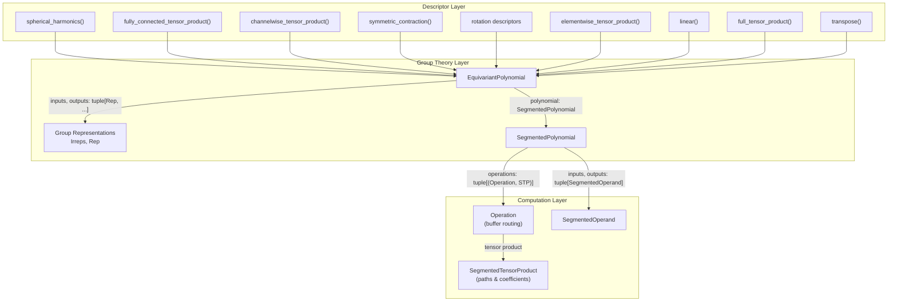
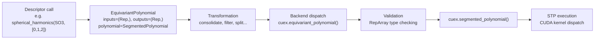

This page maps the architectural layers that connect abstract group-theoretic constraints to concrete GPU-accelerated computation in cuEquivariance. Understanding this hierarchy is essential for anyone who needs to construct custom equivariant operations, compose existing descriptors, or extend the framework with new backends. The hierarchy spans three levels—**descriptors**, the **`EquivariantPolynomial` wrapper**, and the underlying **`SegmentedPolynomial` engine**—each with distinct responsibilities and interfaces.

## The Three-Layer Architecture

The equivariant polynomial hierarchy is not a deep inheritance tree. Rather, it is a layered composition where each tier adds a specific capability: group-aware metadata, operand management, or raw tensor computation. The top layer (`EquivariantPolynomial`) wraps the middle layer (`SegmentedPolynomial`), which itself wraps the bottom layer (`SegmentedTensorProduct`). Descriptors sit above all three as factory functions that produce fully-configured `EquivariantPolynomial` instances.



Sources: [equivariant_polynomial.py](cuequivariance/cuequivariance/group_theory/equivariant_polynomial.py#L28-L46), [segmented_polynomial.py](cuequivariance/cuequivariance/segmented_polynomials/segmented_polynomial.py#L34-L52), [__init__.py](cuequivariance/cuequivariance/__init__.py#L41-L58)

## EquivariantPolynomial: The Group-Aware Wrapper

`EquivariantPolynomial` is the primary user-facing abstraction for equivariant operations. It is an **immutable frozen dataclass** that pairs group-theoretic metadata (`inputs` and `outputs` as tuples of `cue.Rep` objects) with a concrete `SegmentedPolynomial` that defines the actual computation. The class validates dimensional consistency at construction time: every operand's size must exactly match its corresponding representation's dimensionality (`rep.dim`) [equivariant_polynomial.py](cuequivariance/cuequivariance/group_theory/equivariant_polynomial.py#L71-L74).

The dataclass holds exactly three fields:

| Field | Type | Purpose |
|-------|------|---------|
| `inputs` | `tuple[cue.Rep, ...]` | Group representations for each input tensor |
| `outputs` | `tuple[cue.Rep, ...]` | Group representations for each output tensor |
| `polynomial` | `SegmentedPolynomial` | Underlying computation graph of operations and tensor products |

Its interface mirrors `SegmentedPolynomial` closely—every transformation method (`consolidate`, `fuse_stps`, `symmetrize_for_identical_operands`, `squeeze_modes`, `flatten_modes`, etc.) delegates directly to the wrapped polynomial and re-wraps the result with the same `inputs` and `outputs` tuples. This delegation pattern means the group-theoretic layer is transparent to structural transformations [equivariant_polynomial.py](cuequivariance/cuequivariance/group_theory/equivariant_polynomial.py#L296-L420).

The `__repr__` output provides a compact ASCII visualization. For example, spherical harmonics of degrees 0, 1, and 2 from an SO(3) vector (`irrep 1`) renders as:

```
╭ a=1 -> B=0+1+2
│  []➜B[] ───────── num_paths=1
│  []·a[]➜B[] ───── num_paths=3
╰─ []·a[]·a[]➜B[] ─ num_paths=11
```

Each line represents one operation (one degree of the polynomial), where `[]·a[]·a[]➜B[]` means "constant times vector squared yields output", and `num_paths` counts the linearly independent paths in the corresponding `SegmentedTensorProduct`.

Sources: [equivariant_polynomial.py](cuequivariance/cuequivariance/group_theory/equivariant_polynomial.py#L28-L182), [segmented_polynomial.py](cuequivariance/cuequivariance/segmented_polynomials/segmented_polynomial.py#L314-L381)

## SegmentedPolynomial: The Computation Graph

`SegmentedPolynomial` is the structural backbone of every equivariant operation. It is also an immutable frozen dataclass that defines a **DAG of operations**: a sequence of `(Operation, SegmentedTensorProduct)` pairs where each operation specifies which operands (inputs and intermediate buffers) participate and `SegmentedTensorProduct` defines how those operands are combined through weighted paths.

The three fields of `SegmentedPolynomial` are:

| Field | Type | Purpose |
|-------|------|---------|
| `inputs` | `tuple[SegmentedOperand, ...]` | Segment-structured input operands |
| `outputs` | `tuple[SegmentedOperand, ...]` | Segment-structured output operands |
| `operations` | `tuple[tuple[Operation, SegmentedTensorProduct], ...]` | Ordered computation steps |

Operations are **sorted by output buffer index** at construction time, which guarantees that intermediate results are computed before they are consumed by subsequent operations. The `Operation` class encodes a buffer routing map—essentially a permutation that specifies which operand slots (inputs, intermediate buffers, and outputs) are read and written by each step [segmented_polynomial.py](cuequivariance/cuequivariance/segmented_polynomials/segmented_polynomial.py#L57-L89).

> [!TIP]
> `SegmentedPolynomial` is callable via `__call__` with raw NumPy arrays, providing a **reference implementation** for testing and validation. This NumPy evaluation sequentially computes each operation's tensor product and accumulates into the output buffers. Production code uses the JAX or PyTorch backends instead, which dispatch to optimized CUDA primitives [segmented_polynomial.py](cuequivariance/cuequivariance/segmented_polynomials/segmented_polynomial.py#L383-L410).

### Key Transformation and Filtering Methods

The `SegmentedPolynomial` API provides a rich set of structural manipulation methods that `EquivariantPolynomial` re-exports. These fall into several categories:

**Consolidation and fusion** — `consolidate()` chains together `fuse_stps()`, empty-segment removal, and mode squeezing to produce a minimal canonical form. `fuse_stps()` merges tensor products that share identical operations and operand structures by combining their paths [segmented_polynomial.py](cuequivariance/cuequivariance/segmented_polynomials/segmented_polynomial.py#L613-L659).

**Symmetrization** — `symmetrize_for_identical_operands()` expands paths to account for permutation symmetries when the same buffer appears in multiple operand positions. The inverse `unsymmetrize_for_identical_operands()` removes redundant paths to reduce computation [segmented_polynomial.py](cuequivariance/cuequivariance/segmented_polynomials/segmented_polynomial.py#L739-L775).

**Operand splitting** — `split_operand_by_size()` and `split_operand_by_segment()` decompose a single operand into multiple operands along segment boundaries, enabling fine-grained computation of specific irreps or channels [segmented_polynomial.py](cuequivariance/cuequivariance/segmented_polynomials/segmented_polynomial.py#L777-L902).

**Filtering** — `filter_keep_outputs()` produces a polynomial that computes only a selected subset of outputs while automatically dropping any operations that write to removed outputs. `compute_only()` is similar but retains all operands in the signature (useful for shape compatibility). `filter_drop_unused_operands()` removes any operand not referenced by any operation [segmented_polynomial.py](cuequivariance/cuequivariance/segmented_polynomials/segmented_polynomial.py#L908-L997).

**Composition** — `stack()` and `concatenate()` combine multiple polynomials into one. `stack()` vertically concatenates shared operands and re-indexes segments, while `concatenate()` provides explicit mapping of operand indices between the original and combined polynomials [segmented_polynomial.py](cuequivariance/cuequivariance/segmented_polynomials/segmented_polynomial.py#L167-L308).

Sources: [segmented_polynomial.py](cuequivariance/cuequivariance/segmented_polynomials/segmented_polynomial.py#L34-L1134)

## The Descriptor System: Factory Functions

Descriptors are the entry point for constructing `EquivariantPolynomial` instances. Every descriptor function in `cuequivariance.descriptors` returns an `EquivariantPolynomial` that is mathematically guaranteed to be equivariant with respect to the specified group. They are organized by the type of operation they describe.

### Rotation and Geometry Descriptors

These descriptors encode rotation-equivariant operations that are fundamental to 3D equivariant models:

| Descriptor | Signature | Purpose |
|------------|-----------|---------|
| `spherical_harmonics` | `(ir_vec, ls, layout)` | Compute spherical harmonics up to specified degrees from a 3D vector |
| `fixed_axis_angle_rotation` | `(irreps, axis, angle)` | Rotate irreps by a known angle around a known axis |
| `y_rotation` / `x_rotation` | `(irreps, lmax)` | Rotation around a single axis parameterized by an angle |
| `xy_rotation` / `yx_rotation` | `(irreps, lmax)` | Two-axis rotation compositions |
| `yxy_rotation` | `(irreps, lmax)` | Euler-angle rotation (Y-X-Y convention) |
| `inversion` | `(irreps)` | Parity inversion (reflection through the origin) |

Sources: [rotations.py](cuequivariance/cuequivariance/group_theory/descriptors/rotations.py#L22-L253), [spherical_harmonics_.py](cuequivariance/cuequivariance/group_theory/descriptors/spherical_harmonics_.py#L23-L26)

### Tensor Product Descriptors

These define the core equivariant tensor products used in message-passing and feature mixing:

| Descriptor | Signature | Purpose |
|------------|-----------|---------|
| `fully_connected_tensor_product` | `(irreps1, irreps2, irreps3)` | Full TP between all irrep pairs (NequIP-style) |
| `channelwise_tensor_product` | `(irreps1, irreps2, irreps3_filter)` | TP with channel/multiplicity alignment (MACE-style) |
| `elementwise_tensor_product` | `(irreps1, irreps2, irreps3_filter)` | Element-wise TP requiring matching multiplicities |
| `full_tensor_product` | `(irreps1, irreps2, irreps3_filter)` | Simplified full TP without layout alignment |
| `linear` | `(irreps_in, irreps_out)` | Linear equivariant transformation |

Sources: [irreps_tp.py](cuequivariance/cuequivariance/group_theory/descriptors/irreps_tp.py#L22-L348)

### Contraction Descriptors

| Descriptor | Signature | Purpose |
|------------|-----------|---------|
| `symmetric_contraction` | `(irreps_in, irreps_out, degrees)` | MACE-style body-ordered equivariant contraction |
| `transpose` | — | Transposition descriptor for layer norm and related operations |

Sources: [symmetric_contractions.py](cuequivariance/cuequivariance/group_theory/descriptors/symmetric_contractions.py#L20-L62), [__init__.py](cuequivariance/cuequivariance/group_theory/descriptors/__init__.py#L1-L53)

## Backend Dispatch: From Descriptor to GPU Kernel

Once an `EquivariantPolynomial` is constructed via a descriptor, it is evaluated through backend-specific functions that unwrap the group-aware layer and execute the underlying `SegmentedPolynomial` on hardware.

### JAX Backend

The JAX entry point is `cuex.equivariant_polynomial()` in [equivariant_polynomial.py](cuequivariance_jax/cuequivariance_jax/equivariant_polynomial.py#L25-L38). This function performs three key tasks before delegation:

1. **Type validation** — Each input is checked against the expected `cue.Rep`. Non-scalar inputs must be `cuex.RepArray` instances; bare `jax.Array` inputs are only accepted for scalar representations [equivariant_polynomial.py](cuequivariance_jax/cuequivariance_jax/equivariant_polynomial.py#L83-L93).

2. **Shape inference** — When `outputs_shape_dtype` is `None`, the function broadcasts input batch shapes to infer output shapes. If output indices are provided (scatter mode), shape specification becomes mandatory [equivariant_polynomial.py](cuequivariance_jax/cuequivariance_jax/equivariant_polynomial.py#L99-L115).

3. **Delegation and re-wrapping** — The raw `jax.Array` inputs are passed to `cuex.segmented_polynomial()`, and the resulting arrays are wrapped back into `cuex.RepArray` objects with the corresponding output representations [equivariant_polynomial.py](cuequivariance_jax/cuequivariance_jax/equivariant_polynomial.py#L133-L136).

### PyTorch Backend

The PyTorch backend provides module-level layers (in `cuequivariance_torch/layers/`) that encapsulate descriptor construction, weight management, and kernel dispatch. These modules accept descriptor configuration at initialization and manage the full lifecycle of polynomial evaluation during training.

Sources: [equivariant_polynomial.py](cuequivariance_jax/cuequivariance_jax/equivariant_polynomial.py#L25-L203)

## Automatic Differentiation Through the Hierarchy

The hierarchy supports both forward-mode (JVP) and reverse-mode (transpose/backward) automatic differentiation at the polynomial descriptor level. These methods transform the polynomial's structure to produce a **new polynomial** that computes derivatives, rather than relying on framework-level autodiff alone.

| Method | Level | Purpose |
|--------|-------|---------|
| `jvp(has_tangent)` | Both | Produces a polynomial that computes forward-mode Jacobian-vector products by adding tangent inputs alongside primal inputs |
| `transpose(is_undefined_primal, has_cotangent)` | Both | Produces a transposed polynomial for VJP computation by reversing data flow through operations |
| `backward(requires_gradient, has_cotangent)` | Both | Chains `jvp` and `transpose` to produce the full backward-pass polynomial |

Each method returns a **mapping function** alongside the transformed polynomial. This mapping function converts the original `(inputs, outputs)` lists into the augmented lists required by the differentiated polynomial (e.g., interleaving tangents with primals for JVP, or concatenating cotangents for transpose) [equivariant_polynomial.py](cuequivariance/cuequivariance/group_theory/equivariant_polynomial.py#L566-L622), [segmented_polynomial.py](cuequivariance/cuequivariance/segmented_polynomials/segmented_polynomial.py#L1003-L1133).

> [!TIP]
> The JVP implementation first calls `symmetrize_for_identical_operands()` before differentiating. This is critical because it exposes permutation symmetries in the paths, allowing the `group_by_operational_symmetries` pass to identify redundant computations and apply multiplicative factors instead of duplicating paths—reducing the cost of the differentiated polynomial [segmented_polynomial.py](cuequivariance/cuequivariance/segmented_polynomials/segmented_polynomial.py#L1023-L1033).

## Putting It All Together

The following diagram traces the full lifecycle from descriptor construction to GPU execution:



For a deeper understanding of the computational substrate, proceed to [Segmented Tensor Products](6-segmented-tensor-products). To see how specific descriptors produce polynomials for real-world models, consult [Tensor Product Descriptors](9-tensor-product-descriptors) and [Spherical Harmonics Descriptors](10-spherical-harmonics-descriptors). For backend-specific usage patterns, see the [JAX Equivariant Polynomial](16-jax-equivariant-polynomial) and [PyTorch Segmented Polynomial Module](12-pytorch-segmented-polynomial-module) pages.