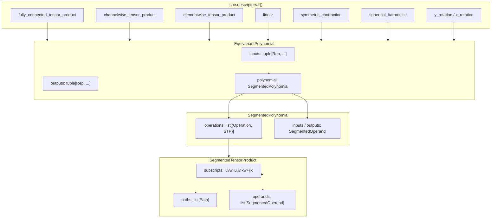
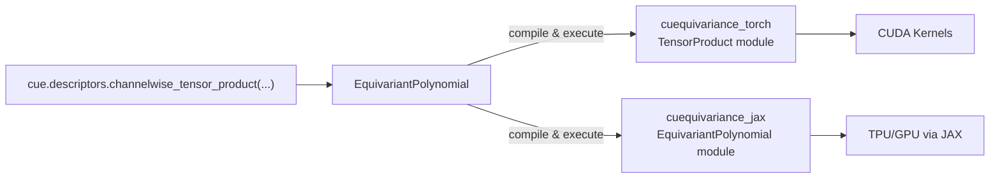

Tensor product descriptors are the entry point for constructing equivariant operations in cuEquivariance. Each descriptor is a factory function in the `cue.descriptors` namespace that produces an `EquivariantPolynomial` — a typed blueprint encoding the exact contraction pattern, coefficient layout, and group-theoretic constraints of an operation, ready for execution by any backend. This page maps the complete descriptor API, explains the underlying construction pattern, and shows how descriptors relate to the [Segmented Tensor Products](6-segmented-tensor-products) and [Segmented Polynomials](7-segmented-polynomials) layers beneath them.

## Architecture: From Group Theory to Executable Blueprint

Every descriptor follows a three-layer construction pipeline. At the bottom sits `SegmentedTensorProduct` (STP), which knows nothing about symmetry — it is pure segmented linear algebra with subscripts, operands, and paths. The `SegmentedPolynomial` layer composes multiple STPs into a polynomial (e.g., a degree-3 polynomial = three STPs of increasing arity). The `EquivariantPolynomial` layer then annotates each operand with its group-theoretic representation (`IrrepsAndLayout`), producing a descriptor that backends can compile and execute.



All descriptor functions are exported through [`cuequivariance.group_theory.descriptors`](cuequivariance/cuequivariance/group_theory/descriptors/__init__.py#L35-L53) and re-exported at the top-level `cuequivariance` package as `cue.descriptors`. The complete public API includes fifteen factory functions spanning four functional families.

Sources: [__init__.py](cuequivariance/cuequivariance/__init__.py#L1-L96), [descriptors/__init__.py](cuequivariance/cuequivariance/group_theory/descriptors/__init__.py#L35-L53)

## Descriptor Families and Subscript Conventions

Every descriptor is identified by its subscript pattern — an einsum-like string that defines how indices contract across operands. Understanding these subscripts is the key to reading the descriptor output. In the subscript notation, letters before the `+` represent coefficient (free) indices, while letters after `+` represent the summed indices. The last operand in each subscript is always the output.

The following table summarizes the four descriptor families, their subscript patterns, and the role of each operand:

| Family | Function | Subscripts | Operand Roles |
|--------|----------|------------|---------------|
| **Tensor Products** | `fully_connected_tensor_product` | `weights[uvw],lhs[iu],rhs[jv],output[kw]` | weights, input₁, input₂, output |
| | `channelwise_tensor_product` | `weights[uv],lhs[iu],rhs[jv],output[kuv]` | weights, input₁, input₂, output |
| | `elementwise_tensor_product` | `lhs[iu],rhs[ju],output[ku]` | input₁, input₂, output (weightless) |
| | `full_tensor_product` | `lhs[iu],rhs[jv],output[kuv]` | input₁, input₂, output (weightless) |
| **Linear** | `linear` | `weights[uv],input[iu],output[iv]` | weights, input, output |
| **Rotations** | `y_rotation` / `x_rotation` | `angle[],input[u],output[u]` | angle encoding, input, output |
| | `yxy_rotation` | `γ[],β[],α[],input[u],output[u]` | 3 angle encodings, input, output |
| | `fixed_axis_angle_rotation` | `input[u],output[u]` | input, output (no runtime args) |
| **Spherical Harmonics** | `spherical_harmonics` | `vector[],…,vector[],Yl[]` | ℓ copies of 3D vector, output |
| **Symmetric Contractions** | `symmetric_contraction` | `weights[u],input[u]×d,output[u]` | weights, d copies of input, output |
| **Transpose** | `transpose` | `input[ui],output[iu]` or `input[iu],output[ui]` | input, output (layout change) |

Sources: [irreps_tp.py](cuequivariance/cuequivariance/group_theory/descriptors/irreps_tp.py#L22-L348), [rotations.py](cuequivariance/cuequivariance/group_theory/descriptors/rotations.py#L22-L253), [spherical_harmonics_.py](cuequivariance/cuequivariance/group_theory/descriptors/spherical_harmonics_.py#L23-L122), [symmetric_contractions.py](cuequivariance/cuequivariance/group_theory/descriptors/symmetric_contractions.py#L20-L133)

## Irreducible Tensor Product Descriptors

The tensor product family lives in [`irreps_tp.py`](cuequivariance/cuequivariance/group_theory/descriptors/irreps_tp.py) and provides four descriptor factories for different sparsity patterns of Clebsch-Gordan coupling between irreps. Each function accepts `Irreps` arguments and returns an `EquivariantPolynomial`.

### Fully Connected Tensor Product

`fully_connected_tensor_product(irreps1, irreps2, irreps3)` is the densest variant. It iterates over every triple of irrep segments from the three operands, checks the Clebsch-Gordan selection rule (`ir3 ∈ ir1 × ir2`), and inserts a path with the CG coefficient for every valid coupling. The result is a weight-dominated operation where `weights` has dimensions `(len(irreps1), len(irreps2), len(irreps3))`, enabling every output channel to mix with every input channel pair. The descriptor normalizes paths against the output operand for numerical stability.

The subscript `weights[uvw],lhs[iu],rhs[jv],output[kw]+ijk` means: index `i` selects a segment from `lhs` (irrep dimension × multiplicity), index `j` selects from `rhs`, index `k` selects from `output`, while indices `u`, `v`, `w` are the free (weight) dimensions indexing channel multiplicity.

```python
cue.descriptors.fully_connected_tensor_product(
    16 * cue.Irreps("SO3", "0 + 1 + 2"),
    16 * cue.Irreps("SO3", "0 + 1 + 2"),
    16 * cue.Irreps("SO3", "0 + 1 + 2"),
)
# ╭ a=61440x0 b=16x0+16x1+16x2 c=16x0+16x1+16x2 -> D=16x0+16x1+16x2
# ╰─ [ijk]·a[uvw]·b[iu]·c[jv]➜D[kw] ─ num_paths=15 i={1,3,5} j={1,3,5} k={1,3,5} u=16 v=16 w=16
```

Sources: [irreps_tp.py L22-L86](cuequivariance/cuequivariance/group_theory/descriptors/irreps_tp.py#L22-L86)

### Channelwise Tensor Product

`channelwise_tensor_product(irreps1, irreps2, irreps3_filter=None, simplify_irreps3=False)` is the workhorse of equivariant architectures like MACE. Unlike the fully connected variant, weights have shape `(len(irreps1), len(irreps2))` — only 2D — meaning output irrep channels are determined by the input irrep pairing, not independently weighted. This drastically reduces parameter count while preserving expressiveness. The `irreps3_filter` parameter allows restricting which output irreps are produced, and `simplify_irreps3=True` flattens coefficient modes and re-groups output segments by irrep type.

The subscript `weights[uv],lhs[iu],rhs[jv],output[kuv]+ijk` shows the critical difference: the output operand has an additional `uv` dimension that is multiplied (not summed) with the weight, making output channels a deterministic function of input channel pairing.

Sources: [irreps_tp.py L149-L228](cuequivariance/cuequivariance/group_theory/descriptors/irreps_tp.py#L149-L228)

### Elementwise Tensor Product

`elementwise_tensor_product(irreps1, irreps2, irreps3_filter=None)` is entirely weightless. Both inputs must have the same number of irrep segments. Internally, it calls `_align_two_irreps` to split multiplicity-mismatched scalar segments so the two operands can be paired one-to-one. Each pair of segments couples through Clebsch-Gordan decomposition to produce output segments with the same multiplicity. This is the operation used in NequIP-style models.

The subscript `lhs[iu],rhs[ju],output[ku]+ijk` shows that multiplicity index `u` is shared across all operands — channels are paired, not mixed.

Sources: [irreps_tp.py L258-L312](cuequivariance/cuequivariance/group_theory/descriptors/irreps_tp.py#L258-L312)

### Linear

`linear(irreps_in, irreps_out)` is the simplest equivariant operation: a block-diagonal linear transformation that only connects segments with identical irrep types (`ir1 == ir2`). The weight tensor has shape `(len(irreps_in), len(irreps_out))` but only diagonal blocks (where both irreps match) have non-zero paths. The subscript `weights[uv],input[iu],output[iv]+uiv` collapses to a simple per-irrep scaled copy.

Sources: [irreps_tp.py L313-L348](cuequivariance/cuequivariance/group_theory/descriptors/irreps_tp.py#L313-L348)

> [!TIP]
> All tensor product descriptors call `normalize_paths_for_operand(-1)` before wrapping into `EquivariantPolynomial`. This scales CG coefficients so the output maintains unit variance when inputs are standard normal — a critical detail for training stability that is easy to overlook when implementing custom descriptors.

## Rotation Descriptors

The rotation family in [`rotations.py`](cuequivariance/cuequivariance/group_theory/descriptors/rotations.py) produces descriptors that apply SO(3)/O(3) rotation matrices to irreps-bearing tensors. These are the building blocks for [Rotation and Symmetric Contraction](11-rotation-and-symmetric-contraction) layers.

### Axis Rotations: y_rotation and x_rotation

`y_rotation(irreps, lmax=None)` constructs a rotation around the y-axis parameterized by a single angle. Rather than storing explicit rotation matrices as data, the angle is encoded as a feature vector of length `2·lmax + 1` with the pattern `[cos(θ·lmax), cos(θ·(lmax-1)), ..., cos(θ), 1, sin(θ), sin(2θ), ..., sin(lmax·θ)]`. The STP then builds paths that pick the correct cosine/sine bands for each irrep's Wigner D-matrix entries. `x_rotation` is implemented by composing `y_rotation` with two fixed π/2 z-rotations using the segmented polynomial dot product.

Sources: [rotations.py L134-L236](cuequivariance/cuequivariance/group_theory/descriptors/rotations.py#L134-L236)

### Composite Rotations: yxy_rotation, xy_rotation, yx_rotation

Composite rotations are built by chaining axis rotations via `cue.segmented_polynomials.dot()`, which performs matrix multiplication at the segmented polynomial level. For example, `yxy_rotation` composes γ-rotation → β-rotation → α-rotation, and then reorders operands so all three angle encodings appear before the input/output. The subscript `γ[],β[],α[],input[u],output[u]` shows the three angle operands as scalar (degree-0) inputs.

`fixed_axis_angle_rotation(irreps, axis, angle)` is the only rotation descriptor that produces a coefficient-only STP (no runtime angle arguments). The rotation matrix for each irrep is precomputed and baked into the coefficient tensor via `ir.rotation(axis, angle).T`.

Sources: [rotations.py L51-L133](cuequivariance/cuequivariance/group_theory/descriptors/rotations.py#L51-L133)

## Spherical Harmonics and Symmetric Contraction Descriptors

### Spherical Harmonics

`spherical_harmonics(ir_vec, ls, layout=cue.ir_mul)` in [`spherical_harmonics_.py`](cuequivariance/cuequivariance/group_theory/descriptors/spherical_harmonics_.py) generates polynomial descriptors that map 3D vectors to spherical harmonic features of specified degrees `ls`. Internally, it uses a recursive SymPy-based algorithm adapted from e3nn-jax to derive exact polynomial formulas via Clebsch-Gordan composition: Y₀ = 1, Y₁ = √3·(x, y, z), and higher orders are built from tensor products of lower orders. When `ls` contains multiple degrees, the function stacks the individual descriptors using `EquivariantPolynomial.stack`, automatically fusing STPs of the same degree.

The subscript `vector[],...,vector[],Yl[]` shows that the output is degree-dependent: Y₀ needs 0 vector inputs, Y₁ needs 1, Y₂ needs 2, etc. The operand symmetry is enforced via `d.symmetrize_operands(range(ell), force=True)`.

Sources: [spherical_harmonics_.py L23-L122](cuequivariance/cuequivariance/group_theory/descriptors/spherical_harmonics_.py#L23-L122)

### Symmetric Contractions

`symmetric_contraction(irreps_in, irreps_out, degrees)` in [`symmetric_contractions.py`](cuequivariance/cuequivariance/group_theory/descriptors/symmetric_contractions.py) produces descriptors for the weightless symmetric contraction used in MACE. Given `degrees=(1, 2, 3)`, the output is a stacked polynomial with three operations: a degree-1 contraction (linear), a degree-2 contraction (input·input), and a degree-3 contraction (input·input·input). Each degree uses the `reduced_symmetric_tensor_product_basis` to compute the unique symmetric coupling paths between input irreps and output irreps. The descriptor is `@cache`-decorated, so repeated calls with identical arguments return the same object without recomputation.

The subscript pattern is `weights[u],input[u]·input[u]…➜output[u]`, where multiplicity `u` is treated in parallel across all degree terms. The weight operand aggregates all degree weights into a single flattened scalar operand.

Sources: [symmetric_contractions.py L20-L133](cuequivariance/cuequivariance/group_theory/descriptors/symmetric_contractions.py#L20-L133)

## Common Patterns Across All Descriptors

### Return Type: EquivariantPolynomial

Every descriptor returns an `EquivariantPolynomial` instance with three fields: `inputs` (a tuple of `Rep` objects), `outputs` (a tuple of `Rep` objects), and `polynomial` (a `SegmentedPolynomial`). The first input operand is always the weight tensor (for weighted descriptors), annotated as `irreps.new_scalars(size)` — meaning it is a collection of that many scalar (degree-0) irreps with no rotational structure. The data operands carry full `IrrepsAndLayout` annotations specifying both the irrep composition and the memory layout (`ir_mul` or `mul_ir`).

Sources: [equivariant_polynomial.py L28-L74](cuequivariance/cuequivariance/group_theory/equivariant_polynomial.py#L28-L74)

### Weight Operand Convention

Weighted descriptors (`fully_connected_tensor_product`, `channelwise_tensor_product`, `linear`, `symmetric_contraction`) always place weights as the first input operand. The weight's total dimension is determined after path construction by inspecting `d.operands[0].size`, and the weight's representation is created as `irreps.new_scalars(size)`. This deferred sizing is important because the number of weight parameters depends on the actual Clebsch-Gordan paths generated, which is not known until construction completes.

Sources: [irreps_tp.py L78-L85](cuequivariance/cuequivariance/group_theory/descriptors/irreps_tp.py#L78-L85)

### Polynomial Wrapping via eval_last_operand

Most descriptors use `SegmentedPolynomial.eval_last_operand(d)` to wrap their STP into a polynomial. This classmethod simply creates a polynomial whose single operation is `[0, 1, 2, ..., n]` (all operands feed into a single STP evaluation) and whose sole output is the STP's last operand. More complex descriptors like `spherical_harmonics` and `symmetric_contraction` build custom `SegmentedPolynomial` instances with explicit `Operation` and `SegmentedOperand` definitions to handle degree-stacking and operand reuse.

Sources: [segmented_polynomial.py L150-L164](cuequivariance/cuequivariance/segmented_polynomials/segmented_polynomial.py#L150-L164)

### Stacking for Multi-Degree Descriptors

Descriptors that naturally produce multiple degrees of polynomial (spherical harmonics, symmetric contractions) use `EquivariantPolynomial.stack(polys, stacked)` to fuse them into a single descriptor. The `stacked` parameter controls which operands are concatenated versus shared. For `spherical_harmonics(cue.SO3(1), [0, 1, 2])`, the vector input is shared (`stacked=[False, True]`) while the output irreps are stacked, producing a single polynomial where Y₀, Y₁, Y₂ are computed in separate STP operations that all read from the same input buffer.

Sources: [equivariant_polynomial.py L118-L171](cuequivariance/cuequivariance/group_theory/equivariant_polynomial.py#L118-L171)

## Descriptor Introspection and Transformation

Once created, an `EquivariantPolynomial` descriptor supports a rich set of inspection and transformation methods before being passed to a backend. These methods operate on the underlying `SegmentedPolynomial` while preserving the type annotations.

| Method | Purpose | Use Case |
|--------|---------|----------|
| `.flop(batch_size)` | Count floating-point operations | Benchmarking different descriptor configurations |
| `.used_inputs()` / `.used_outputs()` | Boolean mask of active operands | Pruning unused inputs before compilation |
| `.filter_keep_outputs(keep)` | Retain only selected output segments | Computing a subset of output irreps |
| `.split_operand_by_irrep(oid)` | Split one operand into per-irrep operands | Enabling separate processing per irrep |
| `.consolidate()` | Remove empty segments, fuse identical STPs | Optimization before backend execution |
| `.flatten_coefficient_modes()` | Flatten coefficient dimensions | Required by some CUDA kernels |
| `.symmetrize_for_identical_operands()` | Expand paths for symmetry | Required preprocessing for JVP/transpose |

Sources: [equivariant_polynomial.py L235-L623](cuequivariance/cuequivariance/group_theory/equivariant_polynomial.py#L235-L623)

## From Descriptor to Execution

Descriptors are pure data structures — they contain no backend-specific code. The execution path depends on the target framework:



For PyTorch, the descriptor is passed to modules like `TensorProduct` or `SymmetricContraction` which handle weight initialization, layout conversion, and dispatch to CUDA primitives. For JAX, the `EquivariantPolynomial` class in [`cuequivariance_jax`](cuequivariance_jax/cuequivariance_jax/equivariant_polynomial.py) uses JAX's tracing system to compile the polynomial operations. The descriptor's `IrrepsAndLayout` annotations tell each backend how to interpret the raw tensor dimensions.

## Next Steps

Having understood the descriptor layer, the natural progression is to explore how these descriptors are compiled and executed:

- **[Spherical Harmonics Descriptors](10-spherical-harmonics-descriptors)** — deep dive into the SH descriptor's recursive construction and its role as the geometric input layer
- **[Rotation and Symmetric Contraction](11-rotation-and-symmetric-contraction)** — how rotation descriptors and symmetric contractions compose to form the complete MACE body
- **[PyTorch Segmented Polynomial Module](12-pytorch-segmented-polynomial-module)** — the PyTorch execution layer that consumes these descriptors
- **[Equivariant Polynomial Hierarchy](8-equivariant-polynomial-hierarchy)** — the full `EquivariantPolynomial` → `SegmentedPolynomial` → `SegmentedTensorProduct` class hierarchy