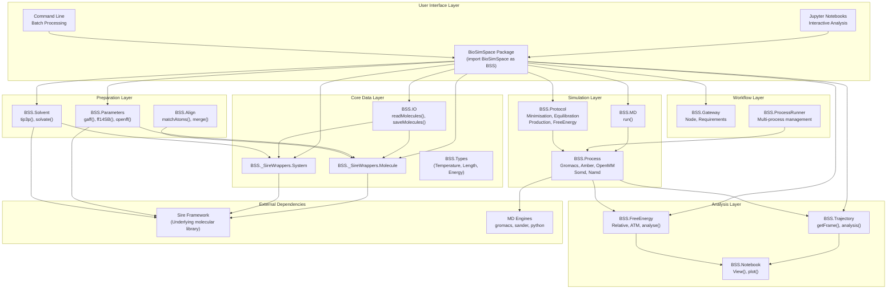
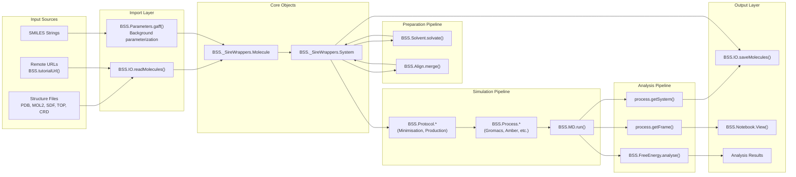

# Overview

<details>
<summary>Relevant source files</summary>

The following files were used as context for generating this wiki page:

- [LICENSE](LICENSE)
- [README.rst](README.rst)
- [actions/update_recipe.py](actions/update_recipe.py)
- [doc/source/code_of_conduct.rst](doc/source/code_of_conduct.rst)
- [doc/source/compatibility.rst](doc/source/compatibility.rst)
- [doc/source/index.rst](doc/source/index.rst)
- [doc/source/install.rst](doc/source/install.rst)
- [doc/source/quickstart/index.rst](doc/source/quickstart/index.rst)
- [doc/source/support.rst](doc/source/support.rst)
- [python/BioSimSpace/Sandpit/Exscientia/_SireWrappers/_utils.py](python/BioSimSpace/Sandpit/Exscientia/_SireWrappers/_utils.py)
- [python/BioSimSpace/_SireWrappers/_utils.py](python/BioSimSpace/_SireWrappers/_utils.py)
- [python/setup.py](python/setup.py)
- [recipes/biosimspace/LICENSE](recipes/biosimspace/LICENSE)
- [recipes/biosimspace/build.sh](recipes/biosimspace/build.sh)
- [recipes/biosimspace/template.yaml](recipes/biosimspace/template.yaml)
- [requirements.txt](requirements.txt)

</details>


## Purpose and Scope

This document provides a comprehensive overview of BioSimSpace, an interoperable Python framework for biomolecular simulation. It covers the core architecture, main components, installation methods, and how the various subsystems work together to provide a unified interface for molecular dynamics simulations.

For detailed information about specific components, see the following related pages:
- For core data structures like `Molecule` and `System` objects, see [Core Data Structures](#2)
- For simulation execution and MD engine integration, see [Simulation Execution](#4)
- For free energy calculation workflows, see [Free Energy Calculations](#5)
- For workflow management and automation, see [Workflow Management](#7)

## What is BioSimSpace

BioSimSpace is an interoperable Python framework for biomolecular simulation that enables users to:

- Write robust and portable biomolecular workflow components that work across different hardware, software packages, and execution environments
- Start, stop, and monitor molecular simulation processes within interactive Python environments
- Use a unified interface to interact with multiple molecular dynamics engines (GROMACS, AMBER, OpenMM, SOMD, NAMD)
- Perform complex workflows like free energy calculations, enhanced sampling, and trajectory analysis

**Core Design Philosophy**: BioSimSpace abstracts away the complexity of different MD engines and file formats, providing a consistent Python API that automatically handles the underlying details of simulation setup, execution, and analysis.

Sources: [README.rst:33-40](), [doc/source/index.rst:21-25]()

## Core Architecture

### High-Level System Architecture



Sources: [README.rst:33-40](), [python/setup.py:25-44](), [doc/source/index.rst:21-28]()

### Data Flow Architecture



Sources: [doc/source/quickstart/index.rst:9-26](), [python/setup.py:109-130]()

## Installation Methods

BioSimSpace provides multiple installation approaches to accommodate different user needs and environments:

| Installation Method | Use Case | Command |
|-------------------|----------|---------|
| **Conda Package** | Production use, easiest setup | `conda create -n openbiosim -c conda-forge -c openbiosim biosimspace` |
| **Development Version** | Latest features, testing | `conda create -n openbiosim-dev -c conda-forge -c openbiosim/label/dev biosimspace` |
| **Web Browser** | No installation, learning | Visit `try.openbiosim.org` |
| **Container** | Isolated environment, reproducibility | `docker run -p 8888:8888 -it openbiosim/biosimspace:latest` |
| **Source Installation** | Development, customization | `git clone` + `pip install -e .` |

**Key Dependencies**: BioSimSpace is built on top of the Sire molecular simulation framework and requires Python 3.8+ with various scientific computing packages defined in `requirements.txt`.

Sources: [README.rst:67-98](), [doc/source/install.rst:42-127](), [requirements.txt:1-31]()

## Quick Start Example

The following example demonstrates the core BioSimSpace workflow:

```python
import BioSimSpace as BSS

# Load molecular system from remote URL
url = BSS.tutorialUrl()
system = BSS.IO.readMolecules([f"{url}/ala.top", f"{url}/ala.crd"])

# Parameterize a molecule with GAFF
molecule = BSS.Parameters.gaff("Cc1ccccc1").getMolecule()

# Solvate in a water box
box, angles = BSS.Box.truncatedOctahedron(35 * BSS.Units.Length.angstrom)
solvated = BSS.Solvent.tip3p(molecule=molecule, box=box, angles=angles)

# Run minimization
protocol = BSS.Protocol.Minimisation(steps=5000)
process = BSS.MD.run(solvated, protocol)
minimised_system = process.getSystem(block=True)

# Save results in multiple formats
BSS.IO.saveMolecules("output", minimised_system, ["pdb", "gro87", "mol2"])
```

This example showcases the key features:
- **Unified I/O**: `BSS.IO.readMolecules()` and `BSS.IO.saveMolecules()` handle multiple file formats automatically
- **Force Field Integration**: `BSS.Parameters.gaff()` applies parameterization with background processing
- **Solvation**: `BSS.Solvent.tip3p()` adds solvent with automatic neutralization
- **Simulation Management**: `BSS.MD.run()` provides a unified interface to any available MD engine
- **Type Safety**: `BSS.Units.Length.angstrom` ensures dimensional consistency

Sources: [doc/source/quickstart/index.rst:7-95]()

## Main Components Overview

### Core Data Structures
- **`BSS._SireWrappers.Molecule`**: Individual molecular entities with atoms, bonds, and properties
- **`BSS._SireWrappers.System`**: Collections of molecules representing complete simulation systems
- **`BSS.Types`**: Physical units system (Temperature, Length, Energy, etc.) ensuring dimensional consistency

### System Preparation
- **`BSS.Parameters`**: Force field application (`gaff()`, `ff14SB()`, `openff()`) with background processing
- **`BSS.Solvent`**: Solvation utilities (`tip3p()`, `solvate()`) with automatic ion placement
- **`BSS.Align`**: Molecular alignment and merging (`matchAtoms()`, `merge()`) for free energy setup

### Simulation Execution  
- **`BSS.Protocol`**: Simulation parameter definitions (Minimisation, Equilibration, Production, FreeEnergy)
- **`BSS.Process`**: Engine-specific interfaces (Gromacs, Amber, OpenMM, Somd, Namd)
- **`BSS.MD`**: Unified simulation launcher (`run()`) with automatic engine selection

### Analysis and Visualization
- **`BSS.Trajectory`**: Trajectory loading and analysis (`getFrame()`, RMSD calculations)  
- **`BSS.FreeEnergy`**: Free energy calculation analysis (Relative, ATM, `analyse()`)
- **`BSS.Notebook`**: Interactive visualization (`View()`, `plot()`) for Jupyter environments

### Workflow Management
- **`BSS.Gateway`**: Reusable workflow nodes with input/output validation
- **`BSS.ProcessRunner`**: Multi-process simulation management and coordination

Each component is designed to work independently while integrating seamlessly with others, following BioSimSpace's philosophy of interoperability and ease of use.

Sources: [python/BioSimSpace/_SireWrappers/_utils.py:1-24](), [python/setup.py:109-130](), [recipes/biosimspace/template.yaml:44-73]()

---