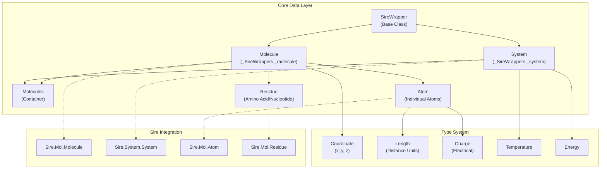
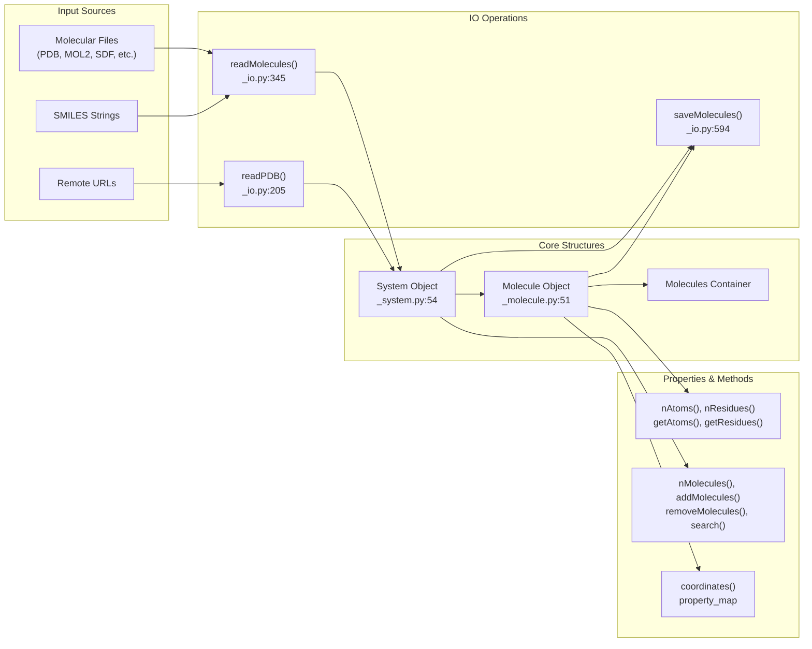
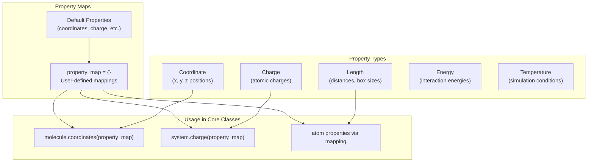
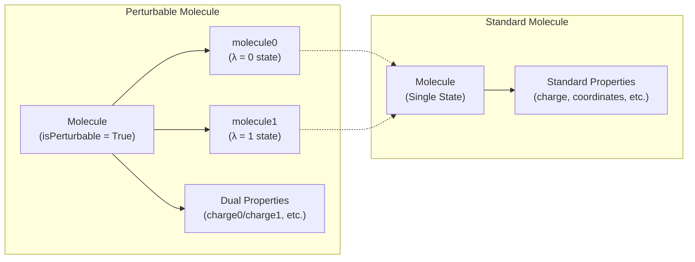

# Core Data Structures

Relevant source files

The following files were used as context for generating this wiki page:

- [python/BioSimSpace/IO/_io.py](python/BioSimSpace/IO/_io.py)
- [python/BioSimSpace/Sandpit/Exscientia/IO/_io.py](python/BioSimSpace/Sandpit/Exscientia/IO/_io.py)
- [python/BioSimSpace/Sandpit/Exscientia/_SireWrappers/_molecule.py](python/BioSimSpace/Sandpit/Exscientia/_SireWrappers/_molecule.py)
- [python/BioSimSpace/Sandpit/Exscientia/_SireWrappers/_system.py](python/BioSimSpace/Sandpit/Exscientia/_SireWrappers/_system.py)
- [python/BioSimSpace/_SireWrappers/_molecule.py](python/BioSimSpace/_SireWrappers/_molecule.py)
- [python/BioSimSpace/_SireWrappers/_system.py](python/BioSimSpace/_SireWrappers/_system.py)

This page documents the fundamental data types that form the backbone of BioSimSpace. These core structures provide the foundation for molecular representation, system manipulation, and data persistence across the entire framework.

For detailed information about molecular force field parameterization, see [System Preparation](#3). For simulation execution workflows, see [Simulation Execution](#4). For input/output file format details, see [IO Operations](#2.3).

## Overview

BioSimSpace's core data structures are built around three primary concepts: individual molecules, collections of molecules (systems), and the input/output operations that enable data persistence. These structures wrap the underlying Sire molecular simulation library while providing a simplified, user-friendly interface.

### Core Class Hierarchy

**Core Class Structure in BioSimSpace**

Sources: [python/BioSimSpace/_SireWrappers/_molecule.py:51-114](), [python/BioSimSpace/_SireWrappers/_system.py:54-154]()

### Data Flow Architecture

**Data Flow from Input to Core Structures**

Sources: [python/BioSimSpace/IO/_io.py:345-592](), [python/BioSimSpace/_SireWrappers/_system.py:555-657]()

## Primary Components

### Molecule Class

The `Molecule` class serves as the fundamental container for individual molecular entities. It wraps Sire's `Mol.Molecule` while providing enhanced functionality for molecular manipulation and analysis.

| Property | Method | Description |
|----------|---------|-------------|
| Atom Count | `nAtoms()` | Returns number of atoms in molecule |
| Residue Count | `nResidues()` | Returns number of residues |
| Chain Count | `nChains()` | Returns number of chains |
| Coordinates | `coordinates(property_map={})` | Gets atomic coordinates |
| Perturbable | `isPerturbable()` | Checks if molecule supports free energy calculations |

Key capabilities include:
- **Atomic Access**: `getAtoms()` and `getResidues()` provide direct access to molecular components
- **Extraction**: `extract(indices)` creates new molecules from atom subsets
- **Compatibility**: `makeCompatibleWith()` aligns molecular properties between different representations
- **Perturbability**: Support for dual-topology molecules in free energy calculations

Sources: [python/BioSimSpace/_SireWrappers/_molecule.py:51-502](), [python/BioSimSpace/_SireWrappers/_molecule.py:220-257]()

### System Class

The `System` class manages collections of molecules, representing complete molecular systems such as solvated proteins or ligand-receptor complexes.

| Operation | Method | Purpose |
|-----------|---------|---------|
| Molecule Management | `addMolecules()`, `removeMolecules()` | System composition control |
| Access | `getMolecule(index)`, `getMolecules()` | Retrieve specific molecules |
| Search | `search(query, property_map={})` | Query-based molecule selection |
| Analysis | `charge()`, `nAtoms()`, `nMolecules()` | System-wide properties |

The system supports:
- **Dynamic Composition**: Add and remove molecules while maintaining consistency
- **Search Functionality**: Complex queries using Sire's selection language
- **Property Aggregation**: Calculate system-wide properties from constituent molecules
- **Comparison**: `isSame()` method for system equivalence testing

Sources: [python/BioSimSpace/_SireWrappers/_system.py:263-360](), [python/BioSimSpace/_SireWrappers/_system.py:555-774]()

### Property System Integration

BioSimSpace integrates a comprehensive property system that handles physical units and molecular properties:

**Property System Integration with Core Classes**

The property mapping system allows users to customize property names while maintaining internal consistency across different molecular representations and file formats.

Sources: [python/BioSimSpace/_SireWrappers/_molecule.py:220-257](), [python/BioSimSpace/_SireWrappers/_system.py:329-359]()

## Perturbable Molecules

BioSimSpace supports perturbable molecules for free energy calculations through a dual-topology approach:

**Perturbable Molecule Structure for Free Energy Calculations**

Perturbable molecules contain properties for both end states of an alchemical transformation, enabling sophisticated free energy perturbation calculations.

Sources: [python/BioSimSpace/_SireWrappers/_molecule.py:82-96](), [python/BioSimSpace/_SireWrappers/_molecule.py:428-453]()

For comprehensive details on individual molecule operations, see [Molecule and System Objects](#2.1). For the complete types and units system, see [Types and Units System](#2.2). For file format handling and data persistence, see [IO Operations](#2.3).

---