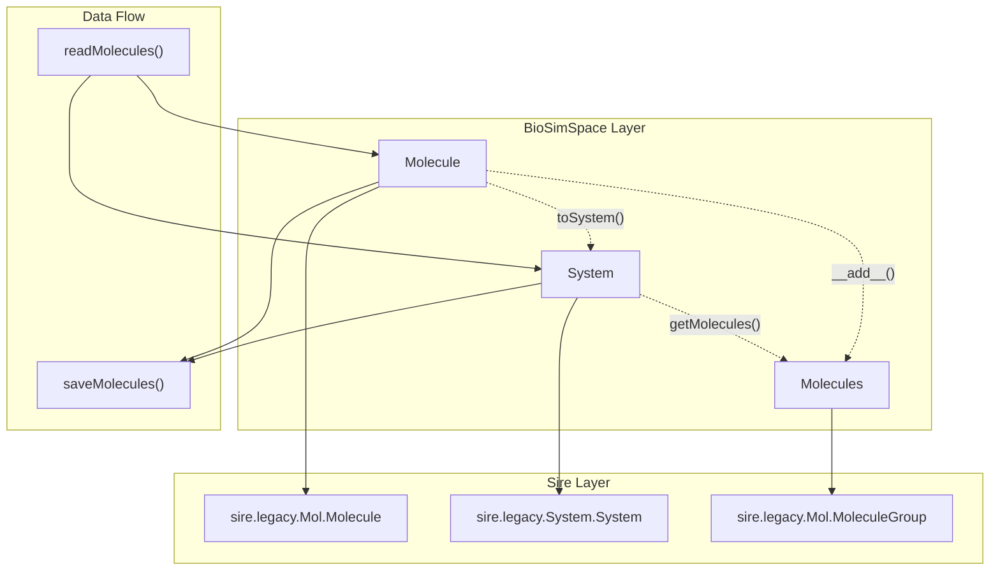
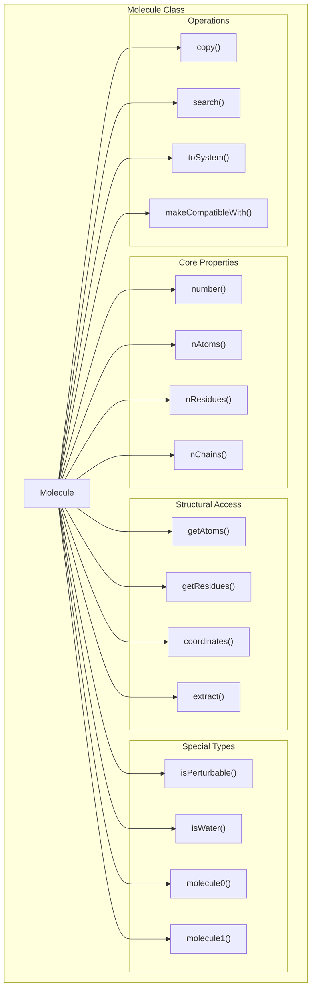
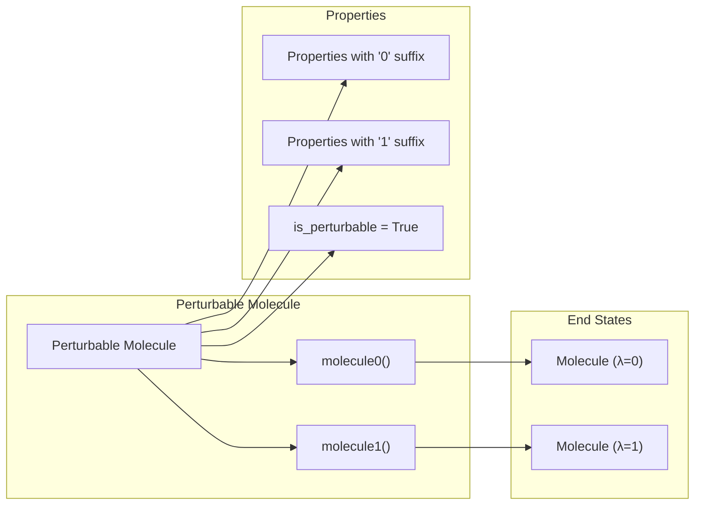
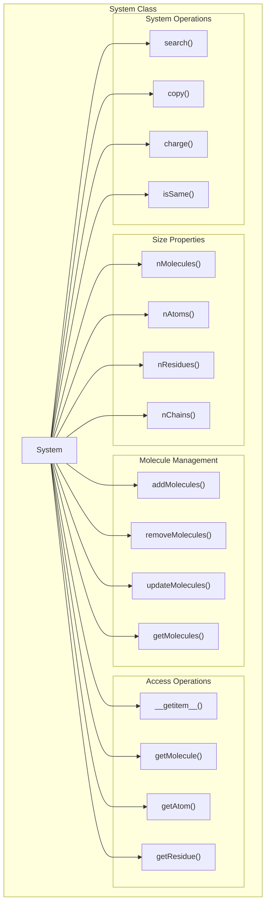
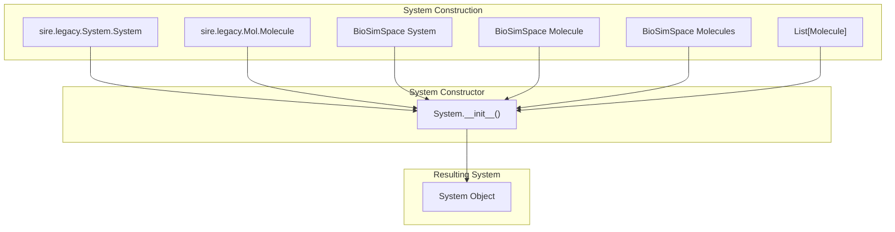
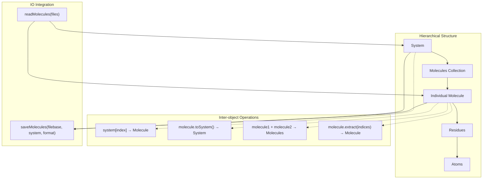
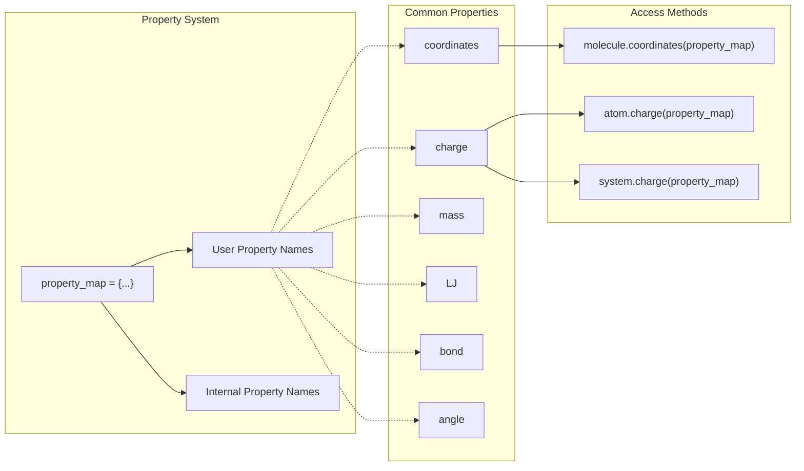

# Molecule and System Objects

Relevant source files

The following files were used as context for generating this wiki page:

- [python/BioSimSpace/IO/_io.py](python/BioSimSpace/IO/_io.py)
- [python/BioSimSpace/Sandpit/Exscientia/IO/_io.py](python/BioSimSpace/Sandpit/Exscientia/IO/_io.py)
- [python/BioSimSpace/Sandpit/Exscientia/_SireWrappers/_molecule.py](python/BioSimSpace/Sandpit/Exscientia/_SireWrappers/_molecule.py)
- [python/BioSimSpace/Sandpit/Exscientia/_SireWrappers/_system.py](python/BioSimSpace/Sandpit/Exscientia/_SireWrappers/_system.py)
- [python/BioSimSpace/_SireWrappers/_molecule.py](python/BioSimSpace/_SireWrappers/_molecule.py)
- [python/BioSimSpace/_SireWrappers/_system.py](python/BioSimSpace/_SireWrappers/_system.py)

This page documents the fundamental data structures that form the backbone of BioSimSpace: the `Molecule` and `System` classes. These objects represent molecular data and provide the core abstractions for all molecular simulations in BioSimSpace. For information about reading and writing these objects to files, see [IO Operations](#2.3). For details about physical unit types used by these objects, see [Types and Units System](#2.2).

## Core Architecture

BioSimSpace's molecular data structures are built as thin wrapper classes around the Sire molecular simulation library. The wrapper design provides a simplified, consistent interface while leveraging Sire's powerful underlying functionality.

**Wrapper Architecture**
Sources: [python/BioSimSpace/_SireWrappers/_molecule.py:48-49](), [python/BioSimSpace/_SireWrappers/_system.py:48-49]()

## Molecule Objects

The `Molecule` class represents a single molecular entity with all its associated properties, atoms, residues, and chains.

### Molecule Class Structure

**Molecule Class Methods and Properties**
Sources: [python/BioSimSpace/_SireWrappers/_molecule.py:51-584]()

### Key Molecule Operations

| Method | Purpose | Return Type |
|--------|---------|-------------|
| `number()` | Get unique molecule identifier | `int` |
| `nAtoms()` | Count atoms in molecule | `int` |
| `getAtoms()` | Access all atoms | `List[Atom]` |
| `getResidues()` | Access all residues | `List[Residue]` |
| `coordinates()` | Get atomic coordinates | `List[Coordinate]` |
| `extract(indices)` | Create new molecule from subset | `Molecule` |
| `search(query)` | Find atoms/residues by query | `SearchResult` |
| `copy()` | Deep copy with unique number | `Molecule` |
| `toSystem()` | Convert to single-molecule system | `System` |

Sources: [python/BioSimSpace/_SireWrappers/_molecule.py:207-584]()

### Perturbable Molecules

BioSimSpace supports perturbable molecules for free energy calculations, which contain dual topologies representing different chemical states.

**Perturbable Molecule Support**
Sources: [python/BioSimSpace/_SireWrappers/_molecule.py:82-95](), [python/BioSimSpace/_SireWrappers/_molecule.py:428-452](), [python/BioSimSpace/_SireWrappers/_molecule.py:490-501]()

## System Objects

The `System` class represents collections of molecules, providing the primary interface for molecular systems in simulations.

### System Class Structure

**System Class Methods and Properties**
Sources: [python/BioSimSpace/_SireWrappers/_system.py:54-2079]()

### System Construction and Manipulation

Systems can be constructed from various molecular inputs:

**System Construction**
Sources: [python/BioSimSpace/_SireWrappers/_system.py:57-154]()

### Key System Operations

| Method | Purpose | Parameters | Return Type |
|--------|---------|------------|-------------|
| `addMolecules(molecules)` | Add molecules to system | `Molecule`, `Molecules`, `System`, or list | `None` |
| `removeMolecules(molecules)` | Remove molecules from system | `Molecule`, `Molecules`, or list | `None` |
| `updateMolecules(molecules)` | Update existing molecules | `Molecule` or list | `None` |
| `getMolecules(group)` | Get molecules by group | `str` (default "all") | `Molecules` |
| `search(query)` | Search for atoms/residues | `str` | `SearchResult` |
| `charge()` | Calculate total charge | `property_map`, `is_lambda1` | `Charge` |

Sources: [python/BioSimSpace/_SireWrappers/_system.py:555-898](), [python/BioSimSpace/_SireWrappers/_system.py:917-1081]()

## Object Relationships and Data Flow

The relationship between BioSimSpace's core objects follows a hierarchical pattern:

**Object Relationships and Operations**
Sources: [python/BioSimSpace/_SireWrappers/_molecule.py:132-175](), [python/BioSimSpace/_SireWrappers/_molecule.py:574-583](), [python/BioSimSpace/_SireWrappers/_system.py:202-257]()

## Property Management

Both `Molecule` and `System` objects support flexible property management through property maps, allowing users to customize how molecular properties are accessed and stored.

**Property Management System**
Sources: [python/BioSimSpace/_SireWrappers/_molecule.py:220-256](), [python/BioSimSpace/_SireWrappers/_system.py:329-359]()

## Integration with IO Operations

The `Molecule` and `System` objects are tightly integrated with BioSimSpace's IO system for reading and writing molecular data:

| Function | Purpose | Input | Output |
|----------|---------|-------|--------|
| `readMolecules(files)` | Load system from files | File paths or URLs | `System` |
| `saveMolecules(base, system, format)` | Save system to files | System + format | File paths |
| `readPerturbableSystem()` | Load perturbable system | End state files | `System` |
| `savePerturbableSystem()` | Save perturbable system | System + base name | File paths |

Sources: [python/BioSimSpace/IO/_io.py:345-591](), [python/BioSimSpace/IO/_io.py:594-861](), [python/BioSimSpace/IO/_io.py:946-1145](), [python/BioSimSpace/IO/_io.py:864-944]()

The `Molecule` and `System` classes form the foundation for all molecular operations in BioSimSpace, providing consistent interfaces for molecular manipulation, property access, and integration with simulation workflows.

---