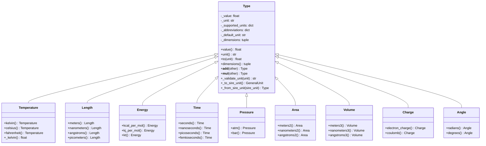
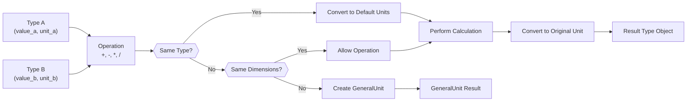

# Types and Units System

<details>
<summary>Relevant source files</summary>

The following files were used as context for generating this wiki page:

- [python/BioSimSpace/Types/_angle.py](python/BioSimSpace/Types/_angle.py)
- [python/BioSimSpace/Types/_area.py](python/BioSimSpace/Types/_area.py)
- [python/BioSimSpace/Types/_charge.py](python/BioSimSpace/Types/_charge.py)
- [python/BioSimSpace/Types/_energy.py](python/BioSimSpace/Types/_energy.py)
- [python/BioSimSpace/Types/_length.py](python/BioSimSpace/Types/_length.py)
- [python/BioSimSpace/Types/_pressure.py](python/BioSimSpace/Types/_pressure.py)
- [python/BioSimSpace/Types/_temperature.py](python/BioSimSpace/Types/_temperature.py)
- [python/BioSimSpace/Types/_time.py](python/BioSimSpace/Types/_time.py)
- [python/BioSimSpace/Types/_type.py](python/BioSimSpace/Types/_type.py)
- [python/BioSimSpace/Types/_volume.py](python/BioSimSpace/Types/_volume.py)

</details>


The Types and Units System provides a comprehensive framework for handling physical quantities with proper unit management, conversion, and mathematical operations in BioSimSpace. This system ensures type safety and dimensional consistency across all simulation parameters while providing a user-friendly interface for unit conversions and calculations.

For information about the core data structures that use these types, see [Molecule and System Objects](#2.1). For details on reading and writing these types to/from files, see [IO Operations](#2.3).

## Architecture Overview

The Types system is built around a base `Type` class that provides common functionality for all physical quantities. Each specific physical quantity inherits from this base class and implements unit-specific behavior.

### Class Hierarchy



**Sources:** [python/BioSimSpace/Types/_type.py:37-694](), [python/BioSimSpace/Types/_temperature.py:34-478](), [python/BioSimSpace/Types/_length.py:34-400](), [python/BioSimSpace/Types/_energy.py:34-290](), [python/BioSimSpace/Types/_time.py:34-429](), [python/BioSimSpace/Types/_pressure.py:34-244](), [python/BioSimSpace/Types/_area.py:34-407](), [python/BioSimSpace/Types/_volume.py:34-364](), [python/BioSimSpace/Types/_charge.py:34-258](), [python/BioSimSpace/Types/_angle.py:34-261]()

## Core Type Classes

The system provides the following physical quantity types:

| Type Class | Purpose | Default Unit | Supported Units |
|------------|---------|--------------|-----------------|
| `Temperature` | Temperature values | KELVIN | KELVIN, CELSIUS, FAHRENHEIT |
| `Length` | Distance measurements | ANGSTROM | METER, CENTIMETER, MILLIMETER, NANOMETER, ANGSTROM, PICOMETER |
| `Energy` | Energy quantities | KILO CALORIES PER MOL | KILO CALORIES PER MOL, KILO JOULES PER MOL, KT |
| `Time` | Time intervals | NANOSECOND | DAY, HOUR, MINUTE, SECOND, MILLISECOND, NANOSECOND, PICOSECOND, FEMTOSECOND |
| `Pressure` | Pressure values | ATMOSPHERE | ATMOSPHERE, BAR |
| `Area` | Area measurements | ANGSTROM2 | METER2, NANOMETER2, ANGSTROM2, PICOMETER2 |
| `Volume` | Volume measurements | ANGSTROM3 | METER3, NANOMETER3, ANGSTROM3, PICOMETER3 |
| `Charge` | Electric charge | ELECTRON CHARGE | ELECTRON CHARGE, COULOMB |
| `Angle` | Angular measurements | RADIAN | RADIAN, DEGREE |

**Sources:** [python/BioSimSpace/Types/_temperature.py:41-64](), [python/BioSimSpace/Types/_length.py:48-91](), [python/BioSimSpace/Types/_energy.py:41-72](), [python/BioSimSpace/Types/_time.py:50-100](), [python/BioSimSpace/Types/_pressure.py:41-59](), [python/BioSimSpace/Types/_area.py:41-76](), [python/BioSimSpace/Types/_volume.py:41-76](), [python/BioSimSpace/Types/_charge.py:41-62](), [python/BioSimSpace/Types/_angle.py:41-56]()

## Unit System and Conversions

The Types system provides seamless unit conversion through integration with the Sire units framework. Each type maintains mappings between user-friendly unit names and internal Sire unit objects.

### Unit Conversion Flow

```mermaid
flowchart TD
    UserInput["User Input<br/>\"298 K\" or Temperature(298, \"K\")"] --> Parse["_from_string() or __init__()"]
    Parse --> Validate["_validate_unit()"]
    Validate --> Normalize["Unit Normalization<br/>K → KELVIN"]
    Normalize --> Store["Store _value and _unit"]
    
    Store --> Convert["to() or celsius()"]
    Convert --> SireConvert["_supported_units[unit].to(target_unit)"]
    SireConvert --> NewObject["New Type Object<br/>in Target Unit"]
    
    Store --> Math["Mathematical Operations<br/>+, -, *, /"]
    Math --> DefaultUnit["_to_default_unit()"]
    DefaultUnit --> Calculate["Perform Calculation"]
    Calculate --> Result["Result in Original Unit"]
    
    Store --> SireInt["_to_sire_unit()"]
    SireInt --> SireUnit["Sire GeneralUnit"]
    
    SireUnit --> FromSire["_from_sire_unit()"]
    FromSire --> TypeObject["Type Object"]
```

**Sources:** [python/BioSimSpace/Types/_type.py:596-646](), [python/BioSimSpace/Types/_type.py:465-491](), [python/BioSimSpace/Types/_type.py:647-693](), [python/BioSimSpace/Types/_temperature.py:395-418]()

### Unit Validation and Abbreviations

Each type class implements flexible unit validation through the `_validate_unit()` method, supporting:

- Full unit names: `"KELVIN"`, `"CELSIUS"`
- Abbreviations: `"K"`, `"C"`
- Case-insensitive matching
- Plural forms: `"seconds"` → `"SECOND"`
- Common variations: `"degrees celsius"` → `"CELSIUS"`

**Sources:** [python/BioSimSpace/Types/_temperature.py:395-418](), [python/BioSimSpace/Types/_length.py:342-363](), [python/BioSimSpace/Types/_time.py:340-358]()

## Mathematical Operations

The Type base class provides comprehensive mathematical operation support with proper unit handling and dimensional analysis.

### Arithmetic Operations



**Sources:** [python/BioSimSpace/Types/_type.py:150-179](), [python/BioSimSpace/Types/_type.py:187-216](), [python/BioSimSpace/Types/_type.py:224-256](), [python/BioSimSpace/Types/_type.py:271-305]()

### Special Operations

- **Multiplication**: `Length * Length` → `Area`, `Area * Length` → `Volume`
- **Division**: `Volume / Area` → `Length`, `Area / Length` → `Length` 
- **Temperature**: Special handling for offset units (Celsius, Fahrenheit)
- **Comparison**: All comparison operators (`<`, `<=`, `==`, `>=`, `>`) with unit conversion

**Sources:** [python/BioSimSpace/Types/_length.py:136-189](), [python/BioSimSpace/Types/_area.py:122-166](), [python/BioSimSpace/Types/_volume.py:122-177](), [python/BioSimSpace/Types/_temperature.py:109-197]()

## String Parsing and Validation

The system provides flexible string parsing capabilities for creating Type objects from human-readable strings.

### String Format Support

The `_from_string()` method supports multiple formats:

- Scientific notation: `"1.23e-4 nm"`
- Decimal format: `"298.15 K"`
- Integer format: `"1 atm"`
- Flexible spacing: `"298K"`, `"298 K"`, `"298   K"`

**Sources:** [python/BioSimSpace/Types/_type.py:596-646]()

### Unit Normalization

Each type implements custom unit normalization logic:

```python
# Temperature: strips "DEGREES", "DEGREE", "DEGS", "DEG"
unit = unit.replace("DEGREES", "")

# Length: handles "ANGSTROM" special case (contains "S")
if unit[0:3] == "ANG":
    unit = "ANGS" + unit[3:]

# Area/Volume: handles "squared"/"cubed" and power notation
unit = unit.replace("SQUARED", "2")
unit = unit.replace("^", "")
```

**Sources:** [python/BioSimSpace/Types/_temperature.py:401-406](), [python/BioSimSpace/Types/_length.py:352-354](), [python/BioSimSpace/Types/_area.py:340-347]()

## Sire Integration

The Types system seamlessly integrates with the underlying Sire molecular simulation framework through bidirectional conversion methods.

### Sire Unit Conversion

```mermaid
flowchart TB
    BSSType["BioSimSpace Type<br/>Temperature(298, \"K\")"] --> ToSire["_to_sire_unit()"]
    ToSire --> SireUnit["sire.units.GeneralUnit<br/>298 * kelvin"]
    
    SireUnit --> FromSire["_from_sire_unit()"]
    FromSire --> BSSType2["BioSimSpace Type<br/>Temperature(298, \"KELVIN\")"]
    
    SireUnit --> SireOps["Sire Operations<br/>Calculations, Conversions"]
    SireOps --> SireResult["Sire Result"]
    SireResult --> FromSire
    
    BSSType --> SireFormat["_to_sire_format()"]
    SireFormat --> SireString["Sire-compatible String<br/>\"298*kelvin\""]
```

**Sources:** [python/BioSimSpace/Types/_type.py:647-657](), [python/BioSimSpace/Types/_type.py:659-693](), [python/BioSimSpace/Types/_temperature.py:420-431](), [python/BioSimSpace/Types/_temperature.py:432-477]()

### Dimensional Analysis

Each type maintains dimensional information for compatibility checking:

- **Mass**: `_dimensions[0]`
- **Length**: `_dimensions[1]` 
- **Time**: `_dimensions[2]`
- **Charge**: `_dimensions[3]`
- **Temperature**: `_dimensions[4]`
- **Quantity**: `_dimensions[5]`
- **Angle**: `_dimensions[6]`

**Sources:** [python/BioSimSpace/Types/_type.py:492-593](), [python/BioSimSpace/Types/_temperature.py:64](), [python/BioSimSpace/Types/_length.py:91]()

## Usage Examples

### Creating Type Objects

```python
# From value and unit
temp = Temperature(298, "K")
length = Length(10.5, "nm") 
energy = Energy(-1038, "kcal/mol")

# From string representations
temp = Temperature("298 K")
length = Length("10.5 nanometers")
energy = Energy("-1038 kcal/mol")

# From Sire units
sire_temp = 298 * sire.units.kelvin
temp = Temperature(sire_temp)
```

### Unit Conversions

```python
temp_k = Temperature(298, "K")
temp_c = temp_k.celsius()        # Convert to Celsius
temp_f = temp_k.fahrenheit()     # Convert to Fahrenheit

# Generic conversion
value_in_celsius = temp_k.to("CELSIUS")
```

### Mathematical Operations

```python
# Addition/subtraction (same type)
total_time = Time(10, "ps") + Time(5, "ps")
temp_diff = Temperature(300, "K") - Temperature(298, "K")

# Multiplication creates derived units
area = Length(5, "nm") * Length(3, "nm")     # Returns Area
volume = area * Length(2, "nm")              # Returns Volume

# Division
density_ratio = volume1 / volume2            # Returns float
length = area / Length(2, "nm")              # Returns Length
```

**Sources:** [python/BioSimSpace/Types/_type.py:150-305](), [python/BioSimSpace/Types/_length.py:136-189](), [python/BioSimSpace/Types/_area.py:122-166]()

---