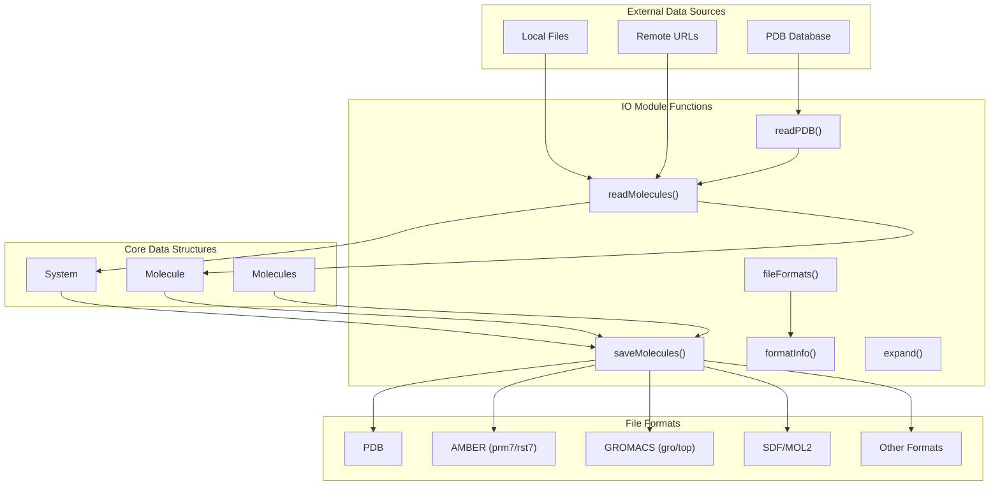
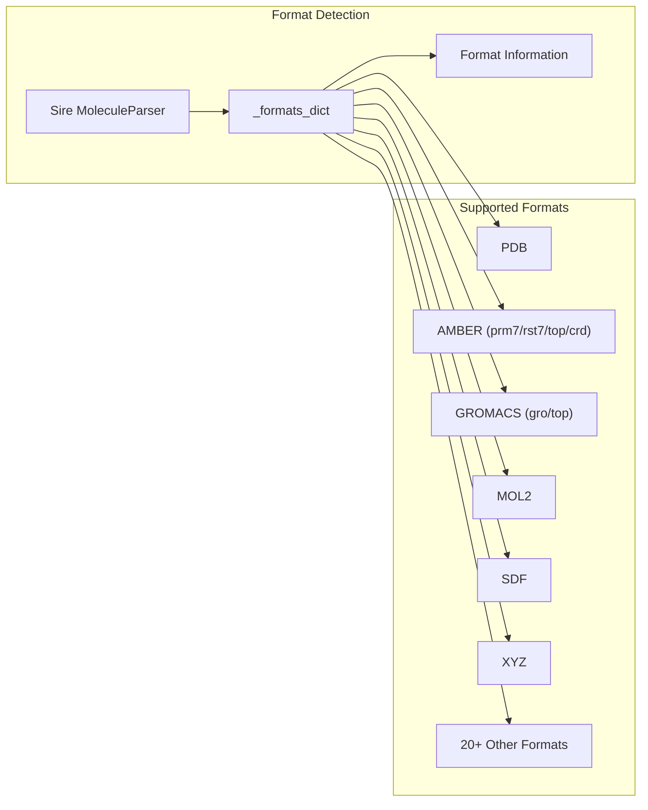
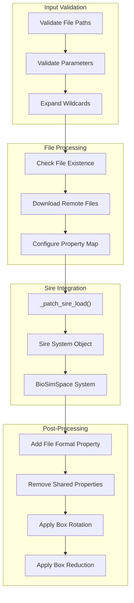
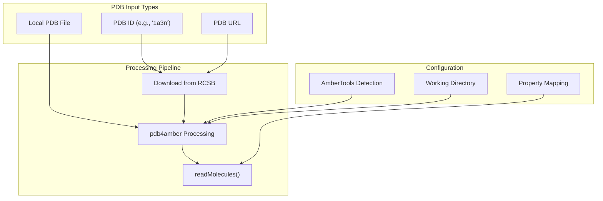
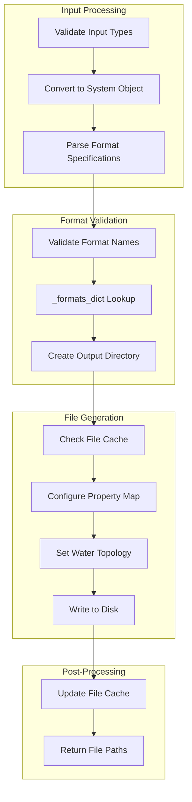
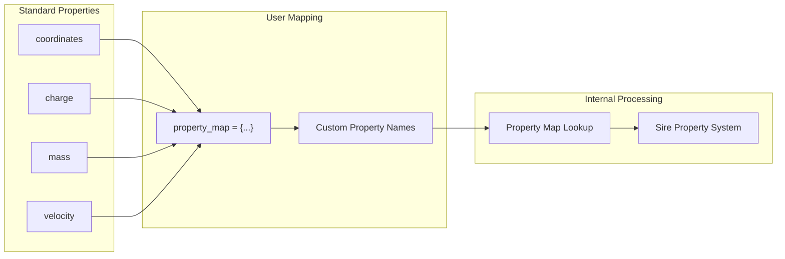
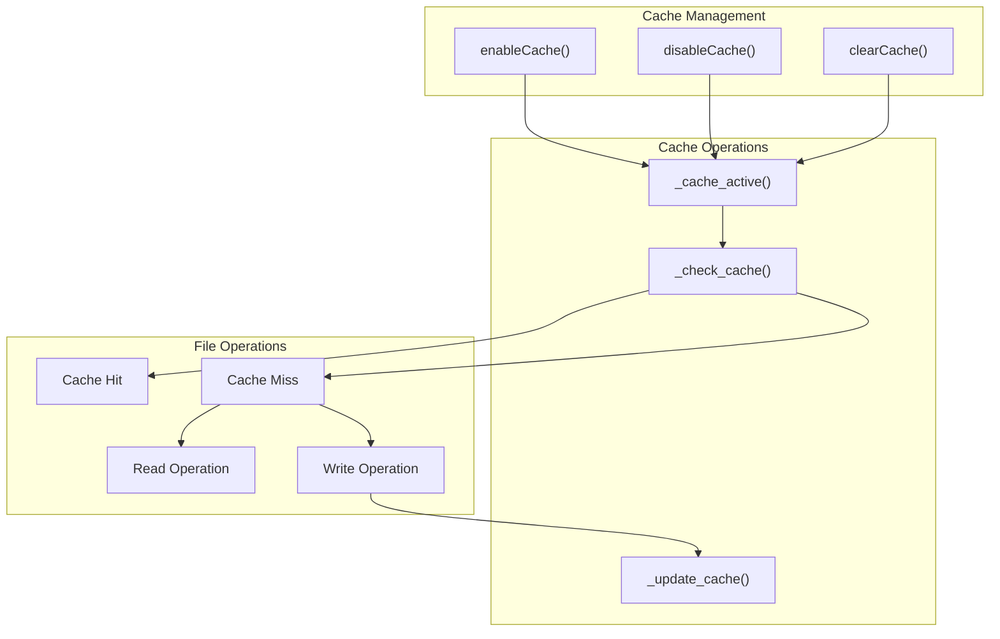
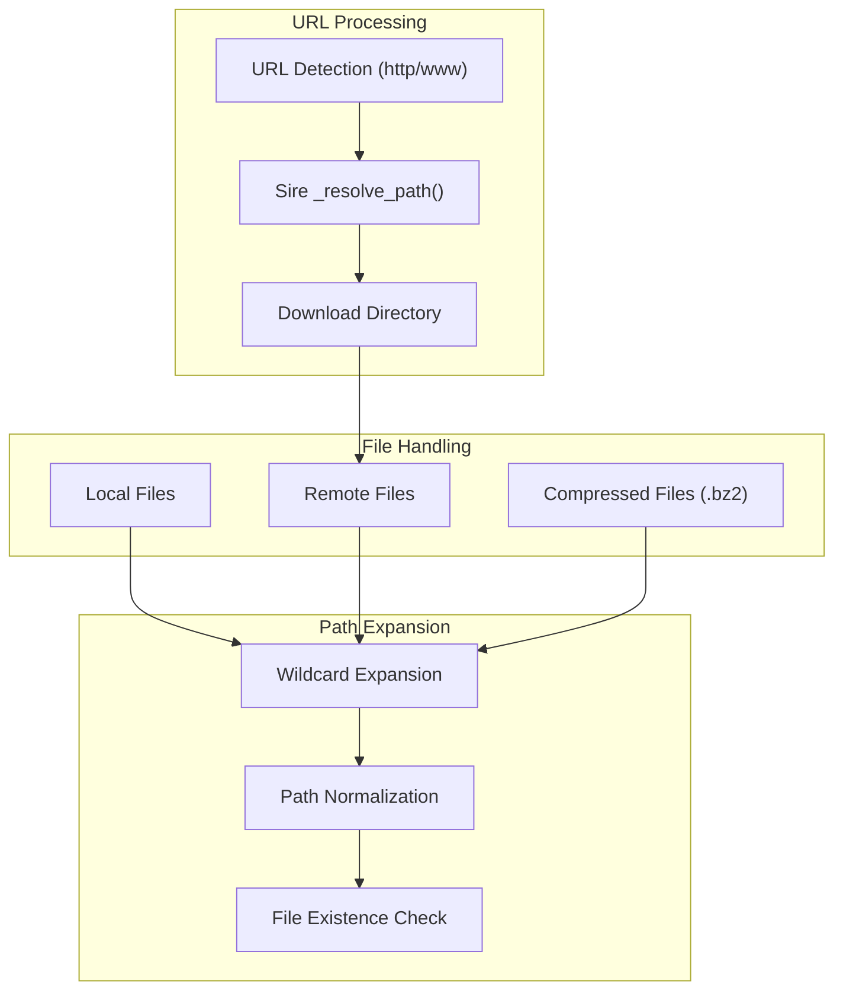

# IO Operations

Relevant source files

The following files were used as context for generating this wiki page:

- [python/BioSimSpace/IO/__init__.py](python/BioSimSpace/IO/__init__.py)
- [python/BioSimSpace/IO/_io.py](python/BioSimSpace/IO/_io.py)
- [python/BioSimSpace/Parameters/_Protocol/_protocol.py](python/BioSimSpace/Parameters/_Protocol/_protocol.py)
- [python/BioSimSpace/Parameters/__init__.py](python/BioSimSpace/Parameters/__init__.py)
- [python/BioSimSpace/Parameters/_process.py](python/BioSimSpace/Parameters/_process.py)
- [python/BioSimSpace/Process/_task.py](python/BioSimSpace/Process/_task.py)
- [python/BioSimSpace/Sandpit/Exscientia/IO/_io.py](python/BioSimSpace/Sandpit/Exscientia/IO/_io.py)
- [python/BioSimSpace/Sandpit/Exscientia/Parameters/_Protocol/_protocol.py](python/BioSimSpace/Sandpit/Exscientia/Parameters/_Protocol/_protocol.py)
- [python/BioSimSpace/Sandpit/Exscientia/Parameters/_process.py](python/BioSimSpace/Sandpit/Exscientia/Parameters/_process.py)
- [python/BioSimSpace/Sandpit/Exscientia/_SireWrappers/_molecule.py](python/BioSimSpace/Sandpit/Exscientia/_SireWrappers/_molecule.py)
- [python/BioSimSpace/Sandpit/Exscientia/_SireWrappers/_system.py](python/BioSimSpace/Sandpit/Exscientia/_SireWrappers/_system.py)
- [python/BioSimSpace/Solvent/__init__.py](python/BioSimSpace/Solvent/__init__.py)
- [python/BioSimSpace/_SireWrappers/_molecule.py](python/BioSimSpace/_SireWrappers/_molecule.py)
- [python/BioSimSpace/_SireWrappers/_system.py](python/BioSimSpace/_SireWrappers/_system.py)

The IO Operations module provides comprehensive functionality for reading and writing molecular data in various file formats. This system serves as the primary interface between external molecular data files and BioSimSpace's internal data structures, enabling seamless import and export of molecular systems.

For information about the core data structures that IO operations create and manipulate, see [Molecule and System Objects](#2.1). For details about physical unit handling in imported data, see [Types and Units System](#2.2).

## Core Functions and Architecture

The IO module is built around several key functions that handle different aspects of molecular data input/output:

Sources: [python/BioSimSpace/IO/_io.py:27-36](), [python/BioSimSpace/IO/__init__.py:25-41]()

## File Format Support

BioSimSpace leverages Sire's extensive file format support, providing access to numerous molecular file formats through a unified interface:

The format information is captured at module initialization and stored in `_formats_dict` for efficient lookup. Users can query supported formats using `fileFormats()` and get detailed descriptions with `formatInfo()`.

Sources: [python/BioSimSpace/IO/_io.py:89-111](), [python/BioSimSpace/IO/_io.py:154-202]()

## Reading Operations

### Primary Reading Function

The `readMolecules()` function serves as the main entry point for loading molecular data:

| Parameter | Type | Description |
|-----------|------|-------------|
| `files` | `str` or `list[str]` | File paths or URLs to read |
| `make_whole` | `bool` | Unwrap molecules split across periodic boundaries |
| `rotate_box` | `bool` | Align box vectors with coordinate axes |
| `reduce_box` | `bool` | Reduce box vectors |
| `show_warnings` | `bool` | Display parsing warnings |
| `download_dir` | `str` | Directory for downloaded files |
| `property_map` | `dict` | Custom property name mappings |

Sources: [python/BioSimSpace/IO/_io.py:345-591](), [python/BioSimSpace/IO/_io.py:500-507]()

### PDB-Specific Reading

The `readPDB()` function provides specialized handling for Protein Data Bank files and IDs:

Sources: [python/BioSimSpace/IO/_io.py:205-342](), [python/BioSimSpace/IO/_io.py:300-337]()

## Writing Operations

### Molecular System Export

The `saveMolecules()` function handles export of molecular systems to various file formats:

| Parameter | Type | Description |
|-----------|------|-------------|
| `filebase` | `str` | Base name for output files |
| `system` | `System/Molecule/Molecules` | Molecular data to save |
| `fileformat` | `str` or `list[str]` | Target file format(s) |
| `match_water` | `bool` | Update water naming conventions |
| `property_map` | `dict` | Custom property name mappings |

Sources: [python/BioSimSpace/IO/_io.py:594-970](), [python/BioSimSpace/IO/_io.py:750-840]()

## Advanced Features

### Property Mapping System

Property maps allow users to customize how molecular properties are referenced, enabling flexible naming schemes:

Sources: [python/BioSimSpace/IO/_io.py:387-391](), [python/BioSimSpace/IO/_io.py:732-736]()

### File Caching System

BioSimSpace implements a caching mechanism to avoid redundant file operations:

Sources: [python/BioSimSpace/IO/_io.py:69-71](), [python/BioSimSpace/IO/_io.py:751-764]()

### URL and Remote File Support

The IO system supports downloading files from remote URLs and handles various compression formats:

Sources: [python/BioSimSpace/IO/_io.py:450-457](), [python/BioSimSpace/IO/_io.py:494-497]()

---