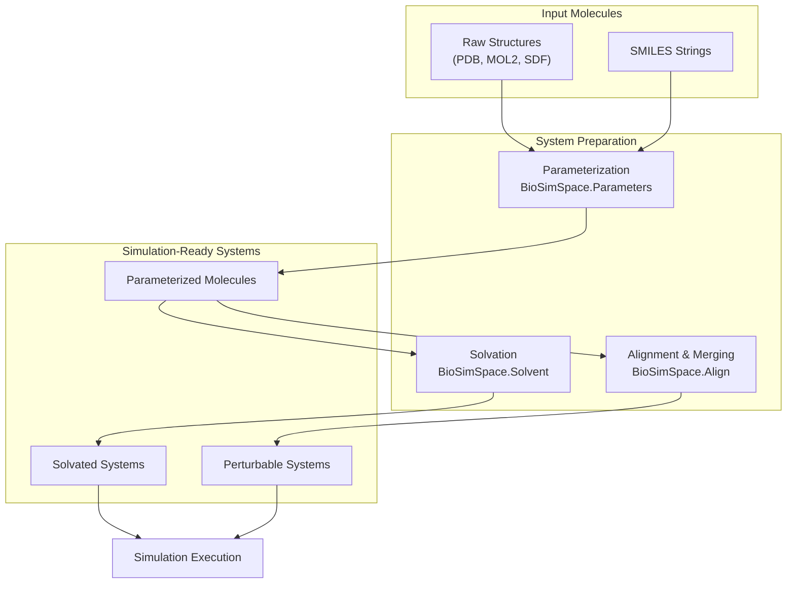
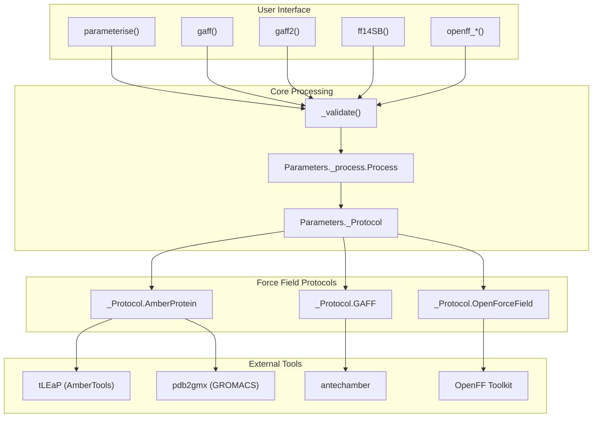
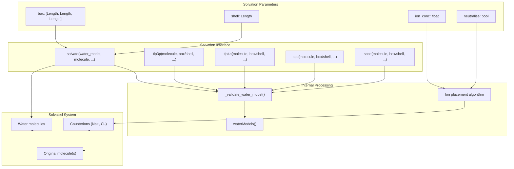
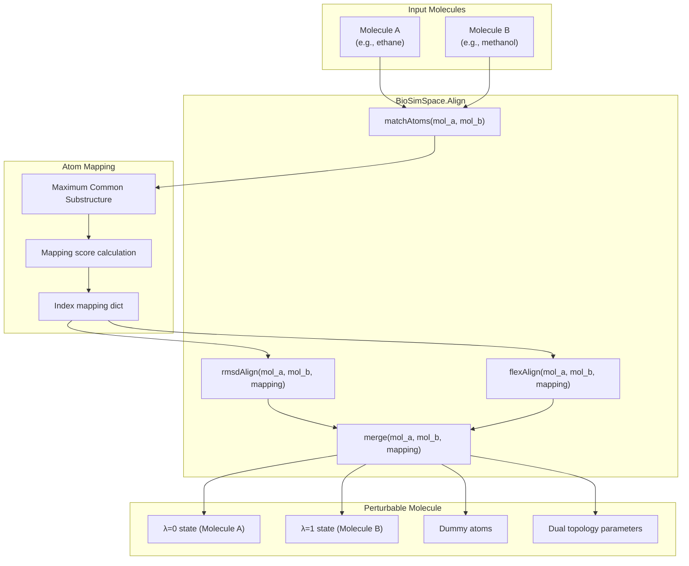
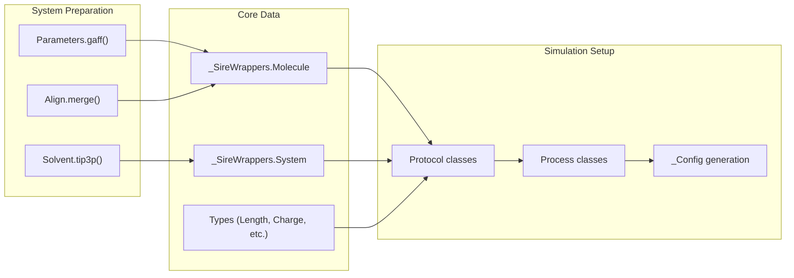

# System Preparation

Relevant source files

The following files were used as context for generating this wiki page:

- [doc/source/tutorials/hydration_freenrg.rst](doc/source/tutorials/hydration_freenrg.rst)
- [doc/source/tutorials/images/ethane_methanol_mapping.png](doc/source/tutorials/images/ethane_methanol_mapping.png)
- [python/BioSimSpace/IO/__init__.py](python/BioSimSpace/IO/__init__.py)
- [python/BioSimSpace/Parameters/_Protocol/_amber.py](python/BioSimSpace/Parameters/_Protocol/_amber.py)
- [python/BioSimSpace/Parameters/_Protocol/_openforcefield.py](python/BioSimSpace/Parameters/_Protocol/_openforcefield.py)
- [python/BioSimSpace/Parameters/_Protocol/_protocol.py](python/BioSimSpace/Parameters/_Protocol/_protocol.py)
- [python/BioSimSpace/Parameters/__init__.py](python/BioSimSpace/Parameters/__init__.py)
- [python/BioSimSpace/Parameters/_parameters.py](python/BioSimSpace/Parameters/_parameters.py)
- [python/BioSimSpace/Parameters/_process.py](python/BioSimSpace/Parameters/_process.py)
- [python/BioSimSpace/Process/_task.py](python/BioSimSpace/Process/_task.py)
- [python/BioSimSpace/Sandpit/Exscientia/Parameters/_Protocol/_amber.py](python/BioSimSpace/Sandpit/Exscientia/Parameters/_Protocol/_amber.py)
- [python/BioSimSpace/Sandpit/Exscientia/Parameters/_Protocol/_openforcefield.py](python/BioSimSpace/Sandpit/Exscientia/Parameters/_Protocol/_openforcefield.py)
- [python/BioSimSpace/Sandpit/Exscientia/Parameters/_Protocol/_protocol.py](python/BioSimSpace/Sandpit/Exscientia/Parameters/_Protocol/_protocol.py)
- [python/BioSimSpace/Sandpit/Exscientia/Parameters/_parameters.py](python/BioSimSpace/Sandpit/Exscientia/Parameters/_parameters.py)
- [python/BioSimSpace/Sandpit/Exscientia/Parameters/_process.py](python/BioSimSpace/Sandpit/Exscientia/Parameters/_process.py)
- [python/BioSimSpace/Solvent/__init__.py](python/BioSimSpace/Solvent/__init__.py)
- [tests/Parameters/test_parameters.py](tests/Parameters/test_parameters.py)
- [tests/Sandpit/Exscientia/Parameters/test_parameters.py](tests/Sandpit/Exscientia/Parameters/test_parameters.py)

System preparation encompasses the tools and workflows required to transform raw molecular structures into simulation-ready systems. This includes applying force field parameters to molecules, adding solvent environments, and creating perturbable molecules for free energy calculations. For information about reading molecular data, see [IO Operations](#2.3). For details about running simulations with prepared systems, see [Simulation Execution](#4).

## Overview

System preparation in BioSimSpace bridges the gap between initial molecular structures and simulation-ready systems through three primary operations: parameterization (applying force field parameters), solvation (adding solvent molecules and ions), and molecular alignment/merging (creating perturbable molecules for alchemical calculations).

**Sources:** [python/BioSimSpace/Parameters/_parameters.py:68-131](), [python/BioSimSpace/Solvent/__init__.py:22-113](), [doc/source/tutorials/hydration_freenrg.rst:20-93]()

## Parameterization Workflow

The parameterization system applies force field parameters to molecules using various computational chemistry tools. The process is handled asynchronously through the `Process` class, allowing users to continue working while parameterization runs in the background.

**Sources:** [python/BioSimSpace/Parameters/_parameters.py:68-131](), [python/BioSimSpace/Parameters/_process.py:95-334](), [python/BioSimSpace/Parameters/_Protocol/_amber.py:116-613]()

## Force Field Support Matrix

BioSimSpace supports multiple force field families through a unified interface:

| Force Field | Type | Tool | Compatibility |
|-------------|------|------|---------------|
| GAFF/GAFF2 | Small molecules | antechamber | Full support |
| ff14SB | Protein | tLEaP/pdb2gmx | Full support |
| ff99SB | Protein | tLEaP/pdb2gmx | Full support |
| ff03 | Protein | tLEaP/pdb2gmx | Full support |
| OpenFF | Small molecules | OpenFF Toolkit | Full support |

The parameterization process handles charge calculation, atom typing, and parameter assignment automatically. For AMBER force fields, the system can detect disulfide bonds and structural ions, requiring water model specification for ion parameters.

**Sources:** [python/BioSimSpace/Parameters/_parameters.py:44-50](), [python/BioSimSpace/Parameters/_parameters.py:588-625](), [python/BioSimSpace/Parameters/_Protocol/_amber.py:444-452]()

## Solvation System

The solvation system adds water molecules and ions to create simulation-ready systems. It provides both box-based and shell-based solvation with automatic ion placement for charge neutralization.

**Sources:** [python/BioSimSpace/Solvent/__init__.py:31-37](), [python/BioSimSpace/Solvent/_solvent.py](), [doc/source/tutorials/hydration_freenrg.rst:89-92]()

## Alignment and Merging for Free Energy Calculations

The alignment and merging system creates perturbable molecules for alchemical free energy calculations by finding atom mappings between molecules and creating dual-topology systems.

**Sources:** [doc/source/tutorials/hydration_freenrg.rst:25-87](), [python/BioSimSpace/Align](), [tests/Parameters/test_parameters.py:146-174]()

## Integration with Simulation Workflow

System preparation components integrate seamlessly with the broader BioSimSpace simulation workflow:

**Sources:** [python/BioSimSpace/Parameters/_parameters.py:370-404](), [python/BioSimSpace/Parameters/_process.py:198-248](), [doc/source/tutorials/hydration_freenrg.rst:94-153]()

The system preparation workflow is designed to be both user-friendly and computationally efficient, with automatic background processing, comprehensive error handling, and support for multiple molecular dynamics engines downstream. All parameterization processes return `Process` objects that can be queried for status and results, enabling interactive workflows in Jupyter notebooks and other interactive environments.

---