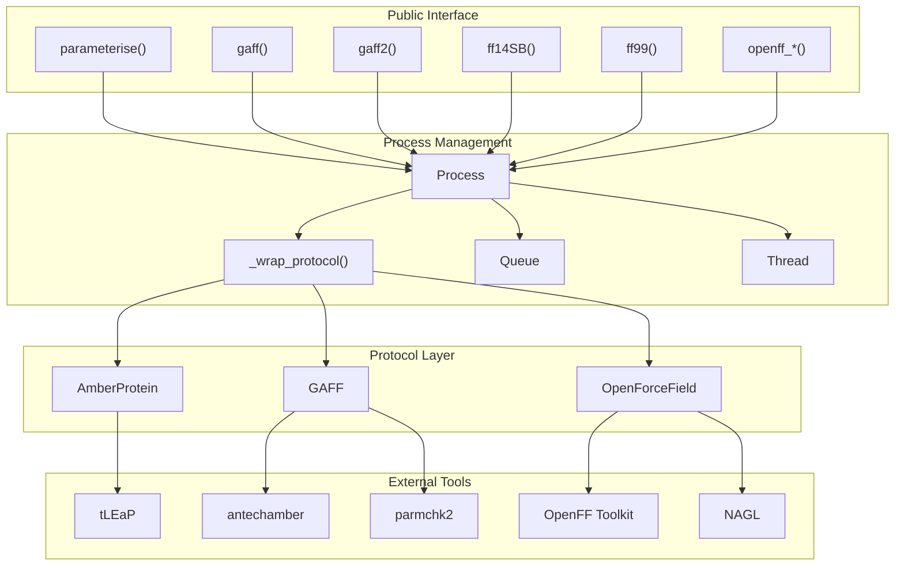
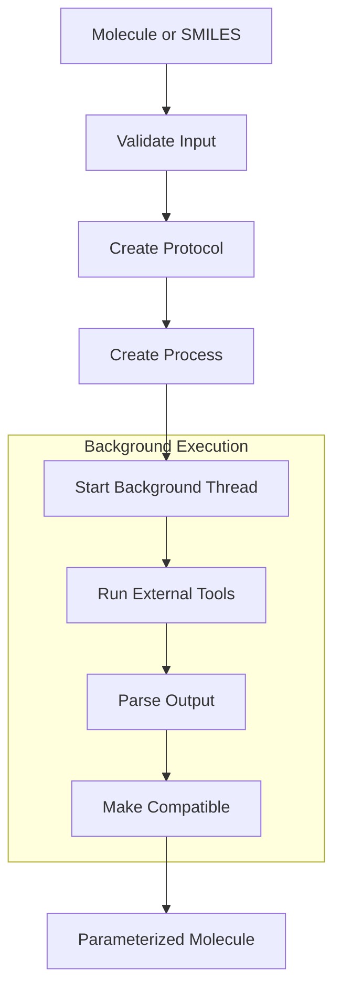
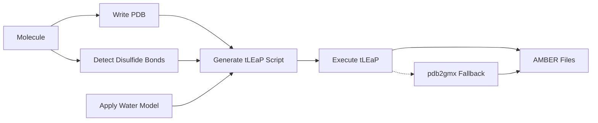
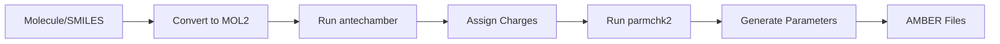
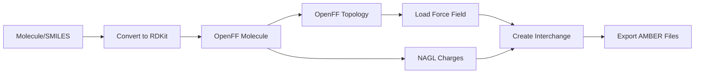

# Parameterization

<details>
<summary>Relevant source files</summary>

The following files were used as context for generating this wiki page:

- [doc/source/tutorials/hydration_freenrg.rst](doc/source/tutorials/hydration_freenrg.rst)
- [doc/source/tutorials/images/ethane_methanol_mapping.png](doc/source/tutorials/images/ethane_methanol_mapping.png)
- [python/BioSimSpace/IO/__init__.py](python/BioSimSpace/IO/__init__.py)
- [python/BioSimSpace/Parameters/_Protocol/_amber.py](python/BioSimSpace/Parameters/_Protocol/_amber.py)
- [python/BioSimSpace/Parameters/_Protocol/_openforcefield.py](python/BioSimSpace/Parameters/_Protocol/_openforcefield.py)
- [python/BioSimSpace/Parameters/_Protocol/_protocol.py](python/BioSimSpace/Parameters/_Protocol/_protocol.py)
- [python/BioSimSpace/Parameters/__init__.py](python/BioSimSpace/Parameters/__init__.py)
- [python/BioSimSpace/Parameters/_parameters.py](python/BioSimSpace/Parameters/_parameters.py)
- [python/BioSimSpace/Parameters/_process.py](python/BioSimSpace/Parameters/_process.py)
- [python/BioSimSpace/Process/_task.py](python/BioSimSpace/Process/_task.py)
- [python/BioSimSpace/Sandpit/Exscientia/Parameters/_Protocol/_amber.py](python/BioSimSpace/Sandpit/Exscientia/Parameters/_Protocol/_amber.py)
- [python/BioSimSpace/Sandpit/Exscientia/Parameters/_Protocol/_openforcefield.py](python/BioSimSpace/Sandpit/Exscientia/Parameters/_Protocol/_openforcefield.py)
- [python/BioSimSpace/Sandpit/Exscientia/Parameters/_Protocol/_protocol.py](python/BioSimSpace/Sandpit/Exscientia/Parameters/_Protocol/_protocol.py)
- [python/BioSimSpace/Sandpit/Exscientia/Parameters/_parameters.py](python/BioSimSpace/Sandpit/Exscientia/Parameters/_parameters.py)
- [python/BioSimSpace/Sandpit/Exscientia/Parameters/_process.py](python/BioSimSpace/Sandpit/Exscientia/Parameters/_process.py)
- [python/BioSimSpace/Solvent/__init__.py](python/BioSimSpace/Solvent/__init__.py)
- [tests/Parameters/test_parameters.py](tests/Parameters/test_parameters.py)
- [tests/Sandpit/Exscientia/Parameters/test_parameters.py](tests/Sandpit/Exscientia/Parameters/test_parameters.py)

</details>


The parameterization system in BioSimSpace applies force field parameters to molecular structures, making them ready for molecular dynamics simulations. This system provides a unified interface for parameterizing molecules with various force fields including AMBER protein force fields, GAFF for small molecules, and Open Force Field Initiative force fields.

For information about molecule alignment and merging for free energy calculations, see [Alignment and Merging](#3.3). For system preparation workflows that use parameterized molecules, see [Solvation](#3.2).

## System Architecture

The parameterization system follows a layered architecture with public functions, protocol implementations, and background process management:



Sources: [python/BioSimSpace/Parameters/_parameters.py:68-131](), [python/BioSimSpace/Parameters/_process.py:95-177](), [python/BioSimSpace/Parameters/_Protocol/_amber.py:116-274](), [python/BioSimSpace/Parameters/_Protocol/_openforcefield.py:129-179]()

## Force Field Support

BioSimSpace supports multiple categories of force fields, each with specialized protocols:

| Force Field Category | Supported Fields | Protocol Class | External Dependencies |
|---------------------|------------------|----------------|----------------------|
| AMBER Protein | ff03, ff99, ff99SB, ff99SBildn, ff14SB | `AmberProtein` | tLEaP, pdb2gmx (fallback) |
| AMBER Small Molecule | GAFF, GAFF2 | `GAFF` | antechamber, parmchk2 |
| Open Force Field | openff_unconstrained_* | `OpenForceField` | OpenFF Toolkit, NAGL |

The system automatically selects the appropriate protocol based on the force field name and creates the necessary external tool commands.

Sources: [python/BioSimSpace/Parameters/_parameters.py:44-50](), [python/BioSimSpace/Parameters/_parameters.py:598-625](), [python/BioSimSpace/Parameters/_Protocol/_amber.py:31](), [python/BioSimSpace/Parameters/_Protocol/_openforcefield.py:31]()

## Process Execution Flow

The parameterization process follows a consistent pattern regardless of the force field used:



The process runs in a separate thread to allow non-blocking execution. Users can call `.getMolecule()` to block until completion or check status with `.isRunning()` and `.isError()`.

Sources: [python/BioSimSpace/Parameters/_process.py:178-196](), [python/BioSimSpace/Parameters/_process.py:198-248](), [python/BioSimSpace/Parameters/_Protocol/_amber.py:274-405]()

## Protocol Implementations

### AMBER Protein Force Fields

The `AmberProtein` protocol handles parameterization of proteins and other biomolecules using AMBER force fields:



Key features:
- Automatic disulfide bond detection using `_get_disulphide_bonds()`
- Support for custom LEaP commands via `pre_mol_commands` and `post_mol_commands`
- Fallback to GROMACS `pdb2gmx` for compatible force fields
- Ion parameterization with water model selection

Sources: [python/BioSimSpace/Parameters/_Protocol/_amber.py:407-539](), [python/BioSimSpace/Parameters/_Protocol/_amber.py:614-683](), [python/BioSimSpace/Parameters/_Protocol/_amber.py:736-895]()

### GAFF Small Molecule Force Fields

The `GAFF` protocol specializes in parameterizing small molecules using the General AMBER Force Field:



Supports multiple charge calculation methods: BCC, RESP, CM2, MUL, ESP, GAS.

Sources: [python/BioSimSpace/Parameters/_Protocol/_amber.py:1045-1400](), [python/BioSimSpace/Parameters/_parameters.py:277-370]()

### Open Force Field

The `OpenForceField` protocol integrates with the Open Force Field Initiative toolkit:



Features modern charge calculation with NAGL (Neural Atomic Graph Learning) when available.

Sources: [python/BioSimSpace/Parameters/_Protocol/_openforcefield.py:180-375](), [python/BioSimSpace/Parameters/_Protocol/_openforcefield.py:257-272]()

## API Usage Patterns

### Basic Parameterization

```python
# Using force field specific functions
process = BSS.Parameters.gaff(molecule)
parameterized = process.getMolecule()

# Using generic interface
process = BSS.Parameters.parameterise(molecule, "gaff")
parameterized = process.getMolecule()
```

### Advanced Options

```python
# GAFF with custom charge
process = BSS.Parameters.gaff(
    molecule, 
    net_charge=1, 
    charge_method="RESP"
)

# AMBER protein with custom LEaP commands
process = BSS.Parameters.ff14SB(
    molecule,
    water_model="tip3p",
    pre_mol_commands=["source custom.leaprc"],
    post_mol_commands=["bond mol.1.CYS.SG mol.45.CYS.SG"]
)
```

Sources: [python/BioSimSpace/Parameters/__init__.py:45-93](), [python/BioSimSpace/Parameters/_parameters.py:277-370](), [python/BioSimSpace/Parameters/_parameters.py:134-274]()

## Error Handling and Validation

The system includes comprehensive validation and error handling:

- Input validation for molecule types, force field names, and parameters
- Software dependency checking (AmberTools, GROMACS, OpenFF)
- Topology compatibility verification with `ensure_compatible` flag
- Background process error capture and reporting

The `_validate()` function performs extensive input checking, while the `Process` class wraps execution to capture and report errors appropriately.

Sources: [python/BioSimSpace/Parameters/_parameters.py:778-945](), [python/BioSimSpace/Parameters/_process.py:66-93](), [python/BioSimSpace/Parameters/_process.py:237-247]()

## Integration with System Preparation

Parameterized molecules integrate seamlessly with other BioSimSpace components:

- **Solvation**: Parameterized molecules can be directly solvated
- **Alignment**: Support for perturbable molecule creation in free energy calculations  
- **Simulation**: Direct use in MD simulation protocols
- **File I/O**: Automatic format conversion and property preservation

The `property_map` system allows consistent property naming across different file formats and molecular representations.

Sources: [python/BioSimSpace/Parameters/_process.py:224-235](), [python/BioSimSpace/Parameters/_Protocol/_protocol.py:75-79]()

---