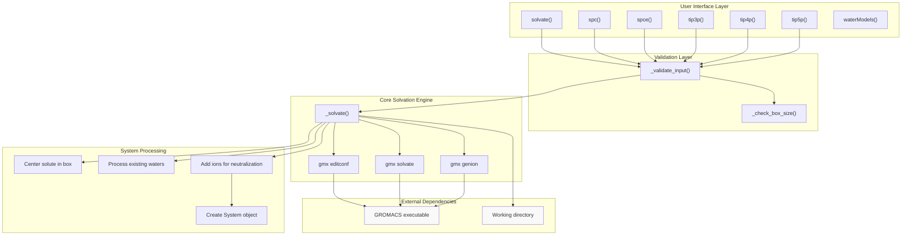
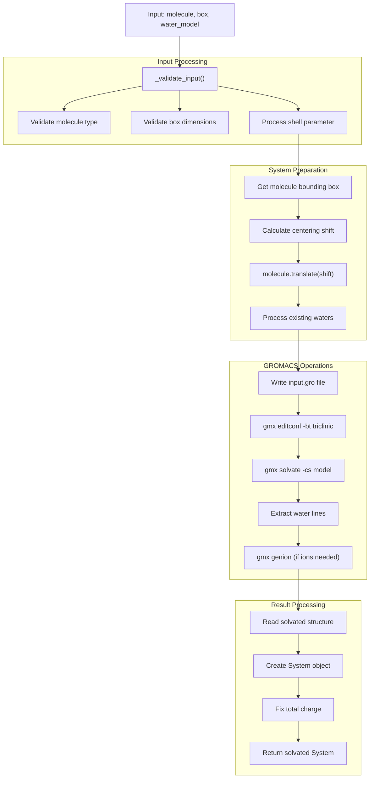
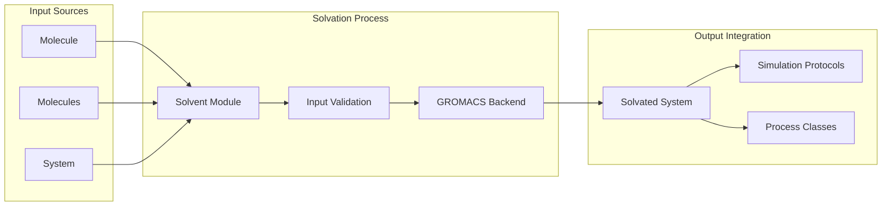

# Solvation

<details>
<summary>Relevant source files</summary>

The following files were used as context for generating this wiki page:

- [python/BioSimSpace/IO/__init__.py](python/BioSimSpace/IO/__init__.py)
- [python/BioSimSpace/Parameters/_Protocol/_protocol.py](python/BioSimSpace/Parameters/_Protocol/_protocol.py)
- [python/BioSimSpace/Parameters/__init__.py](python/BioSimSpace/Parameters/__init__.py)
- [python/BioSimSpace/Parameters/_process.py](python/BioSimSpace/Parameters/_process.py)
- [python/BioSimSpace/Process/_task.py](python/BioSimSpace/Process/_task.py)
- [python/BioSimSpace/Sandpit/Exscientia/Parameters/_Protocol/_protocol.py](python/BioSimSpace/Sandpit/Exscientia/Parameters/_Protocol/_protocol.py)
- [python/BioSimSpace/Sandpit/Exscientia/Parameters/_process.py](python/BioSimSpace/Sandpit/Exscientia/Parameters/_process.py)
- [python/BioSimSpace/Sandpit/Exscientia/Solvent/_solvent.py](python/BioSimSpace/Sandpit/Exscientia/Solvent/_solvent.py)
- [python/BioSimSpace/Solvent/__init__.py](python/BioSimSpace/Solvent/__init__.py)
- [python/BioSimSpace/Solvent/_solvent.py](python/BioSimSpace/Solvent/_solvent.py)
- [tests/Sandpit/Exscientia/Solvent/test_solvent.py](tests/Sandpit/Exscientia/Solvent/test_solvent.py)
- [tests/Solvent/test_solvent.py](tests/Solvent/test_solvent.py)

</details>


This document describes BioSimSpace's solvation functionality, which adds solvent molecules and ions to molecular systems to create simulation-ready solvated systems. The solvation module provides a unified interface for multiple water models and handles the complex process of placing solvent molecules around solutes while maintaining proper system geometry and electrostatic neutrality.

For information about system preparation more broadly, including parameterization and alignment, see [System Preparation](#3). For details about the underlying data structures used to represent solvated systems, see [Molecule and System Objects](#2.1).

## Overview

The BioSimSpace Solvent module provides functions to solvate molecular systems using various water models. It serves as a wrapper around GROMACS solvation tools, providing a simplified Python interface while handling the complexities of file format conversions, parameter validation, and system setup.

**Sources:** [python/BioSimSpace/Solvent/_solvent.py:22-27](), [python/BioSimSpace/Solvent/__init__.py:22-38]()

## Architecture



The solvation system follows a layered architecture where user-facing functions delegate to validation and core solvation routines that interface with GROMACS tools.

**Sources:** [python/BioSimSpace/Solvent/_solvent.py:59-149](), [python/BioSimSpace/Solvent/_solvent.py:889-955]()

## Supported Water Models

BioSimSpace supports five common water models, each implemented as both a dedicated function and accessible through the generic `solvate()` function:

| Water Model | Function | Atoms per Molecule | Description |
|-------------|----------|-------------------|-------------|
| SPC | `spc()` | 3 | Simple Point Charge model |
| SPC/E | `spce()` | 3 | Extended Simple Point Charge |
| TIP3P | `tip3p()` | 3 | Transferable Intermolecular Potential 3-point |
| TIP4P | `tip4p()` | 4 | Transferable Intermolecular Potential 4-point |
| TIP5P | `tip5p()` | 5 | Transferable Intermolecular Potential 5-point |

The `waterModels()` function returns a list of all supported water models, which is used for validation and user information.

**Sources:** [python/BioSimSpace/Solvent/_solvent.py:151-658](), [python/BioSimSpace/Solvent/_solvent.py:1865-1878]()

## Solvation Workflow



The solvation process involves careful coordination between input validation, geometric calculations, and GROMACS tool invocation to produce a properly solvated system.

**Sources:** [python/BioSimSpace/Solvent/_solvent.py:889-1400](), [python/BioSimSpace/Solvent/_solvent.py:1015-1155]()

## Key Parameters and Options

### Box Definition

The solvation functions accept box dimensions in two primary ways:

- **Explicit box dimensions**: `box` parameter as a list of three `Length` objects defining x, y, z dimensions
- **Shell thickness**: `shell` parameter defining the minimum water layer thickness around the solute

When using the `shell` parameter, the system automatically calculates appropriate box dimensions based on the solute's axis-aligned bounding box:

```python
# Example from validation logic
base_length = max(2 * molecule._getAABox().halfExtents())
base_length = _Length(base_length, "A") + shell
```

**Sources:** [python/BioSimSpace/Solvent/_solvent.py:838-852](), [python/BioSimSpace/Solvent/_solvent.py:793-812]()

### Ion Concentration and Neutralization

The solvation system supports adding ions for:
- **System neutralization**: `is_neutral=True` adds counter-ions to achieve zero net charge
- **Physiological conditions**: `ion_conc` parameter sets the desired salt concentration in mol/L

The ion addition process uses GROMACS `genion` tool with automatic ion placement based on electrostatic potential.

**Sources:** [python/BioSimSpace/Solvent/_solvent.py:1413-1530](), [python/BioSimSpace/Solvent/_solvent.py:98-102]()

### Water Molecule Handling

The `match_water` parameter controls how existing water molecules are processed:
- **`True`**: Existing waters are reformatted to match GROMACS topology conventions
- **`False`**: Existing waters are preserved with their original naming (marked as crystal waters)

This is particularly important for systems containing structural waters that should be distinguished from bulk solvent.

**Sources:** [python/BioSimSpace/Solvent/_solvent.py:990-1007](), [python/BioSimSpace/Solvent/_solvent.py:108-111]()

## Integration with System Architecture



The solvation module integrates seamlessly with BioSimSpace's broader ecosystem, accepting various molecular input types and producing System objects ready for simulation protocols.

**Sources:** [python/BioSimSpace/Solvent/_solvent.py:734-746](), [python/BioSimSpace/Solvent/_solvent.py:80-85]()

## Error Handling and Dependencies

The solvation module includes comprehensive error handling for common failure modes:

### Software Dependencies
All solvation functions require GROMACS installation and raise `MissingSoftwareError` if not available:

```python
if _gmx_exe is None:
    raise _MissingSoftwareError(
        "'BioSimSpace.Solvent.tip3p' is not supported. "
        "Please install GROMACS (http://www.gromacs.org)."
    )
```

### Validation Errors
- **Box size validation**: Ensures box is large enough to contain the molecule
- **Parameter type checking**: Validates all input parameters have correct types
- **Geometric constraints**: Prevents shell thickness that would create invalid box dimensions

### GROMACS Integration
The module handles GROMACS subprocess execution robustly, checking for expected output files and providing informative error messages when tools fail.

**Sources:** [python/BioSimSpace/Solvent/_solvent.py:215-219](), [python/BioSimSpace/Solvent/_solvent.py:877-885](), [python/BioSimSpace/Solvent/_solvent.py:1084-1088]()

## Usage Patterns

The solvation module supports several common workflows:

### Basic Solvation
```python
# Direct water model function
solvated = BSS.Solvent.tip3p(molecule, box=[5*nm, 5*nm, 5*nm])

# Generic solvate function  
solvated = BSS.Solvent.solvate("tip3p", molecule, box=[5*nm, 5*nm, 5*nm])
```

### Shell-based Solvation
```python
# Create water shell around molecule
solvated = BSS.Solvent.tip3p(molecule, shell=2*nm)
```

### Ionic Solutions
```python
# Neutralize and add physiological salt
solvated = BSS.Solvent.tip3p(
    molecule, 
    box=[5*nm, 5*nm, 5*nm],
    ion_conc=0.15,  # 150 mM
    is_neutral=True
)
```

**Sources:** [python/BioSimSpace/Solvent/__init__.py:50-86](), [python/BioSimSpace/Solvent/__init__.py:87-101]()

---