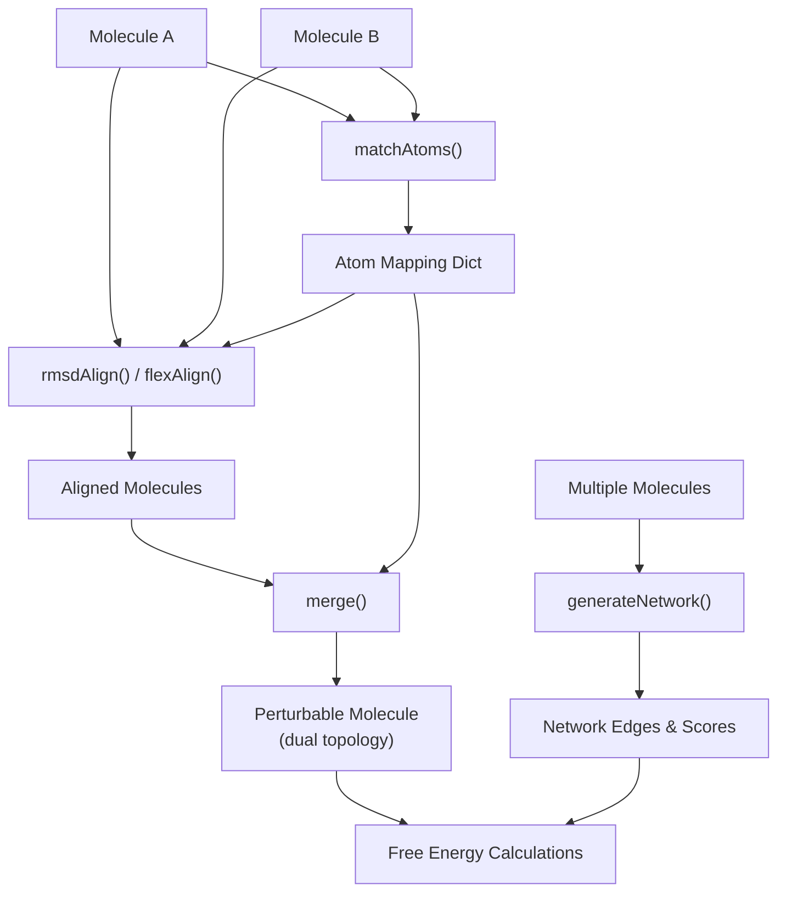
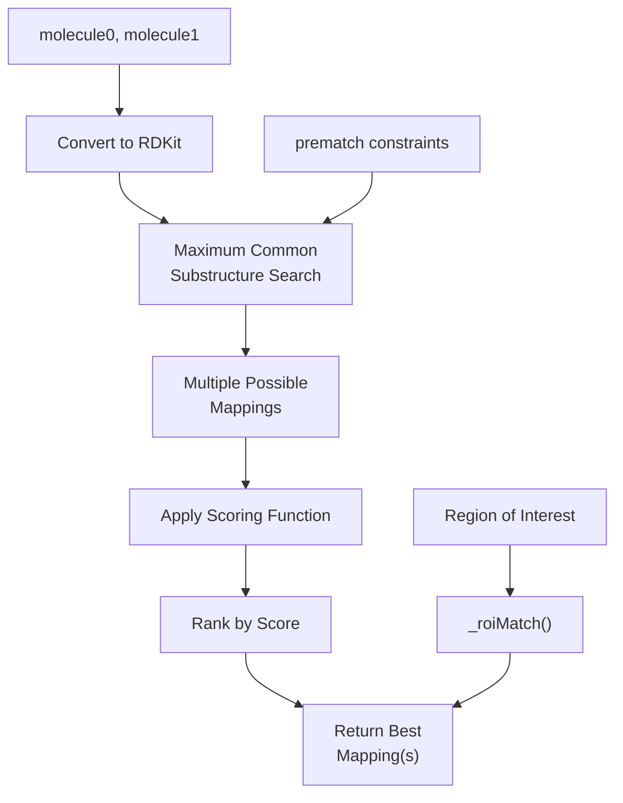
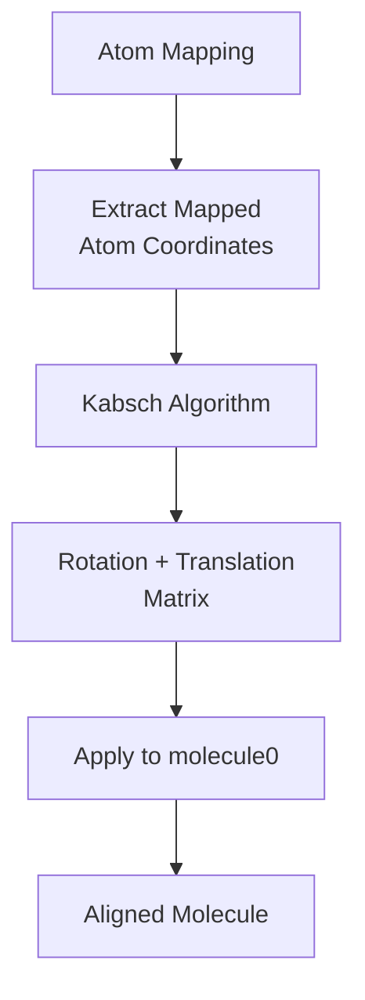
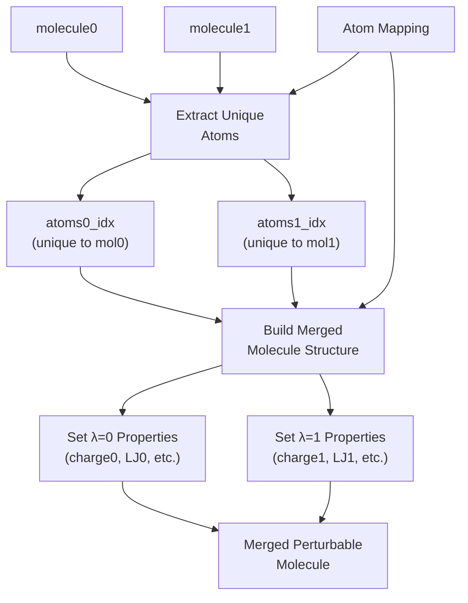
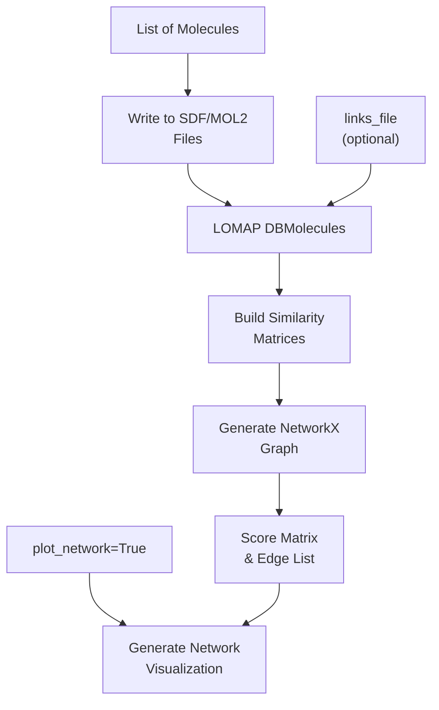
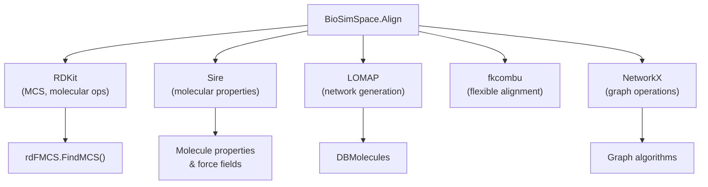

# Alignment and Merging

<details>
<summary>Relevant source files</summary>

The following files were used as context for generating this wiki page:

- [python/BioSimSpace/Align/__init__.py](python/BioSimSpace/Align/__init__.py)
- [python/BioSimSpace/Align/_align.py](python/BioSimSpace/Align/_align.py)
- [python/BioSimSpace/Align/_merge.py](python/BioSimSpace/Align/_merge.py)
- [python/BioSimSpace/Sandpit/Exscientia/Align/_align.py](python/BioSimSpace/Sandpit/Exscientia/Align/_align.py)
- [python/BioSimSpace/Sandpit/Exscientia/Align/_merge.py](python/BioSimSpace/Sandpit/Exscientia/Align/_merge.py)
- [python/BioSimSpace/_SireWrappers/__init__.py](python/BioSimSpace/_SireWrappers/__init__.py)
- [tests/Align/test_align.py](tests/Align/test_align.py)
- [tests/Sandpit/Exscientia/Align/test_align.py](tests/Sandpit/Exscientia/Align/test_align.py)

</details>


This document covers BioSimSpace's molecular alignment and merging functionality, which is essential for preparing molecules for free energy perturbation (FEP) calculations. The system provides tools to find atom mappings between similar molecules, align them spatially, and merge them into dual-topology perturbable molecules suitable for alchemical transformations.

For information about free energy calculation methods that use these merged molecules, see [Free Energy Calculations](#5). For details on parameterizing molecules before alignment, see [Parameterization](#3.1).

## Overview

The `BioSimSpace.Align` module provides a complete workflow for preparing molecules for free energy calculations through four main operations:

1. **Atom Matching**: Finding optimal atom-to-atom mappings between molecules using Maximum Common Substructure (MCS) algorithms
2. **Molecular Alignment**: Spatially aligning molecules based on atom mappings to minimize structural differences
3. **Molecule Merging**: Creating dual-topology perturbable molecules with properties for both λ=0 and λ=1 end states
4. **Network Generation**: Creating perturbation networks for multiple molecules using LOMAP

## Core Workflow



**Molecular Alignment and Merging Workflow**

Sources: [python/BioSimSpace/Align/_align.py:27-34](), [python/BioSimSpace/Align/_merge.py:27]()

## Atom Matching and Mapping

The `matchAtoms()` function finds optimal atom mappings between two molecules using various algorithms and scoring functions.

### Core Matching Process



**Atom Matching Algorithm Flow**

### Scoring Functions

The system supports multiple scoring functions for ranking atom mappings:

| Function | Description | Implementation |
|----------|-------------|----------------|
| `"rmsd"` | Root mean squared distance between mapped atoms | Direct coordinate comparison |
| `"rmsd_align"` | RMSD after optimal spatial alignment | Kabsch algorithm alignment |
| `"rmsd_flex_align"` | RMSD after flexible alignment | Uses external `fkcombu` tool |

### Advanced Mapping Options

The `matchAtoms()` function provides several advanced options:

```python
mapping = BSS.Align.matchAtoms(
    molecule0, molecule1,
    scoring_function="rmsd_align",
    matches=5,                    # Return top 5 mappings
    prematch={0: 5, 1: 6},       # Force specific atom pairs
    timeout=10 * BSS.Units.Time.second,
    roi=[2, 3],                  # Residue indices for ROI
    prune_perturbed_constraints=True,  # For AMBER engine
    complete_rings_only=True
)
```

Sources: [python/BioSimSpace/Align/_align.py:717-896](), [python/BioSimSpace/Align/_align.py:898-1688]()

## Molecular Alignment

Once atom mappings are established, molecules can be spatially aligned using two primary methods:

### RMSD Alignment

The `rmsdAlign()` function performs optimal rigid-body alignment to minimize RMSD between mapped atoms:



**RMSD Alignment Process**

### Flexible Alignment

The `flexAlign()` function uses the external `fkcombu` tool for more sophisticated alignment that can handle conformational flexibility.

Sources: [python/BioSimSpace/Align/_align.py:1690-1792](), [python/BioSimSpace/Align/_align.py:1794-1896]()

## Molecule Merging

The `merge()` function creates dual-topology perturbable molecules by combining two aligned molecules with mapped atoms.

### Dual Topology Creation



**Molecule Merging Process**

### Property Handling

The merging process creates separate properties for each λ state:

- **λ=0 state**: Molecule0 is fully interacting, atoms unique to molecule1 have zero charges/LJ parameters
- **λ=1 state**: Molecule1 is fully interacting, atoms unique to molecule0 have zero charges/LJ parameters  
- **Shared properties**: Bonds, angles, dihedrals, and impropers are merged with appropriate atom index remapping

### Ring Breaking Controls

The merge function provides controls for handling challenging molecular transformations:

```python
merged = BSS.Align.merge(
    molecule0, molecule1, mapping,
    allow_ring_breaking=True,      # Allow ring opening/closing
    allow_ring_size_change=True,   # Allow ring size changes
    force=True,                    # Override all restrictions
    roi=[res_indices]              # Region of interest merge
)
```

Sources: [python/BioSimSpace/Align/_merge.py:39-96](), [python/BioSimSpace/Align/_merge.py:475-673]()

## Network Generation

The `generateNetwork()` function uses LOMAP (Lead Optimisation Mapper) to generate optimal perturbation networks for multiple molecules.

### LOMAP Integration



**LOMAP Network Generation Workflow**

### Network Output

The function returns:
- **Edges**: List of tuples `(mol_idx0, mol_idx1)` representing network connections
- **Scores**: LOMAP similarity scores for each edge (higher = better for FEP)

```python
edges, scores = BSS.Align.generateNetwork(
    molecules,
    names=["ligA", "ligB", "ligC"],
    plot_network=True,
    n_edges_forced=5,              # Force specific edge count
    links_file="forced_edges.txt"  # Pre-defined connections
)
```

Sources: [python/BioSimSpace/Align/_align.py:107-714]()

## Implementation Architecture

### Core Dependencies



**External Dependencies and Their Roles**

### Module Structure

The alignment functionality is organized across several key files:

- **`_align.py`**: Core alignment functions (`matchAtoms`, `rmsdAlign`, `flexAlign`, `generateNetwork`)
- **`_merge.py`**: Molecule merging functionality (`merge`)  
- **`__init__.py`**: Public API exports
- **Test files**: Comprehensive validation in both main and Sandpit branches

### Error Handling

The system includes specific exception types for common failure modes:
- `AlignmentError`: MCS search failures, coordinate issues
- `IncompatibleError`: Force field mismatches, invalid ring transformations
- `MissingSoftwareError`: Missing external dependencies

Sources: [python/BioSimSpace/Align/_align.py:1-96](), [python/BioSimSpace/Align/_merge.py:1-37](), [python/BioSimSpace/Align/__init__.py:26-44]()

---